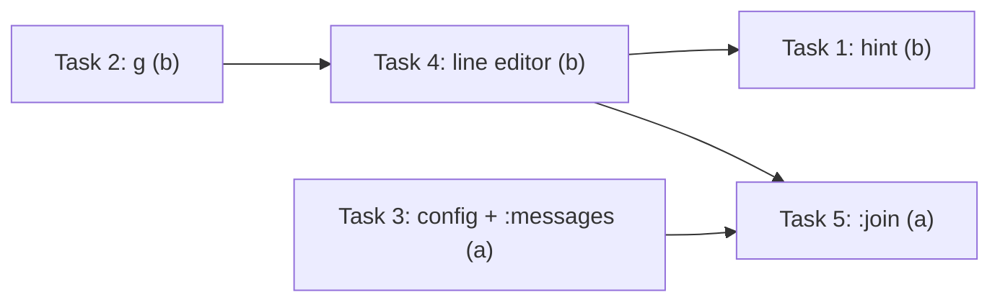

# Owner work E Implementation Plan

> **For agentic workers:** REQUIRED SUB-SKILL: Use superpowers:subagent-driven-development (recommended) or superpowers:executing-plans to implement this plan task-by-task. Steps use checkbox (`- [ ]`) syntax for tracking.

**Goal:** Five owner-approved items, one pull request each: a hint on the
composer's top rule when newer messages are below the timeline pane; the
key after `g` in the editors goes to edtui without the keymap, as in nvim;
a configuration written for a newer mxt loads in an older one, with
warnings that the status line points to and a new `:messages` that lists
them; a cursor and nvim's editing keys in the command line, the search
lines, picker queries and the recovery key prompt; and `:join <target>`,
which joins rooms, accepts invites and opens or creates direct messages
without creating a room by mistake. A sixth, requested by the owner
later: a jump list with nvim's `<C-o>` and `<C-i>` (Task 6), with its
design addendum in the same pull request.

**Architecture:** Task 1 is `mxt-tui` only, and Task 2 too apart from two
doc comments in `mxt-core`: the hint is drawn from the frame the timeline
pane already lays out, and the `g` fix is one more case of
`Editor::key_mode` returning `EditorMode::AwaitingChar`.
Task 3 keeps the configuration's checks in `mxt` and `Action::from_spec`,
but classifies their problems into errors and warnings; the core gains a
status message history, `Msg::ConfigWarnings` and the `:messages` view
(`View::Help` with generated text). Task 4 replaces the core's `Edit`
(append-only editing in `app/command_line.rs`) with one line editor that
has a cursor, used by the command line, the search line, the pickers and
`SECRET` mode; the tui adapter only draws the cursor. Task 5 adds the
`room.join` action and `:join`; the core reads the argument, completes
pending invites, opens the answered room and asks before a new direct
message is created, and `mxt-matrix` joins, finds an existing direct
message in a fixed order, or, after the user's `y`, creates one.

**Tech Stack:** Rust 2024; `toml` 1.2 (`toml::de::DeTable`,
`toml::de::Deserializer::from`), `unicode-segmentation` in `mxt-core`,
edtui (mxt's fork at the pinned commit), matrix-sdk 0.19.1 and its ruma
(`MatrixToUri`, `OwnedRoomOrAliasId`), matrix-sdk's `MatrixMockServer`
for tests.

## Global Constraints

- The design is `docs/superpowers/specs/2026-11-18-mxt-design.md`. It
  describes the result of all six tasks and wins over this plan when they
  disagree. Sections per task: Task 1 "Timeline" (the newer-messages hint)
  and "Layout"; Task 2 "Input routing", "Keymap resolver", "edtui
  differences from vim"; Task 3 "Layers", "Help views" (`:messages`),
  "Commands", "Action registry", "Error handling", "Logging", "Startup",
  "Risks" (ignored settings); Task 4 "Line editing", "Modes",
  "Tables and resolution", "Input routing" (pasted text); Task 5 "Joining
  rooms and direct messages", "Matrix adapter" (pending invites),
  "Commands", "Action registry", "Room list", "Modes" (`CONFIRM`),
  "Logging", "Risks" (finding an existing direct message); Task 6 "Jump
  list", "Default keymap", "Action registry", "Layers" (the `<C-i>`
  duplicate).
- Everything in the repository is in English. Tests use made-up
  identifiers (`@alice:example.org`, `!room:example.org`,
  `#mxt:example.org`, a bridge bot `@discordbot:example.org`); no real room
  or user IDs.
- `mxt-core` stays free of I/O and of `ruma`.
- Each task is its own pull request and adds its own `CHANGELOG.md`
  `[Unreleased]` lines, listed in the task, and updates the user
  documentation (`docs/keys.md`, `docs/configuration.md`, `README.md`) it
  changes. No release tag: merging is the orchestrator's.
- Slots: worktree b builds only `-p mxt-core` and `-p mxt-tui`; a task
  that touches `mxt` or `mxt-matrix` (configuration loading, matrix calls)
  runs in worktree a, which may build the workspace under the heavy-build
  lock. CI compiles everything for every pull request.
- Tests assert specific lines, positions or properties, not whole
  generated texts that keep growing (the default keymap, `:help`).
- Breaking changes (`docs/releasing.md`): none of the six tasks is
  breaking, each for the reason in its task, so none adds a
  `**Breaking:**` line and the release after them is a patch release.

## Order and slots

| Task | Slot | Crates | Runs in parallel with |
|---|---|---|---|
| 2: `g` in the editors | b | `mxt-tui` (and two doc comments in `mxt-core`) | Task 3 |
| 4: line editor | b | `mxt-core`, `mxt-tui` | Task 3 |
| 1: newer-messages hint | b | `mxt-tui` | Task 5 |
| 3: forward-compatible configuration and `:messages` | a | `mxt-core`, `mxt` | Tasks 2 and 4 |
| 5: `:join` | a | `mxt-core`, `mxt-matrix` | Task 1 |
| 6: jump list | b | `mxt-core`, `mxt-tui` (tests), `mxt` (the configuration's duplicate check; CI builds it) | Task 5 |

- Slot b runs Task 2, then Task 4, then Task 1; slot a runs Task 3, then
  Task 5. Two tasks run at a time, one per worktree.
- Task 3 and Task 5 both add a command to the registry
  (`crates/mxt-core/src/command.rs`), an `Action` variant with its name,
  `Msg` variants, and rows to the same tables of `docs/keys.md` and
  `docs/configuration.md`, so they run one after the other in slot a.
- Task 5 starts after Task 4 is merged: both edit
  `crates/mxt-core/src/app/command_line.rs` (Task 4 the text and its
  cursor, which completion leaves at the end; Task 5 the `join`
  candidates), and Task 5's completion tests rely on Task 4's cursor rule.
- Task 1 and Task 4 both edit `crates/mxt-tui/src/view.rs` (Task 1
  `draw` and `draw_composer`, Task 4 `draw_prompt_line` and
  `draw_command_line`); they are in the same slot anyway. Task 2 goes
  first because it is small and touches only `editor.rs`, two doc
  comments in `mxt-core` and docs lines no other task edits.
- Tasks 3 and 4 run in parallel and edit neighbouring rows of the same
  docs tables: the Modes table of `docs/keys.md` (Task 3 the `VIEW` row,
  Task 4 the `COMMAND`, `PICKER` and `SECRET` rows) and the table of
  keymap tables in `docs/configuration.md` (Task 3 the `message_view` row,
  Task 4 the `picker` and `command_line` rows). Git sees adjacent changed
  lines as one conflict, so the second of the two to merge must rebase
  and keep both rows' changes.
- Every task adds lines to `CHANGELOG.md` `[Unreleased]`; a later task
  rebases onto the earlier ones and keeps all lines.

## Task 1: The newer-messages hint

**Slot b. Crates:** `mxt-tui`.
**Files:** `crates/mxt-tui/src/timeline_view.rs`,
`crates/mxt-tui/src/view.rs`, `docs/keys.md`, `CHANGELOG.md`.
**Breaking:** no. It only draws; no setting, name or stored data changes.

- [ ] In `timeline_view.rs`, a function that counts the
  `TimelineEntry::Item`s after the last entry with a row on the pane
  (the second index `TimelinePane::draw` returns), stopping at 100, so a
  long timeline costs no more than a short one. Date dividers, the read
  marker and `TimelineEntry::Hidden` do not count; items of every content
  kind do, local echoes too.
- [ ] In `view::draw`, after `draw_timeline`, compute the count (0 when
  the timeline drew nothing) and pass it to `draw_composer`.
- [ ] `draw_composer` draws the hint over the right end of the rule, after
  the block: ` ↓ N newer ` and one `─`, dim, with `99+` for counts above
  99. The rule is the composer area's width; the draft label takes
  `─ <label> ` from its left end (as the block title draws it). The full
  hint needs the label's columns, at least one `─`, the hint and the final
  `─`; otherwise ` ↓ N ` alone; otherwise nothing. The label is never cut
  for the hint. Measure with `text_width`.
- [ ] Tests (`TestBackend` through the `Screen` helper, `Screen::sized`
  for widths):
  - after a burst taller than the space below the cursor's message (as in
    `moving_down_after_a_burst_shows_the_newest_message`), the composer's
    rule row ends with `↓ 3 newer ─`; after `j` until the pane shows the
    newest message, the row has no `↓`;
  - entries after the last visible one that are only a `Hidden` entry and
    a date divider give no hint;
  - 150 items below the pane read `↓ 99+ newer`;
  - with a reply draft (`Reply to <name>` label) and a width where label
    and full hint do not fit together, the row shows the full label and
    `↓ 3`; narrower, the full label and no `↓`.
- [ ] `docs/keys.md`, "The screen": the hint on the composer's top rule and
  what it counts.
- [ ] CHANGELOG `### Added`: "When newer messages are below the timeline
  pane, for example after a burst of messages arrived while the cursor was
  on an older one, the composer's top rule ends with `↓ N newer`; it goes
  once the pane shows the newest message."

## Task 2: The key after `g` goes to the editor

**Slot b. Crates:** `mxt-tui`.
**Files:** `crates/mxt-tui/src/editor.rs`,
`crates/mxt-tui/src/composer.rs` (tests), the message view's key tests in
`crates/mxt-tui` (where `view.close` is tested; `view.rs` tests or the
tui's key handling tests), the doc comments of `EditorMode::AwaitingChar`
(`crates/mxt-core/src/msg.rs`) and `InputContext::EditorPassthrough`
(`crates/mxt-core/src/keymap.rs`), `docs/keys.md`,
`docs/configuration.md`, `CHANGELOG.md`.
**Breaking:** no. A configuration loads and means what it did: a binding
in `normal`, `composer.normal` or `composer.visual` that starts with `g`
still runs in the composer, because the keymap sees `g` before edtui does
(`App::input_context` gives `ComposerNormal`/`ComposerVisual`, whose
chain includes `normal`; edtui gets `g` only when the resolver releases
it). No default binding in those tables starts with `g` (`gg`, `gx` and
`gd` are in `room_list` and `timeline`, see `DEFAULTS` in
`crates/mxt-core/src/keymap.rs`). What changes is only the key typed
after a `g` that edtui already holds: it no longer runs a binding
(`g]u`, `g:`, `g<Esc>`), as in nvim.

edtui at the pinned commit (`1182cb9`, `vim_keybindings` in
`src/events/key.rs`) has these key sequences in normal and visual mode:
`gg` (both), `dd`, `dw`, `dW`, `df`, `dt`, `diw`, `diW`, `di` with a quote
or bracket, `cw`, `cW`, `cf`, `ct`, `ciw`, `ciW`, `ci` with a quote or
bracket, `yy`, and visual `iw` and `i` with a quote or bracket; insert
mode has single keys only, and search mode takes every key. mxt already
routes the key after `d`, `c`, `y`, `di`, `ci`, visual `i`, `df`, `dt`,
`cf`, `ct` (and its own `f`, `F`, `t`, `T`, `r`) to edtui
(`edtui_waits`); `g` is the only prefix left. edtui drops both keys of a
sequence it does not have (`KeyEventHandler::get` clears its lookup).

- [ ] `Editor::key_mode` returns `EditorMode::AwaitingChar` while
  `Pending::G` waits (in normal and visual mode, like the others), so the
  core routes the next key to `InputContext::EditorPassthrough`. The
  existing `Drop` after `gf`, `gF`, `gt`, `gT` stays. Update the comments
  of `Pending::G`, `Editor::pending`, `edtui_waits` and the module: the key
  after `g` goes to edtui without the keymap. In `mxt-core`, the doc
  comments of `EditorMode::AwaitingChar` and
  `InputContext::EditorPassthrough`, which list what makes a key wait,
  add `g` (comments only; no code in `mxt-core` changes).
- [ ] Tests in `editor.rs`: replace the `gd` assertion
  (`the_key_after_an_operator_goes_to_edtui`) with: after `g` the mode is
  `AwaitingChar`, also after `v` then `g`; `gg` moves to the first row;
  `g]` and `g<Esc>` leave the text unchanged and the mode `Normal`, and an
  `x` after them deletes a character.
- [ ] Tests in `composer.rs`: in
  `operators_and_text_objects_never_run_the_default_unread_keys`, add
  `0g]` (text unchanged, no pending keys, and the following `u` neither
  opens `!b` nor leaves the composer) and `0g<Esc>` (the composer keeps
  the focus). A second test with a user binding `"gt" = "focus.timeline"`
  in `normal` (a variant of `composing` that takes a configured `Keymap`):
  `gt` in the composer's normal mode moves the focus to the timeline, and
  `gg` still reaches edtui (after `timeoutlen`, through `Msg::Timeout`).
- [ ] Test for the message view: `gq` leaves the view open, and a `q`
  after it closes the view.
- [ ] `docs/keys.md`, "Differences from vim": the key after `g` goes to the
  editor too; edtui's only `g` command is `gg`, the key after any other
  `g` is dropped with it, and `g<Esc>` cancels. `docs/configuration.md`,
  the paragraph on keys that never reach the keymap: add "after `g`".
- [ ] CHANGELOG `### Fixed`: "In the composer and the message view, the
  key after `g` goes to the editor without the keymap, as in nvim:
  `g]u` no longer opens another room, `g<Esc>` cancels the `g` instead of
  leaving the composer, and `gq` no longer closes the message view.
  Bindings in `normal` that start with `g` work as before."

## Task 3: Forward-compatible configuration and `:messages`

**Slot a** (the `mxt` crate). **Crates:** `mxt-core`, `mxt` (and one doc
comment in `mxt-tui`).
**Files:** `crates/mxt-core/src/action.rs`, `keys.rs`, `msg.rs`,
`command.rs`, `app.rs`, `app/timeline.rs` (`view_help`),
`crates/mxt-core/src/app/tests.rs`; `crates/mxt/src/config.rs`,
`config/dto.rs`, `config/tests.rs`, `main.rs`, `startup.rs`;
`crates/mxt-tui/src/timeline_view.rs` (the doc comment of
`TimeFormat::parse`); `docs/configuration.md`, `docs/keys.md`,
`README.md`, `CHANGELOG.md`.
**Breaking:** no. Every configuration that loaded before loads the same
way and means the same: each new warning was an error before, so a
configuration that loaded had none. Configurations that failed with an
unknown name or a `ui.time_format` jiff rejects now load; nothing a user
wrote changes meaning.

Core:

- [ ] `ArgValue` gains `Unsupported`: any TOML value other than a
  string, an integer or a boolean (a float, an array, a table, a
  date-time), which no action takes. `Args::new` keeps checking the
  argument names first, so an unknown argument is `UnknownArgument`
  whatever its value; `Args::string` gives `WrongType` for
  `Unsupported` as it does for an integer, so only a known argument's
  value can be a wrong type.
- [ ] `ActionError`: a new `UnknownValue { action, arg, value, allowed }`
  for a value outside a fixed set (`Args::choice`), with the text
  `<action>: unknown "<arg>" value "<value>"; expected one of "a", "b"`.
  `InvalidValue`, which then covers only the empty string, becomes
  `Empty { action, arg }` (text `<action>: "<arg>" must not be empty`),
  so it cannot hold a value or a list of allowed values. `message.react`
  with `emoji = ""` is `Empty`; an unknown, non-empty emoji stays
  `UnknownEmoji` (its doc comment no longer mentions the empty one).
  `ActionError::is_unknown_name()` is true for `UnknownAction`,
  `UnknownArgument`, `UnknownValue` and `UnknownEmoji`. The doc comment of
  `Action::from_spec` states the order its checks run in (design,
  "Layers"): the name, the argument names, conflicts, then each
  argument's type and value and a missing required argument, in the order
  the action reads them; the first error is returned.
- [ ] `KeyParseError`: `<leader>` with modifiers (`<C-leader>`) becomes a
  new `ModifiedLeader` (text `<leader> takes no modifiers`) instead of
  `UnknownKey`, since no version accepts it. `is_unknown_name()`: true
  for `UnknownKey` and `UnknownModifier` only.
- [ ] The status message history: `App` keeps the last 200 status
  messages (`VecDeque<StatusMessage>`, oldest dropped first); `set_status`
  appends every message it sets. The `CONFIRM` question and the `SECRET`
  prompt are not status messages and stay out.
- [ ] `Msg::ConfigWarnings { warnings: Vec<String> }`: appends each
  warning to the history without showing it, then sets, as an error, the
  status `Ignored 1 setting in the configuration; see :messages` or
  `Ignored <N> settings in the configuration; see :messages`. An empty
  list does nothing.
- [ ] `Action::StatusMessages` (`status.messages`, no arguments, no
  default key) opens `View::Help` with
  `Status line messages, oldest first; the last 200 are kept.`, an empty
  line and one line per message, oldest first; with no messages, the
  first line alone. Registry entry `:messages` after `:map`, no
  argument, description "List the status line's recent messages".
- [ ] Core tests: the history keeps 200 and drops the oldest; the first
  line of `:messages` exactly; warnings come before the status that counts
  them; singular and plural status texts; `:messages x` is
  `:messages takes no argument`; a `CONFIRM` question is not in the
  history; `UnknownValue`'s and `Empty`'s texts and `is_unknown_name` for
  each variant; `emoji = ""` is `Empty`; `from_spec` with an
  `Unsupported` value: `("message.future", [ids: Unsupported])` is
  `UnknownAction`, `("room.open", [ratio: Unsupported])` is
  `UnknownArgument`, `("room.open", [filter: Unsupported])` is
  `WrongType`; the order: `room.open` with `sort`, `pick` and `query` is
  `UnknownArgument`, with `pick`, `query` and `filter = "dm"` is
  `Conflict`; `<C-leader>` is `ModifiedLeader`.

`mxt`:

- [ ] `dto.rs`: `Arg` accepts every TOML value: strings, integers and
  booleans as now, anything else as `ArgValue::Unsupported`
  (`visit_f64`; `visit_seq` and `visit_map`, which skip the contents with
  `de::IgnoredAny`; toml hands a date-time to `visit_map`). So a binding's
  arguments always reach `Action::from_spec`, which decides whether one
  is unknown (a warning) or of the wrong type (an error). The `action`
  value itself must still be a string.
- [ ] Parse with `toml::de::DeTable::parse` (syntax errors stay errors,
  through `Source::toml_error`). Walk the document against a schema of
  the known keys: root `account`, `ui`, `files`, `keymap`;
  `account.user_id`, `account.homeserver`; `ui.leader`, `ui.timeoutlen`,
  `ui.room_list` with `visible`, `sort`, `width`, `network`,
  `ui.time_format`, `ui.image_preview`, `ui.read_receipts`;
  `files.download_dir`, `files.opener`. The keymap part is built from
  `TableId::ALL` and `TableId::config_name()` (a dotted name such as
  `composer.normal` is a table inside `composer`), whose keys are
  bindings, so the loader cannot fall behind the core's tables;
  `dto::Keymap::into_tables` already fails to compile when it misses a
  `TableId`. Remove every unknown key or table and record a warning at
  its key's position: `unknown table` when its value is a table,
  `unknown key` otherwise. Deserialize what is left with
  `toml::de::Deserializer::from(document)`. The DTOs keep
  `deny_unknown_fields`, but it fires only when the schema knows a key
  the DTOs do not; a key the DTOs read and the schema misses is pruned
  with a warning, and the tests below catch that: `ok()` asserts no
  warnings, and one document sets every key and every table.
- [ ] The DTO enums `RoomSort`, `NetworkPlacement`, `ImagePreview` and
  `ReadReceipts` become `Spanned<String>` converted by name: an unknown
  name is a warning at the value (`unknown value "<v>"; expected one of
  …`) and the setting keeps its default, except `ui.read_receipts`,
  which falls back to private receipts (`ReceiptKind::Private`) with the
  warning `<file>:<line>:<column>: ui.read_receipts: unknown value
  "<v>", using "private"` (no `(ignored)`). A wrong type stays an error.
- [ ] `ui.time_format`: an empty one stays an error (`must not be
  empty`); one that `TimeFormat::parse` rejects is a warning with jiff's
  error as its reason, and `TimeFormat::default()` (`%H:%M`) applies.
  The loader checks for the empty string before `TimeFormat::parse`.
  Update the doc comment of `TimeFormat::parse`, which says an invalid
  directive is an error.
- [ ] `ui.leader`: a key error with `is_unknown_name()` is a warning and
  the leader is `<Space>`; other key errors stay errors.
- [ ] Bindings, in the order of the design's "Layers": the keys (an
  unknown key name or modifier skips the binding with a warning, other key
  errors are errors), the duplicate spelling check, then each action
  (`Action::from_spec`): an error with `is_unknown_name()` skips the
  whole binding with a warning at the position `argument_start` gives
  (`UnknownValue` and `Empty` like `InvalidValue` before), any other error
  stays an error. A duplicate spelling is an error, except while
  `ui.leader` was ignored when exactly one of the two spellings contains
  `<leader>` (case-insensitive): then the later binding in the file is
  skipped with the warning `<setting>: "<later>" is the same key sequence
  as "<earlier>" on line <n>, since ui.leader fell back to "<Space>"
  (ignored)`. A skipped binding is not passed to `Keymap::new`, so the
  default binding of its keys stays.
- [ ] `Config` gains `warnings: Vec<ConfigWarning>`; `ConfigWarning` has
  the path, line, column and message, and displays as
  `<file>:<line>:<column>: <setting>: <reason> (ignored)`, or for
  `ui.read_receipts` as above.
- [ ] `main.rs`: after `init_logging`, log each warning at `warn` from the
  `config` module (target `mxt::config`), the message being the warning's
  `Display`. Nothing is printed to the terminal.
- [ ] `startup.rs`: right after `App::new`, `app.update(Msg::ConfigWarnings
  { warnings })` with the warnings' `Display` strings.
- [ ] `mxt` tests (`config/tests.rs`). `ok()` asserts that the
  configuration has no warnings; a new helper returns the configuration
  and its warnings for the tests of warnings. Each warning with its line,
  column and text, and the configuration otherwise loaded:
  - an unknown key (`ui.font`), an unknown root table
    (`[notifications]`), an unknown keymap table
    (`[keymap.composer.foo]`, `[keymap.foo]`);
  - an unknown setting value (`ui.image_preview = "wezterm"` keeps
    `auto`); `ui.read_receipts = "x"` gives `ReceiptKind::Private` and
    the warning `ui.read_receipts: unknown value "x", using "private"`;
    `ui.time_format = "%H:%K"` keeps `%H:%M`;
  - an unknown action (`"x" = "message.dlete"` in `timeline`), an unknown
    action over a default (`"dd" = "message.dlete"` leaves `dd` as
    `message.delete`), an array with one unknown action (ignored whole),
    an unknown argument, an unknown `filter` value, an unknown emoji, an
    unknown key name (`"<F13>"`), an unknown `ui.leader` (`"<F13>"` gives
    `<Space>`);
  - arguments of other TOML types: an unknown action with an array
    argument (`{ action = "message.future", ids = [1, 2] }`) and a known
    action with an unknown float argument
    (`{ action = "room.open", ratio = 0.5 }`) are warnings;
  - the order: `{ action = "room.open", sort = "name", pick = "next",
    query = "x" }` is a warning (`unknown argument "sort"`), and
    `{ action = "room.open", pick = "next", query = "x", filter = "dm" }`
    an error (the conflict);
  - the leader fallback: under `leader = "<F13>"`, `"<leader>x"` and
    `"<Space>x"` in one table load, the later one skipped with its
    warning; without a `ui.leader`, the same two stay an error.

  Still errors: a syntax error, `timeoutlen = "1s"`, `filter = 3`,
  `filter = 3.5` (now `room.open: "filter" must be a string` at the
  argument, from `from_spec`), `emoji = ""`, `"<C-x"`, `"<C-leader>x"`,
  `pick` with `query`, `file.upload` without `path`, `width = 5`,
  `time_format = ""`, a duplicate spelling, a binding table without
  `action`. Update the existing tests whose cases became warnings
  (`errors_name_the_line`: `timeoutln`, `message.dlete`,
  `keymap.composer.foo`; `messages_name_the_setting`: `sort = "size"`,
  `network = "beside"` with its column; `argument_errors_point_at_the_argument`:
  `pik`, `unred`; `an_unknown_emoji_points_at_its_argument`;
  `image_preview_takes_auto_off_and_each_protocol`: its unknown values;
  `an_invalid_time_format_names_its_line`: `%H:%K`); they keep their
  positions as warnings.

  A test `every_key_and_table_loads_without_warnings`: one document that
  sets every key of every DTO struct to a value other than its default,
  and binds a key in every table of `TableId::ALL`, its headers generated
  from `config_name()`; it loads with no warnings, every value is read
  and every binding is found in its input context. A key added to a DTO
  later fails `ok()` in its own test until the schema has it.
  `the_design_example_loads` and the complete example of
  `docs/configuration.md` load with no warnings too; read the latter with
  `include_str!` so the test fails when the documentation's example stops
  loading cleanly.
- [ ] `docs/configuration.md`: "Errors" becomes "Errors and warnings":
  what stays an error, what is a warning and why (a configuration shared
  between versions), the warning's form with an example, that the setting
  or binding is ignored and its default applies (a default binding of the
  same keys stays), the status line text and `:messages`, the log; and
  that "nothing is silently ignored". Rows of the `[ui]` table: `leader`
  (an unknown key name is ignored with a warning and `<Space>` applies),
  `time_format` (a format jiff cannot read is ignored with a warning and
  `"%H:%M"` applies; an empty one is an error), `read_receipts` (an
  unknown value, such as one a newer mxt knows, sends private receipts,
  not the default public ones, with a warning that says so). The
  `message_view` row of the table of keymap tables and the `view.close`
  row of the Actions table: `:messages` beside `:help` and `:map`.
  Actions table: `status.messages`. `docs/keys.md`: `:messages` in the
  commands table, the sentence on arguments, "Actions without a default
  key", the `VIEW` row of the Modes table, and the message view paragraph
  (`:help` and `:map` show their text in the same view). `README.md`, the
  log paragraph under Files: configuration warnings are logged too, and
  `:messages` lists the status line's recent messages.
- [ ] CHANGELOG: edit the existing `[Unreleased]` `### Added` line on
  `message.react`'s `emoji`, which says "An unknown or empty emoji is an
  error when the configuration is loaded", to: "An empty emoji is an
  error when the configuration is loaded; an unknown one ignores the
  binding with a warning." Add no second line about emoji. `### Changed`:
  "Settings, tables, actions, action arguments, values and key names that
  this version does not know no longer stop mxt, nor does a
  `ui.time_format` it cannot read: each is ignored with a warning and its
  default applies, so one configuration works with older and newer
  versions. An unknown `ui.read_receipts` value sends private receipts.
  Syntax errors, wrong types, values out of range, conflicting or missing
  arguments and malformed keys still stop it. At startup the status line
  says how many settings were ignored, and the log names each with its
  line." `### Added`: "`:messages` lists the status line's recent
  messages (the last 200), the configuration's warnings included, in the
  full-screen view; the action `status.messages` opens it from a key."

## Task 4: One line editor for the command line, search lines, pickers and `SECRET`

**Slot b. Crates:** `mxt-core`, `mxt-tui`.
**Files:** a new `crates/mxt-core/src/line.rs` (the line editor and the
character classes), `crates/mxt-core/src/lib.rs`, `app.rs` (paste),
`app/command_line.rs`, `app/picker.rs`, `app/recovery.rs`,
`app/search.rs` if it reads the line's text, the core tests;
`crates/mxt-tui/src/view.rs` (`draw_prompt_line`, `draw_command_line`,
the `SECRET` prompt), `crates/mxt-tui/src/overlay.rs` (the picker's query
line); `docs/keys.md`, `docs/configuration.md`, `CHANGELOG.md`.
**Breaking:** no. Keys that did nothing on these lines now edit them;
`<C-u>` deletes before the cursor, which is the whole text whenever the
cursor is at the end, the only place it could be before; `<C-w>` splits
words by character class (`foo.bar` loses `bar`, not all of it), a change
of behaviour but not of anything a user wrote. Bindings in `command_line`
and `picker` still take their keys first. No configuration changes
meaning.

- [ ] `line.rs`: a line editor type holding a text and a cursor (a byte
  offset on a grapheme cluster boundary), with the keys of the design's
  "Line editing" table, returning whether the text changed, the cursor
  moved, or a `<BS>` found the text empty. Insert at the cursor, which
  pastes use too. Words by the character classes: a cluster's class is
  its first character's, from a copy of the class table of mxt's edtui
  fork (`CharacterClass` in `src/actions/motion.rs` at the pinned
  commit, with its comment on where it differs from vim); say where it
  comes from in a comment.
- [ ] `app/command_line.rs`: the line editor replaces `Edit` and
  `CommandLine::text`; `CommandLine` exposes the text and the cursor to
  the tui. Any edit or cursor move ends the completion cycle; every
  completion step sets the whole text and puts the cursor at the end;
  completion still reads the whole text. `<BS>` on an empty command or
  search line closes it.
- [ ] `app/picker.rs`: the query is a line editor; the items are ranked
  again and the first selected only when the text changed. `Picker`
  exposes the query's cursor.
- [ ] `app/recovery.rs`: `SECRET` mode uses the same keys on the key's
  own `String` (no second copy; `RecoveryKey` keeps it, allocated with
  room for 128 bytes as now), plus `<CR>` and `<Esc>`. `secret_prompt()`
  gives the prompt, the number of grapheme clusters and the cursor's
  index among them, nothing else of the key.
- [ ] `app.rs`: a paste's first line goes in at the cursor
  (`paste_into_line`, `paste_into_picker`, `paste_into_secret`).
- [ ] `view.rs`: `draw_prompt_line` takes the cursor: the terminal cursor
  goes on the first column of the cluster after it (after the text at the
  end); a text wider than the line is cut at its start, by whole
  clusters, by as little as it takes for the cursor's cell to fit. The
  `SECRET` line draws one `*` per cluster with the cursor among them.
  `overlay.rs` passes the query's cursor.
- [ ] Core tests: each key of the table, also on CJK text and on an emoji
  with a skin tone or ZWJ (one cluster for `<Left>`, `<BS>`, `<Del>`);
  `<C-w>` on `日本語のテキスト` and on `open foo.bar`; `<S-Left>` and
  `<S-Right>` across blanks; `<C-u>` in the middle; `<Del>` and
  `<Right>` at the end and `<Left>` at the start do nothing; `<BS>` at the
  start of a non-empty line does nothing and on an empty one closes it;
  `<Tab>` after moving the cursor left completes the whole text and leaves
  the cursor at the end, and a `<Left>` ends the cycle; moving in a picker
  does not re-rank or reset the selection, typing does; a paste in the
  middle; `SECRET`: editing in the middle, the cluster count and cursor
  from `secret_prompt`, and the key's capacity unchanged after editing a
  59-character key in the middle; a user binding of `<C-e>` in `picker`
  wins over the line editor.
- [ ] tui tests (`TestBackend`): the terminal cursor's column with the
  cursor in the middle, after wide characters, and in a text wider than
  the line; the masked `SECRET` line with the cursor among the stars.
- [ ] `docs/keys.md`: replace the paragraph on what the command line,
  search lines and picker queries take with the keys and the word rule,
  and update the `SECRET` row of the Modes table. `docs/configuration.md`:
  the `picker` and `command_line` rows of the tables ("edit the line
  with the key", linking to keys.md).
- [ ] CHANGELOG `### Added`: "The command line, the `/` search line,
  picker queries and the recovery key prompt have a cursor: `<Left>`,
  `<Right>`, `<Home>` or `<C-b>`, `<End>` or `<C-e>`, `<S-Left>` and
  `<S-Right>` by word, and typing, `<BS>` and `<Del>` at the cursor."
  `### Changed`: "On those lines `<C-u>` deletes the text before the
  cursor and `<C-w>` the word before it, with words split as in the
  editors: `foo.bar` loses `bar` first, and kanji, hiragana and katakana
  are separate words."

## Task 5: `:join`

**Slot a** (`mxt-matrix`). **Crates:** `mxt-core`, `mxt-matrix`.
Starts after Task 3 and Task 4 are merged.
**Files:** `crates/mxt-core/src/action.rs`, `command.rs`, `effect.rs`,
`msg.rs`, `room.rs` (`Invite`), `app.rs`, `app/rooms.rs`,
`app/command_line.rs`, the core tests; a new
`crates/mxt-matrix/src/join.rs`, `crates/mxt-matrix/src/rooms.rs`
(pending invites; `DmCandidate::partner` also gives the person's user ID),
`crates/mxt-matrix/src/adapter.rs`, `adapter/tests.rs`, `error.rs`;
`docs/keys.md`, `docs/configuration.md`, `CHANGELOG.md`.
**Breaking:** no. A new command, action and argument; nothing existing
changes.

matrix-sdk 0.19.1 and its ruma offer what is needed (checked in the
registry sources): `Client::join_room_by_id_or_alias(&RoomOrAliasId,
&[OwnedServerName])` (resolves an alias with `resolve_room_alias`, then
`/join` with `via`; `/join` accepts an invite), `Room::join` for an
invited room, `Client::get_dm_rooms(user)` (joined rooms whose `m.direct`
targets are exactly that user, with the default `DmRoomDefinition::
MatrixSpec`), `Client::create_dm(user)` (invite, `is_direct`, preset
`TrustedPrivateChat`, `m.room.encryption` with recommended defaults since
mxt enables `e2e-encryption`, then `Account::mark_as_dm`, which writes
`m.direct` to the server but not to the store's `direct_targets`),
`Client::invited_rooms`, `Client::get_room` (also left rooms;
`Room::state`), `Room::creators`, `Room::is_direct` (for an invited room,
the stripped member event's `is_direct`), `Room::invite_details` (the
inviter), `Room::canonical_alias`, `Room::alt_aliases`, `Room::name`,
`Room::joined_members_count`, `Room::invited_members_count`,
`Room::heroes` (user ID, display name and avatar only, no membership;
service members filtered out), `Room::get_member_no_sync`,
`Room::get_member` (fetches members when they are not synced), and
`ruma::MatrixToUri::parse` (`id()`: `MatrixId::{Room, RoomAlias, User,
Event}`, `via()`), `RoomId::server_name() -> Option<&ServerName>`. Tests
use `MatrixMockServer`'s `mock_room_join`,
`mock_room_directory_resolve_alias`, `mock_create_room`,
`mock_get_members`, `mock_sync` and a plain wiremock `Mock` on
`server()` for the `m.direct` account data `PUT`.

Core:

- [ ] `Action::RoomJoin { target: String }` (`room.join`, `target`
  required and non-empty, rendered after `emoji` by
  `Action::arguments`). Registry entry `:join` right after `:open`,
  `Argument::Required(":join <target>")`, description "Join a room or
  accept an invite, or open a direct message with a user".
- [ ] Reading the argument (design, "Joining rooms and direct
  messages"): an alias, a room ID, a user ID or a matrix.to link by its
  form, else the best fuzzy match among the pending invites' names
  (`fuzzy::rank`), else the error `No pending invite matches "<argument>"`.
  When another invite has the same name as the best match: the error
  `More than one pending invite is named "<name>"; <Tab> completes their
  room IDs`, and no effect. A room ID of a listed room opens it at once.
  Otherwise status `Joining…`, `MatrixEffect::Join { target }` (the
  argument, or the invite's room ID), and the wait: `App` keeps the
  target it waits for.
- [ ] `Msg::Invites(Vec<Invite>)` (`Invite { room: RoomId, name: String
  }`) replaces the core's pending invites.
- [ ] `Msg::Joined { target, room, how }` with `how` `Already`, `Joined`
  or `Created`, when `target` is the one waited for: open the room now if
  the room list has it, else when its `Msg::RoomUpserted` arrives. On
  opening: status `Joined <room name>`, `Created a direct message`, or
  for `Already` no status (a `Joining…` still shown is cleared). Any other
  `target` changes nothing.
- [ ] The wait ends when its room opens, and at the start of every
  `Msg::Key` and `Msg::Paste`, before the key is resolved, so a key that
  runs `room.join` again starts a new wait after ending the old one.
- [ ] `Msg::NoDirectMessage { target, user }`: while `target` is waited
  for, `CONFIRM` mode with a new `Confirm::CreateDm { user }`, whose
  question `Create a direct message with <user>? (y/n)` names the user
  (`Confirm::question` then returns a `String`). `y`:
  `MatrixEffect::CreateDm { user }`, status `Creating a direct
  message…`, and a wait for `user` as the target; any other key cancels
  with no effect, as for a redaction. When no `:join` is waited for, the
  status `No direct message found; :join again to create one` and no
  question; when another `:join` is waited for, nothing.
- [ ] Completion: after `join `, `join <name>` for each pending invite,
  ranked against the typed text like `:open`'s room names, cycling the
  same way; an invite whose name another invite shares completes to
  `join <room ID>`. The name `join` completes with a space.
- [ ] Core tests: each target form reaches `MatrixEffect::Join` with the
  argument as typed; an invite name sends its room ID; no match gives the
  error and no effect; two invites with one name give the duplicate error
  and complete to their room IDs; a listed room ID opens without an
  effect; `Joined` for a listed room opens it, for an unlisted one opens
  it on its upsert; after a key typed while waiting, or another `:join`,
  neither opens the room; a `Joined` with an earlier target changes
  nothing; the three status texts; `NoDirectMessage` while waiting asks
  the question, `y` gives `CreateDm` with the user and `n` or `<Esc>`
  gives no effect; `NoDirectMessage` after a key gives the status and no
  question; the question is not in the status history; completion of
  invite names and of the command name; a binding
  `{ action = "room.join", target = "#mxt:example.org" }` and the
  `target = ""` error; `:map` renders `target`.

`mxt-matrix`:

- [ ] `rooms.rs`: with each sync response, compare the pairs of room ID
  and `display_name` of `Client::invited_rooms()` with the last ones sent,
  and send `Msg::Invites` (sorted by name) when they changed, names
  included, since an invite's name often resolves a sync later; once at
  the start too.
- [ ] `join.rs`, run by `run_effects` for `MatrixEffect::Join` and
  `MatrixEffect::CreateDm` as spawned tasks answered through `answered`;
  every answer carries the effect's target (for `CreateDm`, the user).
  Parse the target (matrix.to link, room ID or alias, user ID; otherwise
  the error "not a room alias, room ID, user ID or matrix.to link").
- [ ] Room target: a joined room with that ID, canonical alias or
  alternative alias answers `Already` without a request, unless it is a
  space: the error `The room is a space, which mxt does not list`.
  Otherwise `join_room_by_id_or_alias` with `via`: the link's `via`;
  without it, the room ID's server name when it has one, and for a room
  `Client::get_room` still has (left, or invited) the server names of
  `Room::creators`, without duplicates; else none. A space the join
  entered answers `Joined, but the room is a space, which mxt does not
  list`; an alias the directory does not know (`M_NOT_FOUND`) is
  `Joining failed: no room has this alias`; other failures
  `Joining failed: <brief>`.
- [ ] User targets and `CreateDm` run one at a time: the adapter holds
  one `tokio::sync::Mutex` over the session's created direct messages
  (`HashMap<OwnedUserId, OwnedRoomId>`) for each whole lookup and
  creation, so a second one sees what the first created; room targets
  do not take it. The own user ID is an error. Then the lookup of the
  design in its order, the latest activity deciding within a step:
  1. the room this session created for that user, while it is still
     joined (`Room::state`), and `get_dm_rooms`, skipping a room only
     when `get_member_no_sync` has the user as left or banned (no member
     event keeps it; heroes are not read);
  2. a joined, non-space room with `joined_members_count` 2 where the
     user is joined: `get_member_no_sync` decides when it has the user;
     else the heroes decide when they are exactly `[user]` and
     `invited_members_count` is 0; else one `get_member` (a `/members`
     request) decides. Without bridge state, or with bridge state whose
     bot is the user, with no `Room::name` and a room type of none or
     `Dm` (`bridges::Bridge`);
  3. the bridged DM rule, sharing `DmCandidate` with the room list so
     both agree;
  4. a pending direct invite from the user, joined: `Joined`.

  Log at `info` which step found a room (`direct message lookup: step
  <n> found a room`) or `direct message lookup: no step found a room`,
  with no user ID, name or room ID. A room found answers `Already`
  (steps 1 to 3) or `Joined` (step 4). Nothing found: for `Join`,
  `Msg::NoDirectMessage { target, user }`; for `CreateDm`, `create_dm`,
  remembered in the map and answered `Created`. Failures are `Opening the
  direct message failed: <brief>`. No failure text names the target or a
  room.
- [ ] Tests against `MatrixMockServer`:
  - room targets: by alias (resolve, then `/join`); by the ID of an
    invited room (`/join` accepts it); by a matrix.to link whose `via`
    reaches the request; by the ID of a room the store has as left, whose
    creator's server reaches the request as `via`; an unknown alias's
    text; a refused join's text; an already joined room by ID and by
    alias with no request; an already joined space by ID: its error, no
    request.
  - the direct message lookup, each with `mock_create_room()` expected
    never: a room in `m.direct`; a room in `m.direct` where the store has
    the user as left is skipped; a bridge bot's management room without
    bridge state (two joined members, not in `m.direct`), found by
    `Join @discordbot:example.org`; the same room with bridge state whose
    `bridgebot` is that bot, no name and no room type, found too, next to
    the existing negative case: a named bridged channel with only the
    user and the bot is not taken for the bot's room; a room with no
    member event of the user, heroes `[user]` and no invited members,
    found with `mock_get_members()` expected never; the same with one
    invited member, decided by one `/members` request; a bridged DM
    (bridge state with the bot, the bot, the user and the person) found
    by the person's ID; a pending direct invite from the user is
    accepted. Nothing found: `Msg::NoDirectMessage` with the user.
  - creating: `CreateDm` with nothing found: `mock_create_room()`
    expected once, its body has `is_direct`, the invite, the
    `trusted_private_chat` preset and an `m.room.encryption` initial
    state event, and `m.direct` is written. Two `CreateDm @bob:example.org`
    sent back to back, before either is answered, with
    `mock_create_room().expect(1)`: both are answered with the same room;
    a `Join @bob:example.org` after them, before any sync, answers that
    room `Already` with no request.
- [ ] `docs/keys.md`: `:join <target>` in the commands table with its
  forms, the lookup order in short, and that a new direct message is
  created only when none is found and you answer `y` to `Create a direct
  message with <user>? (y/n)`; the `CONFIRM` row of the Modes table; the
  Commands intro (`<Tab>` completes pending invites after `:join`); the
  argument sentence; "Actions without a default key".
  `docs/configuration.md`: Actions table `room.join` with `target`; the
  `command_line.complete` row adds invites after `:join`.
- [ ] CHANGELOG `### Added`: "`:join <target>` joins a room by its alias
  (`#name:server`), its ID or a matrix.to link, which also accepts a
  pending invite, and opens it; `:join @name:server` opens the direct
  message with that person, bridged ones and a bridge bot's room
  included. Only when there is none does it ask whether to create one,
  and it creates an encrypted one after `y`. `<Tab>` after `:join `
  completes pending invites by name. The action `room.join` takes
  `target`."

The account check after Task 5, by the Task 5 worker on the check device
the orchestrator provides:

1. First, without creating anything, find out which room the lookup
   finds for the Discord bridge bot: `:join <the bot's user ID>`, the ID
   that the orchestrator's task prompt gives (a generic ID, kept out of
   the repository). `:join` cannot create a room before a `y`. If a room
   opens, report the `direct message lookup: step <n> found a room` line
   of the log and whether it is the bridge-bot room. If the question
   `Create a direct message with …? (y/n)` appears, the lookup found
   none: never answer `y`; cancel it with `<Esc>` (any key but `y`
   cancels, and nothing is created), stop, and report instead of going
   on.
2. Leave the test room in another client, then `:join <its room ID>`
   joins and opens it again.

## Task 6: The jump list

**Slot b. Crates:** `mxt-core`; `mxt-tui` (a test); `mxt` (the
configuration's check of duplicate key spellings), which slot b does not
build: CI compiles and tests it.
**Files:** a new `crates/mxt-core/src/app/jumps.rs` and
`crates/mxt-core/src/app/tests/jumps.rs`; `crates/mxt-core/src/keys.rs`,
`action.rs`, `keymap.rs`, `app.rs`, `app/rooms.rs`, `app/timeline.rs`,
`app/search.rs`, `app/tests.rs`; `crates/mxt-tui/src/composer.rs`
(tests); `crates/mxt/src/config.rs`, `config/tests.rs`; the design
("Jump list", "Domain model", "Timeline", "Default keymap", "Action
registry", "Layers", "Testing"); `docs/keys.md`, `docs/configuration.md`,
`CHANGELOG.md`.
**Breaking:** no. No name, table or stored data changes; the actions and
default keys are new. Every configuration that loaded before loads the
same: the one new duplicate, a table that binds both `<C-i>` and `<Tab>`,
is a warning that ignores the `<C-i>` binding, which could never fire, so
the keys that worked still do; every other duplicate stays an error,
checked as mxt 0.1.2 read the keys. A `<C-i>` binding without a `<Tab>`
one in its table, which never fired, now fires on the key it names (the
user's Ctrl+I, which the terminal sends as `<Tab>`) and replaces that
table's default `<Tab>`; nothing the user wrote means another key. The
new defaults in `normal` take keys that did nothing in the room list and
the timeline and that edtui's normal and visual modes do not bind (edtui
binds `<Tab>` and `<C-o>` in insert mode only, which never looks at
`normal`); a user binding of either key in `normal` or the focused table
still wins. The changed meaning of `<C-i>` gets a `### Changed` line.

Core:

- [ ] `keys.rs`: `KeySeq::parse` reads `<C-i>` as `<Tab>` and `<C-A-i>`
  as `<A-Tab>`, after the shift check (`<C-S-i>` stays `ShiftIgnored`);
  `KeySeq::parse_ctrl_i_apart` parses as 0.1.2 did, for the
  configuration's duplicate check. The terminal adapter is unchanged:
  crossterm never reports ctrl and `i` without the kitty protocol.
- [ ] `Action::JumpBack` (`jump.back`) and `Action::JumpForward`
  (`jump.forward`), no arguments, no count; default keys `<C-o>` and
  `<Tab>` in `normal`.
- [ ] `app/jumps.rs`: `JumpList` (entries in a `VecDeque`, at most 100,
  and the index), `record` (drop the entries after the index, add unless
  equal to the newest, index to the newest position), `jump.back` and
  `jump.forward` with the position added at the newest position and taken
  back when no entry is left, skipping by `Reach` (a room not in the room
  list; an event missing from an open room whose start is loaded), and the
  wait (`JumpWait`) for an event that is not loaded: `paginate`, then
  `check_jump_wait` after `Msg::Timeline` and `Msg::PaginationDone`. The
  status texts of the design.
- [ ] `App::open_at` takes a `RoomSwitch`: `Recorded` from every caller
  but the jump list, which passes `FromJumpList`. `cursor.first` and
  `cursor.last` in the timeline, a timeline search that finds a match and
  `gd` that finds its message record before moving. `reset_timeline`, a
  key, a paste and `Msg::PaginationFailed` end the wait.

`mxt`:

- [ ] `config.rs`, `bindings`: a second map keyed by the keys as
  `parse_ctrl_i_apart` reads them (with `ui.leader` read the same way)
  keeps every duplicate that was an error an error, the leader fallback
  warning included; a duplicate only in the new reading is a warning that
  ignores the spelling that writes `<C-i>` (the later one when both do),
  removing an earlier one's binding, with no second warning for an
  earlier binding already ignored for its action.

Tests:

- [ ] Core (`app/tests/jumps.rs`): back and forward across rooms with the
  message loaded after the room opens (the `PaginateBackwards` effect, the
  `Loading older messages…` status and its clearing); room list `<CR>`,
  `]u`, `:open` and the room picker each record, opening the open room
  does not; `gg`, `G`, `/`, `N` and `gd` record and `j`, `5j`, `<C-u>` do
  not; a jump after going back drops the newer entries; the newest entry
  is not added twice; 150 jumps leave 100 entries (99 moves back, then
  `No older jump`); a left room is skipped both ways, and with only left
  rooms behind, nothing moves; a gone message in the open room whose start
  is loaded is skipped; a message missing once another room's start loads
  is skipped on to the next entry, which loads; with nothing after it the
  room stays open; a key or a failed page ends the wait; `<Tab>` and
  `<C-o>` in the composer's insert mode, the mention menu, a picker, the
  command line and the message view keep their meaning, and in the
  composer's normal and visual modes they jump. `keys.rs`: the alias, with
  alt and in a sequence, `<C-S-i>` still an error, and the apart reading.
- [ ] `mxt-tui` (`composer.rs`): with edtui, in insert mode `<Tab>`
  inserts a tab and `<C-o>` stays in the composer, and in normal mode
  `<C-o>` and `<Tab>` move between the rooms `]u` went between.
- [ ] `mxt` (`config/tests.rs`): `<Tab>` then `<C-i>` and `<C-i>` then
  `<Tab>` in one table load with the warning at the `<C-i>` line and the
  `<Tab>` binding in effect; the same in a sequence and with alt; an
  earlier `<C-i>` with an unknown action gets one warning; an earlier
  `<C-i>` with a later `<Tab>` whose action is unknown leaves the default;
  `<C-I>` after `<Tab>` and `<C-i>`, and `<Tab>` with `<tab>`, stay
  errors.
- [ ] After PR #75 (`:join`) is merged: merge `origin/main` into the
  branch and add a test that `:join` of a listed room records a jump.

Docs:

- [ ] `docs/keys.md`: the two keys in the `normal` table, a section on the
  jump list (what records, back and forward, loading, skipping, what the
  keys do where `normal` does not apply), and `<C-i>` being `<Tab>`.
  `docs/configuration.md`: the actions, the key notation paragraph on
  `<C-i>`, and the duplicate warning beside the leader one.
- [ ] CHANGELOG `### Added`: "A jump list, as in nvim: `<C-o>` goes back
  to where the timeline cursor was before a jump (opening another room,
  `gg`, `G`, `/`, `n`, `N`, `gd`), also in another room, and `<Tab>`
  (`<C-i>`) forward again; the actions are `jump.back` and
  `jump.forward`." `### Changed`: "`<C-i>` in a binding is another name
  for `<Tab>`, as in nvim, since terminals send the same key for both: a
  `<C-i>` binding, which never fired, now fires on `<Tab>`. A table that
  binds both still loads; the `<C-i>` binding is ignored with a warning."
