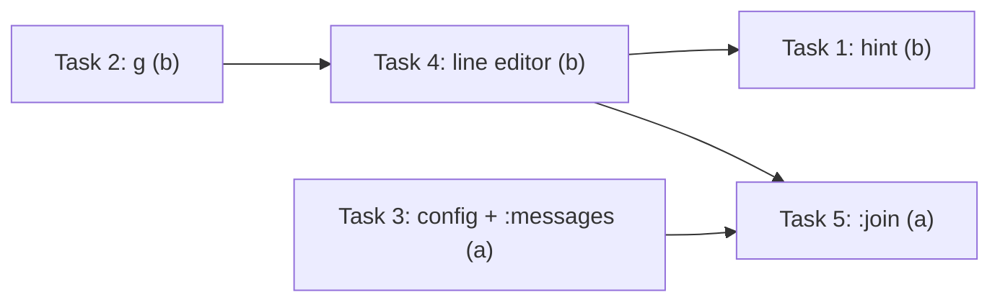

# Owner work E Implementation Plan

> **For agentic workers:** REQUIRED SUB-SKILL: Use superpowers:subagent-driven-development (recommended) or superpowers:executing-plans to implement this plan task-by-task. Steps use checkbox (`- [ ]`) syntax for tracking.

**Goal:** Five owner-approved items, one pull request each: a hint on the
composer's top rule when newer messages are below the timeline pane; the
key after `g` in the editors goes to edtui without the keymap, as in nvim;
a configuration written for a newer mxt loads in an older one, with
warnings that the status line points to and a new `:messages` that lists
them; a cursor and nvim's editing keys in the command line, the search
lines, picker queries and the recovery key prompt; and `:join <target>`,
which joins rooms, accepts invites and opens or creates direct messages
without creating a room by mistake.

**Architecture:** Task 1 and Task 2 are `mxt-tui` only: the hint is drawn
from the frame the timeline pane already lays out, and the `g` fix is one
more case of `Editor::key_mode` returning `EditorMode::AwaitingChar`.
Task 3 keeps the configuration's checks in `mxt` and `Action::from_spec`,
but classifies their problems into errors and warnings; the core gains a
status message history, `Msg::ConfigWarnings` and the `:messages` view
(`View::Help` with generated text). Task 4 replaces the core's `Edit`
(append-only editing in `app/command_line.rs`) with one line editor that
has a cursor, used by the command line, the search line, the pickers and
`SECRET` mode; the tui adapter only draws the cursor. Task 5 adds the
`room.join` action and `:join`; the core reads the argument, completes
pending invites and opens the answered room, and `mxt-matrix` joins, finds
an existing direct message in a fixed order, or creates one.

**Tech Stack:** Rust 2024; `toml` 1.2 (`toml::de::DeTable`,
`toml::de::Deserializer::from`), `unicode-segmentation` in `mxt-core`,
edtui (mxt's fork at the pinned commit), matrix-sdk 0.19.1 and its ruma
(`MatrixToUri`, `OwnedRoomOrAliasId`), matrix-sdk's `MatrixMockServer`
for tests.

## Global Constraints

- The design is `docs/superpowers/specs/2026-11-18-mxt-design.md`. It
  describes the result of all five tasks and wins over this plan when they
  disagree. Sections per task: Task 1 "Timeline" (the newer-messages hint)
  and "Layout"; Task 2 "Input routing", "Keymap resolver", "edtui
  differences from vim"; Task 3 "Layers", "Help views" (`:messages`),
  "Commands", "Action registry", "Error handling", "Logging", "Startup",
  "Risks" (ignored settings and privacy); Task 4 "Line editing", "Modes",
  "Tables and resolution", "Input routing" (pasted text); Task 5 "Joining
  rooms and direct messages", "Matrix adapter" (pending invites),
  "Commands", "Action registry", "Room list", "Risks" (finding an existing
  direct message).
- Everything in the repository is in English. Tests use made-up
  identifiers (`@alice:example.org`, `!room:example.org`,
  `#mxt:example.org`, a bridge bot `@discordbot:example.org`); no real room
  or user IDs.
- `mxt-core` stays free of I/O and of `ruma`.
- Each task is its own pull request and adds its own `CHANGELOG.md`
  `[Unreleased]` lines, listed in the task, and updates the user
  documentation (`docs/keys.md`, `docs/configuration.md`, `README.md`) it
  changes. No release tag: merging is the orchestrator's.
- Slots: worktree b builds only `-p mxt-core` and `-p mxt-tui`; a task
  that touches `mxt` or `mxt-matrix` (configuration loading, matrix calls)
  runs in worktree a, which may build the workspace under the heavy-build
  lock. CI compiles everything for every pull request.
- Tests assert specific lines, positions or properties, not whole
  generated texts that keep growing (the default keymap, `:help`).
- Breaking changes (`docs/releasing.md`): none of the five tasks is
  breaking, each for the reason in its task, so none adds a
  `**Breaking:**` line and the release after them is a patch release.

## Order and slots

| Task | Slot | Crates | Runs in parallel with |
|---|---|---|---|
| 2: `g` in the editors | b | `mxt-tui` | Task 3 |
| 4: line editor | b | `mxt-core`, `mxt-tui` | Task 3 |
| 1: newer-messages hint | b | `mxt-tui` | Task 5 |
| 3: forward-compatible configuration and `:messages` | a | `mxt-core`, `mxt` | Tasks 2 and 4 |
| 5: `:join` | a | `mxt-core`, `mxt-matrix` | Task 1 |

- Slot b runs Task 2, then Task 4, then Task 1; slot a runs Task 3, then
  Task 5. Two tasks run at a time, one per worktree.
- Task 3 and Task 5 both add a command to the registry
  (`crates/mxt-core/src/command.rs`), an `Action` variant with its name,
  `Msg` variants, and rows to the same tables of `docs/keys.md` and
  `docs/configuration.md`, so they run one after the other in slot a.
- Task 5 starts after Task 4 is merged: both edit
  `crates/mxt-core/src/app/command_line.rs` (Task 4 the text and its
  cursor, which completion leaves at the end; Task 5 the `join`
  candidates), and Task 5's completion tests rely on Task 4's cursor rule.
- Task 1 and Task 4 both edit `crates/mxt-tui/src/view.rs` (Task 1
  `draw` and `draw_composer`, Task 4 `draw_prompt_line` and
  `draw_command_line`); they are in the same slot anyway. Task 2 goes
  first because it is small and touches only `editor.rs` and docs lines
  no other task edits.
- Every task adds lines to `CHANGELOG.md` `[Unreleased]`; a later task
  rebases onto the earlier ones and keeps all lines.

## Task 1: The newer-messages hint

**Slot b. Crates:** `mxt-tui`.
**Files:** `crates/mxt-tui/src/timeline_view.rs`,
`crates/mxt-tui/src/view.rs`, `docs/keys.md`, `CHANGELOG.md`.
**Breaking:** no. It only draws; no setting, name or stored data changes.

- [ ] In `timeline_view.rs`, a function that counts the
  `TimelineEntry::Item`s after the last entry with a row on the pane
  (the second index `TimelinePane::draw` returns), stopping at 100, so a
  long timeline costs no more than a short one. Date dividers, the read
  marker and `TimelineEntry::Hidden` do not count; items of every content
  kind do, local echoes too.
- [ ] In `view::draw`, after `draw_timeline`, compute the count (0 when
  the timeline drew nothing) and pass it to `draw_composer`.
- [ ] `draw_composer` draws the hint over the right end of the rule, after
  the block: ` ↓ N newer ` and one `─`, dim, with `99+` for counts above
  99. The rule is the composer area's width; the draft label takes
  `─ <label> ` from its left end (as the block title draws it). The full
  hint needs the label's columns, at least one `─`, the hint and the final
  `─`; otherwise ` ↓ N ` alone; otherwise nothing. The label is never cut
  for the hint. Measure with `text_width`.
- [ ] Tests (`TestBackend` through the `Screen` helper, `Screen::sized`
  for widths):
  - after a burst taller than the space below the cursor's message (as in
    `moving_down_after_a_burst_shows_the_newest_message`), the composer's
    rule row ends with `↓ 3 newer ─`; after `j` until the pane shows the
    newest message, the row has no `↓`;
  - entries after the last visible one that are only a `Hidden` entry and
    a date divider give no hint;
  - 150 items below the pane read `↓ 99+ newer`;
  - with a reply draft (`Reply to <name>` label) and a width where label
    and full hint do not fit together, the row shows the full label and
    `↓ 3`; narrower, the full label and no `↓`.
- [ ] `docs/keys.md`, "The screen": the hint on the composer's top rule and
  what it counts.
- [ ] CHANGELOG `### Added`: "When newer messages are below the timeline
  pane, for example after a burst of messages arrived while the cursor was
  on an older one, the composer's top rule ends with `↓ N newer`; it goes
  once the pane shows the newest message."

## Task 2: The key after `g` goes to the editor

**Slot b. Crates:** `mxt-tui`.
**Files:** `crates/mxt-tui/src/editor.rs`,
`crates/mxt-tui/src/composer.rs` (tests), the message view's key tests in
`crates/mxt-tui` (where `view.close` is tested; `view.rs` tests or the
tui's key handling tests), `docs/keys.md`, `docs/configuration.md`,
`CHANGELOG.md`.
**Breaking:** no. A configuration loads and means what it did: a binding
in `normal`, `composer.normal` or `composer.visual` that starts with `g`
still runs in the composer, because the keymap sees `g` before edtui does
(`App::input_context` gives `ComposerNormal`/`ComposerVisual`, whose
chain includes `normal`; edtui gets `g` only when the resolver releases
it). No default binding in those tables starts with `g` (`gg`, `gx` and
`gd` are in `room_list` and `timeline`, see `DEFAULTS` in
`crates/mxt-core/src/keymap.rs`). What changes is only the key typed
after a `g` that edtui already holds: it no longer runs a binding
(`g]u`, `g:`, `g<Esc>`), as in nvim.

edtui at the pinned commit (`1182cb9`, `vim_keybindings` in
`src/events/key.rs`) has these key sequences in normal and visual mode:
`gg` (both), `dd`, `dw`, `dW`, `df`, `dt`, `diw`, `diW`, `di` with a quote
or bracket, `cw`, `cW`, `cf`, `ct`, `ciw`, `ciW`, `ci` with a quote or
bracket, `yy`, and visual `iw` and `i` with a quote or bracket; insert
mode has single keys only, and search mode takes every key. mxt already
routes the key after `d`, `c`, `y`, `di`, `ci`, visual `i`, `df`, `dt`,
`cf`, `ct` (and its own `f`, `F`, `t`, `T`, `r`) to edtui
(`edtui_waits`); `g` is the only prefix left. edtui drops both keys of a
sequence it does not have (`KeyEventHandler::get` clears its lookup).

- [ ] `Editor::key_mode` returns `EditorMode::AwaitingChar` while
  `Pending::G` waits (in normal and visual mode, like the others), so the
  core routes the next key to `InputContext::EditorPassthrough`. The
  existing `Drop` after `gf`, `gF`, `gt`, `gT` stays. Update the comments
  of `Pending::G`, `Editor::pending`, `edtui_waits` and the module: the key
  after `g` goes to edtui without the keymap.
- [ ] Tests in `editor.rs`: replace the `gd` assertion
  (`the_key_after_an_operator_goes_to_edtui`) with: after `g` the mode is
  `AwaitingChar`, also after `v` then `g`; `gg` moves to the first row;
  `g]` and `g<Esc>` leave the text unchanged and the mode `Normal`, and an
  `x` after them deletes a character.
- [ ] Tests in `composer.rs`: in
  `operators_and_text_objects_never_run_the_default_unread_keys`, add
  `0g]` (text unchanged, no pending keys, and the following `u` neither
  opens `!b` nor leaves the composer) and `0g<Esc>` (the composer keeps
  the focus). A second test with a user binding `"gt" = "focus.timeline"`
  in `normal` (a variant of `composing` that takes a configured `Keymap`):
  `gt` in the composer's normal mode moves the focus to the timeline, and
  `gg` still reaches edtui (after `timeoutlen`, through `Msg::Timeout`).
- [ ] Test for the message view: `gq` leaves the view open, and a `q`
  after it closes the view.
- [ ] `docs/keys.md`, "Differences from vim": the key after `g` goes to the
  editor too; edtui's only `g` command is `gg`, the key after any other
  `g` is dropped with it, and `g<Esc>` cancels. `docs/configuration.md`,
  the paragraph on keys that never reach the keymap: add "after `g`".
- [ ] CHANGELOG `### Fixed`: "In the composer and the message view, the
  key after `g` goes to the editor without the keymap, as in nvim:
  `g]u` no longer opens another room, `g<Esc>` cancels the `g` instead of
  leaving the composer, and `gq` no longer closes the message view.
  Bindings in `normal` that start with `g` work as before."

## Task 3: Forward-compatible configuration and `:messages`

**Slot a** (the `mxt` crate). **Crates:** `mxt-core`, `mxt`.
**Files:** `crates/mxt-core/src/action.rs`, `keys.rs`, `msg.rs`,
`command.rs`, `app.rs`, `app/timeline.rs` (`view_help`),
`crates/mxt-core/src/app/tests.rs`; `crates/mxt/src/config.rs`,
`config/dto.rs`, `config/tests.rs`, `main.rs`, `startup.rs`;
`docs/configuration.md`, `docs/keys.md`, `README.md`, `CHANGELOG.md`.
**Breaking:** no. Every configuration that loaded before loads the same
way and means the same: each new warning was an error before, so a
configuration that loaded had none. Configurations that failed with an
unknown name now load; nothing a user wrote changes meaning.

Core:

- [ ] `ActionError`: a new `UnknownValue { action, arg, value, allowed }`
  for a value outside a fixed set (`Args::choice`), with the text
  `<action>: unknown "<arg>" value "<value>"; expected one of "a", "b"`;
  `InvalidValue` keeps only the empty string ("must not be empty").
  `message.react` with `emoji = ""` is `InvalidValue`; an unknown,
  non-empty emoji stays `UnknownEmoji`. `ActionError::is_unknown_name()`
  is true for `UnknownAction`, `UnknownArgument`, `UnknownValue` and
  `UnknownEmoji`.
- [ ] `KeyParseError::is_unknown_name()`: true for `UnknownKey` and
  `UnknownModifier`.
- [ ] The status message history: `App` keeps the last 200 status
  messages (`VecDeque<StatusMessage>`, oldest dropped first); `set_status`
  appends every message it sets. The `CONFIRM` question and the `SECRET`
  prompt are not status messages and stay out.
- [ ] `Msg::ConfigWarnings { warnings: Vec<String> }`: appends each
  warning to the history without showing it, then sets, as an error, the
  status `Ignored 1 setting in the configuration; see :messages` or
  `Ignored <N> settings in the configuration; see :messages`. An empty
  list does nothing.
- [ ] `Action::StatusMessages` (`status.messages`, no arguments, no
  default key) opens `View::Help` with
  `Status line messages, oldest first; the last 200 are kept.`, an empty
  line and one line per message, oldest first; with no messages, the
  first line alone. Registry entry `:messages` after `:map`, no
  argument, description "List the status line's recent messages".
- [ ] Core tests: the history keeps 200 and drops the oldest; the first
  line of `:messages` exactly; warnings come before the status that counts
  them; singular and plural status texts; `:messages x` is
  `:messages takes no argument`; a `CONFIRM` question is not in the
  history; `UnknownValue`'s text and `is_unknown_name` for each variant;
  `emoji = ""` is `InvalidValue`.

`mxt`:

- [ ] Parse with `toml::de::DeTable::parse` (syntax errors stay errors,
  through `Source::toml_error`). Walk the document against a static
  schema of the known keys (root `account`, `ui`, `files`, `keymap`;
  `account.user_id`, `account.homeserver`; `ui.leader`, `ui.timeoutlen`,
  `ui.room_list` with `visible`, `sort`, `width`, `network`,
  `ui.time_format`, `ui.image_preview`, `ui.read_receipts`;
  `files.download_dir`, `files.opener`; the keymap tables `normal`,
  `room_list`, `timeline`, `message_view`, `picker`, `command_line` and
  `composer` with `normal`, `visual`, `insert`, `completion`, whose keys
  are bindings). Remove every unknown key or table and record a warning
  at its key's position: `unknown table` when its value is a table,
  `unknown key` otherwise. Deserialize what is left with
  `toml::de::Deserializer::from(document)`; the DTOs keep
  `deny_unknown_fields`, which a schema that misses a key turns into a
  failing test.
- [ ] The DTO enums `RoomSort`, `NetworkPlacement`, `ImagePreview` and
  `ReadReceipts` become `Spanned<String>` converted by name: an unknown
  name is a warning at the value (`unknown value "<v>"; expected one of
  …`) and the setting keeps its default. A wrong type stays an error.
- [ ] `ui.leader`: a key error with `is_unknown_name()` is a warning and
  the leader is `<Space>`; other key errors stay errors.
- [ ] Bindings, in the order of the design's "Layers": the keys (an
  unknown key name or modifier skips the binding with a warning, other key
  errors are errors), the duplicate spelling check (error), then each
  action (`Action::from_spec`): an error with `is_unknown_name()` skips the
  whole binding with a warning at the position `argument_start` gives
  (`UnknownValue` like `InvalidValue`), any other error stays an error. A
  skipped binding is not passed to `Keymap::new`, so the default binding
  of its keys stays.
- [ ] `Config` gains `warnings: Vec<ConfigWarning>`; `ConfigWarning` has
  the path, line, column and message, and displays as
  `<file>:<line>:<column>: <setting>: <reason> (ignored)`.
- [ ] `main.rs`: after `init_logging`, log each warning at `warn` from the
  `config` module (target `mxt::config`), the message being the warning's
  `Display`. Nothing is printed to the terminal.
- [ ] `startup.rs`: right after `App::new`, `app.update(Msg::ConfigWarnings
  { warnings })` with the warnings' `Display` strings.
- [ ] `mxt` tests (`config/tests.rs`), each warning with its line, column
  and text, and the configuration otherwise loaded: an unknown key
  (`ui.font`), an unknown root table (`[notifications]`), an unknown
  keymap table (`[keymap.composer.foo]`, `[keymap.foo]`), an unknown
  setting value (`ui.image_preview = "wezterm"` keeps `auto`), an unknown
  action (`"x" = "message.dlete"` in `timeline`), an unknown action over a
  default (`"dd" = "message.dlete"` leaves `dd` as `message.delete`), an
  array with one unknown action (ignored whole), an unknown argument, an
  unknown `filter` value, an unknown emoji, an unknown key name
  (`"<F13>"`), an unknown `ui.leader` (`"<F13>"` gives `<Space>`). Still
  errors: a syntax error, `timeoutlen = "1s"`, `filter = 3`,
  `emoji = ""`, `"<C-x"`, `pick` with `query`, `file.upload` without
  `path`, `width = 5`, a duplicate spelling, a binding table without
  `action`. Update the existing tests whose unknown names became warnings
  (`errors_name_the_line`: `timeoutln`, `message.dlete`,
  `keymap.composer.foo`; `messages_name_the_setting`: `sort = "size"`,
  `network = "beside"` with its column; `argument_errors_point_at_the_argument`:
  `pik`, `unred`; `an_unknown_emoji_points_at_its_argument`); they keep
  their positions as warnings. `the_design_example_loads` and the complete
  example of `docs/configuration.md` load with no warnings; read the
  latter with `include_str!` so the test fails when the documentation's
  example stops loading cleanly.
- [ ] `docs/configuration.md`: "Errors" becomes "Errors and warnings":
  what stays an error, what is a warning and why (a configuration shared
  between versions), the warning's form with an example, that the setting
  or binding is ignored and its default applies (a default binding of the
  same keys stays), the status line text and `:messages`, the log; and
  that "nothing is silently ignored". Actions table: `status.messages`.
  `docs/keys.md`: `:messages` in the commands table, the sentence on
  arguments, and "Actions without a default key". `README.md`, the log
  paragraph under Files: configuration warnings are logged too, and
  `:messages` lists the status line's recent messages.
- [ ] CHANGELOG `### Changed`: "Settings, tables, actions, action
  arguments, values and key names that this version does not know no
  longer stop mxt: each is ignored with a warning and its default applies,
  so one configuration works with older and newer versions. Syntax errors,
  wrong types and invalid values still stop it. At startup the status line
  says how many settings were ignored, and the log names each with its
  line." `### Added`: "`:messages` lists the status line's recent
  messages (the last 200), the configuration's warnings included, in the
  full-screen view; the action `status.messages` opens it from a key."

## Task 4: One line editor for the command line, search lines, pickers and `SECRET`

**Slot b. Crates:** `mxt-core`, `mxt-tui`.
**Files:** a new `crates/mxt-core/src/line.rs` (the line editor and the
character classes), `crates/mxt-core/src/lib.rs`, `app.rs` (paste),
`app/command_line.rs`, `app/picker.rs`, `app/recovery.rs`,
`app/search.rs` if it reads the line's text, the core tests;
`crates/mxt-tui/src/view.rs` (`draw_prompt_line`, `draw_command_line`,
the `SECRET` prompt), `crates/mxt-tui/src/overlay.rs` (the picker's query
line); `docs/keys.md`, `docs/configuration.md`, `CHANGELOG.md`.
**Breaking:** no. Keys that did nothing on these lines now edit them;
`<C-u>` deletes before the cursor, which is the whole text whenever the
cursor is at the end, the only place it could be before; `<C-w>` splits
words by character class (`foo.bar` loses `bar`, not all of it), a change
of behaviour but not of anything a user wrote. Bindings in `command_line`
and `picker` still take their keys first. No configuration changes
meaning.

- [ ] `line.rs`: a line editor type holding a text and a cursor (a byte
  offset on a grapheme cluster boundary), with the keys of the design's
  "Line editing" table, returning whether the text changed, the cursor
  moved, or a `<BS>` found the text empty. Insert at the cursor, which
  pastes use too. Words by the character classes: a cluster's class is
  its first character's, from a copy of the class table of mxt's edtui
  fork (`CharacterClass` in `src/actions/motion.rs` at the pinned
  commit, with its comment on where it differs from vim); say where it
  comes from in a comment.
- [ ] `app/command_line.rs`: the line editor replaces `Edit` and
  `CommandLine::text`; `CommandLine` exposes the text and the cursor to
  the tui. Any edit or cursor move ends the completion cycle; every
  completion step sets the whole text and puts the cursor at the end;
  completion still reads the whole text. `<BS>` on an empty command or
  search line closes it.
- [ ] `app/picker.rs`: the query is a line editor; the items are ranked
  again and the first selected only when the text changed. `Picker`
  exposes the query's cursor.
- [ ] `app/recovery.rs`: `SECRET` mode uses the same keys on the key's
  own `String` (no second copy; `RecoveryKey` keeps it, allocated with
  room for 128 bytes as now), plus `<CR>` and `<Esc>`. `secret_prompt()`
  gives the prompt, the number of grapheme clusters and the cursor's
  index among them, nothing else of the key.
- [ ] `app.rs`: a paste's first line goes in at the cursor
  (`paste_into_line`, `paste_into_picker`, `paste_into_secret`).
- [ ] `view.rs`: `draw_prompt_line` takes the cursor: the terminal cursor
  goes on the first column of the cluster after it (after the text at the
  end); a text wider than the line is cut at its start, by whole
  clusters, by as little as it takes for the cursor's cell to fit. The
  `SECRET` line draws one `*` per cluster with the cursor among them.
  `overlay.rs` passes the query's cursor.
- [ ] Core tests: each key of the table, also on CJK text and on an emoji
  with a skin tone or ZWJ (one cluster for `<Left>`, `<BS>`, `<Del>`);
  `<C-w>` on `日本語のテキスト` and on `open foo.bar`; `<S-Left>` and
  `<S-Right>` across blanks; `<C-u>` in the middle; `<Del>` and
  `<Right>` at the end and `<Left>` at the start do nothing; `<BS>` at the
  start of a non-empty line does nothing and on an empty one closes it;
  `<Tab>` after moving the cursor left completes the whole text and leaves
  the cursor at the end, and a `<Left>` ends the cycle; moving in a picker
  does not re-rank or reset the selection, typing does; a paste in the
  middle; `SECRET`: editing in the middle, the cluster count and cursor
  from `secret_prompt`, and the key's capacity unchanged after editing a
  59-character key in the middle; a user binding of `<C-e>` in `picker`
  wins over the line editor.
- [ ] tui tests (`TestBackend`): the terminal cursor's column with the
  cursor in the middle, after wide characters, and in a text wider than
  the line; the masked `SECRET` line with the cursor among the stars.
- [ ] `docs/keys.md`: replace the paragraph on what the command line,
  search lines and picker queries take with the keys and the word rule,
  and update the `SECRET` row of the Modes table. `docs/configuration.md`:
  the `picker` and `command_line` rows of the tables ("edit the line
  with the key", linking to keys.md).
- [ ] CHANGELOG `### Added`: "The command line, the `/` search line,
  picker queries and the recovery key prompt have a cursor: `<Left>`,
  `<Right>`, `<Home>` or `<C-b>`, `<End>` or `<C-e>`, `<S-Left>` and
  `<S-Right>` by word, and typing, `<BS>` and `<Del>` at the cursor."
  `### Changed`: "On those lines `<C-u>` deletes the text before the
  cursor and `<C-w>` the word before it, with words split as in the
  editors: `foo.bar` loses `bar` first, and kanji, hiragana and katakana
  are separate words."

## Task 5: `:join`

**Slot a** (`mxt-matrix`). **Crates:** `mxt-core`, `mxt-matrix`.
Starts after Task 3 and Task 4 are merged.
**Files:** `crates/mxt-core/src/action.rs`, `command.rs`, `effect.rs`,
`msg.rs`, `room.rs` (`Invite`), `app.rs`, `app/rooms.rs`,
`app/command_line.rs`, the core tests; a new
`crates/mxt-matrix/src/join.rs`, `crates/mxt-matrix/src/rooms.rs`
(pending invites; `DmCandidate::partner` also gives the person's user ID),
`crates/mxt-matrix/src/adapter.rs`, `adapter/tests.rs`, `error.rs`;
`docs/keys.md`, `docs/configuration.md`, `CHANGELOG.md`.
**Breaking:** no. A new command, action and argument; nothing existing
changes.

matrix-sdk 0.19.1 and its ruma offer what is needed (checked in the
registry sources): `Client::join_room_by_id_or_alias(&RoomOrAliasId,
&[OwnedServerName])` (resolves an alias with `resolve_room_alias`, then
`/join` with `via`; `/join` accepts an invite), `Room::join` for an
invited room, `Client::get_dm_rooms(user)` (joined rooms whose `m.direct`
targets are exactly that user, with the default `DmRoomDefinition::
MatrixSpec`), `Client::create_dm(user)` (invite, `is_direct`, preset
`TrustedPrivateChat`, `m.room.encryption` with recommended defaults since
mxt enables `e2e-encryption`, then `Account::mark_as_dm`),
`Client::invited_rooms`, `Room::is_direct` (for an invited room, the
stripped member event's `is_direct`), `Room::invite_details` (the
inviter), `Room::canonical_alias`, `Room::alt_aliases`,
`Room::joined_members_count`, `Room::heroes`, `Room::get_member_no_sync`,
`Room::get_member` (fetches members when they are not synced), and
`ruma::MatrixToUri::parse` (`id()`: `MatrixId::{Room, RoomAlias, User,
Event}`, `via()`), `RoomId::server_name() -> Option<&ServerName>`. Tests
use `MatrixMockServer`'s `mock_room_join`,
`mock_room_directory_resolve_alias`, `mock_create_room`,
`mock_get_members`, `mock_sync` and a plain wiremock `Mock` on
`server()` for the `m.direct` account data `PUT`.

Core:

- [ ] `Action::RoomJoin { target: String }` (`room.join`, `target`
  required and non-empty, rendered after `emoji` by
  `Action::arguments`). Registry entry `:join` right after `:open`,
  `Argument::Required(":join <target>")`, description "Join a room or
  accept an invite, or open a direct message with a user".
- [ ] Reading the argument (design, "Joining rooms and direct
  messages"): an alias, a room ID, a user ID or a matrix.to link by its
  form, else the best fuzzy match among the pending invites' names
  (`fuzzy::rank`), else the error `No pending invite matches "<argument>"`.
  A room ID of a listed room opens it at once. Otherwise status
  `Joining…`, `MatrixEffect::Join { target }` (the argument, or the
  invite's room ID), and remember the join.
- [ ] `Msg::Invites(Vec<Invite>)` (`Invite { room: RoomId, name: String
  }`) replaces the core's pending invites. `Msg::Joined { room, how }`
  with `how` `Already`, `Joined` or `Created`: open the room now if the
  room list has it, else when its `Msg::RoomUpserted` arrives; another
  room opened or another `:join` cancels the wait. On opening: status
  `Joined <room name>`, `Created a direct message`, or for `Already` no
  status (a `Joining…` still shown is cleared).
- [ ] Completion: after `join `, `join <name>` for each pending invite,
  ranked against the typed text like `:open`'s room names, cycling the
  same way; the name `join` completes with a space.
- [ ] Core tests: each target form reaches `MatrixEffect::Join` with the
  argument as typed; an invite name sends its room ID; no match gives the
  error and no effect; a listed room ID opens without an effect; `Joined`
  for a listed room opens it, for an unlisted one opens it on its upsert,
  and not after another room was opened meanwhile; the three status
  texts; completion of invite names and of the command name; a binding
  `{ action = "room.join", target = "#mxt:example.org" }` and the
  `target = ""` error; `:map` renders `target`.

`mxt-matrix`:

- [ ] `rooms.rs`: with each sync response, compare `Client::invited_rooms()`
  with the last set sent and send `Msg::Invites` (room ID and
  `display_name`, sorted by name) when it changed; once at the start too.
- [ ] `join.rs`, run by `run_effects` for `MatrixEffect::Join` as a spawned
  task answered through `answered`: parse the target (matrix.to link,
  room ID or alias, user ID; otherwise the error "not a room alias, room
  ID, user ID or matrix.to link"). Room target: a joined room with that
  ID, canonical alias or alternative alias answers `Already` without a
  request; else `join_room_by_id_or_alias` with the link's `via`, else
  the room ID's server name, else none; a joined space answers the error
  `Joined, but the room is a space, which mxt does not list`; an alias
  the directory does not know (`M_NOT_FOUND`) is
  `Joining failed: no room has this alias`; other failures
  `Joining failed: <brief>`.
- [ ] User target: the own user ID is an error; then the lookup of the
  design in its order (`m.direct` without rooms the user left or was
  banned from; an unbridged joined room with exactly the two of them,
  using the store, then heroes, then one `get_member` per undecided room;
  the bridged DM rule, sharing `DmCandidate` with the room list so both
  agree; a pending direct invite from the user), the latest activity
  deciding within a step; nothing found: `create_dm`, answered `Created`.
  Failures are `Opening the direct message failed: <brief>`. No failure
  text names the target or a room.
- [ ] Tests against `MatrixMockServer`: joining by alias (resolve, then
  `/join`), by the ID of an invited room (`/join` accepts it), by a
  matrix.to link whose `via` reaches the request; an unknown alias's
  text; a refused join's text; an already joined room by ID and by alias
  with no request. The direct message lookup with `mock_create_room()`
  expected never: a room in `m.direct`; a bridge bot's management room
  (two joined members, no bridge state, not in `m.direct`), found by
  `:join @discordbot:example.org`; a bridged DM (bridge state with the
  bot, the bot, the user and the person) found by the person's ID; a
  bridged channel with only the user and the bot is not taken for the
  bot's room; a pending direct invite from the user is accepted. Creating:
  nothing found, `mock_create_room()` expected once, its body has
  `is_direct`, the invite, the `trusted_private_chat` preset and an
  `m.room.encryption` initial state event, and `m.direct` is written.
- [ ] `docs/keys.md`: `:join <target>` in the commands table with its
  forms, the lookup order in short, and that a new direct message is
  created only when none is found; the Commands intro (`<Tab>` completes
  pending invites after `:join`); the argument sentence; "Actions without
  a default key". `docs/configuration.md`: Actions table `room.join` with
  `target`; the `command_line.complete` row adds invites after `:join`.
- [ ] CHANGELOG `### Added`: "`:join <target>` joins a room by its alias
  (`#name:server`), its ID or a matrix.to link, which also accepts a
  pending invite, and opens it; `:join @name:server` opens the direct
  message with that person, bridged ones and a bridge bot's room
  included, and creates an encrypted one only when there is none.
  `<Tab>` after `:join ` completes pending invites by name. The action
  `room.join` takes `target`."

The owner's account check after Task 5 (not for the worker): `:join` with
the Discord bridge bot's user ID opens the existing bridge-bot room with
no `createRoom` request, and leaving the test room in another client and
`:join <its room ID>` joins and opens it again.
