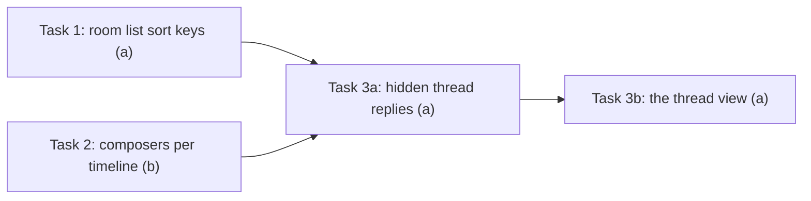

# Owner work F Implementation Plan

> **For agentic workers:** REQUIRED SUB-SKILL: Use superpowers:subagent-driven-development (recommended) or superpowers:executing-plans to implement this plan task-by-task. Steps use checkbox (`- [ ]`) syntax for tracking.

**Goal:** Two owner-approved items of owner work F (item 1, the scrolling
fix, is merged as PR #78): configurable sort keys for the room list (F2),
with the default order unchanged, and threads (F3): replies in threads
leave the main timeline, a root shows its reply count, and `t` shows the
thread in place of the timeline, where the timeline's keys work and the
composer sends into the thread.

**Architecture:** F2 is one task in slot a (Task 1): `mxt-core::rooms`
gets sort keys and keeps the room list in their order, the cursor
following its room; `RoomSummary` gains the time of the user's own latest
read receipt, which `mxt-matrix` reads from the state store with the
room's other facts; `mxt` parses `ui.room_list.sort` as a comma-separated
list of keys, still one string. F3 is three tasks. Task 2 (slot b) keys
the composers by `TimelineId` (a room's main timeline or a thread)
instead of `RoomId`, between the core and the tui only, with no visible
change. Task 3a (slot a) hides the replies in threads: the main timeline
is built with them hidden, diffs and pagination name their `TimelineId`,
and a root draws the `💬` row with its unread mark. Task 3b (slot a) adds
the thread itself: the core keeps the main timeline aside while a
thread's timeline is shown in its place, routes sends, receipts and jump
list entries by `TimelineId`, and adds `thread.open`, `thread.close`, the
keymap table `thread` and `gd` into threads; `mxt-matrix` keeps a second,
thread-focused timeline and sends a thread's receipt; `mxt-tui` draws the
thread's title row.

**Tech Stack:** Rust 2024; matrix-sdk and matrix-sdk-ui 0.19.1
(`TimelineFocus`, `ThreadSummary`, `Timeline::send`/`send_reply` on a
thread-focused timeline, `Room::send_single_receipt`,
`Room::load_user_receipt`, `AttachmentConfig::reply`,
`RoomEventCache::find_event`, `serde_helpers::extract_thread_root`),
ruma-events 0.35.2 (`Receipt`, `ReceiptThread`), matrix-sdk's
`MatrixMockServer` and matrix-sdk-test's `EventFactory` and
`JoinedRoomBuilder` for tests.

## Global Constraints

- The design is `docs/superpowers/specs/2026-11-18-mxt-design.md`. It
  describes the result of all four tasks and wins over this plan when
  they disagree. Sections per task: Task 1 "Room list", "Domain model"
  (`RoomSummary`), "Matrix adapter" (room summaries, optimistic clearing),
  "Configuration" (example, settings), "Layers", "Testing"; Task 2
  "Domain model" (`TimelineId`, composers, members), "Terminal adapter and
  the composer", "Error handling" (the draft put back); Task 3a
  "Threads" ("The main timeline"), "Timeline", "Matrix adapter"
  (timelines), "Testing"; Task 3b the rest of "Threads", "Layout",
  "Matrix adapter" (sending, read receipts, `room.mark_read`, optimistic
  clearing), "Default keymap", "Search and jumps", "Jump list", "Tables
  and resolution", "Action registry", "Help views" (`:map`'s table
  order), "Error handling", "Testing", "Risks".
- SDK calls are checked in the registry sources
  (`~/.cargo/registry/src/*/matrix-sdk*-0.19.1`, `ruma-events-0.35.2`);
  the design's "Threads" section gives file and line for each.
- Everything in the repository is in English. Tests use made-up
  identifiers (`@alice:example.org`, `!room:example.org`,
  `$root:example.org`); no real room or user IDs.
- `mxt-core` keeps the design's dependency rule ("Crates and the
  dependency rule"): `std` and small pure crates without I/O, not the
  SDK, `ruma`, an async runtime, a terminal library, `serde` or `toml`.
- Each task is its own pull request and adds its own `CHANGELOG.md`
  `[Unreleased]` lines, listed in the task (Task 2 has none: nothing a user
  sees changes), and updates the user documentation (`docs/keys.md`,
  `docs/configuration.md`, `README.md`) it changes. No release tag:
  merging is the orchestrator's.
- Slots: worktree b builds only `-p mxt-core` and `-p mxt-tui`; a task
  that touches `mxt` or `mxt-matrix` (configuration loading, matrix calls)
  runs in worktree a, which may build the workspace under the heavy-build
  lock. CI compiles everything for every pull request.
- Tests assert specific lines, positions or properties, not whole
  generated texts that keep growing (the default keymap, `:map`).
- Breaking changes (`docs/releasing.md`): none of the four tasks is
  breaking, each for the reason in its task, so none adds a
  `**Breaking:**` line.

## Order and slots

| Task | Slot | Crates | Runs in parallel with |
|---|---|---|---|
| 1: room list sort keys (F2) | a | `mxt-core`, `mxt-matrix`, `mxt`, `mxt-tui` (test helpers) | Task 2 |
| 2: composers per timeline (F3, part 1) | b | `mxt-core`, `mxt-tui` | Task 1 |
| 3a: hidden thread replies, the `💬` row (F3, part 2) | a | `mxt-core`, `mxt-matrix`, `mxt-tui` | nothing of this plan |
| 3b: the thread view (F3, part 3) | a | `mxt-core`, `mxt-matrix`, `mxt-tui`, `mxt` | nothing of this plan |

- Slot a runs Task 1, then Task 3a, then Task 3b; slot b runs Task 2 at
  the same time as Task 1. Task 3a starts once Task 1 and Task 2 are
  merged (it needs Task 2's `TimelineId` and works on Task 1's
  `mark_read`); Task 3b starts once Task 3a is merged.
- Nothing is released between Task 3a and Task 3b: 3a alone hides the
  replies in threads with no way to open them. The orchestrator tags no
  release while 3a is on `main` without 3b.
- Task 1 needs slot a: `RoomSummary` gains a field that `mxt-matrix`
  fills, and the configuration is `mxt`'s; a core-only part could not
  compile alone.
- Tasks 3a and 3b both need slot a: every type they change
  (`TimelineItem`, `Msg::Timeline`, the pagination messages in 3a;
  `MatrixEffect::Send`, `Upload`, the thread effects and `Msg::ThreadFound`
  in 3b) is built or matched in `mxt-matrix`, so their core parts do not
  compile without their `mxt-matrix` parts. Task 2 is the part that does:
  the composer effects and messages pass between the core and the tui
  only (the binary matches `MatrixEffect::Send { id, .. }` alone), so it
  runs in slot b in parallel with Task 1. The split of 3a and 3b is by
  size and review, not by slot: 3a is the main timeline's part (routing by
  `TimelineId`, hidden replies, the `💬` row and its mark), 3b everything
  a shown thread needs.
- F1 (PR #78) is merged, and this plan starts from a `main` that has it.
  It changed `crates/mxt-tui/src/timeline_view.rs` (`lay_out`, `around`,
  `TimelinePane::draw`, and the test helper `render`, which now takes the
  pane's height), where Task 3a adds a row in `Render::item` and the new
  `TimelineItem` field in the test helpers (`message`, `remote`), and
  Task 3b an anchor reset at the start of `TimelinePane::draw`; both work
  on that code as it is, so nothing waits on F1. The design addendum keeps
  off F1's "Timeline" bullets on scrolling and the hint (its own
  "Timeline" bullet is the section's second).
- Task 1 and Task 2 both edit `crates/mxt-core/src/app.rs` (Task 1
  `RoomList::new(settings.room_sort.clone())` in `App::new`; Task 2 the
  `composers` field and a new `members` field) and the test helpers of
  `crates/mxt-tui/src/composer.rs` and `crates/mxt-tui/src/view.rs`
  (Task 1 `last_read: None` in the `RoomSummary` literals; Task 2 the
  composers' keys next to them). The second to merge merges `main` and
  keeps both.
- `CHANGELOG.md` `[Unreleased]` has F1's `### Fixed` line. Task 1 adds an
  `### Added` line, Task 3a a `### Changed` line, Task 3b an `### Added`
  and a `### Changed` line, each section in Keep a Changelog's order; a
  later task keeps all lines.

## Task 1: Room list sort keys

**Slot a. Crates:** `mxt-core`, `mxt-matrix`, `mxt`; `mxt-tui` only for
the `RoomSummary` literals of its tests.
**Files:** `crates/mxt-core/src/rooms.rs`, `room.rs`, `settings.rs`,
`app.rs`, `app/rooms.rs`, `app/timeline.rs` (`check_receipt`),
`app/tests.rs` (its `room()` helper, `:30-31`, builds a `RoomSummary`),
`app/tests/room_actions.rs`; `crates/mxt-matrix/src/rooms.rs`;
`crates/mxt/src/config.rs`, `config/dto.rs`, `config/tests.rs`;
`crates/mxt-tui/src/composer.rs`, `view.rs` (tests only);
`docs/configuration.md`, `docs/keys.md`, `CHANGELOG.md`.
**Breaking:** no. `"recent"` and `"name"` keep their meaning and the
default stays `"recent"`; the list form, the keys `mentions`, `unread`
and `read` and their warnings are new. `sort` stays a string, so every
configuration that loaded loads the same way: a value 0.1.3 did not know
was a warning that kept `"recent"`, and it now either names keys this
version knows, which is how the configuration grows (design, "Layers":
new names only), or stays a warning that keeps `"recent"`. The other
direction holds too: mxt 0.1.3 reads a list or a new key as an unknown
value, a warning, and keeps `"recent"` (0.1.3
`crates/mxt/src/config.rs:169-176`), so a shared configuration can carry
the new value; the user documentation says so.

Core:

- [ ] `rooms.rs`: `pub enum SortKey { Mentions, Unread, Recent, Read,
  Name }` with `pub const ALL: [SortKey; 5]` and `config_name()`
  (`"mentions"`, `"unread"`, `"recent"`, `"read"`, `"name"`), as
  `RoomFilter` has them: the one place the names are written.
  `RoomSort` becomes a non-empty list of distinct keys:
  `RoomSort::new(Vec<SortKey>) -> Result<RoomSort, RoomSortError>`
  (`Empty`, `Repeated(SortKey)`), `RoomSort::one(SortKey)`,
  `keys() -> &[SortKey]`, `Default` = `[Recent]`; `Clone`, no longer
  `Copy`. `compare` applies the keys in order: `Mentions` puts
  `mentions > 0` first; `Unread` puts `RoomFilter::Unread.matches(&unread)`
  first; `Recent` compares `latest_activity` newest first, `None` last (as
  `b.cmp(&a)` on the options does now); `Read` the same on `last_read`;
  `Name` the lowercase displayed name. Then the name order, then the room
  ID, so the order stays total. Remove the old variants; update the doc
  comments. Delete `RoomList::sort()` (`rooms.rs:141-143`): it has no
  caller and could not return a `RoomSort` by value any more.
- [ ] `room.rs`: `RoomSummary::last_read: Option<Timestamp>`, documented
  as the time of the user's own latest read receipt (design, "Room list").
- [ ] `RoomList::clear_unread` places the room again (remove, then insert
  at its `partition_point`, as `upsert` does) and returns
  `Option<(usize, usize)>`, the old and new index; its doc no longer says
  the order does not depend on counts.
- [ ] `app/rooms.rs`: `App::clear_room_unread(&RoomId)` calls it and moves
  `room_cursor` with `follow`, as `upsert_room` does; `mark_read` and
  `check_receipt` (`app/timeline.rs`) call it instead of
  `rooms.clear_unread`.
- [ ] `settings.rs`: `room_sort: RoomSort`, default `RoomSort::default()`;
  `app.rs` clones it into `RoomList::new`.
- [ ] Tests in `rooms.rs`: each key alone (`mentions` with rooms of 1 and
  5 mentions tied and ordered by name; `unread` counting `marked` and
  `messages` alike; `recent` and `read` with `None` last); `mentions,
  unread, read` over rooms that differ in each; ties falling to the
  name and then the room ID; `RoomSort::new` refusing no key and a
  repeated key; `clear_unread` moving a room under `unread` and returning
  both indices; `SortKey::ALL` round-trips through `config_name()`. In
  `app/tests/room_actions.rs`: under `unread`, the cursor on a room that
  an upsert moves stays on it, and so does a cursor on another room that
  the move passes; `room.mark_read` and a timeline receipt (optimistic
  clearing) move the open room down with the cursor on it; `]u` after
  that opens the first unread room in the new order.

`mxt-matrix`:

- [ ] `rooms.rs`: `RoomFacts::last_read: Option<Timestamp>`, read in
  `room_facts`: the latest `Receipt::ts` (ruma-events `receipt.rs:124-132`)
  among `room.load_user_receipt(ty, &thread, room.own_user_id())` for `ty`
  in `ReceiptType::Read`, `ReceiptType::ReadPrivate` and `thread` in
  `ReceiptThread::Unthreaded`, `ReceiptThread::Main` (matrix-sdk-base
  `room/mod.rs:555-564`, reached through `matrix_sdk::Room`'s `Deref`,
  matrix-sdk `room/mod.rs:219-225`); a store error fails the room's read
  as the other store reads there do. `summary` passes it on. Facts are
  read for every room of each sync response already (`run`, `check`), so
  a receipt that arrives changes the facts and sends `RoomUpserted`.
- [ ] A test against `MatrixMockServer` in `rooms.rs`'s test module
  (`#[tokio::test]`; the dev-dependencies are there): a sync with
  `JoinedRoomBuilder::add_receipt` (matrix-sdk-test
  `sync_builder/joined_room.rs:99-102`) of
  `EventFactory::new().read_receipts().add_with_timestamp(..)`
  (`event_factory.rs:1298, 1874-1890`) holding, each on its own event, the
  user's `m.read` unthreaded at 1000, the user's `m.read.private` with
  `ReceiptThread::Main` at 2000, the user's `m.read` with
  `ReceiptThread::Thread($root)` at 3000 and another user's `m.read` at
  4000: `room_facts` gives `last_read` 2000. A room without receipts gives
  `None`.

`mxt`:

- [ ] `dto.rs`: `RoomList::sort` stays `Option<Spanned<String>>`, now
  documented as a comma-separated list of `SortKey::config_name()`s.
  Delete `ROOM_SORTS`; the doc comment that says settings with fixed
  values are strings moves to the remaining tables.
- [ ] `config.rs`: `fn room_sort(source, value: Option<Spanned<String>>,
  warnings) -> RoomSort` replaces the `choice` call; the default when the
  value is absent. The value splits at `,`, each key trimmed of
  whitespace (`str::trim`); the names are `SortKey::ALL` by
  `config_name()`, compared as written (so case-sensitive, as `named`
  is). In the design's order ("Layers"), each problem a warning at the
  value's start (`source.ignored(&value, ..)`), ending in `(ignored)`:
  every key empty, `ui.room_list.sort: names no sort key`, the default;
  else some key empty, `ui.room_list.sort: empty sort key in
  "mentions,,read"` (the value as written, `{:?}`), the default; else
  each key in turn: unknown, the text of an unknown value with the five
  names (`ui.room_list.sort: unknown value "size"; expected one of
  "mentions", "unread", "recent", "read", "name"`), skipped; known, kept.
  Then `RoomSort::new(kept)`: `Ok` is the setting; `Err(Empty)` (every key
  unknown) the default with no further warning; `Err(Repeated(key))`
  `ui.room_list.sort: "unread" is listed twice`, the default. Build the
  unknown value's message with the code `choice` uses (factor the
  `expected one of` loop into a helper taking the names), so both read
  the same.
- [ ] `config/tests.rs`, each with the warnings' line, column and text:
  each key alone (`"mentions"`, `"unread"`, `"recent"`, `"read"`,
  `"name"`, no warning); `"mentions, unread, read"`,
  `"mentions,unread,read"` and `" mentions ,unread,  read "` giving the
  same `RoomSort`; `"Mentions, unread"` (a warning for `"Mentions"`, then
  `[Unread]`); `"mentions, size, read"` (one warning, `[Mentions, Read]`);
  `"size, age"` (two warnings at the same position, the default); `""`
  and `" "` (no sort key, the default); `"mentions,,read"`,
  `"mentions, read,"` and `",read"` (an empty key, the default);
  `"unread, read, unread"` (listed twice, the default); `"size, read,
  read"` (the unknown key's warning, then listed twice, the default);
  `sort = "size"` with the five names in the existing tests' expected
  text; `sort = true` still the wrong-type error.
  `every_key_and_table_loads_without_warnings` sets `sort = "mentions,
  read"` and asserts it.

`mxt-tui`:

- [ ] The `RoomSummary` literals in the tests of `composer.rs` and
  `view.rs` get `last_read: None`.

Docs:

- [ ] `docs/configuration.md`: the example's comment; the `sort` row of
  the `room_list` table (a comma-separated list of keys, spaces optional,
  lowercase; the five keys with what each puts first; ties by name; one
  key as before, so `"recent"` and `"name"` keep their meaning; `read`
  from your own latest read receipt on any device, rooms never read last;
  with `read`, a room moves up when its newest message is newer than
  your last read receipt in it, once the receipt comes back, and opening
  a room with nothing new leaves it in place, since servers keep only
  receipts that move forward; with `unread` or `mentions` it moves at
  once); "Errors and warnings": the warnings of an unknown key, no key,
  an empty key and a repeated key; a sentence that mxt 0.1.3 reads a list
  or a new key as an unknown value, a warning that keeps `"recent"`, so a
  configuration shared with it can carry the new value.
- [ ] `docs/keys.md`, "The screen": the room list follows
  `ui.room_list.sort`; the cursor stays on its room when rooms move; `]u`,
  `[u` and the room picker follow the list's order.
- [ ] CHANGELOG `### Added`: "`ui.room_list.sort` takes a comma-separated
  list of keys, applied in order, each deciding between the rooms the
  keys before it leave tied: `mentions` (rooms with unread mentions
  first), `unread` (rooms with unread messages first), `recent` (latest
  activity first), `read` (the rooms you read most recently first, by
  your own latest read receipt from any device; rooms you never read
  last) and `name`, for example `sort = "mentions, unread, read"`.
  Remaining ties go by name; `"recent"` and `"name"` mean what they did.
  With `read`, a room you open moves up when it had something new for
  you. The cursor stays on its room when rooms move. mxt 0.1.3 ignores
  such a value with a warning and sorts by `recent`, so a configuration
  shared with it can carry it."

## Task 2: Composers per timeline

**Slot b. Crates:** `mxt-core`, `mxt-tui`. Runs in parallel with Task 1.
**Files:** `crates/mxt-core/src/ids.rs` (`TimelineId`), `effect.rs`,
`msg.rs`, `app.rs`, `app/composer.rs`, the core tests that build the
composer messages and effects (`app/tests/composer.rs`, `app/tests.rs`,
`app/tests/files.rs`, `app/tests/jumps.rs` where they do);
`crates/mxt-tui/src/composer.rs`, `terminal.rs`, `view.rs` and their
tests.
**Breaking:** no, and nothing a user sees changes: without threads every
composer is a room's main one, keyed as before in effect. No CHANGELOG
line. The design already describes composers per `TimelineId`.

- [ ] `ids.rs`: `pub struct TimelineId { pub room: RoomId, pub thread:
  Option<EventId> }` (`Clone`, `Debug`, `PartialEq`, `Eq`, `Hash`) and
  `TimelineId::main(room)`, documented as a room's main timeline or one of
  its threads by the root's event ID.
- [ ] `effect.rs`: `UiEffect::FocusComposer { timeline, mode }`,
  `RequestSubmit(TimelineId)`, `InsertNewline(TimelineId)`,
  `LoadComposer { timeline, text }`, `ClearComposer(TimelineId)`,
  `ReplaceMentionToken { timeline, text }`, `ExternalEditor(TimelineId)`.
  `MatrixEffect` stays as it is (`Send` keeps `room`; Task 3b changes it).
- [ ] `msg.rs`: `Msg::Submit { timeline, body }`,
  `ComposerEdited { timeline, empty }`, `MentionQuery { timeline, query }`;
  `MembersLoaded { room, .. }` stays.
- [ ] `app.rs`, `app/composer.rs`: `composers: HashMap<TimelineId,
  Composer>`; `Composer::members` and `members_requested` move to
  `members: HashMap<RoomId, RoomMembers>` on `App`, requested on the first
  focus of any of the room's composers and used by all of them;
  `MentionMenu::timeline`; `PendingSend::timeline`; `send_failed` puts the
  draft back when `shown_timeline()` is `pending.timeline` and that
  composer is empty with a new draft; `App::draft(&TimelineId)`;
  `App::shown_timeline() -> Option<TimelineId>`, for now the open room's
  main timeline; `composer_effect` takes `fn(TimelineId) -> UiEffect`;
  `submit` sends `MatrixEffect::Send { room: timeline.room, .. }`.
- [ ] `mxt-tui`: `Composers` keyed by `TimelineId` (the map and `focused`),
  `Composer` reports with its `TimelineId`; `terminal.rs` dispatches the
  new effect shapes; the frame draws the composer of
  `app.shown_timeline()` and labels it from `app.draft(..)` of the same.
- [ ] Tests: the existing core and tui tests, updated to the new shapes,
  pass unchanged in meaning (`nix develop -c cargo test -p mxt-core` and
  `-p mxt-tui`). No new tests: nothing produces a thread's `TimelineId`
  before Task 3b, whose tests cover drafts per thread.

## Task 3a: Hidden thread replies and the `💬` row

**Slot a. Crates:** `mxt-core`, `mxt-matrix`, `mxt-tui`. Starts after
Task 1 and Task 2 are merged. Nothing is released until Task 3b is
merged: this task hides replies in threads, and only Task 3b opens them.
**Files:** `crates/mxt-core/src/timeline.rs`, `msg.rs`, `effect.rs`,
`app.rs`, `app/timeline.rs`, `app/rooms.rs` (`mark_read`), a new
`app/tests/threads.rs` and the existing core tests that build
`Msg::Timeline`, the pagination messages or `TimelineItem` literals;
`crates/mxt-matrix/src/timeline.rs`, `adapter.rs`, `adapter/tests.rs`
and a new `adapter/tests/threads.rs`; `crates/mxt-tui/src/timeline_view.rs`
and its tests (the helpers `message` and `remote`); `docs/keys.md`,
`CHANGELOG.md`.
**Breaking:** no. Hiding replies in threads from the main timeline is
behaviour, not a user's setup: no configuration key, keymap table,
action, command or stored data changes (the SDK's thread support stays
off; the event cache keeps threads as before).

Core:

- [ ] `timeline.rs`: `TimelineItem::thread_summary:
  Option<ThreadSummary>`, with `pub struct ThreadSummary { pub replies:
  u32, pub latest: Option<Timestamp> }` (`replies` above zero) and
  `ThreadSummary::unread_after(&self, read_up_to: Timestamp) -> bool`
  (`latest` newer). No field for the thread an item is in: no item of the
  main timeline is a reply in a thread, and in a thread `thread.open` only
  keeps the focus (design, "Threads").
- [ ] `msg.rs`: `Msg::Timeline { timeline: TimelineId, diffs }`,
  `PaginationDone { timeline, reached_start }`,
  `PaginationFailed { timeline, error }`.
- [ ] `effect.rs`: `MatrixEffect::PaginateBackwards(TimelineId)`.
- [ ] `app/timeline.rs`: `timeline_diffs`, `pagination_done` and
  `pagination_failed` act when their timeline is the open room's main one
  (`TimelineId::main`) and ignore any other; `paginate` names the main
  timeline. `Timeline::read_up_to: Option<Timestamp>`: `check_receipt`
  sets it to the later of itself and the timestamp of the item whose
  event gets the receipt. `App::thread_marks_after() -> Option<Timestamp>`:
  `read_up_to` while the open room's `UnreadCounts::messages` is above
  zero, else `None` (Task 3b adds `None` while a thread is shown).
- [ ] `app/rooms.rs`: `mark_read` on the open room sets `read_up_to` to
  the later of itself and the room's `latest_activity`, read before
  `clear_room_unread`; on another room it leaves it.
- [ ] Core tests (`app/tests/threads.rs`): diffs for the main
  `TimelineId` change the timeline, and diffs for a thread's `TimelineId`
  or another room's do not; `PaginateBackwards` names the main
  `TimelineId` near the oldest item, and a `PaginationDone` for another
  timeline leaves the request in flight; `thread_marks_after()` is `None`
  before a receipt, the newest item's timestamp after `check_receipt`,
  the later `latest_activity` after `room.mark_read` on the open room,
  unchanged after `room.mark_read` on another room, and `None` once the
  room's `messages` is zero; `unread_after` is false for an equal time and
  without `latest`.

`mxt-matrix`:

- [ ] `timeline.rs`: `Subscription::start` builds the timeline with
  `sdk_room.timeline_builder().with_focus(TimelineFocus::Live {
  hide_threaded_events: true }).build()` instead of `sdk_room.timeline()`,
  which is `timeline_builder().build()` (matrix-sdk-ui
  `timeline/traits.rs:76-83`, `timeline/builder.rs:74-77`,
  `timeline/mod.rs:129-135`). Its `Msg::Timeline` and pagination answers
  carry `TimelineId::main(room)`. `event_entry` fills `thread_summary`
  from `MsgLikeContent::thread_summary` through a function of its own:
  `None` without a summary or with `num_replies` zero; `latest` the
  `timestamp` of `latest_event` when it is `TimelineDetails::Ready`
  (`event_item/content/msg_like.rs:51-62,73-76`, `content/reply.rs:65-79`).
- [ ] `adapter.rs`: `PaginateBackwards(TimelineId)` paginates the open
  subscription when the `TimelineId` is its room's main timeline, and
  otherwise answers `PaginationFailed` for that `TimelineId` with
  `TimelineNotOpen`, as it does now for another room.
- [ ] Tests: a unit test of the summary conversion (the SDK's
  `ThreadSummary` has public fields): `num_replies` 0 gives `None`, 3 with
  an unavailable latest event `{ replies: 3, latest: None }`. Against
  `MatrixMockServer` (`adapter/tests/threads.rs`, the harness of
  `adapter/tests.rs`; threaded events from `EventFactory`'s `in_thread`,
  matrix-sdk-test `event_factory.rs:462`): with a root and a reply in a
  thread synced, the main subscription's entries hold the root with
  `thread_summary` `{ replies: 1, latest: Some(<reply's time>) }` and not
  the reply, and its diffs carry the main `TimelineId`. These tests build
  the client as mxt does, without thread support, which settles the
  design's risk "Thread features without the SDK's thread support" for
  the main timeline.

`mxt-tui`:

- [ ] `timeline_view.rs`: `Render::item` ends a root with the row
  `💬 <N> · <time>`, dim: the time in `ui.time_format`, preceded by
  `%Y-%m-%d ` when its local date is not the root's, and the row
  `💬 <N>` without a latest time. `Render` gets `thread_marks_after:
  Option<Timestamp>` from `app.thread_marks_after()`; a root whose
  summary is `unread_after` it ends with ` · unread`, bold, after the dim
  part.
- [ ] Tests through `render(..).rows(index)` with `TimeZone::UTC`, as the
  existing tests of `rows` do: a root's last row reads `💬 3 · 14:32`,
  `💬 3` without a latest time, and starts with the date when the reply
  is a day later; with `thread_marks_after` older than the reply it reads
  `💬 3 · 14:32 · unread` with `unread` bold and the rest dim, and with
  it equal or newer, or `None`, it has no mark.

Docs:

- [ ] `docs/keys.md`, "The screen": replies in threads are not in the
  timeline; a root shows `💬 N · <time>` (the date when the latest reply
  is on another day), and `· unread` while the room's unread count
  includes replies of that thread, which means: replies newer than what
  mxt last marked read in the room (the timeline's newest message when
  you read it, or `room.mark_read`), in a room that has unread messages.
- [ ] CHANGELOG `### Changed`: "Replies in threads are no longer shown in
  the timeline. Their root shows `💬 N` with the time of the latest reply,
  and `· unread` while the room's unread count includes replies in that
  thread."

## Task 3b: The thread view

**Slot a. Crates:** `mxt-core`, `mxt-matrix`, `mxt-tui`, `mxt` (the
keymap DTO's table `thread`). Starts after Task 3a is merged.
**Files:** `crates/mxt-core/src/msg.rs`, `effect.rs`, `action.rs`,
`keymap.rs`, `app.rs`, a new `app/thread.rs`, `app/timeline.rs`,
`app/jumps.rs`, `app/rooms.rs`, `app/composer.rs`, `app/tests/threads.rs`
and the existing core tests that build the changed messages and effects;
`crates/mxt-matrix/src/timeline.rs`, `adapter.rs`, `media.rs`,
`adapter/tests.rs`, `adapter/tests/threads.rs`;
`crates/mxt-tui/src/timeline_view.rs`, `view.rs` and their tests;
`crates/mxt/src/config/dto.rs`, `config/tests.rs`; `docs/keys.md`,
`docs/configuration.md`, `README.md`, `CHANGELOG.md`.
**Breaking:** no. No name changes meaning: `thread.open`, `thread.close`
and the table `thread` are new, nothing is renamed, and no stored data
changes. The new default keys are behaviour, not a user's setup: `q` and
`<Esc>` sit in the new table `thread`, which applies only in a thread, so
a binding of them in `normal` still works in the main timeline; `t` sits
in `timeline`, which comes before `normal`, so a binding of `t` in
`normal` no longer applies while the timeline has focus, as 0.1.3's new
`composer.completion` keys took precedence over `composer.insert`
bindings without being breaking. The configuration still loads and every
other key means the same; the `### Changed` line below names the remedy
(bind it in `[keymap.timeline]` too).

Core:

- [ ] `msg.rs`: `Msg::ThreadFound { room, event, root: Option<EventId> }`.
- [ ] `effect.rs`: `MatrixEffect::SubscribeThread { room, root }`,
  `UnsubscribeThread { room, root }`, `Send { timeline, id, message }`,
  `Upload { timeline, path }`, `FindThread { room, event }` and
  `SendThreadReceipt { room, root, event, unthreaded: bool }`, documented
  as: one receipt of the configured type on `event`, unthreaded when
  `unthreaded` (the main timeline is read and older than `event`), else
  threaded with `root` as `thread_id`; never both, since `/sync` carries
  one receipt per user, type and event and Synapse keeps the unthreaded
  one (design, "Threads").
- [ ] `action.rs`: `Action::ThreadOpen` (`thread.open`) and
  `Action::ThreadClose` (`thread.close`), no arguments, no count.
- [ ] `keymap.rs`: `TableId::Thread` (config name `thread`, after
  `Timeline` in `ALL`, so `:map` lists it after `timeline`) and
  `InputContext::Thread` (chain `[Thread, Timeline, Normal]`, sink `Drop`,
  counts on); defaults `t` → `thread.open` in `timeline`, `q` and `<Esc>`
  → `thread.close` in `thread`. `App::input_context` gives `Thread` when
  the timeline has focus and a thread is shown.
- [ ] `app/thread.rs`: `OpenThread { root: EventId, main: Timeline }` and
  `App::thread: Option<OpenThread>`; `App::timeline` stays the shown
  timeline, so the actions on the timeline need no change. `thread.open`
  with the design's rules and status texts, the root being the item under
  the cursor: record the jump, move the main timeline into `OpenThread`,
  start an empty `Timeline` for the thread, `SubscribeThread`, viewport
  to `None`, close a message view (a help view stays) and the mention
  menu, focus the timeline. `thread.close`: record the jump (the position
  in the thread), `UnsubscribeThread`, put the main timeline back,
  viewport to `None`, the cursor on the root, or a wait for it (below),
  focus the timeline; nothing without a thread. `App::shown_timeline()`
  gives the thread's `TimelineId` while one is shown, and
  `App::thread_marks_after()` gives `None` then. `App::thread() ->
  Option<ThreadView<'_>>` with the root's event ID and its item, from the
  thread's entries, else the main timeline's, for the title row.
- [ ] `app/timeline.rs`: `timeline_diffs` applies main diffs to
  `OpenThread::main` while a thread is shown (no pagination, receipt or
  jump checks there) and a thread's diffs to the shown timeline when its
  root is the open thread's; `pagination_done` and `pagination_failed`
  find their timeline the same way; `paginate` names the shown timeline.
  `check_receipt` for a shown thread: once per newest remote event, when
  the pane shows the newest item and the terminal has focus,
  `SendThreadReceipt` with `unthreaded` true when the main timeline's last
  requested receipt is on its newest remote item and that item's timestamp
  is older than the thread event's; only then optimistic clearing
  (`clear_room_unread`) and the main timeline's `read_up_to` set to the
  thread event's timestamp. `reset_timeline` drops an open thread and
  pushes `UnsubscribeThread`; `open_at` calls it before it pushes
  `UnsubscribeTimeline` (reorder the two), as `remove_room` already does.
  `goto_reply` follows the design ("Going to the replied-to message"):
  the shown timeline as now; else, in a thread, the main timeline's
  entries (record the jump, go to `Jump { timeline: main, event }`, which
  closes the thread without recording); else `FindThread` with
  `App::reply_lookup: Option<(RoomId, EventId)>` set, cleared where a jump
  wait ends (a key, a paste, `open_at`, the room's removal).
  `thread_found` acts only when `reply_lookup` is that room and event:
  with a root other than the shown thread's, record the jump and go to
  `Jump { timeline: TimelineId { room, thread: Some(root) }, event:
  Some(event) }`; otherwise `The replied-to message is not loaded`.
- [ ] `app/jumps.rs`: `Jump { timeline: TimelineId, event: Option<EventId>
  }`; `position` from the shown timeline; `reach` judges an event gone
  only when the entry's timeline is the shown one and its start is
  loaded; `go_to` opens the room (`FromJumpList`), then opens the entry's
  thread without recording (or keeps it when shown), or closes an open
  thread without recording, then places or waits in the shown timeline.
  `JumpWait` gains what follows a gone event: the next entry in a
  direction (as now) or, for `thread.close`'s wait for the root, the
  cursor following the newest message with no skip text.
- [ ] `app/composer.rs`: `submit` sends `Send { timeline, .. }` with the
  composer's `TimelineId`; `file.upload` sends `Upload { timeline:
  <shown>, path }`.
- [ ] Core tests (`app/tests/threads.rs`): `t` on a root gives
  `SubscribeThread` and shows the thread's entries after its diffs; on a
  message without replies the same; on a local echo and on a deleted
  message without replies the status texts and no effect; `t` in a thread
  keeps it; `q` and `<Esc>` give `UnsubscribeThread` and the cursor on the
  root; closing when the main timeline lost the root paginates the main
  timeline and puts the cursor on the root once it arrives, and follows
  the newest message when its start loads without it and the grace timer
  expires; main diffs while a thread is shown change the main timeline
  that comes back; a thread's diffs for another root are ignored;
  `PaginateBackwards` names the thread near its oldest item; opening
  another room and the room's removal give `UnsubscribeThread` before
  `UnsubscribeTimeline`; drafts: text left in the main composer and in the
  thread's stays with each across open and close, and `Submit` from the
  thread's composer gives `Send` with the thread's `TimelineId`; `:upload`
  in a thread names it; receipts: a thread whose newest item is shown
  gives one `SendThreadReceipt`, `unthreaded` false with the main
  timeline unread or newer and no clearing, `unthreaded` true when the
  main timeline's receipt is on its newest item and that is older, with
  the room's counts cleared and, after `q`, `thread_marks_after()` the
  thread event's timestamp; `thread_marks_after()` is `None` while a
  thread is shown; jumps: `t` then `<C-o>` closes the thread with the
  cursor on the root, `<Tab>` opens it again with the cursor where it
  was; `q` then `<C-o>` goes back into the thread; a jump entry into a
  thread of another room opens the room and the thread and loads the
  event; `gd`: in a thread to a message the main timeline holds, the
  thread closes with the cursor on it and `<C-o>` goes back; in the main
  timeline to a message it does not hold, `FindThread` and no status, then
  `ThreadFound` with a root opens that thread and puts the cursor on the
  message once its diffs bring it, with one jump recorded; `ThreadFound`
  without a root gives `The replied-to message is not loaded`, and one
  after a key, for another event or for another room does nothing;
  `:map` lists `[keymap.thread]` after `[keymap.timeline]`; `q` in the
  main timeline runs a user's `"q" = "app.quit"` from `normal`.

`mxt-matrix`:

- [ ] `timeline.rs`: `Subscription::start(sdk_room, timeline: TimelineId,
  to_core)` builds a thread's timeline with `TimelineFocus::Thread {
  root_event_id }` (`timeline/mod.rs:146`) and the main one as in Task
  3a; its messages carry its `TimelineId`; only the main subscription
  loads members.
- [ ] `adapter.rs`: `run_effects` keeps the thread's `Subscription` next to
  the main one: `SubscribeThread` stops a previous thread and starts the
  new one, `UnsubscribeThread` stops it, and the `select!` polls its tasks
  as it polls the main one's. `PaginateBackwards`, `Send` and `Upload`
  with a thread's `TimelineId` use the thread's timeline when its root
  matches, else answer as for a room that is not open (`PaginationFailed`,
  `SendFailed` with `TimelineNotOpen`). Item effects (`ToggleReaction`,
  `Redact`, `Resend`, `Download`, `FetchImage`) use the thread's timeline
  when one is open and holds the item, else the main one.
  `SendThreadReceipt`: one `Room::send_single_receipt(ty, thread, event)`
  (matrix-sdk `room/mod.rs:2177-2211`), `thread` `ReceiptThread::Unthreaded`
  with `unthreaded`, else `ReceiptThread::Thread(root)`; `ty`
  `create_receipt::v3::ReceiptType::Read` or `ReadPrivate` from
  `ui.read_receipts`; failures reported as "Sending the read receipt
  failed". `FindThread`: `Room::event_cache()` (`room/mod.rs:3969-3973`),
  `RoomEventCache::find_event` (`event_cache/caches/room/mod.rs:169-180`)
  and `matrix_sdk::serde_helpers::extract_thread_root` on its `raw()`
  (matrix-sdk-common `serde_helpers.rs:69-71`,
  `deserialized_responses.rs:810-812`), answered with `Msg::ThreadFound`;
  a missing event or an event cache error answers `root: None` (an error
  logged at `debug`).
- [ ] `media.rs`: `upload` takes the thread's root and timeline when the
  upload names a thread and sets matrix-sdk's `AttachmentConfig::reply`
  (`attachment.rs:200-202, 277-280`) to `Reply { event_id:
  timeline.latest_event_id().await (timeline/mod.rs:322-324), else the
  root, enforce_thread: EnforceThread::Threaded(ReplyWithinThread::No),
  add_mentions: AddMentions::No }` (`room/reply.rs:38-46, 66-78`).
- [ ] Tests against `MatrixMockServer` (`adapter/tests/threads.rs`; the
  root from `mock_room_event`, replies from `mock_room_relations`, mocks
  `test_utils/mocks/mod.rs:606, 1233`): `SubscribeThread` and a page give
  the thread's entries, root first, with the thread's `TimelineId`;
  `Send` with the thread's `TimelineId` sends (`mock_room_send`)
  `m.relates_to` with `rel_type` `m.thread`, `event_id` the root,
  `is_falling_back: true` and `m.in_reply_to` the reply, and `m.mentions`
  as given; a `Reply` there sends `is_falling_back: false` and
  `m.in_reply_to` the replied event; a `Send` naming a thread that is not
  subscribed answers `SendFailed`; `Upload` into the thread sends a media
  event with the same thread relation; `SendThreadReceipt` without
  `unthreaded` sends one receipt to `mock_send_receipt(ReceiptType::Read)`
  (`mocks/mod.rs:1433-1440`) with `match_thread(ReceiptThread::Thread(root))`
  and `match_event_id(event)` (`mocks/mod.rs:4369-4388`), `.expect(1)`;
  with `unthreaded` one receipt with `.body_json(json!({}))`, no
  `thread_id`, `.expect(1)`, and a mock matching the root's `thread_id`
  with `.expect(0)` (the room is not marked unread, so
  `set_unread_flag(false)` sends nothing, `room/mod.rs:3947-3951`);
  `FindThread` on a synced reply in a thread answers its root, on a synced
  message outside threads and on an unknown event `None`, with no request.

`mxt-tui`:

- [ ] `timeline_view.rs`: `TimelinePane` remembers the `TimelineId` of its
  last frame and drops its anchor when `app.shown_timeline()` is another,
  so the cursor's item is placed as on a first frame.
- [ ] `view.rs`: `draw_timeline` draws the title row under the room's name
  while `app.thread()` is `Some`: `Thread · ` dim, the sender bold,
  `: ` and the first line of the root's `plain_text()`, cut with `…`
  (`fit`); `Thread` alone without the root's item; the entries below it.
- [ ] Tests: through `TestBackend` and the `Screen` helper, the title row
  reads `Thread · Alice: first line`, and `Thread` while the root is not
  loaded, and is cut with `…` on a narrow pane; the thread's root shows
  its `💬` row without the mark; after `t` the composer shows the
  thread's draft, and after `q` the room's.

`mxt`:

- [ ] `config/dto.rs`: `Keymap::thread: Table` and its `into_tables` entry
  (it fails to compile without one). `config/tests.rs`: a binding in
  `[keymap.thread]` loads into the `Thread` input context;
  `every_key_and_table_loads_without_warnings` covers it through
  `TableId::ALL`.

Docs:

- [ ] `docs/keys.md`: "The screen" (the thread in place of the timeline
  with its title row); the `timeline` table's `t`; a table `### thread`
  with `q` and `<Esc>`; a section `## Threads`: opening on a root or any
  message, the keys that work in a thread, closing with the cursor on the
  root, a draft per thread, `r` replying within it, `:upload` into it,
  the jumps, `gd` to a message in a thread or, from a thread, in the
  timeline. Next to `thread.open`, the receipts and their side effect:
  reading a thread marks it read for other clients; when you have read
  the timeline, it marks the room read up to the thread's newest reply,
  which marks the older replies of other threads read too, in mxt and in
  other clients, as reading the timeline does; otherwise mxt keeps
  counting the thread's replies, and keeps its root marked, until you read
  the timeline past them or use `room.mark_read`. A note that a binding
  of `t` in `[keymap.normal]` needs repeating in `[keymap.timeline]`;
  "The jump list": opening and closing a thread record a jump.
  `docs/configuration.md`: the table list gains `thread` (used in a
  thread, falls back to `timeline` then `normal`); the Actions table gains
  `thread.open` and `thread.close`. `README.md`: "Not included" loses
  threads.
- [ ] CHANGELOG `### Added`: "Threads. `t` shows the thread of the message
  under the cursor in place of the timeline, or starts a thread on a
  message without replies; the timeline's keys work in it, the composer
  sends into it (`r` replies within the thread, `:upload` uploads into
  it), each thread keeps its own draft, and `q` or `<Esc>` goes back to
  the timeline with the cursor on the root. Opening and closing a thread
  are jumps for `<C-o>` and `<Tab>`, and `gd` goes to a replied-to message
  in a thread. Reading a thread sends a threaded read receipt, or, when
  you have read the timeline, an unthreaded one, so the room counts as
  read. The actions are `thread.open` and `thread.close`; the keymap table
  `thread` holds keys that apply only in a thread." `### Changed`: "`t` in
  the timeline opens a thread, so a binding of `t` in `[keymap.normal]`
  no longer applies while the timeline has focus; bind it in
  `[keymap.timeline]` too to keep it there."

The account check after Task 3b, by the orchestrator or the worker it
assigns, on the check device, only in the test room:

1. Open the test room. On a message without replies, `t`: the pane shows
   `Thread · <sender>: <text>` and the message alone. Write a reply in
   the composer and send it: it appears under the root. `q`: the
   timeline is back, the cursor on the root, which shows `💬 1 · <time>`;
   the reply is not in the timeline.
2. `t` on the root again: the root and the reply. `r` on the reply and
   send: the new reply shows `> <name>: <text>`. `<C-o>`: the timeline
   with the cursor on the root; `<Tab>`: the thread again; `q`.
3. From the owner's other client, reply in that thread. In mxt the room
   gets its badge and the root `💬 3 · <time> · unread`; `t`, then `q`:
   the mark and the badge are gone.
4. The owner's other client shows the replies in that thread, the second
   as a reply to the first, and the thread as read. If it shows the
   thread unread, note the client: one that counts threads from threaded
   receipts only does (design, "Threads", "What does not agree").
5. The log has no errors from these steps.
