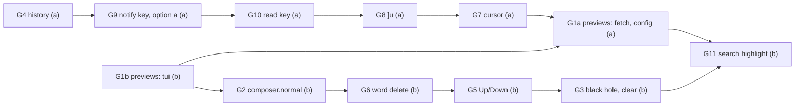

# Owner work G Implementation Plan

> **For agentic workers:** REQUIRED SUB-SKILL: Use superpowers:subagent-driven-development (recommended) or superpowers:executing-plans to implement this plan task-by-task. Steps use checkbox (`- [ ]`) syntax for tracking.

**Goal:** Eleven owner-approved items of owner work G. G1: image previews
in the timeline, off by default, at most `image_rows` rows tall. G2:
`composer.normal`, on `<C-c>` in insert mode. G3: the black hole register
`"_` in the editors and `composer.clear`. G4: a persisted history for the
`:` command line and the `/` search lines. G5: `<Up>` and `<Down>` at the
composer's first and last line. G6: deleting the word before the cursor in
insert mode (`<C-w>`, `<A-BS>`). G7 to G10, the room list with
`sort = "mentions, unread, read"`: the cursor stays on its row when the
open room moves (G7), `]u` opens the topmost unread room (G8), a `notify`
sort key puts the rooms that notify before those whose only news is a dim
count (G9, option (a); the supervisor's choice among three options is
pending, see Task G9), and `read` orders unread rooms by their newest
message (G10). G11: search highlighting in the timeline, with `:noh`.

**Architecture:** G1 is two tasks. Task G1b (slot b) is the tui adapter's
part: the reserved rows, a worker thread that decodes and encodes
previews, a bounded cache, drawing with ratatui-image's `SlicedImage`, the
clearing rules per protocol and the list of wanted previews; it adds the
core's `Msg::PreviewsWanted` and `UiEffect::ShowPreview`/`PreviewFailed`,
and stays invisible because nothing enables previews yet. Task G1a
(slot a) adds the core's fetch queue and `MatrixEffect::FetchPreview`,
`mxt-matrix`'s thumbnail choice, stickers' dimensions, `[ui.timeline]` and
the binary's waker. G2, G5 and G6 are editor and keymap work in `mxt-core`
and `mxt-tui`; G3 adds a per-editor flag on the register handle and a
status message from the editor; G4 keeps the histories in the core and
adds `Effect::Store`, which the binary executes with a writer task and the
file `$XDG_STATE_HOME/mxt/history`. G7 to G10 change `mxt-core::rooms` and
`app/rooms.rs` (G9 under option (a) also the loader's tests in `mxt`).
G11 adds `mxt-core::search` (one matcher for the
search and its highlight) and draws matches in the timeline and the
message view.

**Tech Stack:** Rust 2024; matrix-sdk and matrix-sdk-ui 0.19.1
(`Media::get_media_content`, `MediaFormat::Thumbnail`,
`MediaThumbnailSettings`, `Room::latest_event_timestamp`,
`TimelineItemContent::as_sticker`), ruma-events 0.35.2
(`StickerEventContent`, `StickerMediaSource`), ratatui 0.30 and
ratatui-core 0.1.2 (`CellDiffOption`), ratatui-image 11.1.0 (`SlicedImage`,
`SlicedProtocol`, `Resize`, `Picker`, `Protocol`), image 0.25, the edtui
fork at `1182cb9` (`DeleteChar`, `SwitchMode`, the key handler,
`EditorState::set_highlights`), crossterm 0.29, tokio (`sync::Notify`,
`spawn_blocking`), tracing-appender 0.2.5; matrix-sdk's `MatrixMockServer`
for tests.

## Global Constraints

- The design is `docs/superpowers/specs/2026-11-18-mxt-design.md`. It
  describes the result of all twelve tasks and wins over this plan when
  they disagree. Sections per task: G1 "Images in the timeline" (in "Files
  and images"), "Timeline", "Matrix adapter" (images), "Domain model"
  (`Sticker`), "Configuration", "Layers", "Error handling", "Logging";
  G2, G3, G5, G6 "Terminal adapter and the composer" (the composer
  bullets, "Input routing" and its black hole register), "Default keymap";
  G4 "Line editing" (the history), "Functional core" (`Effect::Store`),
  "Storage", "Error handling", "Logging"; G7 to G10 "Room list", "Matrix
  adapter" (optimistic clearing, the open room sorting as read), "Action
  registry" (`filter`, `pick`), "Default keymap" (`]u`), "Goals"; G11
  "Search and jumps", "Commands", "Help views"; every task "Action
  registry", "Testing" and "Risks" where it is named.
- Library behaviour is checked in the registry sources
  (`~/.cargo/registry/src/*/`, the edtui fork in
  `~/.cargo/git/checkouts/edtui-*/1182cb9`); the design gives file and line
  for each fact a task relies on.
- Everything in the repository is in English. Tests use made-up
  identifiers (`@alice:example.org`, `!room:example.org`,
  `$event:example.org`) and generated images, never real ones.
- `mxt-core` keeps the design's dependency rule: `std` and small pure
  crates without I/O, not the SDK, `ruma`, an async runtime, a terminal
  library, `serde` or `toml`.
- Each task is its own pull request and adds its own `CHANGELOG.md`
  `[Unreleased]` lines, listed in the task (G1b has none: nothing a user
  sees changes until G1a), in Keep a Changelog's section order, keeping
  the lines of earlier tasks, and updates the user documentation
  (`docs/keys.md`, `docs/configuration.md`, `docs/terminal.md`,
  `README.md`) it changes. No release tag: merging is the orchestrator's.
- Slots: worktree b builds only `-p mxt-core` and `-p mxt-tui`; a task
  that touches `mxt` or `mxt-matrix` (configuration loading, matrix calls,
  state files) runs in worktree a, which may build the workspace under the
  heavy-build lock. CI compiles everything for every pull request.
- Tests assert specific lines, cells, positions or properties, not whole
  generated texts that keep growing (the default keymap, `:map`, `:help`).
- Breaking changes (`docs/releasing.md`): none of the twelve tasks is
  breaking, each for the reason in its task; none renames a configuration
  key, table, action or command, none makes a configuration stop loading,
  and none moves stored data. G8 and G10 change what existing values do
  (`pick = "first"` skips the open room and the default `]u` uses it,
  `read` orders unread rooms by their newest message). This is behaviour
  that leaves setups working, as `t` taking the timeline was in 0.1.4
  (owner work F: a `### Changed` line that says how to keep a binding of
  `t`, not `**Breaking:**`). So their lines are `### Changed` lines that
  say what changed and, where there is a way, how to get the old
  behaviour. G9 under option (a) adds a sort key (`### Added`); under (b)
  or (c) it narrows `filter = "unread"` and the `unread` key, a
  `### Changed` line by the same precedent. The supervisor decided this
  on 2026-11-22: the next release is a patch, 0.1.5.

## Order and slots



| Task | Slot | Crates | Runs in parallel with |
|---|---|---|---|
| G4: command line history | a | `mxt-core`, `mxt` | G1b, G2 |
| G9: the `notify` sort key (option (a)) | a | `mxt-core`, `mxt` (tests only); (b) or (c): `mxt-core` | G1b, G2, G6 |
| G10: the `read` key | a | `mxt-core` | G2, G6 |
| G8: `]u` and `pick = "first"` | a | `mxt-core` | G6, G5 |
| G7: the room list cursor | a | `mxt-core` | G5, G3 |
| G1a: previews, fetching and configuration | a | `mxt-core`, `mxt-matrix`, `mxt-tui`, `mxt` | G3 |
| G1b: previews, the tui part | b | `mxt-core`, `mxt-tui` | G4, G9 |
| G2: `composer.normal` | b | `mxt-core`, `mxt-tui` | G4, G9, G10 |
| G6: word delete | b | `mxt-core`, `mxt-tui` | G9, G10, G8 |
| G5: `<Up>`/`<Down>` at the edges | b | `mxt-tui` | G8, G7 |
| G3: black hole register, `composer.clear` | b | `mxt-core`, `mxt-tui` | G7, G1a |
| G11: search highlighting | b | `mxt-core`, `mxt-tui` | nothing of this plan |

- Slot a starts with G4: it is decided and independent of the room list
  items. The room list items follow once the supervisor has chosen G9's
  option (Task G9): G9, then G10 (its news time asks G9's notion of
  unread, and its tests use the owner's sort), then G8 (both change
  `rooms.rs`; under (b) or (c) `resolve_room` uses G9's
  `RoomFilter::matches`), then G7 (its tests use G8's `]u`). Then G1a,
  which starts once G1b is merged. Slot b runs G1b first, since G1a waits
  for it, then G2, G6 (after G2: both add `composer.insert` defaults to
  `keymap.rs` and the same table of `docs/keys.md`), G5, G3 (after G5:
  both change `Editor::feed`; after G6: both use edtui's `DeleteChar` in
  `composer.rs`), and G11 last, once G1a is merged (both change
  `Render::item`'s image and sticker arms in `timeline_view.rs`).
- G1b alone shows nothing (the binary never calls
  `Tui::enable_previews`), so the orchestrator may tag a release between
  G1b and G1a. Every other task stands on its own.
- G1b needs no slot a: its core types are matched only by the core
  (`Msg`) and the tui (`UiEffect`); `MatrixEffect::FetchPreview`, which
  `mxt-matrix` matches exhaustively, waits for G1a. G1a needs slot a
  (`mxt-matrix`, `mxt`). G4 needs slot a: `Effect` gains `Store`, which
  the binary's event loop matches, and the file is `mxt`'s. G9 under
  option (a) needs slot a for the loader's tests in `mxt`; G7, G8, G10
  and G9 under (b) or (c) need no slot a, but slot a has room for them,
  and slot b has G1b's long task.
- Mechanical overlaps, which the second to merge resolves by merging
  `main` and keeping both: `keymap.rs` `DEFAULTS` (G2, G6, G8, G4),
  `action.rs` (G2, G3, G4, G6, G11), `effect.rs` (G1b, G1a, G2, G3, G4,
  G6, G11), `msg.rs` (G1b, G1a, G3, G4), `app.rs` `run` and `update`
  (most tasks), `terminal.rs` `execute` (G1b, G1a, G2, G3, G6),
  `timeline_view.rs` (G1b, G1a, G11), `config/tests.rs` (G9 (a), G1a),
  `docs/keys.md`, `docs/configuration.md` (the Actions table, the sort
  keys) and `CHANGELOG.md`.

## Task G4: Command line history

**Slot a. Crates:** `mxt-core`, `mxt`. Runs first in slot a.
**Files:** a new `crates/mxt-core/src/history.rs` (and `lib.rs`),
`app/command_line.rs`, `action.rs`, `keymap.rs`, `msg.rs`, `effect.rs`,
`app.rs`, the command line tests in `app/tests.rs` (or a new
`app/tests/history.rs`); `crates/mxt/src/history.rs` (new), `paths.rs`,
`startup.rs`, `event_loop.rs`, `main.rs` (module); `docs/keys.md`,
`docs/configuration.md`, `README.md`, `CHANGELOG.md`.
**Breaking:** no. New actions and a new file in the state directory, which
older versions ignore; `<Up>` and `<Down>` did nothing on these lines (the
line editor's table, design "Line editing"), and the `command_line` table
falls back to no table, so the defaults hide no user binding.

Core:

- [ ] `history.rs`: `pub struct History` (a `VecDeque<String>`, at most
  100, oldest first) with `record(&mut self, line: &str)` (an empty line
  is not recorded; an equal line moves to the newest place),
  `lines() -> impl Iterator<Item = &str>` oldest first, and
  `from_lines(Vec<String>)` keeping the last 100 and the newer of
  repeats. `pub struct LineHistories { pub commands: History, pub
  searches: History }`.
- [ ] `action.rs`: `Action::CommandLineHistoryPrev`
  (`command_line.history_prev`) and `CommandLineHistoryNext`
  (`command_line.history_next`), no arguments. `keymap.rs`: `<Up>` and
  `<Down>` in `TableId::CommandLine`.
- [ ] `app/command_line.rs`: `OpenLine::browse: Option<Browse { filter:
  String, typed: String, cursor: usize, at: Option<usize> }>`; the history
  of a line is `commands` for `LineKind::Command` and `searches` for
  `LineKind::Search(_)`. `history_prev` and `history_next` as in the
  design (the filter is the text before the cursor, byte-wise
  `starts_with`; recall with `LineEditor::set_text`; past the newest the
  typed text and cursor come back, which needs a `LineEditor` setter that
  keeps a given cursor). `type_into_line`, `paste_into_line` and
  `complete_line` end the browsing; the history actions end a completion.
  `execute_line` records the line's text in its history before it runs
  the command or the search, and pushes
  `Effect::Store(StoreEffect::SaveHistory { commands, searches })` with
  both histories (oldest first) when the history changed.
- [ ] `msg.rs`: `Msg::HistoryLoaded { commands: Vec<String>, searches:
  Vec<String> }`, applied with `History::from_lines`, no effect.
  `effect.rs`: `Effect::Store(StoreEffect)` with
  `StoreEffect::SaveHistory { commands: Vec<String>, searches:
  Vec<String> }`, documented as executed by the binary.
- [ ] Core tests: `<Up>` with `jo` typed gives the newest line starting
  with `jo`, again the next older one, and none left does nothing;
  `<Up>` on an empty line walks every line, newest first; `<Down>` walks
  back and past the newest restores `jo` with the cursor where it was
  (also mid-line); typing after a recall ends browsing and the next `<Up>`
  filters by the new text; `<Tab>` after a recall completes the recalled
  text; commands and searches are separate, and the room list's and the
  timeline's searches share one; executing a line records it, a repeat
  moves to the newest place, the 101st line drops the oldest, an empty
  line is not recorded, an unknown command is recorded; a cancelled line
  is not; `SaveHistory` follows each recorded line with both histories;
  `HistoryLoaded` with 120 lines and repeats keeps the last 100 without
  repeats; the `SECRET` prompt (`:recover`, then typing a key) records
  `recover` only; a picker's `<Up>` still selects.

`mxt`:

- [ ] `paths.rs`: `Paths::history_file()` (`state/history`).
- [ ] `history.rs`: `load(path) -> LineHistories as two Vec<String>`
  (`info!(target: "mxt::history", ..)` for a missing file, which is
  normal until the first line is executed; `warn!` with the same target
  for an unreadable or non-UTF-8 file, a wrong first line, or a line
  starting with neither `:` nor `/`; any of these gives empty histories);
  `format(commands, searches) -> String`; `write(path, text)` as
  `mxt-matrix`'s `save_session` writes (`crates/mxt-matrix/src/
  session.rs:58-97`): remove a leftover `history.tmp` (`NotFound` is
  fine, another error fails the write), open it with `create_new(true)`
  and `mode(0o600)` (never `create(true).truncate(true)`, which keeps a
  leftover file's mode and follows a symlink), write, `sync_all`, rename
  over `history`, remove `history.tmp` when writing or renaming fails,
  then sync the directory; `Writer::spawn(path, to_core)`: a tokio task
  fed by an unbounded channel that keeps only the newest waiting
  snapshot, writes it with `spawn_blocking`, sends the first failure of
  the run as `Msg::EffectFailed { error: "Saving the command line history
  failed: <reason>" }` on `to_core` and logs its full error at `debug`
  (the event loop's `log_failure` logs the status text at `warn`,
  `crates/mxt/src/event_loop.rs:103-107`), and logs later failures at
  `warn` without sending them; `Writer::finish(self)` closes the channel
  and awaits the task.
- [ ] `startup.rs` (`run_ui`): load the file and feed `Msg::HistoryLoaded`
  after `Msg::ConfigWarnings`; spawn the writer with a clone of
  `to_core`; after the event loop ends, `finish` it within
  `tokio::time::timeout(1 s)`. `event_loop.rs`: `run` takes the writer's
  sender, and `update` routes `Effect::Store` to it.
- [ ] `mxt` tests (`history.rs`): a round trip of commands and searches
  with spaces, CJK and emoji; the file's first line and mode 0600; no
  `history.tmp` left after a write; a leftover `history.tmp` with mode
  0644 is replaced and the file ends 0600; a symlink at `history.tmp`
  pointing to another file in the test directory is removed, not
  followed, and that file keeps its contents; a missing, a non-UTF-8, a
  wrongly headed and a file with a line `x` each give empty histories
  (the log lines are not asserted; logging is global); the writer with a
  directory that cannot be written reports one `EffectFailed` for two
  failures; two snapshots sent before the task runs write the newer one.
- [ ] Docs: `docs/keys.md`, "Line editing" (no longer "without history":
  `<Up>`/`<Down>` recall by the text before the cursor, separate histories
  of 100, kept across starts; pickers and the recovery key prompt have
  none) and the `command_line` row of the default keymap;
  `docs/configuration.md`, the Actions table; `README.md`, "Files" (the
  state directory holds `history`, mode 0600).
- [ ] CHANGELOG `### Added`: "History in the `:` command line and the `/`
  search lines: `<Up>` and `<Down>` (`command_line.history_prev` and
  `command_line.history_next`) recall earlier lines that start with the
  text before the cursor, newest first, and `<Down>` past the newest
  brings back what you typed. Commands and searches keep separate
  histories of 100 lines each in `$XDG_STATE_HOME/mxt/history` (mode
  0600), across starts. `<Up>` and `<Down>` did nothing on these lines
  before."

## Task G9: Rooms that notify (option (a), pending the supervisor's choice)

The owner's report (b): busy bridged channels with dim counts fill the
unread group and come up with `]u`. The read-only observation on the
check device (mxt 0.1.4, `sort = "mentions, unread, read"`, no room
opened): of about 120 unread rooms, 14 notified for every message and 108
had dim counts, 107 of them set to mentions and keywords only and 1
muted; a room that became unread landed at position 68 to 70 of about
118 (G10 fixes that part). The supervisor chooses one option (design,
"Room list", "G9 options"); this task is written for (a), the
supervisor's recommendation, and each other option replaces the steps
marked (a) with those marked (b)/(c):

- **(a)** `unread` keeps meaning every badge; a new sort key `notify`
  puts the rooms that notify first, by the rule of `filter = "notify"`
  (`RoomFilter::Notify`, `crates/mxt-core/src/rooms.rs:164`:
  `notifications > 0 || mentions > 0 || marked`). The owner sets
  `sort = "mentions, notify, unread, read"` and binds `]u` and `[u` to
  `filter = "notify"` in their dotfiles. No change to `unread`, the
  `filter`s or `RoomFilter::matches`; G10's news time applies to the rooms
  unread by the `unread` notion, unchanged.
- **(b)** A room whose mode is `Mute` or `MentionsAndKeywords` counts as
  unread for the `unread` key, `filter = "unread"` (the picker's too),
  `]u` and `[u` only with unread mentions or the manual mark. No new key.
- **(c)** The same for `Mute` alone, as first written.

**Slot a. Crates:** (a) `mxt-core`, and `mxt` for the loader's tests;
(b)/(c) `mxt-core`. Starts after G4, once the supervisor has chosen.
**Files:** (a) `crates/mxt-core/src/rooms.rs`,
`app/tests/room_actions.rs`, `crates/mxt/src/config/tests.rs`;
(b)/(c) `crates/mxt-core/src/rooms.rs`, `app/picker.rs` (the filter at
`:239`), `app/tests/room_actions.rs` and the picker tests in
`app/tests.rs`, `README.md`; both `docs/configuration.md`,
`docs/keys.md`, `CHANGELOG.md`.
**Breaking:** no. (a): a new sort key; mxt 0.1.4 skips an unknown key with
a warning and applies the others (`crates/mxt/src/config.rs:349-371`), so
`"mentions, notify, unread, read"` sorts there as `"mentions, unread,
read"`. (b)/(c): no name changes and every configuration loads; a binding
with `filter = "unread"` and the `unread` key pass over the narrowed
rooms whose only unread state is their message count, behaviour as `t`
taking the timeline was in F (Global Constraints); the badge is
unchanged.

Steps (a):

- [ ] `rooms.rs`: `SortKey::Notify`, `config_name` `"notify"`, between
  `Mentions` and `Unread` in the enum and in `SortKey::ALL`, so the
  loader's list of expected names reads `"mentions", "notify", "unread",
  "recent", "read", "name"`; `compare` gives it
  `has(b, RoomFilter::Notify).cmp(&has(a, RoomFilter::Notify))`, so the
  open room has nothing for it, as for `Mentions` and `Unread`. Doc
  comments: `SortKey::Notify` (rooms that notify first, by the rule of
  `filter = "notify"`), `SortKey::compare`'s note on the open room, and
  `RoomFilter::Notify` (the key uses it). The loader parses with
  `SortKey::ALL`, so `crates/mxt/src/config.rs` does not change.
- [ ] Tests in `rooms.rs`: `SortKey::ALL` and `config_name` include
  `notify`; under `"mentions, notify, unread, read"`, a room with a
  mention first, then rooms with `notifications: 2` or `marked` (and no
  mention), then a room with `messages: 5` alone, then a read room, each
  group by G10's order once G10 lands (here by `last_read`); the open room
  with `notifications: 2` sorts among the read rooms; an upsert that gives
  the room with `messages: 5` a notification moves it into the second
  group; `RoomFilter::Unread` still matches a muted room with
  `messages: 5` (nothing narrowed). In the app tests: with that sort and a
  user binding `"]u" = { action = "room.open", filter = "notify" }`, `]u`
  passes over the room with the dim count.
- [ ] `crates/mxt/src/config/tests.rs`: `room_list_sort_is_a_list_of_keys`
  gains `("notify", Notify)` among the single keys and
  `"mentions, notify, unread, read"` as a list, and its `unknown` text
  lists `"notify"` after `"mentions"`.
- [ ] Docs: `docs/configuration.md`, the example's comment (line 27) and
  the [sort keys](#sort-keys) table gain `"notify"` (rooms that notify
  you: unread mentions, bold counts, the manual unread mark, the rooms
  that `filter = "notify"` takes; not the rooms whose only news is a dim
  count, such as muted rooms and rooms set to mentions and keywords
  only), and the paragraph under the table gives
  `sort = "mentions, notify, unread, read"` with
  `"]u" = { action = "room.open", filter = "notify" }` and
  `"[u" = { action = "room.open", filter = "notify", pick = "prev" }` as
  the setup that keeps busy rooms with dim counts behind the rooms that
  notify, and says that 0.1.4 skips `notify` with a warning and sorts by
  the other keys; `docs/keys.md`, the `]u` row's note: `]u` and `[u` count
  every badge, dim counts included, and the binding above skips them.
- [ ] CHANGELOG `### Added`: "The `notify` sort key for
  `ui.room_list.sort` puts the rooms that notify you first: unread
  mentions, bold counts and rooms marked unread, the rooms that
  `filter = "notify"` takes. With `sort = "mentions, notify, unread,
  read"`, rooms whose only news is a dim count (muted rooms, rooms set to
  mentions and keywords only) come after them, and
  `"]u" = { action = "room.open", filter = "notify" }` in
  `[keymap.normal]` jumps between the rooms that notify only. mxt 0.1.4
  skips `notify` with a warning and sorts by the other keys."

Steps (b)/(c), in place of the steps (a):

- [ ] `rooms.rs`: `RoomFilter::matches(self, room: &RoomSummary) -> bool`
  in place of `matches(&UnreadCounts)`, with `let counts = &room.unread;`.
  The rule is one match arm on the mode in `Unread`:

  ```rust
  RoomFilter::Unread => match room.mode {
      // (b); for (c) the pattern is `NotificationMode::Mute` alone.
      NotificationMode::Mute | NotificationMode::MentionsAndKeywords => {
          counts.mentions > 0 || counts.marked
      }
      _ => {
          counts.messages > 0
              || counts.notifications > 0
              || counts.mentions > 0
              || counts.marked
      }
  },
  ```

  `All`, `Notify` and `Mentions` ignore the mode. Every caller passes the
  summary: `SortKey::compare`'s `has`, `resolve_room` (`Pick` and
  `Fuzzy`), `app/picker.rs:239`. Update the doc comments (`RoomFilter`,
  `SortKey::Unread`). No `SortKey::Notify`; `mxt` does not change.
- [ ] Tests in `rooms.rs`: a room in a narrowed mode with `messages: 5`
  alone does not match `Unread`, with `mentions: 1` or `marked` it does;
  a `Default` room with `messages: 5` does; (b) asserts
  `MentionsAndKeywords` narrowed, (c) asserts it unchanged; `Notify`,
  `Mentions` and `All` give the same answers in every mode for equal
  counts; under `sort = "mentions, unread, read"` a narrowed room with
  messages only sorts among the read rooms, one with a mention among the
  mentions; `resolve_room` with `filter = Unread` and `Pick::Next` skips
  the narrowed room with messages only. `Badge::from_counts` of that room
  is still `Messages(5)` (one assertion). In the app tests: `]u` passes
  over it, and `picker.rooms` with `filter = "unread"` does not list it.
- [ ] Docs: `docs/configuration.md`, the `"unread"` row of the sort keys
  and the `filter` values of `room.open` (`unread`: a room muted [(b): or
  set to mentions and keywords only] only with unread mentions or the
  manual mark); `docs/keys.md`, "The screen" (such a room keeps its dim
  count and is skipped by `]u`, `[u` and the unread order unless it has
  mentions or the mark); `README.md`, the feature line about unread
  messages in muted rooms (still shown, not jumped to).
- [ ] CHANGELOG `### Changed`: "A room that is muted [(b): or set to
  mentions and keywords only] counts as unread for `filter = "unread"`,
  the `unread` sort key, `]u` and `[u` only with unread mentions or the
  manual unread mark, so busy rooms whose messages do not notify you no
  longer fill the unread group or come up with `]u`; its dim count of
  unread messages stays in the room list. `filter = "notify"`,
  `"mentions"` and `"all"` are unchanged."

## Task G10: The `read` key orders unread rooms by their newest message

**Slot a. Crates:** `mxt-core`. Starts after G9 is merged.
**Files:** `crates/mxt-core/src/rooms.rs`, `app/tests/room_actions.rs`;
`docs/configuration.md`, `CHANGELOG.md`.
**Breaking:** no. `read` keeps its name and its order for read rooms;
unread rooms now go by their newest message, which changes the order, not
a setup.

- [ ] `rooms.rs`: a private `fn news_time(room: &RoomSummary, open:
  Option<&RoomId>) -> Option<Timestamp>`: for the open room the later of
  `last_read` and `latest_activity` (`Option::max`, `None` below `Some`);
  for a room that `RoomFilter::Unread` matches, the `unread` notion (under
  G9's option (a) every badge, unchanged, `matches(&room.unread)`; under
  (b) or (c) G9's narrowed rule, `matches(room)`),
  `latest_activity.or(last_read)`; otherwise `last_read`.
  `SortKey::Read` compares `news_time(b).cmp(&news_time(a))`, so the
  newest first and rooms without a time last. Doc comments of `SortKey`
  and `RoomList::open` follow the design ("Room list", "The open room
  sorts as read").
- [ ] `RoomList::clear_unread` also sets `last_read` to
  `last_read.max(latest_activity)` before placing the room again.
- [ ] `RoomList::upsert` keeps `last_read` at the later of the stored
  room's and the update's (receipts only move forward; design, "Optimistic
  clearing").
- [ ] Tests in `rooms.rs`: with `read` alone, an unread room (messages)
  by its `latest_activity` among read rooms by `last_read`, newest first;
  an unread room without `latest_activity` by its `last_read`; a read room
  without `last_read` last; under `"mentions, unread, read"`, three unread
  rooms ordered by `latest_activity`, and an upsert that makes a fourth
  room unread with the newest activity puts it at the top of the unread
  group (the observation the orchestrator repeats); under option (a),
  with `"mentions, notify, unread, read"`, a fourth room that becomes
  unread with a notification goes to the top of the second group and one
  with a dim count to the top of the third; the open room under `read`
  placed by the later of its `last_read` and `latest_activity`;
  `clear_unread` on a room with an old `last_read` moves it to the top of
  the read rooms; an upsert with an older `last_read` than the stored one
  keeps the stored one, and one with a newer replaces it. In the app
  tests: `room.mark_read` from the room list moves that room to the top of
  the read group at once.
- [ ] Docs: `docs/configuration.md`, the `"read"` row of the sort keys
  (unread rooms by their newest message, the others by your last read;
  the open room counts as read up to its newest message) and the
  paragraph under the table (`"mentions, unread, read"`: a room that gets
  a new message goes to the top of its group; what `read` alone means;
  a room you read takes its place at once and keeps it until the receipt
  comes back).
- [ ] CHANGELOG `### Changed`: "The `read` sort key orders unread rooms by
  the time of their newest message and the other rooms by your last read,
  newest first, so with `sort = "mentions, unread, read"` (or
  `"mentions, notify, unread, read"`) a room that gets a new message goes
  to the top of its group; before, unread rooms went by your last read
  too, and a room unread after days of silence sat low in its group. The
  room you have open counts as read up to its newest message, and a room
  you read takes its place among the read rooms at once instead of
  waiting for the homeserver to confirm the receipt."

## Task G8: `]u` opens the topmost unread room

**Slot a. Crates:** `mxt-core`. Starts after G10 is merged.
**Files:** `crates/mxt-core/src/rooms.rs` (`resolve_room`), `keymap.rs`
(`UNREAD_NEXT`), `action.rs` (doc comments), the keymap tests,
`app/tests/room_actions.rs`, the `:map` test in `app/tests.rs`;
`docs/keys.md`, `docs/configuration.md`, `README.md`, `CHANGELOG.md`.
**Breaking:** no. `]u`'s action and `pick`'s values keep their names and
every configuration loads. `pick = "first"` now skips the open room,
which before could only move the focus to its timeline, and the default
`]u` changes from `pick = "next"` to `pick = "first"`: behaviour of a
default and of a value, which `docs/releasing.md` lists among patch
changes ("changes to defaults or behaviour that leave existing setups
working"). A user's own `]u` binding is unaffected.

- [ ] `rooms.rs`: `resolve_room`, `Pick::First`: the first room that
  passes the filter and is not `current`; its doc comment says so.
  `Pick::Next` and `Pick::Prev` are unchanged.
- [ ] `keymap.rs`: the constant becomes `UNREAD_FIRST` with
  `pick: Pick::First`; `]u` binds it, `[u` keeps `UNREAD_PREV`. The
  comment names the design.
- [ ] Tests: `resolve_room` with `Pick::First` returns the second match
  when the first is `current`, the first otherwise, and `None` when the
  open room is the only match; the default `]u` with the cursor's room
  below a room that just got a mention opens that room (with `sort =
  "mentions, unread, read"`), and with the open room the only unread room
  says "No matching room"; with the terminal unfocused (no receipt goes
  out) and two unread rooms A above B, `]u` opens A, `]u` opens B, and
  `]u` opens A again; `[u` still goes backwards with wrapping; `:map`
  lists `]u -> room.open (filter = "unread")`.
- [ ] Docs: `docs/keys.md`, the `normal` table's `]u` row (the topmost
  unread room other than the open one) and `[u` (`pick = "prev"`), and a
  sentence under the table: a room you open but have not read yet (the
  terminal has no focus, or you press `]u` again before its timeline is
  drawn) is still unread, so `]u` pressed again goes back and forth
  between the two topmost unread rooms; `docs/configuration.md`, the
  `pick` values (`"first"` skips the open room); `README.md`, the feature
  line about `]u`.
- [ ] CHANGELOG `### Changed`: "`]u` opens the topmost unread room in the
  room list's order other than the one you have open, so a room with a new
  mention at the top comes first; it used to open the next unread room
  after the open one, which `"]u" = { action = "room.open", filter =
  "unread", pick = "next" }` in `[keymap.normal]` brings back. A room you
  opened but have not read yet stays unread, so `]u` pressed again goes
  back and forth between the two topmost unread rooms. `pick = "first"`
  of `room.open` now skips the open room (it only moved the focus to the
  timeline before), and `]u` is `{ action = "room.open", filter =
  "unread" }`. `[u` is unchanged."

## Task G7: The room list cursor stays on its row

**Slot a. Crates:** `mxt-core`. Starts after G8 is merged.
**Files:** `crates/mxt-core/src/rooms.rs` (`upsert`'s result),
`app/rooms.rs` (`open_at`, `upsert_room`, `clear_room_unread`, `follow`),
`app/tests/room_actions.rs`; `docs/keys.md`, `CHANGELOG.md`.
**Breaking:** no: where the cursor rests is behaviour.

- [ ] `rooms.rs`: `RoomList::upsert` returns a small struct with `old`,
  `new` and `read_only`: whether the stored room and the update differ
  only in `unread` and `last_read` (false for a new room), compared as the
  two summaries with those two fields set equal. Callers updated.
- [ ] `app/rooms.rs`: `open_at` remembers whether `room_cursor` was
  `Some(index)` before `self.rooms.open(&id)`; if so the cursor stays at
  `index` (at most the last index), otherwise it goes to the opened room's
  new index as now. `clear_room_unread` on the open room with the cursor
  on it keeps the cursor's index; elsewhere `follow` as now.
  `upsert_room` of the open room with the cursor on it and `read_only`
  keeps the cursor's index; every other upsert uses `follow`. Doc
  comments name the design's rule ("Room list").
- [ ] Tests in `app/tests/room_actions.rs`, with `sort = "mentions, unread,
  read"` and four rooms: `<CR>` on the unread room at row 0 opens it, the
  room moves among the read rooms, and the cursor is on row 0, now the
  next unread room; `]u` from the timeline with the room list's cursor on
  the topmost unread room keeps the cursor on that row; the room picker
  and `:open` opening the room under the cursor do the same; `]u` opening
  a room while the cursor is on another room puts the cursor on the
  opened room's new place; a receipt's optimistic clearing and
  `room.mark_read` of the open room with the cursor on it keep the row; an
  upsert of the open room with a newer `last_read`, cleared counts and the
  same `latest_activity` keeps the row, while one with newer activity
  (under `recent`), one that renames it (under `name`) and one that
  changes its mode take the cursor along; an upsert of another room under
  the cursor takes it along, and one passing the cursor shifts its index,
  as before; opening the last room keeps the cursor within the list; with
  the terminal unfocused, opening A from row 0 and then B, which moved
  into row 0, puts A, still unread and no longer open, back at row 0
  under the cursor, where `<CR>` opens it again (the documented case).
- [ ] Docs: `docs/keys.md`, "The screen": after you open a room, the room
  list's cursor stays where that room was, on the room that took its
  place, so `<CR>` opens the next one; when other rooms move, the cursor
  stays on its room; a room you left unread (the terminal had no focus)
  goes back to its place among the unread rooms and can be the one under
  the cursor again.
- [ ] CHANGELOG `### Changed`: "When the room you open moves in the room
  list (it sorts as read while open), the room list's cursor stays on its
  row, on the room that took its place, as in a mail inbox; also when
  `]u`, the picker or `:open` opens the room under the cursor, and when
  the open room moves because you read it. Other moves keep the cursor on
  its room."

## Task G1b: Timeline previews, the tui part

**Slot b. Crates:** `mxt-core`, `mxt-tui`. Runs first in slot b.
**Files:** `crates/mxt-core/src/msg.rs`, `effect.rs`, `app.rs` (the
`Msg::PreviewsWanted` arm); `crates/mxt-tui/src/image_view.rs`, a new
`previews.rs`, `timeline_view.rs`, `view.rs`, `overlay.rs`, `terminal.rs`,
`lib.rs`, and their tests.
**Breaking:** no, and nothing a user sees changes: previews stay off until
G1a enables them. No CHANGELOG line.

Core:

- [ ] `msg.rs`: `Msg::PreviewsWanted { timeline: TimelineId, items:
  Vec<ItemRef> }`, documented as the tui adapter's list (design, "Images
  in the timeline"). `effect.rs`: `UiEffect::ShowPreview { item: ItemRef,
  bytes: MediaBytes }` and `UiEffect::PreviewFailed(ItemRef)`. `app.rs`:
  the core drops `PreviewsWanted` for now; G1a routes it. Nothing sends
  it before G1a, since no preview is enabled.

`mxt-tui`:

- [ ] `lib.rs`: `pub struct ImageRows(u16)` with `new(i64) ->
  Option<ImageRows>` (1 to 50), `Default` 8, `get()`, as `RoomListWidth`.
- [ ] `image_view.rs`: `decode` and `tmux_sixel` become `pub(crate)`;
  `Images::preview_encoder() -> PreviewEncoder` (`Picker(Picker)` or
  `TmuxSixel(FontSize)`), giving a half-block picker where
  `picker.tmux_detected()` and the protocol is `Iterm2` or `Sixel`
  (passthrough: a forced protocol inside tmux, and `auto` over SSH from a
  local tmux, where `TMUX` is unset but `TERM` names tmux; design). The
  view's own path is unchanged.
- [ ] `previews.rs`: `Previews` with the rows, the encoder, a job sender
  and a result receiver for one worker thread (`std::thread::Builder`,
  name `mxt-previews`), the kept previews, the cache's `Limits { count,
  bytes }` (`Limits::DEFAULT` 64 and 64 MiB; a field, so tests pass
  smaller ones), the failed items (cleared when the shown timeline
  changes), the targets (item to reserved size and whether it came from
  dimensions), the last reported list, and the tmux sixel placements on
  the screen. The cache drops the least recently drawn previews past a
  limit but never a target. `fn reserve(dimensions:
  Option<(u32, u32)>, width: u16, rows: ImageRows, cell: FontSize) ->
  Size` per the design (ratatui-image's `Fit` arithmetic, which is
  private there: write it as `fit` and `cells` with a reference to
  `src/lib.rs:526-575`). `fn estimate(size: Size, cell: FontSize) ->
  usize`: the reserved pixels times 8 (4 bytes each for the scaled image
  and for the encoding), for targets not kept yet. `fn prepare(job: Job)
  -> Done`, a plain function
  the worker loops over: `decode(bytes, w, h)` with the target's pixels,
  `Resize::Scale` (with dimensions) or `Resize::Fit` (without) and
  `FilterType::Triangle`, `size_for` and `resize` to whole cells, then
  `SlicedProtocol::new_with_resize(&picker, image, size, Resize::Fit(None))`
  for a picker, or `tmux_sixel(..)` for tmux's sixel; a decoding or
  encoding error is `Done::Failed(item)`. After each result the worker
  calls the waker. `show(item, bytes)` drops bytes of an item without a
  target, else queues a job; `fail(item)`; `take_done()` moves results
  into the cache and marks failures; a kept preview whose size or cell
  size differs from its target is queued for encoding again from its
  scaled image (the scaled image is kept with the encoding).
- [ ] `timeline_view.rs`: `Render` gets `previews: Option<PreviewLayout>`
  (rows, cell size, failed set). `Render::item` adds the reserved blank
  rows after the `[image: …]` line of an `Image` item, a remote one or a
  local echo, unless it failed; `rows` leaves the preview out when the
  item with it would be taller than the pane. `Window` keeps, per entry,
  the preview's row offset, size and item. `TimelinePane::draw` takes
  `previews: Option<&mut Previews>` and `covered: &[Rect]`: for each
  window entry with a kept preview whose rows reach the pane and whose
  area meets no covered rectangle, it renders `SlicedImage::new(&sliced,
  SignedPosition { x: 0, y: top })` into the entries area (x offset 2,
  the item's text width), or `Image` for tmux's sixel only while all its
  rows are on the pane, records the placements, and touches the cache.
  For tmux's sixel it first compares this frame's placements with those
  on the screen: when one on the screen is missing, it draws no tmux
  sixel preview in this frame and reports that a second draw is needed.
  Then it lays out the targets (design, "Fetching": the remote `Image`
  items with a row on the pane, all of them, then those within as many
  entries again each way, at least 5, by distance, below first, while
  the kept sizes and the estimates of the others stay within the cache's
  limits) and the wanted list (the targets without a kept, queued or
  failed preview, in that order), and returns the list when it differs
  from the last report, with the shown `TimelineId`.
- [ ] `overlay.rs`: `fn mention_menu_area(composer, bounds, len) ->
  Option<Rect>` and `fn picker_area(bounds) -> Rect`, used by the draw
  functions and by `view::draw`, which computes the open overlays' areas
  before it draws the timeline and passes them as `covered`.
- [ ] `terminal.rs`: `Tui::enable_previews(&mut self, rows: ImageRows,
  wake: Box<dyn Fn() + Send>)`, a no-op without `images`; `draw` takes
  the finished previews before drawing, passes `previews` to the panes,
  returns `Msg::PreviewsWanted` when the frame has a new list, and when
  the pane reported that a tmux sixel placement went, runs `repaint`
  (the screen cleared, no placements on it) and draws the frame a second
  time, now with the tmux sixel previews, so each is sent once;
  `execute` passes `ShowPreview` and `PreviewFailed` to `Previews`;
  `handle_event`'s resize gives `Previews` the new cell size after
  `Images::resized`.
- [ ] Tests: `reserve` for 4000 by 3000 at 60 columns, 8 rows, 10 by 20
  pixels (8 rows, 22 columns: `fit` gives 213 by 160 pixels), 100 by 50
  (3 rows, 10 columns), 3000 by 100 (1 row, 60 columns), no dimensions (8
  rows, 60 columns); `render`
  of an image item reserves those rows below its line, a failed one has
  only its line, a local echo reserves them too, and on a pane of 6 rows
  an 8-row preview is left out; `prepare` of a generated 64 by 32 PNG
  with a half-block picker gives a sliced protocol of the reserved size,
  of a truncated PNG `Failed`; the wanted list on a timeline of 30
  messages with images at 5, 12 and 25 and the pane on 10 to 15 lists 12,
  then 5 (within the margin), not 25, and not 12 once kept or failed; a
  second frame with the same pane reports nothing; with `Limits { count:
  4, .. }` and a timeline of 20 image messages, 2 of them on the pane,
  the targets are those 2 and the 2 nearest in the margin (below first),
  and once all 4 are kept an idle frame reports nothing new and the cache
  still holds all 4; with a byte limit that fits 3 estimates, the margin
  stops after one; a scroll that leaves a kept preview out of the targets
  lets the cache drop it past the limit; drawing with a
  half-block picker into `TestBackend` puts `▀` cells in the reserved
  rows at column 2, and with the image two rows above the pane only its
  visible rows; a tmux sixel encoder leaves a partly visible preview's
  rows blank; after a scroll that moved a fully visible one, the first
  draw leaves its cells without the image and asks for the second draw,
  and the second draw draws it at its new place; a frame that only adds a
  placement draws it at once without a second draw; a preview under the
  mention menu's area is not drawn; the cache drops the least recently
  drawn preview that is not a target past 64 entries or 64 MiB.

## Task G1a: Timeline previews, fetching and configuration

**Slot a. Crates:** `mxt-core`, `mxt-matrix`, `mxt-tui`, `mxt`. Starts
after G1b is merged.
**Files:** `crates/mxt-core/src/msg.rs`, `effect.rs`, `timeline.rs`
(`Sticker`), `app.rs`, `app/timeline.rs` (the queue, `view_message`),
`app/rooms.rs` (`open_at`, `remove_room`), a new `app/tests/previews.rs`
and the tests that build `MessageContent::Sticker`;
`crates/mxt-matrix/src/media.rs`, `timeline.rs`, `adapter.rs`, a new
`adapter/tests/previews.rs`; `crates/mxt-tui/src/timeline_view.rs`,
`previews.rs` (stickers), their tests; `crates/mxt/src/config.rs`,
`config/dto.rs`, `config/tests.rs`, `startup.rs`, `event_loop.rs`;
`docs/configuration.md`, `docs/terminal.md`, `docs/keys.md`, `README.md`,
`CHANGELOG.md`.
**Breaking:** no. `ui.timeline` is a new table, off by default; mxt 0.1.4
reads it as an unknown table, a warning, so a shared configuration can
carry it. Nothing existing changes meaning; `<CR>` on a sticker showing
its image is new behaviour.

Core:

- [ ] `msg.rs`: `Msg::PreviewFetched { room: RoomId, item: ItemRef,
  bytes: MediaBytes }` and `Msg::PreviewFailed { room, item }`.
  `effect.rs`: `MatrixEffect::FetchPreview { room: RoomId, item: ItemRef
  }`.
- [ ] `timeline.rs`: `MessageContent::Sticker { body, dimensions:
  Option<(u32, u32)> }`.
- [ ] `app/timeline.rs` (or a new `app/previews.rs`): `PreviewQueue {
  room, wanted: Vec<ItemRef>, in_flight: Vec<ItemRef> }` on `App`.
  `PreviewsWanted` for the shown timeline replaces `wanted` (remote items
  only) and starts fetches up to 4 in flight; `PreviewFetched` and
  `PreviewFailed` for the open room remove the item from `in_flight`, push
  `ShowPreview` or `PreviewFailed`, and start the next; for another room
  they are dropped. `open_at` (another room) and `remove_room` (the open
  room) drop the queue. `view_message` shows a remote sticker as
  `ViewContent::Image { name: body, size: None, dimensions }` and fetches
  it as an image, refusing a local echo as images are.
- [ ] Core tests (`app/tests/previews.rs`): a list of six items gives four
  `FetchPreview` in order, an answer starts the fifth, a newer list
  without the sixth never fetches it; answers become `ShowPreview` and
  `PreviewFailed`; an answer for another room or after opening another
  room gives nothing; a list for a thread that is not shown is dropped; a
  local echo in the list is not fetched; `<CR>` on a sticker opens an
  image view and fetches it.

`mxt-matrix`:

- [ ] `timeline.rs`: the sticker conversion fills `dimensions` from
  `sticker.content().info` (`width`, `height`); `preview_media(timeline,
  item) -> Result<Option<(Option<ImageInfo>, MediaSource)>, Error>` for an
  image message (`MessageType::Image`: `info`, `source`) and a sticker
  (`as_sticker()`, `info`, `source.into()`); `fetch_image` uses it for
  stickers too.
- [ ] `media.rs`: `fetch_preview(client, timeline, item)`: the design's
  order (the event's thumbnail unless above 10 MiB; for a plain source the
  server's thumbnail with `MediaThumbnailSettings::new(uint!(640),
  uint!(480))`, which takes `UInt`s (`matrix_sdk::ruma::uint`;
  matrix-sdk-base `media/mod.rs:99`), and the file if that fails; for an
  encrypted source the file; the 10 MiB rule for files), every request
  through `get_media_content(.., true)`;
  answers `PreviewFetched`, or `PreviewFailed` for anything else, the
  error logged at `debug`.
- [ ] `adapter.rs`: `FetchPreview` spawned as `FetchImage` is, with the
  item's timeline from `ItemTimelines::of(..).holding(..)`, its errors
  answered as `PreviewFailed`, never `EffectFailed`.
- [ ] Tests against `MatrixMockServer` (`adapter/tests/previews.rs`): an
  image with a plain thumbnail fetches the thumbnail and not the file
  (one `mock_authed_media_download` request, whose path, read from the
  mock server's received requests, names the thumbnail's media ID); an
  encrypted image with an encrypted thumbnail decrypts the
  thumbnail; a plain image without a thumbnail requests
  `mock_authed_media_thumbnail(Method::Scale, 640, 480, false)` once; when
  that answers 404, the file is fetched; an encrypted image without a
  thumbnail downloads and decrypts the file; an image whose info says
  11 MiB, without a thumbnail: encrypted, it answers `PreviewFailed` with
  no request; plain, it makes exactly one request, for the server's
  thumbnail, and when that answers 404 it answers `PreviewFailed` without
  downloading the file (no `mock_authed_media_download` request); a
  sticker's source is fetched; a text message answers `PreviewFailed`.
  Encrypted media: `Client::upload_encrypted_file` (matrix-sdk
  `encryption/mod.rs:613`; `AttachmentEncryptor` itself is not
  re-exported) against `mock_upload` (`test_utils/mocks/mod.rs:628`)
  gives the `EncryptedFile`, and the uploaded ciphertext, read from the
  mock server's received requests (`wiremock`, already a dev-dependency),
  is served by `mock_authed_media_download`.

`mxt-tui`:

- [ ] `timeline_view.rs` and `previews.rs`: `Sticker` items reserve rows
  and are wanted as images are; the test helpers build `Sticker` with
  `dimensions`.

`mxt`:

- [ ] `config/dto.rs`: `Ui::timeline: Timeline { images:
  Option<Spanned<String>>, image_rows: Option<Spanned<i64>> }` and
  `TIMELINE_IMAGES` (`"off"`, `"on"`); `config.rs`: the loader's schema
  (`Node::Timeline`), `images` through `choice` (an unknown value warns
  and `"off"` applies), `image_rows` through `ImageRows::new` (outside 1
  to 50 an error, `ui.timeline.image_rows: must be from 1 to 50`), and
  `Config::timeline_images: Option<ImageRows>`, `Some` only with
  `images = "on"`.
- [ ] `startup.rs`: with `timeline_images` set and `image_preview` not
  `Off`, create an `Arc<tokio::sync::Notify>`, call
  `tui.enable_previews(rows, Box::new(move || notify.notify_one()))`, and
  pass the `Notify` to `event_loop::run`, whose `select!` gains `() =
  notify.notified() => {}`.
- [ ] `config/tests.rs`: `images = "on"` with `image_rows = 12`; the
  default; `images = "yes"` a warning at its value with the expected
  values, previews off; `image_rows = 0` and `51` errors with line and
  column; `image_rows = "8"` the wrong-type error;
  `every_key_and_table_loads_without_warnings` sets both.

Docs and CHANGELOG:

- [ ] `docs/configuration.md`: the example and the `[ui]` table gain
  `timeline`, with its own table of `images` and `image_rows`, and the
  sentence that 0.1.4 ignores the table with a warning;
  `docs/terminal.md`, "Images": images appear in the message view and,
  with `ui.timeline.images = "on"`, in the timeline: the protocol is the
  same (half blocks where iTerm2 or sixel would go through tmux's
  passthrough: a forced protocol inside tmux, or `auto` over SSH from a
  local tmux), what
  scrolling costs per protocol (iTerm2 the most), previews only on or
  near the screen, thumbnails first, decoded in the background, a failed
  one shows its line, tmux redraws the screen when a sixel preview moves;
  `docs/keys.md`, "The screen" (the preview under an image's line;
  `<CR>` on a sticker); `README.md`, the features list.
- [ ] CHANGELOG `### Added`: "Images in the timeline: with
  `[ui.timeline] images = "on"` (off by default), image messages and
  stickers show a preview under their line, at most `image_rows` rows tall
  (8 by default), in the graphics protocol the message view uses. mxt
  reserves the rows from the image's dimensions before it loads, so the
  timeline does not jump, fetches only the images on or near the screen,
  prefers thumbnails, decodes them in the background and keeps a bounded
  number in memory. `ui.image_preview = "off"` turns previews off too.
  `<CR>` on a sticker shows its image. mxt 0.1.4 ignores `ui.timeline`
  with a warning."

## Task G2: `composer.normal`

**Slot b. Crates:** `mxt-core`, `mxt-tui`. After G1b in slot b.
**Files:** `crates/mxt-core/src/action.rs`, `keymap.rs`, `effect.rs`,
`app.rs` (`run`), `app/composer.rs`, `app/tests/composer.rs`, the keymap
tests; `crates/mxt-tui/src/editor.rs`, `composer.rs`, `terminal.rs` and
their tests; `docs/keys.md`, `docs/configuration.md`, `CHANGELOG.md`.
**Breaking:** no. A new action, and a new default `<C-c>` in
`composer.insert`, where the key did nothing (edtui's vim keys do not
bind it in insert mode, and its insert mode inserts no ctrl characters;
edtui `src/events/key.rs:139-837, 1098-1158`). `composer.insert` falls
back to no table, so the default hides no user binding: one in
`[keymap.composer.insert]` replaces it, and `"<C-c>" = "nop"` keeps the
old behaviour, which the CHANGELOG line says. (The task's worry that a
`composer.insert` default could hide a `normal` binding does not apply:
that table never looks in `normal`.)

- [ ] `action.rs`: `Action::ComposerNormal` (`composer.normal`).
  `keymap.rs`: `<C-c>` in `TableId::ComposerInsert`. `effect.rs`:
  `UiEffect::ComposerNormal(TimelineId)`.
- [ ] `app/composer.rs`: `composer_normal`: `composer_effect` with
  `ComposerNormal`, the mention menu closed, and `self.editor =
  Some(EditorMode::Normal)` while the composer has focus.
- [ ] `editor.rs`: `Editor::to_normal()`: `cancel_pending`, then in
  insert, visual or search mode `self.keys.on_key_event(<Esc>)` (edtui's
  own path); nothing in normal mode. `composer.rs`: `Composer::to_normal
  (&mut self, msgs)` calls it and reports. `terminal.rs`: dispatches
  `ComposerNormal`.
- [ ] Tests: core: `<C-c>` with the editor in insert mode gives
  `ComposerNormal(main)`, in normal mode still `composer.cancel`; a user
  binding `"<CR>" = ["composer.send", "composer.normal"]` in
  `composer.insert` gives `[RequestSubmit(main), ComposerNormal(main)]`
  in that order, and a key resolved afresh in the same batch is resolved
  in `composer.normal`. tui: insert mode with `hello` and the cursor at
  the end, `to_normal` leaves normal mode on `o`, and `.` after it
  repeats the insert; visual mode becomes normal without a selection;
  search mode stops the search; normal mode is unchanged; executing
  `RequestSubmit`, `ComposerNormal` and then `ClearComposer` for a
  non-blank text answers `Submit` with the text and leaves an empty
  composer in normal mode, and for a blank text (`"  "`) leaves the text
  in normal mode.
- [ ] Docs: `docs/keys.md`, the composer table (`<C-c>` in insert mode:
  normal mode, as vim's `<C-c>`) and "The editors" (with the example
  `"<CR>" = ["composer.send", "composer.normal"]` in
  `[keymap.composer.insert]` to stay in normal mode after sending);
  `docs/configuration.md`, the Actions table.
- [ ] CHANGELOG `### Added`: "`composer.normal` puts the composer's editor
  in normal mode, and `<C-c>` in insert mode runs it, as vim's
  insert-mode `<C-c>` does; `<C-c>` in normal mode still ends a reply or
  an edit. With `"<CR>" = ["composer.send", "composer.normal"]` in
  `[keymap.composer.insert]`, the editor is in normal mode after sending,
  also when nothing was sent. `<C-c>` did nothing in insert mode before;
  `"<C-c>" = "nop"` in `[keymap.composer.insert]` keeps that."

## Task G6: Deleting the word before the cursor

**Slot b. Crates:** `mxt-core`, `mxt-tui`. After G2 in slot b.
**Files:** `crates/mxt-core/src/line.rs` (`word_start` public),
`action.rs`, `keymap.rs`, `effect.rs`, `app.rs`, `app/tests/composer.rs`;
`crates/mxt-tui/src/composer.rs`, `terminal.rs` and their tests;
`docs/keys.md`, `docs/configuration.md`, `CHANGELOG.md`.
**Breaking:** no. A new action, and new defaults `<C-w>` and `<A-BS>` in
`composer.insert`, where both did nothing (as `<C-c>` in G2), so no user
binding is hidden; `<C-w>` as the window prefix is a `normal` key, which
the composer's insert mode never reaches.

- [ ] `line.rs`: `pub fn word_start(text: &str, at: usize) -> usize`, its
  doc comment saying the composer uses it too.
- [ ] `action.rs`: `Action::ComposerDeleteWordBefore`
  (`composer.delete_word_before`); `keymap.rs`: `<C-w>` and `<A-BS>` in
  `TableId::ComposerInsert`; `effect.rs`:
  `UiEffect::DeleteWordBefore(TimelineId)`; `app.rs` runs it with
  `composer_effect`.
- [ ] `composer.rs`: `Composer::delete_word_before(&mut self, msgs)`: in
  insert mode, with `col` the cursor's column clamped to the line: at
  column 0 of a later line `DeleteChar(1)` (joins), at the start of the
  text nothing, otherwise the line's characters before `col` as a
  `String`, `word_start(&text, text.len())`, and `DeleteChar(n)` with the
  number of characters from there; then report. Other modes: nothing.
- [ ] Tests: core: `<C-w>` and `<A-BS>` in insert mode give
  `DeleteWordBefore(main)`; in normal mode `<C-w>h` still focuses the
  room list. tui, each from insert mode with the cursor at the end:
  `foo bar` gives `foo `, `foo bar  ` gives `foo `, `open foo.bar` gives
  `open foo.`, `日本語のテキスト` gives `日本語の`, `hi 👍🏽` gives `hi `;
  the cursor at column 0 of the second line joins the lines; at the start
  of the text nothing changes; `<Esc>` then `u` restores the deleted word;
  the shared register and the OSC 52 queue are untouched; the composer
  reports `ComposerEdited` when it becomes empty and the `@` token when
  one ends at the cursor again; normal mode does nothing.
- [ ] Docs: `docs/keys.md`, the composer table (`<C-w>`, `<A-BS>`) and a
  note: `<C-w>` in normal mode is still the window prefix; `<C-BS>` is not
  a default because most terminals send it as `<C-h>` or `<BS>`, and a
  terminal that tells it apart can bind it
  (`"<C-BS>" = "composer.delete_word_before"`); `docs/configuration.md`,
  the Actions table.
- [ ] CHANGELOG `### Added`: "`composer.delete_word_before` deletes the
  word before the cursor, with the blanks after it, in the composer's
  insert mode, split into words as the command line's `<C-w>` splits them
  (kanji, kana, punctuation and emoji are words of their own); `<C-w>` and
  `<A-BS>` in insert mode run it, and `<C-w>` in normal mode is still the
  window prefix. Many terminals send `<C-BS>` as `<C-h>` or `<BS>`, so it
  is not a default; bind it if yours tells it apart. These keys did
  nothing in insert mode before."

## Task G5: `<Up>` and `<Down>` at the composer's edges

**Slot b. Crates:** `mxt-tui`. After G6 in slot b.
**Files:** `crates/mxt-tui/src/editor.rs` and its tests; `docs/keys.md`,
`CHANGELOG.md`.
**Breaking:** no. `<Up>` on the first line and `<Down>` on the last line
did nothing (edtui's `MoveUp` and `MoveDown` stop there,
`src/actions/motion.rs:54-85`); a user binding of the keys still comes
first, since the keymap sees them before the editor.

- [ ] `editor.rs`: in `feed`, before handing the key to edtui: with no key
  waiting, mode normal or insert, and `<Up>` or `<Down>` without
  modifiers, on the first line `<Up>` sets the cursor to `(0, 0)` and on
  the last line `<Down>` to the last line's end: its length in
  characters in insert mode, and in normal mode the start of its last
  grapheme cluster (`cluster_starts(line).last()`, 0 for an empty line),
  so the cursor never lands inside a cluster; otherwise the key goes to
  edtui as now. The module's doc comment lists the keys.
- [ ] Tests: `ab` over `cd`, insert mode: `<Up>` from `(0, 1)` goes to
  `(0, 0)`, `<Down>` from `(1, 0)` to `(1, 2)`; normal mode: `<Down>`
  from `(1, 0)` to `(1, 1)`; `ab` over `a👍🏽` (`a`, `👍`, the skin tone
  modifier: 3 characters) in normal mode: `<Down>` from `(1, 0)` goes to
  `(1, 1)`, the start of `👍🏽`, not `(1, 2)`; from a middle line of
  three, `<Up>` goes up a line with edtui; an empty composer does not
  move or panic; a first line wrapped over two rows, with the cursor on
  its second row, goes to `(0, 0)` with `<Up>`; visual mode keeps
  edtui's behaviour; `k` on the first line does not move.
- [ ] Docs: `docs/keys.md`, "The editors": `<Up>` on the first line goes
  to the start of the text and `<Down>` on the last line to its end, in
  insert and normal mode; a line is a line of the text, wrapped or not;
  the mention menu keeps its own `<Up>` and `<Down>`.
- [ ] CHANGELOG `### Changed`: "In the composer's insert and normal mode,
  `<Up>` on the first line moves to the start of the text and `<Down>` on
  the last line to its end, as in a text field; `k` and `j` are unchanged,
  and the mention menu keeps its `<Up>` and `<Down>`."

## Task G3: The black hole register and `composer.clear`

**Slot b. Crates:** `mxt-core`, `mxt-tui`. After G5 in slot b.
**Files:** `crates/mxt-core/src/msg.rs`, `app.rs`, `action.rs`,
`effect.rs`, `app/composer.rs`, `app/tests/composer.rs`;
`crates/mxt-tui/src/clipboard.rs`, `editor.rs`, `composer.rs`, `view.rs`,
`terminal.rs` and their tests; `docs/keys.md`, `docs/configuration.md`,
`CHANGELOG.md`.
**Breaking:** no. A new action without a default key; `"` did nothing in
the editors' normal and visual mode (edtui binds no sequence starting with
it there, `src/events/key.rs:139-837`), so `"_` now does what vim's does
instead of moving to the first non-blank first. A user binding that starts
with `"` in `composer.normal`, `composer.visual` or `normal` still comes
first.

- [ ] `clipboard.rs`: `SharedRegister::for_editor() -> EditorRegister`,
  holding the shared register and its own `Rc<Cell<bool>>` black hole
  flag; `EditorRegister` implements `ClipboardTrait` (`set_text` drops the
  text while the flag is set; `get_text` reads the register) and has
  `black_hole() -> bool` and `set_black_hole(bool)`. The flag is the one
  record of the state: `Editor` keeps no field of its own for it.
- [ ] `editor.rs`: `Editor` keeps its `EditorRegister` and gives every new
  `EditorState` a clone (a `fresh_state(text)` used by `Editor::new` and
  by `Composer::reset`); `Command::Register` for `"` in normal and visual
  mode (added to `key_handler`'s `MARK` keys); `Pending::Register`. Today's
  `feed` becomes `feed_key`, with every early return it has (`Pending::
  Drop`, `Pending::Find`, `Pending::Replace`, a key `key_input` cannot
  convert, G5's `<Up>`/`<Down>` path) and the new `Pending::Register`
  arm: `_` sets the handle's flag, another character reports the
  refusal, any other key cancels. `feed` wraps it: it reads the flag
  before the key (`armed`), runs `feed_key`, and clears the flag when
  `armed` and nothing waits afterwards (`waiting()` is `None`); a flag
  that this very key set stays for the next. `key_mode` is `AwaitingChar`
  while the handle's flag is set and nothing else waits; `cancel_pending`
  and `paste` clear the flag. `.` gets no special case: after `"_dd` it
  repeats with a write, and `"_.` repeats without one (design, "Input
  routing"). `feed` returns `Option<EditorNotice>` (or takes
  `&mut Vec<Msg>`) for the refusal.
- [ ] `msg.rs`: `Msg::EditorRefused(String)`; `app.rs`: shown as a
  `StatusKind::Error`, not logged (the event loop logs only
  `EffectFailed` and `SendFailed`). `composer.rs` and `terminal.rs` pass
  the refusal of the composer's and the message view's editor as
  `EditorRefused("Only the black hole register \"_ is supported")`.
- [ ] `action.rs`: `Action::ComposerClear` (`composer.clear`);
  `effect.rs`: `UiEffect::EmptyComposer(TimelineId)`; `app/composer.rs`:
  `composer_effect` and the mention menu closed, the draft and mentions
  kept. `composer.rs`: `Composer::empty_text(msgs)`: nothing when empty;
  else `cancel_pending`, a visual selection dropped (`SwitchMode(Normal)`),
  the cursor after the last character, `DeleteChar(characters + line
  breaks)`, report.
- [ ] Tests: tui, each starting with `"before"` in the shared register and
  the OSC 52 queue taken: `"_dd`, `"_diw`, `"_cw` (then `<Esc>`), `"_D`,
  `"_yy`, `"_x` and visual `"_d` and `"_c` change the text as without
  `"_` and leave the register `"before"` with nothing to send; `dd` after
  `"_j` writes the register again (the flag ended), and so does `dd`
  after each of `"_fa` (mxt's find and its character), `"_rx` (mxt's
  replace) and `"_<F1>` (a key edtui has no code for); `.` after `"_dd`
  deletes the next line into the register, and `"_.` after `"_dd` keeps
  `"before"`; `"a` reports the refusal once and changes nothing (the `a`
  appends nothing), and a `dd` after it deletes into the register;
  `"<Esc>` reports nothing; a paste after `"_`
  ends it; the message view's `"_yy` keeps the register; a composer and
  the view sharing the register: `"_` in one does not drop the other's
  copy. `composer.clear`: a reply draft with `hello` becomes empty with
  the draft kept, `u` (normal mode) brings `hello` back, the register is
  untouched, insert mode stays insert, visual becomes normal, an empty
  composer adds no undo state. Core: `composer.clear` gives
  `EmptyComposer(main)` and keeps `Draft::Reply`; `EditorRefused` sets
  the error status.
- [ ] Docs: `docs/keys.md`, "The editors" (`"_` before a command keeps its
  deletion or yank out of the register and the clipboard; other registers
  are not supported; `"_p` pastes the register) and "Differences from vim"
  (`x` writes no register; only `"_`; `.` after `"_dd` writes the
  register, so type `"_.` to repeat without writing); the actions without
  a default key (`composer.clear`); `docs/configuration.md`, the Actions
  table.
- [ ] CHANGELOG `### Added`, written without backslashes:

  ```markdown
  - `"_` before a command in the editors' normal and visual mode (`"_dd`,
    `"_diw`, `"_x`, `"_cw`, `"_D`, visual `"_d`) deletes or yanks without
    writing mxt's register or the terminal's clipboard, as vim's black
    hole register; `.` repeats such a change with a write, so use `"_.`
    to repeat it without one. Other registers are not supported, and the
    status line says so. `composer.clear` empties the composer as one
    change that `u` undoes and keeps a reply or an edit; it has no
    default key.
  ```

## Task G11: Search highlighting in the timeline

**Slot b. Crates:** `mxt-core`, `mxt-tui`. After G3 in slot b, once G1a is
merged.
**Files:** a new `crates/mxt-core/src/search.rs` (and `lib.rs`),
`rich.rs` (the plain lines' prefixes), `app/search.rs`, `app.rs`,
`app/rooms.rs` (`open_at`, `remove_room`), `app/timeline.rs`
(`view_message`, `view_help`), `action.rs`, `command.rs`, `effect.rs`
(`ViewContent::Text`), the search and command tests;
`crates/mxt-tui/src/timeline_view.rs`, `view.rs`, `terminal.rs` and their
tests; `docs/keys.md`, `docs/configuration.md`, `CHANGELOG.md`.
**Breaking:** no. A new action and the new commands `:noh` and
`:nohlsearch`, which were unknown commands; the rest is drawing. Nothing
existing changes meaning.

Core:

- [ ] `search.rs`: `pub struct Needle` (the pattern lowercased with
  `char::to_lowercase`, as `App::search` does now) with `is_in(&self,
  text: &str) -> bool` and `find_in(&self, text: &str) -> Vec<Range<usize>>`:
  the text lowercased character by character while recording each
  character's range in the lowered text, `match_indices` of the needle,
  each match mapped back to the characters it touches and widened to
  grapheme cluster boundaries (`unicode-segmentation`), overlapping or
  touching ranges merged. `pub fn plain_line_matches(content:
  &MessageContent, needle: &Needle) -> Vec<Vec<Range<usize>>>`: for each
  line of `content.plain_text()`, the matches clipped to the text after
  the line's prefix and relative to it, the prefix lengths from
  `RichText::plain_prefixes()` (a new `Plain` mode that records, for each
  line it starts, the length `start_line` wrote; empty for other
  contents).
- [ ] `app/search.rs`: `find_room` and `find_item` use `Needle::is_in`;
  `search` sets `App::highlight: Option<Needle>` to the last pattern's
  needle (also when nothing is found); `App::search_highlight() ->
  Option<&Needle>`. `Action::SearchClearHighlight`
  (`search.clear_highlight`) sets it to `None`. `open_at` (another room)
  and `remove_room` (the open room) set it to `None`; `thread.open` and
  `thread.close` keep it.
- [ ] `command.rs`: entries `noh` and `nohlsearch` (no argument, "Hide the
  search highlight until the next search"), before `q`.
- [ ] `effect.rs`: `ViewContent::Text { text: String, matches:
  Vec<Range<usize>> }`; `view_message` fills `matches` with
  `needle.find_in(&text)` while the highlight is shown, `view_help` with
  none.
- [ ] Core tests: `find_in` of `ABC abc` for `b` gives both `B` and `b`;
  of `日本語のテキスト` for `テキ` the bytes of `テキ`; of `👍🏽 ok` for `👍`
  the whole cluster (8 bytes); of `İstanbul` for `i` the 2 bytes of `İ`;
  of `cafe\u{301}` for `cafe` the whole `é` cluster; `aaa` for `aa` one
  match; `plain_line_matches` of a quote `> hello` for `hello` gives
  `0..5` on its line, and for `> h` gives `0..1` (the match cut to its
  part after the prefix, the `h`); of `(deleted)` for `del` gives `1..4`;
  `/hello` then `search_highlight()` is the needle; `n` keeps it; `:noh`
  hides it and `n` shows it again; opening another room hides it; `t` and
  `q` keep it; `:noh` with an argument is a usage error; `:help` lists
  `:noh` and `:nohlsearch`; `<CR>` on a message while highlighted opens a
  view with the matches' ranges, and after `:noh` with none.

`mxt-tui`:

- [ ] `timeline_view.rs`: `Render` gets `highlight: Option<&Needle>` and
  the cursor's index; `item` computes `plain_line_matches` for its
  content and hands each plain line's ranges to the matching `Body::line`
  call: one per plain line of rich text; the image, file and sticker lines
  with their name's offset after `[image: `, `[file: `, `[sticker: `; the
  `(deleted)`, `(unable to decrypt)` and `(unsupported: <kind>)` lines at
  offset 0, since they are drawn exactly as `plain_text()` writes them;
  an emote's lead outside any match. `Body::line` splits its pieces at
  the ranges, measured on each piece's original text (a piece records its
  original length and whether it is a spoiler), and patches the match
  style over the piece's (design, "Search and jumps", the styles): a
  piece without `REVERSED` gets `REVERSED`; a piece with it (inline code)
  loses it and gets `UNDERLINED`; a spoiler piece that a range touches is
  drawn whole with `▒` in place of each `█`, its style kept; in the
  cursor's message each of these also gets `BOLD`. The cut-off rows are
  dropped as now.
- [ ] `view.rs`: `View::new` turns `matches` into edtui `Highlight`s
  (row and column in characters, the end inclusive) with the style
  `UNDERLINED | BOLD`, not the editors' `REVERSED` selection style, via
  `EditorState::set_highlights`.
- [ ] Tests: through `render(..).rows(index)` and cell styles: `hello
  world` searched for `world` gives `REVERSED` on the cells of `world`
  only; a match across a bold and a plain span reverses both parts and
  keeps the bold; a list item `- milk` searched for `milk` reverses `milk`
  after the marker; a quote's text; inline code `` `cat` `` searched for
  `cat`: those cells lose `REVERSED` and gain `UNDERLINED`, the code
  around them stays reversed; `[image: cat.png 64x64]` searched for `cat`
  reverses `cat` inside the line; `(deleted)` searched for `del` reverses
  `del`; an emote's text but not `* Alice `; a spoiler containing the
  match is drawn as `▒` over its whole width, one without a match as
  `█`; CJK and an emoji cluster highlight whole cells; the cursor's
  message adds `BOLD` to each of these, the others do not; a message cut
  to `[+N lines]` with its match below the cut shows no highlighted
  cell; after `:noh` no cell is highlighted; a view opened with matches
  has edtui highlights on them with `UNDERLINED | BOLD`, and a visual
  selection over a match draws the selection's `REVERSED`.
- [ ] Docs: `docs/keys.md`, the search section: after `/`, `n` or `N`
  every match on the screen is shown in reverse video (underlined in
  inline code, which is drawn reversed; a spoiler that holds a match is
  drawn as `▒` instead of `█`), the matches in the message under the
  cursor in bold too; `:noh` hides it until the next search, opening
  another room too, a thread keeps it; matches in the cut-off part of a
  tall message are not shown, so open the message with `<CR>`, whose view
  underlines them in bold (a visual selection there stays reversed); the
  room list's names are not highlighted; the editors' own `/` shows only
  the current match; the commands table gains `:noh`, `:nohlsearch`.
  `docs/configuration.md`, the Actions table.
- [ ] CHANGELOG `### Added`: "Search highlighting in the timeline, as
  nvim's `hlsearch`: after `/`, `n` or `N`, every match of the pattern in
  the messages on the screen is shown in reverse video (underlined in
  inline code, which is already reversed; a spoiler with a match turns to
  `▒`), and the matches in the message under the cursor in bold too.
  `:noh` (`:nohlsearch`, the action `search.clear_highlight`) hides it
  until the next search, and opening another room does too. Matches in
  the cut-off part of a tall message are not shown; `<CR>` opens the
  message, whose view underlines them in bold."

## Account checks

After G7 to G10, the orchestrator, read-only on the check device, with
the owner's settings (under G9's option (a) the owner sets
`sort = "mentions, notify, unread, read"` and binds `]u` and `[u` with
`filter = "notify"`; under (b) or (c) `sort = "mentions, unread, read"`
and the default `]u`): a room that gets a new message (from the owner's
other client, in the test room) lands at the top of its group; under
(a), a busy room with a dim count stays below the rooms that notify and
`]u` passes over it; under (b) or (c), a room in a narrowed mode with new
messages but no mention stays among the read rooms with its dim count and
`]u` passes over it; `]u` opens the topmost room it selects; after `<CR>`
on a room and `<C-w><C-h>`, the cursor is on the row where the room was.
The log has no errors.

After the release with G1, the owner, in WezTerm, in the test room only,
on the check device, with `[ui.timeline] images = "on"`:

1. Send a small test PNG with `:upload`. Its line shows
   `[image: <name> <w>x<h>]` with the preview under it, at most 8 rows,
   in proportion, while rows were blank only until it loaded and nothing
   below moved.
2. Hold `j` and `k` across it, outside tmux (iTerm2 graphics) and inside
   tmux (tmux's sixel): the image moves with its line, shows its visible
   part at the edges (outside tmux) or blanks until whole (inside tmux),
   and leaves no pieces when it leaves the screen.
3. Open the room picker and the mention menu over it and close them, and
   `<CR>` on it and `q`: the image is whole again, with no leftovers.
4. `ui.image_preview = "off"`: only the line. The log has no errors.
