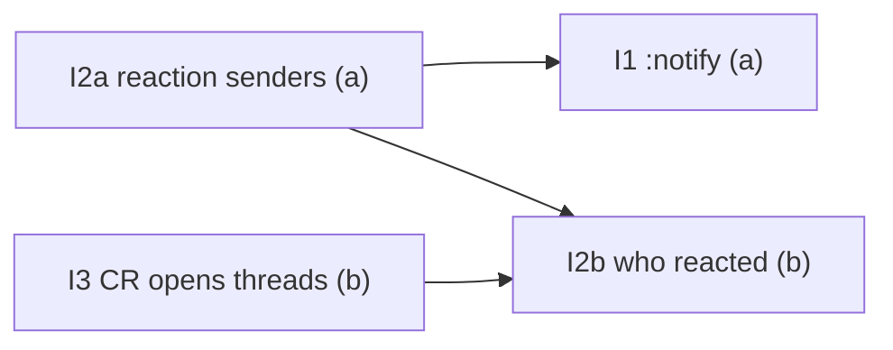

# Owner work I Implementation Plan

> **For agentic workers:** REQUIRED SUB-SKILL: Use superpowers:subagent-driven-development (recommended) or superpowers:executing-plans to implement this plan task-by-task. Steps use checkbox (`- [ ]`) syntax for tracking.

**Goal:** Three owner-approved items of owner work I. I1: `:notify all`
and `:notify mentions` (the action `room.notify`) set whether every
message of a room notifies or only mentions and keywords, so a bridged
channel can count among the rooms that notify; `:notify` alone shows the
setting. I2: the message view lists the message's reactions with who
reacted, `👍 Alice, Bob, you`. I3: `<CR>` in the timeline opens the thread
of a message with replies and shows any other message as before; in a
thread `<CR>` shows every message.

**Architecture:** I1 adds `NotificationMode::AllMessages`, the action
`room.notify` with its command, and replaces `MatrixEffect::SetMute` with
`SetMode`, which `mxt-matrix` runs through `NotificationSettings` in the
same ordered task; the room list task reports a mode change as the new
`Msg::RoomModeChanged`, which carries no counts. I2 is two tasks. Task I2a
(slot a) gives each `ReactionGroup` its senders, oldest reaction first,
with display names that `mxt-matrix` reads from the SDK's store before it
forwards a batch of timeline diffs; nothing a user sees changes. Task I2b
(slot b) has the core build one line per reaction for the message view
(`ViewContent`'s new `reactions`), which the tui appends to the view
editor's text. I3 adds the action `message.enter` (a thread root with
replies opens its thread, anything else the message view) on `<CR>` in
`timeline`, and binds `<CR>` in `thread` to `message.view`.

**Tech Stack:** Rust 2024; matrix-sdk and matrix-sdk-ui 0.19.1
(`NotificationSettings::set_room_notification_mode`,
`delete_user_defined_room_rules`,
`get_user_defined_room_notification_mode`, `subscribe_to_changes`,
`RoomNotificationMode`, `Room::get_member_no_sync`,
`RoomMember::display_name`, `ReactionsByKeyBySender`, `ReactionInfo`);
matrix-sdk-base and matrix-sdk-common 0.19.1 (push actions and unread
counts, read for the design's findings only); ruma 0.17.2
(`push::RuleKind`); matrix-sdk's `MatrixMockServer`
(`mock_set_push_rules`, `mock_delete_push_rules`, `mock_sync`) and
matrix-sdk-test's `SyncResponseBuilder::add_global_account_data` for
tests; the edtui fork at `0f85e23` (the view editor); ratatui 0.30.

## Global Constraints

- The design is `docs/superpowers/specs/2026-11-18-mxt-design.md`. It
  describes the result of all four tasks and wins over this plan when
  they disagree. Sections per task: I1 "Domain model"
  (`NotificationMode`, `UnreadCounts`), "Matrix adapter" (room summaries,
  "Notification modes" with "Counts after a mode change"), "Unread
  badges", "Room list" (the open room's move), "Threads" (actions on the
  room), "Commands", "Help views" (`:help`'s order), "Action registry",
  "Testing", "Risks"; I2a "Domain model" (`TimelineItem`), "Matrix
  adapter" ("Reactions"), "Testing"; I2b "Terminal adapter and the
  composer" ("Who reacted"), "Testing", "Risks"; I3 "Timeline" (the cut
  messages), "Default keymap" (the table and the `<CR>` paragraphs),
  "Search and jumps", "Jump list", "Threads", "Action registry",
  "Testing".
- Library behaviour is checked in the registry sources
  (`~/.cargo/registry/src/*/`); the design gives file and line for each
  fact a task relies on.
- Everything in the repository is in English. Tests use made-up
  identifiers (`@alice:example.org`, `!room:example.org`,
  `$event:example.org`), never real ones.
- `mxt-core` keeps the design's dependency rule: `std` and small pure
  crates without I/O, not the SDK, `ruma`, an async runtime, a terminal
  library, `serde` or `toml`.
- Each task is its own pull request and adds its own `CHANGELOG.md`
  `[Unreleased]` lines, listed in the task (I2a has none: nothing a user
  sees changes until I2b), in Keep a Changelog's section order, keeping
  the lines of earlier tasks, and updates the user documentation
  (`docs/keys.md`, `docs/configuration.md`, `README.md`) it changes. No
  release tag: merging is the orchestrator's.
- Slots: worktree b builds only `-p mxt-core` and `-p mxt-tui`; a task
  that touches `mxt-matrix` or `mxt` runs in worktree a, which may build
  the workspace under the heavy-build lock. CI compiles everything for
  every pull request.
- Tests assert specific lines, cells, statuses or effects, not whole
  generated texts that keep growing (the default keymap, `:map`,
  `:help`).
- Breaking changes (`docs/releasing.md`): none of the four tasks is
  breaking, each for the reason in its task. None renames or removes a
  configuration key, keymap table, action or command, none makes a
  configuration stop loading or gives a name another meaning, and none
  moves stored data. I3 changes what the default `<CR>` does and adds a
  default to `thread` that hides a `[keymap.timeline]` binding of `<CR>`
  while a thread is shown: behaviour that leaves setups working, as `t`
  in 0.1.4 and `g1` … `g9` after 0.1.5 hid `normal` bindings, so a
  `### Changed` line that says how to get the old `<CR>` back. I1 and I2b
  add features: `### Added` lines. The next release stays a patch
  release.

## Order and slots

| Task | Slot | Crates | Runs in parallel with |
|---|---|---|---|
| I2a: reaction senders and their names | a | `mxt-core`, `mxt-matrix`, `mxt-tui` | I3 |
| I1: notification modes, `:notify` | a | `mxt-core`, `mxt-matrix` | I3, I2b |
| I3: `<CR>` opens a thread with replies | b | `mxt-core` | I2a, I1 |
| I2b: who reacted, in the message view | b | `mxt-core`, `mxt-tui` | I1 |

- Slot a starts with I2a, since I2b waits for it, then I1. Slot b starts
  with I3, which depends on nothing, then I2b once I2a is merged (it
  reads `ReactionGroup::senders`).
- Why the slots: I2a changes `mxt-matrix`'s conversion of reactions (and
  the core type it fills, which `mxt-tui` draws), so it needs slot a. I1
  needs slot a for `mxt-matrix`: the mapping of the modes, the room list
  task's `RoomModeChanged`, and `MatrixEffect::SetMode`, which the
  adapter matches exhaustively. I3 is the core alone. I2b changes
  `ViewContent`, which only the core and the tui match (`mxt` and
  `mxt-matrix` never destructure it), so slot b can build and test it.
- Mechanical overlaps, which the second to merge resolves by merging
  `main` and keeping both: `action.rs` (I1, I3), `app.rs` `run` and
  `update` (I1, I3), `effect.rs` (I1 `MatrixEffect`, I2b `ViewContent`),
  `app/tests/threads.rs` and `app/tests/composer.rs` (I2a's
  `ReactionGroup` constructors, I3's tests), `docs/keys.md`,
  `docs/configuration.md` (the Actions table: I1, I3, I2b), `README.md`
  (I1, I3, I2b) and `CHANGELOG.md` (I1, I3, I2b).

## Task I2a: Reaction senders and their names

**Slot a. Crates:** `mxt-core`, `mxt-matrix`, `mxt-tui`. First in slot a.
**Files:** `crates/mxt-core/src/timeline.rs`, the `ReactionGroup`
constructors in `app/tests/composer.rs` and `app/tests/threads.rs`;
`crates/mxt-matrix/src/timeline.rs` and its tests,
`adapter/tests.rs` (its `reactions` helper keeps working; a new test);
`crates/mxt-tui/src/timeline_view.rs` and its tests.
**Breaking:** no. Internal types only; the chips draw the same text.

- [ ] `timeline.rs` (core): `pub struct ReactionSender { pub user:
  UserId, pub name: Option<String> }` (the display name from the room's
  member event in the SDK's store; `None` without one).
  `ReactionGroup { key, senders: Vec<ReactionSender>, mine }`, where
  `senders` replaces the `count` field (oldest reaction first, see the
  design's "Reactions") and `pub fn count(&self) -> usize` gives their
  number, so a count and a list can never disagree. `mine` stays
  ("whether the user is among the senders"). Doc comments.
- [ ] Every use follows: the chips in `timeline_view.rs` write
  `group.count()`; the core and tui tests build groups with senders
  (a helper `group(key, &[user ids], mine)` per test module).
- [ ] `timeline.rs` (`mxt-matrix`): `struct ReactorNames(HashMap<
  OwnedUserId, String>)` with `async fn learn<'a>(&mut self, room: &Room,
  me: &UserId, items: impl Iterator<Item = &'a sdk::TimelineItem>)`: the
  reaction senders of the event items, other than `me` and those already
  known, collected into a set first so each is read once, each looked up
  with `room.get_member_no_sync(user)` (store only); a member with a
  non-empty `display_name()` is kept, anything else (no member, no name,
  an error, which is logged at `debug`) is not, so it is looked up again
  with the next batch that carries it. `fn get(&self, user) ->
  Option<String>`.
- [ ] `reaction_groups(reactions, me, names)`: per key in the SDK's order,
  the senders sorted by `ReactionInfo::timestamp` with a stable sort
  (`sort_by_key`), each `ReactionSender { user, name: names.get(user) }`.
  `entry`, `event_entry` and `timeline_diff` take `&ReactorNames`.
- [ ] `Subscription::start` learns from the initial items before it
  builds the `Reset`; `forward` gets a clone of the `Room` and its own
  `ReactorNames` and, for each batch, learns from the batch's items (the
  values of `Reset` and `Append`, the value of `PushFront`, `PushBack`,
  `Insert` and `Set`) before it converts the batch. A thread's
  subscription does the same with its own names.
- [ ] Tests, constructed inputs: `reaction_groups` with 👍 from
  `@carol` at 30, `@bob` at 10 and the user at 20 (inserted in that
  order) gives the senders bob, the user, carol, `mine` true and
  `count()` 3; equal timestamps keep the SDK's order; a known name and an
  unknown one (`None`). With `MatrixMockServer` (the client of
  `rooms.rs`'s tests): a room synced with `@bob`'s member event
  (`displayname` `Bob`) and `@dave`'s with an empty display name:
  `learn` keeps `Bob`, not Dave, and not `@carol`, who has no member
  event; after a sync that brings Carol's member event, `learn` with the
  same item finds her. In the adapter's harness (`adapter/tests.rs`): a
  message with 👍 from Bob (member event synced) arrives with
  `ReactionSender { user: @bob, name: Some("Bob") }`, and a reaction by
  the user has `name: None` and `mine` true.
- [ ] Docs: none. CHANGELOG: none (I2b shows the names).

## Task I1: Room notification modes, `:notify`

The owner's report: bridged channels that mautrix-discord created with a
room rule without a notify action read as mentions and keywords only, so
their counts are dim, and the owner wants some of them among the rooms
that notify (the `notify` sort key, `]u` with `filter = "notify"`). The
bridge sets that rule only when it creates the portal
(`mute_channels_on_create`, `mutePortal` with `justCreated` in its
`user.go`), so a change from mxt stays.

**Slot a. Crates:** `mxt-core`, `mxt-matrix`. After I2a in slot a.
**Files:** `crates/mxt-core/src/room.rs`, `action.rs`, `command.rs`,
`effect.rs`, `msg.rs`, `rooms.rs`, `app.rs`, `app/rooms.rs`,
`app/command_line.rs`, `app/tests/room_actions.rs` (its `SetMute`
helper), the action and command tests;
`crates/mxt-matrix/src/rooms.rs`, `adapter.rs`, and a new
`adapter/tests/modes.rs` (or the tests of `adapter/tests.rs`);
`docs/keys.md`, `docs/configuration.md`, `README.md`, `CHANGELOG.md`.
**Breaking:** no. A new action (`room.notify`, its argument `mode` with
the values `"all"` and `"mentions"`) and a new command (`:notify`, an
unknown command before); `room.mute` and `room.unmute` keep their names
and behaviour, and `:unmute` still refuses a room that is not muted. mxt
0.1.5 reads a binding of `room.notify` as an unknown action, a warning
that ignores it. Mapping a notifying room rule to `AllMessages` instead
of `Default` shows nowhere (neither has a label). `SetMode` and
`RoomModeChanged` are internal.

Core:

- [ ] `room.rs`: `NotificationMode::AllMessages` between `Default` and
  `MentionsAndKeywords`, documented as the room's own rule that notifies
  for every message; `label()` gives `None` for it (the design's "Unread
  badges" says why); its test covers it. The enum's doc: the room's own
  push rule, `Default` meaning none.
- [ ] `action.rs`: `pub enum NotifyMode { All, Mentions }` with `ALL` and
  `config_name` (`"all"`, `"mentions"`), as `FocusMode`;
  `Action::RoomNotify(Option<NotifyMode>)`; `from_spec("room.notify")`
  reads `mode` with `Args::choice`, so an unknown value is the usual
  unknown-value warning and another type the usual error; `name()` is
  `"room.notify"`, and its arguments for `:map` are `mode` when set. The
  doc comment of `from_spec` lists `room.notify`.
- [ ] `command.rs`: an entry `notify` after `unmute`:
  `Argument::Optional(":notify [<mode>]")`, the description "Set the
  room's notifications to all messages or mentions only, or show them",
  the action `RoomNotify(None)` for an empty argument, `Some(All)` for
  `all`, `Some(Mentions)` for `mentions`, else
  `CommandError::UnknownMode { mode }`, shown as `unknown mode "<mode>";
  expected "all" or "mentions"`.
- [ ] `app/command_line.rs` `candidates`: `Some(("notify", prefix))`
  gives `notify all` and `notify mentions` that start with the trimmed
  prefix, in that order; the doc comment says so.
- [ ] `effect.rs`: `pub enum ModeChange { Mute, Unmute, AllMessages,
  MentionsAndKeywords }` and `MatrixEffect::SetMode { room: RoomId,
  change: ModeChange }`, replacing `SetMute`, documented with the
  design's "Notification modes" (run in order; the room's mode changes
  when the SDK reports it).
- [ ] `msg.rs`: `Msg::RoomModeChanged { room: RoomId, mode:
  NotificationMode }`, documented: the mode alone, the room's counts and
  place stay.
- [ ] `rooms.rs`: `RoomList::set_mode(&mut self, id: &RoomId, mode:
  NotificationMode)` sets the summary's mode in place and places nothing
  (no sort key reads the mode); a room not in the list is ignored.
- [ ] `app/rooms.rs`: `set_mute` sends `SetMode` with `Mute` or `Unmute`
  (its texts and the refusal stay). `notify(mode: Option<NotifyMode>)`
  on `target_room()` ("No room" as an error without one): `None` shows
  the mode as info ("<room> notifies for every message", "<room>
  notifies for mentions and keywords only", "<room> is muted", "<room>
  follows the account's default"); `Some(target)` equal to the room's
  mode (`All` and `AllMessages`, `Mentions` and `MentionsAndKeywords`)
  shows "<room> already notifies for every message" (or "… for mentions
  and keywords only") and sends nothing; otherwise it sends `SetMode`
  with `AllMessages` or `MentionsAndKeywords` and shows "<room> now
  notifies for every message" (or "… for mentions and keywords only").
  `app.rs` runs `Action::RoomNotify` and applies `Msg::RoomModeChanged`
  with `set_mode`.
- [ ] Core tests (`app/tests/room_actions.rs`, `command.rs`,
  `action.rs`): `:notify all` with the room list focused on a room with
  `MentionsAndKeywords` gives `SetMode { room, AllMessages }` and "now
  notifies for every message"; with the timeline focused it acts on the
  open room, also while a thread is shown; `:notify mentions` likewise;
  `:notify all` on an `AllMessages` room and `:notify mentions` on a
  `MentionsAndKeywords` room send nothing and say "already …"; on a
  `Mute` room `:notify all` sends the change; `:notify` alone shows each
  of the four texts and sends nothing; no room gives "No room"; `:notify
  x` and `:notify All` give the unknown mode error and no effect;
  `:notify ` with `<Tab>` cycles `all`, `mentions`, and `:notify m<Tab>`
  gives `notify mentions`; `:help` has a line for `:notify [<mode>]`;
  `room.notify` from a binding with `mode = "all"`, without `mode`, with
  `mode = "mute"` (`ActionError` of an unknown value) and with `mode = 1`
  (wrong type); `RoomModeChanged` after `room.mark_read` on a room under
  the room list's cursor keeps its zeroed counts and its index, changes
  `mode`, and a following `room.unmute` on a room now `Mute` is sent;
  `room.mute` and `room.unmute` send `SetMode` with `Mute` and `Unmute`.

`mxt-matrix`:

- [ ] `rooms.rs`: `notification_mode` maps `None` to `Default`,
  `AllMessages` to `AllMessages`, `MentionsAndKeywordsOnly` to
  `MentionsAndKeywords` and `Mute` to `Mute`; `refresh_modes` sends
  `Msg::RoomModeChanged { room, mode }` for each room whose mode changed
  (and updates the stored facts' mode), no longer `RoomUpserted`; the doc
  comments of `notification_mode`, `refresh_modes` and `run` say so.
- [ ] `adapter.rs`: `MatrixEffect::SetMode { room, change }` goes to the
  ordered task, renamed `set_modes`; `set_mode(client, settings, room,
  change)` runs `set_room_notification_mode(Mute)`,
  `delete_user_defined_room_rules`,
  `set_room_notification_mode(AllMessages)` or
  `set_room_notification_mode(MentionsAndKeywordsOnly)`; a failure is
  reported with "Muting the room failed", "Unmuting the room failed" or
  "Changing the room's notifications failed". The doc comments of
  `run_effects` and the task follow.
- [ ] Tests with `MatrixMockServer`, the push rules synced as global
  account data (`add_global_account_data` with an `m.push_rules` event)
  before the effects run: a room with a room rule without actions,
  `SetMode` `AllMessages` sends one `PUT` of
  `/pushrules/global/room/!room:example.org` whose body's actions are
  `notify` and the default sound (`mock_set_push_rules(RuleKind::Room,
  ..)` with `.expect(1)` and a matcher on the body) and no `DELETE`; a
  muted room (an override rule with a `room_id` condition), `SetMode`
  `AllMessages` sends that `PUT` and a `DELETE` of the override rule; a
  room without a rule, `MentionsAndKeywords` sends a `PUT` with no
  actions; `Unmute` on a muted room sends the `DELETE` only; a `PUT`
  answered 500 gives `EffectFailed` "Changing the room's notifications
  failed: …". `notification_mode` for each of the four rule sets. A sync
  whose account data changes one room's rule to a notifying one makes
  the room list task send `RoomModeChanged { room, AllMessages }` for
  that room and nothing for the others, and no `RoomUpserted` for it.

Docs:

- [ ] `docs/keys.md`: the Commands table gains `:notify [<mode>]` after
  `:unmute`: `all` makes every message of the room notify you, `mentions`
  only mentions and keywords, on the room under the cursor in the room
  list, otherwise the open room; alone it shows the setting; the status
  line says what changed or that it already was so. Below the table, a
  paragraph: the setting is your account's push rule, so other clients
  (Beeper or Element on your phone) notify the same way; a bridged
  channel that the bridge set to mentions only counts among the rooms
  that notify (`notify` sort key, `filter = "notify"`) from its next
  message on, while messages already unread keep their dim count until
  read, and after `:notify mentions` unread messages that notified stay
  bold until read; `:notify all` on a muted room unmutes it, `:unmute`
  leaves a room set with `:notify` alone, and `:mute` then `:unmute`
  (once `Muted` shows) goes back to the account's default; mxt shows no
  label for these settings, only `Muted`. The badge table's note ("Muted
  rooms also show `Muted`") points to `:notify`. The arguments line
  (`:mute`, `:unmute` … take no argument) and the `:react` / `:mute`
  focus sentence name `:notify`. "Actions without a default key":
  `room.notify` / `:notify [<mode>]`. Threads, "In a thread":
  `:notify` acts on the room too.
- [ ] `docs/configuration.md`, the Actions table: `room.notify` with
  `mode`: `"all"` or `"mentions"` sets the room's notifications (the same
  room as `room.mark_read`), without it shows them; an unknown `mode`
  ignores the binding with a warning; the push rule note; `room.unmute`'s
  row: a room set to all messages or mentions only is not muted.
- [ ] `README.md`, Features: "Muting rooms" becomes "Muting rooms and
  choosing which rooms notify for every message (`:notify`)".
- [ ] CHANGELOG `### Added`: "`:notify all` and `:notify mentions` set
  whether every message of a room notifies you or only mentions and
  keywords, on the room under the cursor in the room list, otherwise the
  open room, as `:mute` does; `:notify` alone shows the room's setting,
  and the status line says what changed or that it already was so. The
  action is `room.notify` with `mode = "all"` or `"mentions"`. This is
  your account's push rule, so other clients, such as Beeper on your
  phone, notify the same way. A bridged channel set to mentions only then
  counts among the rooms that notify (the `notify` sort key,
  `filter = "notify"`) from its next message on; messages that were
  already unread keep their dim count until read. `:notify all` on a
  muted room unmutes it, and `:mute` then `:unmute` goes back to the
  account's default. mxt 0.1.5 ignores a binding of `room.notify` with a
  warning."

## Task I3: `<CR>` opens a thread with replies

**Slot b. Crates:** `mxt-core`. First in slot b.
**Files:** `crates/mxt-core/src/action.rs`, `keymap.rs` and its tests,
`app.rs` (`run`), `app/thread.rs`, `app/tests/threads.rs`,
`app/tests/timeline.rs`; `docs/keys.md`, `docs/configuration.md`,
`README.md`, `CHANGELOG.md`.
**Breaking:** no. A new action; `message.view` and `thread.open` keep
their names and meaning and stay bindable. The default `<CR>` in
`timeline` does something else on a thread root with replies, and the
new default `<CR>` in `thread` hides a `[keymap.timeline]` binding of
`<CR>` while a thread is shown. A `[keymap.normal]` binding of `<CR>` is
not affected: `timeline` has bound `<CR>` since the first release, so it
never applied in the timeline. Configurations load as before, so this is
a `### Changed` line with the way back, as for `t` in 0.1.4 and `g1` …
`g9` after 0.1.5.

- [ ] `action.rs`: `Action::MessageEnter` (`message.enter`), no
  arguments, documented: the thread of a thread root with replies while
  no thread is shown, otherwise the message view.
- [ ] `keymap.rs`: `<CR>` in `TableId::Timeline` becomes
  `Action::MessageEnter`; `<CR>` in `TableId::Thread` is
  `Action::MessageView`, with a comment (every message of a shown
  thread, the root included; it hides a `timeline` binding of `<CR>` in
  threads, as the design's "Default keymap" says).
- [ ] `app/thread.rs`: `enter_message(&mut self, effects)`: when no
  thread is shown and the cursor's item has a `thread_summary`,
  `open_thread`; otherwise `view_message`. `app.rs` runs it.
- [ ] Tests: keymap: `<CR>` in `InputContext::Timeline` resolves to
  `MessageEnter` and in `InputContext::Thread` to `MessageView`; a user
  `[keymap.timeline] "<CR>" = "message.react"` applies in the timeline
  and not in a thread, where `thread`'s default wins. App: `<CR>` on a
  root with `ThreadSummary` gives `SubscribeThread` for it, shows the
  thread and records a jump (`<C-o>` goes back to the root in the
  timeline); on a deleted root with replies it opens the thread too; on
  a message without a summary it gives `OpenView` and no subscription;
  on an image that is a local echo it refuses as `message.view` does; in
  the thread, `<CR>` on the root and on a reply gives `OpenView`;
  `message.enter` bound to `o` in `[keymap.thread]` on the root gives
  `OpenView`, not the focus-only `thread.open`; with `"<CR>" =
  "message.view"` in `[keymap.timeline]`, `<CR>` on a root gives
  `OpenView`; `t` on a message without replies still opens a new thread;
  no item under the cursor does nothing.
- [ ] Docs: `docs/keys.md`: "The screen" (`t`, or `<CR>` on a message
  with replies, shows its thread); the cut-message sentence (`<CR>`
  shows it in full; on a thread root, in its thread) and the same in the
  search paragraph; the `timeline` table's `<CR>` row (`message.enter`:
  the thread of a message with replies, as `t`, otherwise the message in
  full); the paragraph under the table (up to mxt 0.1.5 `<CR>` showed
  every message; `"<CR>" = "message.view"` in `[keymap.timeline]` keeps
  that); the `thread` table gains `<CR>` (`message.view`) and its
  paragraph says that a `<CR>` bound in `[keymap.timeline]` no longer
  applies in a thread unless also bound in `[keymap.thread]`; Threads:
  the first paragraph (`t`, or `<CR>` on a root with replies) and "In a
  thread" (`<CR>` shows every message in full, the root too); The jump
  list (opening a thread with `t` or `<CR>`). `docs/configuration.md`,
  the Actions table: `message.enter` after `message.view`. `README.md`,
  Features: "`t`, or `<CR>` on a message with replies, shows its thread".
- [ ] CHANGELOG `### Changed`: "`<CR>` in the timeline opens the thread
  of a message that has replies, as `t` does, and shows any other
  message in full as before (the new action `message.enter`); in a
  thread, `<CR>` shows every message in full, the root included
  (`message.view`, now bound in `[keymap.thread]`). `t` still opens or
  starts a thread on any message. `"<CR>" = "message.view"` in
  `[keymap.timeline]` brings back the old `<CR>`. A binding of `<CR>` in
  `[keymap.timeline]` no longer applies while a thread is shown; write it
  in `[keymap.thread]` too to keep it there."

## Task I2b: Who reacted, in the message view

**Slot b. Crates:** `mxt-core`, `mxt-tui`. After I3 in slot b, once I2a
is merged.
**Files:** `crates/mxt-core/src/effect.rs`, `app/timeline.rs`, the tests
that build `ViewContent` (`app/tests.rs`, `app/tests/timeline.rs`,
`files.rs`, `previews.rs`, `search.rs`); `crates/mxt-tui/src/view.rs` and
its tests; `docs/keys.md`, `docs/configuration.md`, `README.md`,
`CHANGELOG.md`.
**Breaking:** no. The view shows more text; no name or setting changes.

- [ ] `effect.rs`: `ViewContent::Text { text, matches, reactions:
  Vec<String> }` and `ViewContent::Image { item, name, size, dimensions,
  reactions: Vec<String> }`, documented: one line per reaction, appended
  after an empty line; empty for the help views and for a message
  without reactions.
- [ ] `app/timeline.rs`: `fn reaction_lines(item: &TimelineItem, me:
  &UserId) -> Vec<String>`: for each group of `item.shown_reactions()`,
  `"<key> <names>"`, the senders in their order joined by `", "`, each
  `you` when it is `me`, else its name, else its user ID.
  `view_message` fills `reactions` for text, images and stickers (the
  `matches` are still computed on the message's text alone);
  `view_help` leaves it empty.
- [ ] `view.rs`: `View::new` appends `"\n\n"` and the lines joined by
  `"\n"` to the text, or to an image's details, when there are any; the
  `match_highlights` input stays the message's text and ranges. `draw`
  gives an image's details `min(rows, max(2, area.height / 2))` rows, the
  gap row, and the rest to the image.
- [ ] Tests: core: the view of a text message with 👍 from Alice (named)
  and the user, and 🎉 from `@bob:example.org` (no name), has
  `reactions` `["👍 Alice, you", "🎉 @bob:example.org"]` in the chips'
  order; an image and a sticker carry the lines too; a message without
  reactions and `:help` have none; with the search highlight on, the
  `matches` are those of the text alone. tui: the view's editor text is
  the message, an empty line, then the lines; an image's details are the
  name, the info line, an empty line, then the lines; a line of 30 names
  in a 40-column view takes the rows `Editor::rows` gives; an image view
  20 rows high with 15 reaction lines draws the details in 10 rows and
  the image below the gap, and with no reactions the details take their
  two rows as before; a visual `ggVGy` in the view yanks the lines too.
- [ ] Docs: `docs/keys.md`: the `timeline` table's `<CR>` row (with who
  reacted) and a paragraph after it: the view lists each reaction shown
  under the message, in that order, with who reacted (`👍 Alice, Bob,
  you`; a user ID where mxt has no name), under the text or under an
  image's size line; the lines are part of the view's text, so `y` and
  the view's `/` see them, while the timeline's `yy` copies the message
  alone; the view shows the reactions as they were when it opened (open
  it again for newer ones). `docs/configuration.md`, the Actions table:
  `message.view` mentions the reactions. `README.md`, Features: "a
  full-screen view for long messages and images, with who reacted".
- [ ] CHANGELOG `### Added`: "The message view (`<CR>`) lists the
  message's reactions under its text, or under an image's size line, one
  line per reaction in the order shown under the message, with who
  reacted: `👍 Alice, Bob, you`. Names are the room members' display
  names, or user IDs where mxt has none. The lines are part of the view's
  text, so `y` and `/` there see them (the timeline's `yy` still copies
  the message alone), and the view shows the reactions as they were when
  it opened."

## Account checks

The orchestrator, on the check device, in the test room only. Every step
that changes something is undone before the next item; no other room is
touched. While the room list has focus, the commands act on the room
under its cursor, so keep that cursor on the test room, or focus the
test room's timeline.

After I1:

1. With the test room open and the timeline focused, `:notify`: note
   which of the four texts it shows (the original mode).
2. `:notify all`: "<room> now notifies for every message" (or "already
   …" if that was the original). After the next sync (a few seconds),
   `:notify` says "notifies for every message"; a `Muted` label the room
   had is gone. `:notify all` again says "already …". While the test room
   is set so, the owner's phone notifies for every message in it.
3. `:notify mentions`: "now notifies for mentions and keywords only";
   after the sync `:notify` says so, and `:notify mentions` says
   "already …".
4. `:notify x`: `unknown mode "x"; expected "all" or "mentions"`.
5. Restore the original: "notifies for every message", `:notify all`;
   "mentions and keywords only", nothing; "is muted", `:mute`; "follows
   the account's default", `:mute`, wait until the `Muted` label shows,
   then `:unmute`. After the sync, `:notify` shows the original text
   again. The log has no errors.

After I3, in the test room: `<CR>` on a message with replies (create one
with `t` and a reply if the room has none) shows its thread; `<CR>` on
the root there shows it in the view, `q` closes the view, `q` the thread,
and `<C-o>` after `<CR>` opened the thread goes back to the root. `<CR>`
on a message without replies shows the view, as before.

After I2a and I2b, in the test room: react to a test message with `+`
and 👍; `<CR>` on it shows the text, an empty line and `👍 you`, and on a
message with others' reactions their display names, not user IDs. On an
image message (upload a small test PNG with `:upload` if there is none),
react and `<CR>`: `👍 you` sits under the size line and the image below.
Remove the reactions (`g1` on each). The log has no errors.

## Questions for the owner

Each is decided as recommended in the design; the task follows the
answer if it differs.

1. I3: keep `thread`'s default `<CR>` (`message.view`), as decided, or
   drop it? `message.enter` already shows the message in a thread, so
   without it `<CR>` would do the same and hide no `[keymap.timeline]`
   binding of `<CR>` in threads. Recommendation: keep it. It shows in
   `:map`, it gives a sensible `<CR>` in threads to someone who rebinds
   the timeline's `<CR>` to `thread.open`, and the hidden binding is
   documented as for `t` and `g1` … `g9`.
2. I1: `:notify` without an argument shows the room's setting. It is
   beyond the two commands asked for, but no label shows the setting
   (only `Muted`), and the account check has to record the test room's
   original mode in mxt. Recommendation: keep it.
3. I1: no `:notify default` that removes the room's rule; `:mute` then
   `:unmute` goes back to the account's default. Recommendation: not now;
   a `mode` value added later is a warning to older versions, not an
   error.
4. I1: on a room without a rule of its own, `:notify all` writes a rule
   and says "now notifies …" even when the account's default already
   notifies for every message, since finding the default needs the
   room's encryption state, which may take a request. Recommendation:
   keep it; the rule also keeps the room as chosen if the default
   changes.
5. I2: the names are in the order the reactions were sent, oldest first,
   with yours as `you` in its place (the owner's example had `you` last).
   Recommendation: keep the time order, which tells who reacted first
   and does not change with how the message was loaded.
