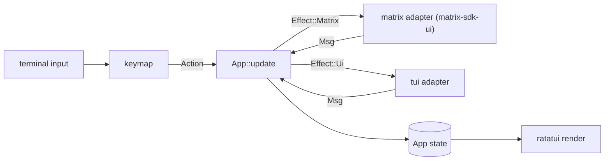
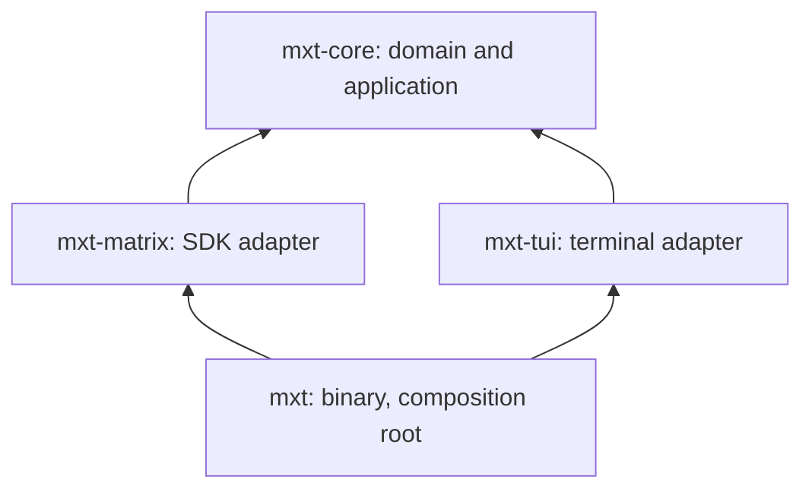

# mxt design

Date: 2026-11-18
Status: draft for review (revision 3)

## Summary

mxt is a terminal Matrix client with nvim-like keybindings. It targets
accounts where most rooms are bridged from other networks (Discord, Slack,
and similar), so it shows which network a room belongs to, makes unread state
easy to navigate, and lets users rebind every key.

mxt is a single Rust binary. End-to-end encryption, sync, event aggregation
and unread counting come from matrix-rust-sdk (`matrix-sdk` and
`matrix-sdk-ui`). mxt itself is the user interface and the glue around the
SDK.

## Goals

- Read and write in encrypted rooms, including rooms bridged by mautrix
  bridges that only accept cross-signed devices.
- Show bridged rooms as `<network> / <room>` (for example
  `myserver / #general`), so rooms with the same name on different networks
  can be told apart.
- Show unread state per room, including unread messages in muted rooms, and
  let keybindings jump between rooms by unread state.
- Default keybindings follow common nvim conventions. Every binding can be
  changed in the configuration file.
- Compose messages with vim-style modal editing.
- Keep the domain and application logic pure and testable without a terminal
  or a homeserver.

## Non-goals

- Implementing any part of the Matrix protocol or end-to-end encryption.
  matrix-rust-sdk owns these.
- Running as a daemon or offering a remote API. mxt starts when the user runs
  it and exits when the user quits.
- Multiple accounts in one process.
- Being a general text editor. Message editing uses an embedded editor widget
  plus an external editor for long text.

## Scope of the first release

Included:

1. Password login and session restore. Entering the recovery key once per
   device to obtain cross-signing and key backup.
2. A room list that shows network names and unread badges.
3. A fuzzy room picker, also used to list rooms with unread mentions.
4. A timeline that renders HTML message bodies and shows replies, edits and
   reactions, and a full-screen view for messages taller than the screen and
   for images.
5. Sending messages written in Markdown, replies, mentions of room members
   completed after typing `@`, and read receipts.
6. Toggling reactions, editing and deleting (redacting) the user's own
   messages.
7. Muting and unmuting a room.
8. Files: downloading and opening attachments, uploading a file, and image
   previews where the terminal supports them.
9. A keymap and action registry that lets the configuration bind any action,
   including "open the next unread room".

Not included in the first release:

- Threads, desktop notifications, typing notifications.
- Event-level mention lists (see "Mentions").
- Room-wide mentions (`@room`).
- SSO or OAuth login, logout, and account management.
- Setting up cross-signing or secret storage for an account that has none
  (bootstrapping needs user-interactive authentication). Such accounts must be
  set up in another client first.
- Themes and colors beyond the terminal's 16-color palette.
- Reloading the configuration at runtime.
- User-defined command aliases and a generic `:<action>` command.

## Conventions

- All documents, code, comments and commit messages in the repository are in
  English.
- License: MIT. Code adapted from Apache-2.0 projects keeps its Apache-2.0
  notice in the adapted files, and the repository then ships `LICENSE-APACHE`.
- Dependency licenses are checked by `cargo-deny` in CI. GPL-family licenses,
  including the AGPL, are rejected. The allow list in `deny.toml` holds the
  permissive licenses the tree needs (MIT, Apache-2.0, BSD-3-Clause, ISC,
  MIT-0, Unicode-3.0, Unlicense and similar) and MPL-2.0.
- Tests and fixtures use made-up identifiers (`@alice:example.org`,
  `!room:example.org`). Real user IDs, room IDs, access tokens and logs are
  never committed.
- Access tokens are never logged. Message bodies are logged only at the
  `trace` level.

## Architecture

### Process and data flow

mxt is one process on a tokio runtime. crossterm handles terminal input and
output, and ratatui draws the screen.



- The keymap turns key input into `Action`s. `App::update` applies actions and
  messages to the application state and returns `Effect`s.
- `update` never performs I/O and never reads a clock. Effects are plain data.
  The matrix adapter executes matrix effects (send a message, subscribe to a
  timeline, mark a room as read) and reports results and SDK stream updates
  back as `Msg`s. The tui adapter executes UI effects (load text into the
  composer, start a timer, open a file) and reports terminal facts as `Msg`s
  (submitted text, pasted text, viewport sizes, terminal focus, timer
  expiry).
- Every frame is rendered from the core state plus the widget state that
  `mxt-tui` owns (the edtui editors and the image cache).
- Actions are resolved against the state, not against rendered widgets, so an
  action such as "open the next unread room" works the same whether or not a
  list has been drawn yet.

### Crates and the dependency rule

The repository is a Cargo workspace. Dependencies point inward, and Cargo
enforces it.



| Crate | Responsibility | May depend on |
|---|---|---|
| `mxt-core` | Domain types, keymap and its resolver, action registry, pickers, mention rendering, `App` state and `update` | `std` and small pure crates without I/O (`nucleo-matcher`, `emojis`, `pulldown-cmark`, `unicode-segmentation`). Not the SDK, `ruma`, an async runtime, a terminal library, `serde` or `toml`. |
| `mxt-matrix` | Builds the SDK client, converts SDK data into domain types, executes matrix effects, forwards SDK streams as `Msg`s, reads bridge state, renders HTML bodies into domain rich text, reads and writes the session file | `mxt-core`, `matrix-sdk`, `matrix-sdk-ui`, tokio, `futures-util`, `tracing`, `serde`/`serde_json` (the session file holds the SDK's serde session type), `mime_guess` (the MIME type of an upload), `image` (the dimensions of uploaded images); HTML parsing through `matrix_sdk::ruma::html`, plus a feature-only `ruma` dependency of the SDK's ruma version that enables `html-matrix` (the SDK enables only `html`) and `markdown` (`FormattedBody::markdown`); as dev-dependencies, `matrix-sdk` with its `testing` feature, `matrix-sdk-test` and `mxt-core` with its `testing` feature (the tests against `MatrixMockServer`) |
| `mxt-tui` | Layout and widgets, input routing, the composers and the message view (edtui), image decoding and previews, OSC 52 clipboard, local time formatting, executing UI effects | `mxt-core`, ratatui, crossterm, edtui, ratatui-image, image, jiff, `base64` (OSC 52), `futures-util` (the terminal event stream), `unicode-segmentation`, `rustix` (reading the terminal's answer to XTVERSION with a timeout, and the window's size in pixels) |
| `mxt` | Command line, startup flow, configuration file loading (TOML DTOs), paths, the data directory lock, logging, wiring the adapters and the event loop | all of the above, `serde`, `toml`, `tracing`, `tracing-appender` and `tracing-subscriber` (the log files), `rpassword` (the password and recovery key prompts); `matrix-sdk` as a dev-dependency |

Because `mxt-core` does not depend on the SDK, its tests build and run without
compiling matrix-rust-sdk, and SDK upgrades only touch `mxt-matrix`.

### Functional core

Workflows are functions over domain types:

```rust
impl App {
    /// Deterministic and free of I/O. Mutates the state in place to avoid
    /// cloning the whole state for every message.
    pub fn update(&mut self, msg: Msg) -> Vec<Effect> { /* ... */ }
}

pub fn resolve_room(rooms: &RoomList, current: Option<&RoomId>, target: &RoomTarget) -> Option<RoomId> {
    /* ... */
}
```

Rules:

- Illegal states are unrepresentable where it is cheap to do so. Examples:

  ```rust
  /// A timeline item: a local echo before the server assigns an event ID,
  /// or a remote event. Mirrors the SDK's `TimelineEventItemId`.
  pub enum ItemRef {
      Local(TxnId),
      Remote(EventId),
  }

  pub enum Draft {
      New,
      /// Replies go to remote events only: a reply to a local echo is refused
      /// until the echo is sent.
      Reply { to: EventId },
      Edit { target: OwnEvent },
  }

  /// An item sent by the current user. The sender is taken from the item
  /// itself, so a caller cannot pass the wrong one.
  pub struct OwnEvent(ItemRef);

  impl OwnEvent {
      pub fn new(item: &TimelineItem, me: &UserId) -> Option<Self> {
          (item.sender == *me).then(|| Self(item.id.clone()))
      }
  }

  /// Which room `room.open` and `picker.rooms` act on.
  pub enum RoomTarget {
      Pick { filter: RoomFilter, pick: Pick },
      Fuzzy { filter: RoomFilter, query: String },
  }
  ```

  Replying and editing at the same time, editing another user's message, and
  a `room.open` that has both a pick rule and a query cannot be expressed.
- Parse, don't validate. Configuration values and SDK data are converted into
  domain types once, at the boundary. Code inside the core trusts them.
- Identifiers in the core are mxt's own newtypes (`RoomId`, `EventId`,
  `TxnId`, `UserId`), not `ruma` types. Timestamps are UTC milliseconds.
- Effects come in two groups. `Effect::Matrix(..)` is executed by the matrix
  adapter (for example `SubscribeTimeline`, `UnsubscribeTimeline`,
  `PaginateBackwards`, `LoadMembers`, `FetchImage`, `Send`). `Effect::Ui(..)`
  is executed by the tui adapter (for example `StartTimer { id, after }`,
  `LoadComposer`, `ClearComposer`, `ReplayKeys`, `ReplaceMentionToken`,
  `OpenView`). Results arrive as `Msg`s (timeline diffs, `Msg::MembersLoaded`,
  `Msg::ImageFetched`, `Msg::Timeout { id }`).
- Media bytes pass through the core as an opaque `MediaBytes` handle
  (`Arc<[u8]>`). The core never decodes them; it only routes them from the
  matrix adapter to the tui adapter.
- No ceremony: no repository traits, dependency injection containers or one
  type per use case. Types and functions are enough.

### Domain model

The main types in `mxt-core`:

- `RoomSummary`: id, `RoomName { network: Option<String>, room: String }`,
  kind (direct message or group), `UnreadCounts`, `NotificationMode`
  (default, mentions and keywords only, mute), time of the latest activity.
  Spaces are not room summaries; their names only feed `RoomName.network`.
- `UnreadCounts { messages, notifications, mentions, marked }`. `messages`
  counts unread messages even in muted rooms. `notifications` counts unread
  events that notify according to the user's push rules. `mentions` counts
  unread highlights. `marked` is the manual unread mark. All counts are
  computed client-side by the SDK (see "Risks").
- `Badge`, derived from `UnreadCounts` (see "Unread badges").
- `RoomTarget`, `RoomFilter` and `Pick` (see "Action registry").
- `TimelineItem`: `id: ItemRef`, sender, timestamp, `MessageContent`,
  optional reply preview, reaction groups (key, count, whether the user
  reacted), an edited flag, and the local send state (sending, sent, failed).
  The timeline also contains date dividers and the read marker, which the SDK
  provides as virtual items.
- `MessageContent`: `Text { body, rich }` (the event's plain `body`, which
  `message.edit` loads, and its `RichText`), `Notice(RichText)`, `Emote(RichText)`,
  `Image { name, size, dimensions }`, `File { name, size, mime }` (also used
  for video and audio), `Sticker { body }`, `Redacted`, `Undecryptable`,
  `Unsupported { kind }`.
- `RichText`: a list of blocks (paragraph, code block with optional language,
  block quote, ordered or unordered list). Paragraphs hold inline spans: text
  with bold, italic, strikethrough, inline code or spoiler style; links with a
  URL; mentions of users or rooms; custom emoticons shown by their alt text.
  The terminal adapter maps it to ratatui lines.
- Composers: per room, the `Draft`, the mentions inserted so far
  (`MentionRef { user: UserId, text: String }`), and whether the composer is
  empty. They are kept when switching rooms.
- Room members: user ID and display name, loaded per room on demand, used for
  mention completion.
- UI state: focus (room list, timeline, composer), mode, keymap resolver
  state, picker state, the open view (a message's item, or a help view:
  `:help` or `:map`), cursor positions, the last known viewport of each
  pane, terminal focus (initially focused), the status message.

### Keymap resolver

The resolver lives in `mxt-core` and is deterministic, so its behavior is
covered by unit tests.

- For the current mode, the tables in the fallback chain (see "Tables and
  resolution") are merged into one effective map before resolution. For the
  same key sequence, the earlier table wins. Prefixes are judged on the
  merged map, so with `"]"` in `timeline` and `"]u"` in `normal`, `]` waits
  like it does in nvim.
- `nop` is a binding that does nothing. It shadows the same key sequence in
  later tables.
- The resolver holds the pending key sequence. Count prefixes (`5j`) are part
  of the same pending state.
- A key sequence that is a complete binding and not a prefix of a longer one
  runs immediately.
- A key sequence that is a prefix of a longer binding stays pending. The
  resolver returns `Effect::Ui(StartTimer)` with `ui.timeoutlen` (default 1000 ms,
  like nvim's `timeoutlen`).
- On `Msg::Timeout`, and when the next key makes the pending sequence match
  nothing: the longest binding that is a prefix of the pending keys (with the
  new key, in the second case) runs, and the keys after it are resolved
  afresh, one by one. When no prefix is a binding, only the first pending key
  is released, and the keys after it are resolved afresh. This is nvim's
  behavior. Keys that wait while a key released to the editor changes its
  mode end the same way, before the next key or paste: with `gt` bound, the
  second `g` of `gg` waits while edtui, which got the first, starts waiting
  for its own next key.
- Released keys go to the text input that would have received them: the
  composer's or the message view's editor through
  `Effect::Ui(ReplayKeys(keys))`, or the picker or command line query. In
  panes without text input they are dropped.

### Matrix adapter

- Sync: classic `/sync` (phase 0 decided it; see "Phase 0 findings"). mxt
  runs its own loop of `Client::sync_once` with the stored token, a long-poll
  timeout of 30 s (120 s until a sync token is stored, which gives the
  initial sync its time budget), presence offline, and a filter with
  lazy-loaded members, a timeline limit of 10, and neither presence nor
  `m.typing`. It subscribes the SDK's event cache, which computes
  unread counts and latest events for every room. The set of rooms comes from
  `Client::rooms()` (joined rooms that are not spaces), updated from each sync
  response and from room info updates.
- Timelines: only the open room has a subscribed `Timeline`. Opening another
  room unsubscribes the previous one. The core requests
  `Effect::Matrix(PaginateBackwards)` when the timeline cursor comes within 10 items
  of the oldest loaded item, with at most one request in flight per room.
- Room summaries come from the SDK room info: display name,
  `num_unread_messages`, `num_unread_notifications`, `num_unread_mentions`,
  `is_marked_unread`, the user-defined notification mode and the latest event
  time. The core filters and sorts them itself, so the meaning of every filter
  is defined in one place.
- Bridge state: classic sync delivers each room's full state (members are
  lazy-loaded), so `m.bridge` and `uk.half-shot.bridge` are read from the
  stored room state. `mxt-matrix` parses them itself and keeps, per room,
  either the bridge information or the fact that the room has none. Besides
  the network and protocol names it reads the bridge bot (`bridgebot`) and
  the room type that mautrix bridges declare (`com.beeper.room_type.v2`, else
  `com.beeper.room_type`: `dm`, `group_dm`, or another value).
- Members: after subscribing the open room's timeline, the adapter loads the
  room's members in the background (`Timeline::fetch_members`) when the room
  has at most 500 joined members, so sender names replace bare user IDs. The
  SDK marks a room's members as missing after every `limited` sync, so this
  is one `/members` request on the first open of a busy room per session.
  Bridged channels usually have few joined members (bridged users join when
  they first speak); phase 0 measured 0.4 to 2.1 KB per request. Mention
  completion loads the full list on the first composer focus, whatever the
  size.
- Network names, for every room including direct messages, first match wins:
  1. `network.displayname` of the room's `m.bridge` event (or
     `uk.half-shot.bridge`)
  2. `protocol.displayname` of that event
  3. the name of the room's canonical parent space
  4. the name of the parent space, when the user has joined exactly one
  5. none
- Recovery: `Recovery::recover(recovery_key)`.
- Encryption settings: `backup_download_strategy` is
  `BackupDownloadStrategy::AfterDecryptionFailure`, so an event that fails to
  decrypt makes the SDK fetch its key from the key backup. The SDK default
  (`Manual`) never fetches keys, and `OneShot` downloads every key at once,
  which is heavy for accounts with many rooms. `auto_enable_backups` and
  `auto_enable_cross_signing` stay off, because creating them is out of
  scope.
- Mute: the SDK notification settings. Muting sets the room mode to mute.
  Unmuting a muted room removes the user-defined room rule, so the account
  default applies again. `room.unmute` on a room that is not muted sends
  nothing and shows the error "<room> is not muted", so a "mentions and
  keywords only" rule set in another client stays. Muting and unmuting show
  "Muted <room>" and "Unmuted <room>".
- Sending: the composer text is Markdown. The core's
  `render_mentions(text, mentions)` returns three things:
  - the plain body: the editor text unchanged, so mentions read as
    `@Alice` in notifications and in clients that ignore HTML;
  - the Markdown for the HTML body: every inserted mention text that is still
    present and not inside inline code or a code block (found with
    `pulldown-cmark` offsets) replaced by a link to
    `https://matrix.to/#/<user ID>`, with Markdown in the link text escaped;
  - the user IDs of the mentions that remain.

  The adapter converts the Markdown with ruma's `FormattedBody::markdown`
  and sends `RoomMessageEventContent::text_html(plain, html)`, or
  `text_plain(plain)` when the Markdown has no formatting at all. Every
  message carries `m.mentions` with the remaining user IDs, and an empty
  `m.mentions` when there are none, so the legacy display-name and `@room`
  push rules never fire for mxt's messages. ruma turns soft line breaks into
  hard breaks, so newlines from `<C-j>` stay newlines in HTML. Bridges turn
  the links into mentions on the remote network. Replies use the timeline's
  reply call; edits of sent messages are built with `Room::make_edit_event`
  and sent through the timeline (so they work after the target has left the
  loaded timeline), edits of local echoes use `Timeline::edit`.
- The send queue: messages, edits, reactions and uploads go through the
  SDK's send queue, fed by one sequential task, so they keep their order
  without holding up other effects; a message sent right after `:upload`
  waits for the upload. The SDK disables a room's queue after a failed
  request; mxt enables it again on every write and whenever the sync state
  becomes synced, so a message that failed for a transient reason goes out
  when the connection returns. A failed message or upload stays as a local
  echo with a failed marker until `message.resend` (`R`) or its deletion, and
  holds back the room's later requests until then. An edit or reaction that
  the server refuses for good would block the room's queue; mxt aborts it
  and reports the failure, and a refused edit of a sent message is answered
  as its send (see "Error handling"). The SDK takes an aborted reaction off
  its target, but an aborted edit's text stays on it until the next
  matrix-sdk-ui release.
- Reactions: `Timeline::toggle_reaction`. Choosing a reaction the user already
  sent removes it.
- Redaction: a sent message is redacted with `Room::redact` directly, not
  through the send queue, so a refused redaction is reported at once and
  never blocks the queue. A local echo is aborted instead.
- Read receipts: the core requests a receipt for the latest event when the
  room is open, the timeline shows its newest item, and the terminal has
  focus. The terminal counts as focused from startup until a crossterm
  `FocusLost` event arrives, so terminals and multiplexers that never send
  focus events still get receipts. The adapter sends the configured receipt
  type (`m.read` or `m.read.private`) and moves the `m.fully_read` marker to
  the same event.
- `room.mark_read` acts on the room under the cursor when the room list has
  focus, and on the open room otherwise. When the room's latest event as
  known to the room list (`Room::latest_event()`) is a remote event, the
  adapter sends the configured receipt and `m.fully_read` for it with
  `Room::send_multiple_receipts`, which also clears the room's manual
  unread mark (matrix-sdk 0.19.1). Otherwise it only clears the mark with
  `Room::set_unread_flag(false)`.
- Optimistic clearing: when the core requests a receipt or runs
  `room.mark_read`, it sets that room's `UnreadCounts` to zero immediately.
  The next SDK update overwrites it. This makes action sequences such as
  `["room.mark_read", <open the next unread room>]` deterministic.
- Room keys are shared with the SDK's default recipient strategy
  (`CollectStrategy::AllDevices`), which does not refuse to send when another
  user's identity changes.
- HTML bodies: `formatted_body` is parsed with `ruma::html` into `RichText`.
  `<mx-reply>` fallbacks are dropped, `<del>` becomes strikethrough,
  `data-mx-spoiler` becomes spoiler style (mentions, emoticons and code
  blocks inside it are hidden too, and so are spoilers inside code blocks),
  and `` becomes its alt text. Reply previews show
  spoilers as `[spoiler]`.
- Images: `FetchImage` uses the event's thumbnail source when there is one.
  In encrypted rooms there is often none, and the SDK cannot ask the server to
  scale encrypted media, so the adapter downloads the full file. Files larger
  than 10 MiB are not fetched for previews; an event that gives no size is
  fetched, and refused after the download if it is larger.
- Sync path: phase 0 decided on classic `/sync` for the target homeserver,
  and only that path is implemented (see "Phase 0 findings"). The core
  receives the same `Msg`s either way, so another path could be added in
  `mxt-matrix` alone.

### Terminal adapter and the composer

- The composer is an edtui editor in vim mode, owned by `mxt-tui`, one editor
  state per room. edtui is used with
  `default-features = false, features = ["system-editor"]`, which leaves out
  the system clipboard (arboard), mouse support and syntax highlighting.
- edtui's clipboard is a custom `ClipboardTrait` implementation: copying
  writes the text to the terminal clipboard with OSC 52 and keeps it in an
  internal register, and pasting reads the internal register. Every editor
  state gets the same `Rc<RefCell<Register>>` handle, and timeline yanks use
  the same register.
- Text editing is an input detail. The core only knows the room's `Draft` and
  whether its composer is empty, which the tui adapter reports with
  `Msg::ComposerEdited { room, empty }` when that changes.
- Sending: `composer.send` makes the tui adapter read the editor text and send
  `Msg::Submit { room, body }`. If the body is blank, nothing happens.
  Otherwise the core returns the send effect and
  `Effect::Ui(ClearComposer(room))`, and the room's draft returns to `New`.
  Failed sends are shown on the local echo, and a send that cannot be queued
  puts its draft back (see "Error handling").
- Editing an existing message: `message.edit` takes the user's own text
  messages only ("Only text messages can be edited"; other messages cannot
  become text without losing what they are), requires an empty composer and
  otherwise reports "Clear the composer first" in the status line. On success
  the core loads the message's plain body (without a reply fallback) with
  `Effect::Ui(LoadComposer { room, text })`, and rebuilds the room's
  `MentionRef`s from the mention spans in the message's `RichText` whose text
  appears in that body. Edits keep their pills and `m.mentions`.
- Other refusals, reported in the status line: `message.reply` while an edit
  draft is open ("Cancel the edit first", since the composer holds the
  edit's text); `message.delete` and `message.react` on a deleted message
  ("The message is deleted"); `message.view` on an image and `message.open`
  on an attachment that are still local echoes ("Wait until the message is
  sent", because the adapter fetches media by remote event); and
  `message.resend` on anything but a failed local echo ("Nothing to
  resend").
- `composer.focus` puts edtui into insert mode by default. With
  `mode = "keep"` it keeps edtui's previous mode.
- `composer.cancel`: a reply draft becomes `New` and keeps its text. An edit
  draft becomes `New` and the composer is cleared.
- `composer.leave` (`<Esc>` in the composer's normal mode): when the draft
  is a reply or an edit and the composer is empty, it ends the draft as
  `composer.cancel` does; then the timeline gets the focus. Any text, also
  whitespace alone (the composer is empty only without a character), keeps
  its draft, so nothing typed is lost. `focus.timeline` never ends a draft.
- Mention completion:
  - After each edit in insert mode, the tui adapter looks for an `@` token at
    the cursor (an `@` at the start of the text or after whitespace, followed
    by non-whitespace) and reports `Msg::MentionQuery { room, query }` when it
    changes, with `query: None` when there is no token.
  - The first time a room's composer gets focus, the core returns
    `Effect::Matrix(LoadMembers(room))`. The members arrive as `Msg::MembersLoaded`.
  - The core ranks the loaded members against the query with
    `nucleo-matcher`, on the display name and the user ID's localpart (the
    whole user ID when the query contains `:`, so same-named members on
    different servers can be told apart). Members who sent one of the
    loaded messages come first, newest sender first.
  - Accepting a candidate records a `MentionRef` in the room's composer and
    returns `Effect::Ui(ReplaceMentionToken { room, text })`, which replaces
    the token with the text and a space.
- Input routing while the composer has focus:
  - edtui in normal or visual mode: look the key up in `composer.normal` or
    `composer.visual`, then in `normal`. If it is not bound, pass it to edtui.
  - edtui in insert mode: while the mention menu is open, look the key up in
    `composer.completion`, then in `composer.insert`. Otherwise look it up in
    `composer.insert`. If it is not bound, pass it to edtui.
  - edtui in search mode: every key goes to edtui, including `<Esc>`.
  - edtui in normal or visual mode while a key waits for the next one: the
    next key goes to edtui without the keymap (see "edtui differences from
    vim"), as in nvim, whose operator-pending mode sees no normal-mode
    mappings. This is the key after:
    - `f`, `F`, `t`, `T` or `r`: its character, also after an operator, as
      in `df` or `yt`;
    - an operator, `d`, `c` or `y` in normal mode: `dw`, `yy`, and
      `d<Esc>`, which cancels the `d`;
    - a text object's `i` or `a` after an operator (`ci[`, `da(`, `yi"`) or
      in visual mode (`vi[`): the object.
    So bindings in `normal` that start with `[`, `]`, `(`, `"` and similar
    keys, the default `]u` and `[u` among them, neither delay these
    commands nor take their keys.
- Pasted text, wherever the keys go: mxt turns on bracketed paste, so the
  terminal reports a paste as one event, which the tui adapter sends as
  `Msg::Paste` with its line breaks as `\n` (terminals and tmux send `\r`).
  A paste is text, never keys: it runs no binding, so a pasted line break
  never sends the message. Like a key, a paste goes to `CONFIRM` and then
  `SECRET` mode before anything else. Otherwise the core ends the pending
  keys first, as their timeout would, so they keep their order with the
  text, and then sends the paste where a released key would go (see "Keymap
  resolver"):
  - an editor (the composer's or the message view's), with
    `Effect::Ui(Paste(text))`: insert mode inserts the text at the cursor,
    line breaks as new lines. Normal mode puts it after the cursor like `p`
    with a characterwise register, and visual mode in place of the
    selection, each as one undo step ending in normal mode with the cursor
    on the last pasted character. This is what neovim's `vim.paste` does
    (vim, too, except that it inserts before a cursor in the first column),
    but the replaced selection goes to no register: a copy into mxt's
    register also goes to the clipboard. edtui's search mode adds the first
    line to the pattern, and a key waiting for its character is cancelled.
    The composer reports the edit once and never opens the mention menu for
    a paste, even one that ends in an `@` token; an open menu closes, and
    the next key looks for the token again.
  - the command line, the search line and the pickers, which hold one line:
    the text up to the first line break; the rest is dropped.
  - `SECRET` mode, also when a binding that the paste ends enters it, as
    for the keys typed after that binding: the first line too, added to the
    key and masked like typed text. The rest is dropped, with the line break
    a copied key ends in. The paste never submits the key and returns no
    effect: the key leaves the core only in the `Recover` effect of `<CR>`.
  - the room list and the timeline: nowhere.
  - `CONFIRM` mode: nowhere, and the question is cancelled, as by any key
    but `y`.
  - where the text would go, a paste larger than 256 KiB (four times the
    64 KiB limit on a Matrix event): nowhere, and the status line says
    "Paste too large (N KiB; the limit is 256 KiB)". The limit bounds the
    memory a mistaken paste of a whole file takes: edtui keeps a copy of
    the whole text for each undo step.
- The external editor (`composer.external_editor`) uses edtui's
  `system-editor` feature, which opens `$VISUAL` or `$EDITOR`.
- The tui adapter reports `Msg::Viewport { pane, first, last }` after a render
  changes which items are visible. Half-page movement moves the cursor by half
  of the visible item count (at least one). The core never computes text
  layout.
- The message view: `message.view` opens the selected message in a
  full-screen overlay. For text, the overlay is an edtui scratch editor
  holding the message's text, so vim motions, search, visual selection and
  yanks work on messages taller than the timeline. Changes are discarded when
  the view closes. For images, the overlay shows the image (fetched with
  `FetchImage`, decoded and scaled down with the `image` crate, and kept in
  the tui adapter's image cache) and the file name and size. Messages taller
  than the timeline pane show a `[+N lines]` marker at the cut-off.
  The help views (`:help`, `:map`; see "Help views") use the same overlay
  and editor for text the core generates. The core's open view is either a
  message (its item, whose content it sends as today, `ViewContent::Text` or
  `ViewContent::Image`) or a help view (its generated text, sent as
  `ViewContent::Text`), so the image checks stay tied to a message view, and
  the tui adapter draws a help view like a text message.
- Replacing edtui later (with another editor widget or an in-house vim engine)
  only touches `mxt-tui`.

## Startup

Command line: `mxt [--config PATH]` and `mxt --version`.

1. Load the configuration. If the file does not exist, print its path and a
   minimal example, and exit with a non-zero status. `HOME` must be an
   absolute path. A cache directory that contains the data or state
   directory is refused, because setting data aside deletes the cache
   directory.
2. Take an exclusive lock on `$XDG_DATA_HOME/mxt/lock` (`std::fs::File::try_lock`).
   If another mxt holds it, exit with a non-zero status. Two processes must
   never share the crypto store.
3. If a session file exists, restore the session; the homeserver saved in it
   wins over `account.homeserver`. A session whose user ID differs from
   `account.user_id` stops the start with both IDs, and nothing is moved
   (removing the session file switches accounts). A session file without
   the store directory is set aside like an `M_UNKNOWN_TOKEN` session (see
   below), because a new crypto store would give an existing device new
   keys; the message adds that the old device stays in the account's device
   list. Without a session file, a store left by an earlier session is moved
   to `store.invalid-<unix seconds>` in the data directory and the cache
   directory is emptied, so a new device never reuses another device's
   crypto store or shows its decrypted events. Then mxt asks for the
   password on the terminal without echo, logs in (no refresh token is
   requested, so the stored access token does not change), and saves the
   session. A first login that fails before the session is saved deletes
   the new store and the cache, which belong to no device.
4. Start the sync. After a first login, the sync uploads the device keys,
   and mxt waits up to 90 s for this device's keys to reach the server,
   because recovery signs the device and needs them. It prints that it
   waits, and says so when the keys did not arrive in time or could not be
   checked. Then it asks for the recovery key. An empty input skips it;
   `:recover` asks again later. If the account has no secret storage, mxt
   prints that recovery has to be set up in another client and continues
   without asking.
5. Start the terminal UI.

If the homeserver answers `M_UNKNOWN_TOKEN` at any time, mxt restores the
terminal, drops the SDK client so the stores are closed, renames the data
directory to `mxt.invalid-<unix seconds>`, deletes the cache directory, prints
why, and exits. The next start logs in as a new device with fresh stores.

## User interface

### Layout

- Left: the room list, which can be hidden. `focus.room_list` shows it again.
- Right: the timeline of the open room, with the composer below it. The
  composer's top rule is labelled "Reply to <name>" or "Edit" while the
  room's draft is a reply or an edit.
- Bottom line: status line showing the mode, the pending count and keys
  (like nvim's showcmd), the open room, the status message or the `CONFIRM`
  question, and the sync state. When they do not fit, the room name is cut
  first. Pressing `:` turns it into the command line.
- Overlays: the fuzzy room picker, whose items show their unread badges, the
  emoji picker, the mention menu above the composer, and the full-screen
  message view, which also shows the help views (`:help`, `:map`).

### Modes

| Mode | When | Keys |
|---|---|---|
| `NORMAL` | the room list or the timeline has focus | keymap |
| composer modes | the composer has focus; the status line shows edtui's mode (`INSERT`, `NORMAL`, `VISUAL`, `SEARCH`) | see "Input routing" above |
| `COMMAND` | the `:` command line is open | `command_line` table, then text input |
| `PICKER` | the room picker, the emoji picker or the link picker is open | `picker` table, then text input |
| `VIEW` | the message view or a help view is open; the status line shows `VIEW` and the view editor's mode (`VIEW NORMAL`, `VIEW INSERT`, `VIEW VISUAL`, `VIEW SEARCH`) | `message_view` table while its editor is in normal or visual mode and no key waits for the next one (see "Input routing" above), then edtui |
| `CONFIRM` | an action asks for confirmation | `y` confirms, any other key cancels |
| `SECRET` | the recovery key is being entered | masked text input, `<CR>` submits, `<Esc>` cancels |

In `NORMAL`, the room list and the timeline have no character cursor. They
move one room or one message at a time. Because of that, `<Space>` is free
and is the default leader.

### Room names

- Rooms with a network name (see "Matrix adapter"): `<network> / <room>`.
  Direct messages use the other user's display name as `<room>`, so a
  Discord DM reads `Discord / Alice`, and a Slack DM whose bridge sets the
  workspace as `network` reads `<workspace> / Alice`.
- Rooms without a network name: the room's display name, or the other user's
  display name for direct messages.
- Bridged direct messages: bridges such as mautrix-discord keep their bot in
  the rooms they bridge, so a bridged DM has two other members and the SDK
  would name it after both. A bridged room is a direct message with one
  person when its joined members besides the user and the bridge bot are
  exactly that person, and the bridge declares the room a `dm` or declares no
  type and the room has no `m.room.name`. mautrix names every channel it
  bridges, so a quiet channel where only one person has spoken stays a
  channel; `group_dm` and other declared types are never taken for DMs.

### Unread badges

A room shows at most one badge, chosen by the first rule that matches:

| Rule | Badge | Style |
|---|---|---|
| `mentions > 0` | `@<mentions>` | mention style |
| `notifications > 0` | `<notifications>` | bold |
| `messages > 0` | `<messages>` | dim (typical for muted rooms) |
| `marked` | `U` | marked style |

Counts above 99 show as `99+`. Muted rooms also show a `Muted` label. Rooms
set to mentions and keywords only show no label.

### Room list

The default order is by latest activity, newest first. `sort = "name"` sorts
case-insensitively by the full displayed name (`network / room`), which groups
rooms by network, whichever `network` layout is set. Spaces themselves are
not listed.

The list is `ui.room_list.width` columns wide, its border included (30 by
default). Terminals narrower than 90 columns give it a third of their width
instead, and it never takes more than half of the width.

`ui.room_list.network` places the network part of the name:

- `"inline"` (default): one row per room, `network / room` as in "Room names".
- `"below"`: a room with a network part takes two rows. The first row has the
  room part (bold when the room is open) and, right-aligned, the badge and
  the `Muted` label. The second row has the network part, dim,
  indented two columns and cut with `…` at its end when it does not fit. A
  Discord DM reads `Alice` over `  Discord`. A room without a network part
  takes one row. The cursor covers both rows of a room, and half-page moves
  count rooms, not rows.

### Timeline

- State events (membership changes, name or topic changes) are not shown in
  the first release.
- Date dividers and the user's read marker come from the SDK's virtual items.
- Each item starts with a header: the local time, the sender, and
  `(edited)`, `sending…` or `failed` when they apply. A reply has a one-row
  preview of the replied-to message under it, `> name: body` (dim, the first
  line of the body). Reactions follow the body on a line of `key count`
  chips, the user's own in bold.
- Messages the SDK cannot decrypt yet show `(unable to decrypt)`. Redacted
  messages show `(deleted)`, and messages of other kinds
  `(unsupported: <kind>)`.
- Images show `[image: <name> <width>x<height>]` inline, or
  `[image: <name>]` without dimensions. Images are never drawn inside the
  scrolling timeline; `message.view` shows them. Files (also video and
  audio) show `[file: <name> <size>]`, without the size when the event has
  none, and stickers `[sticker: <body>]`.
- The cursor follows the newest message from the room's opening until `k`,
  `<C-u>`, `gg`, a search or `gd` moves it to another message; moving down
  onto the newest message or `G` follows again. While the pane shows the
  newest entry's last row, entries that arrive appear at the bottom whether
  or not the cursor follows: the view moves up, but never so far that the
  cursor's message leaves the pane. Whenever the cursor's message and every
  entry after it fit on the pane, the newest entry is at the bottom too, so
  moving down near the end shows what arrived meanwhile. Otherwise the view
  stays put while entries arrive above or below it.
- Messages taller than the pane show `[+N lines]`, and `message.view` shows
  them in full.

### Default keymap

| Table | Key | Action | nvim analogy |
|---|---|---|---|
| `normal` | `:` | `command_line.open` | same |
| `normal` | `<leader><leader>` | `picker.rooms` | file picker in common distributions |
| `normal` | `<leader>e` | `sidebar.toggle` | file explorer toggle |
| `normal` | `<leader>m` | `{ action = "picker.rooms", filter = "mentions" }` | |
| `normal` | `<C-w>h` / `<C-w>l` | `focus.room_list` / `focus.timeline` | window movement |
| `normal` | `<C-w><C-h>` / `<C-w><C-l>` | `focus.room_list` / `focus.timeline` | the same with ctrl held |
| `normal` | `<C-w>j`, `<C-w><C-j>` | `{ action = "composer.focus", mode = "keep" }` | window below |
| `normal` | `<C-w>k`, `<C-w><C-k>` | `focus.timeline` | window above |
| `normal` | `]u` / `[u` | `{ action = "room.open", filter = "unread", pick = "next" }` / `pick = "prev"` | `]` / `[` motions |
| `room_list`, `timeline` | `j` / `k` | `cursor.down` / `cursor.up` | same |
| `room_list`, `timeline` | `gg` / `G` | `cursor.first` / `cursor.last` | same |
| `room_list`, `timeline` | `<C-d>` / `<C-u>` | `cursor.half_page_down` / `cursor.half_page_up` | same |
| `room_list`, `timeline` | `/` / `n` / `N` | `search.start` / `search.next` / `search.prev` | same |
| `room_list` | `<CR>` | `room.open_selected` | |
| `timeline` | `i` / `a` | `composer.focus` (enters insert mode) | insert |
| `timeline` | `<CR>` | `message.view` | |
| `timeline` | `r` | `message.reply` | |
| `timeline` | `e` | `message.edit` (own text messages only) | |
| `timeline` | `dd` | `message.delete` (own messages only, after confirmation) | delete line |
| `timeline` | `yy` | `message.yank` | same |
| `timeline` | `+` | `message.react` (opens the emoji picker) | |
| `timeline` | `gx` | `message.open` (link or attachment) | `gx` |
| `timeline` | `gd` | `message.goto_reply` (the replied-to message) | go to definition |
| `timeline` | `R` | `message.resend` (a failed message) | |
| `composer.insert` | `<CR>` | `composer.send` | |
| `composer.insert` | `<C-j>` | `composer.newline` | |
| `composer.insert`, `composer.normal` | `<C-x><C-e>` | `composer.external_editor` | shell edit-command-line |
| `composer.normal` | `<Esc>` | `composer.leave`: back to the timeline; a reply or an edit without text ends | |
| `composer.normal` | `<C-c>` | `composer.cancel` | |
| `composer.completion` | `<C-n>` / `<C-p>` | `completion.next` / `completion.prev` | completion menu |
| `composer.completion` | `<Down>` / `<Up>` | `completion.next` / `completion.prev` | completion menu |
| `composer.completion` | `<C-y>` / `<Tab>` / `<CR>` | `completion.accept` | completion menu |
| `composer.completion` | `<C-e>` | `completion.cancel` | completion menu |
| `picker` | `<C-n>` / `<C-p>` | `picker.next` / `picker.prev` | completion menu |
| `picker` | `<Down>`, `<Tab>` / `<Up>`, `<S-Tab>` | `picker.next` / `picker.prev` | completion menu |
| `picker` | `<CR>` / `<Esc>` | `picker.accept` / `picker.cancel` | |
| `command_line` | `<CR>` / `<Esc>` / `<Tab>` | `command_line.execute` / `command_line.cancel` / `command_line.complete` | same |
| `message_view` | `q` / `<Esc>` | `view.close` | close window |

`<Esc>` in the composer's insert mode is not bound: edtui switches to its
normal mode and the draft is kept. A user binding of `<Esc>` in
`composer.normal`, such as `"<Esc>" = "focus.timeline"`, replaces
`composer.leave` like any other default.

`<C-j>` inserts a newline because many terminals cannot tell Shift+Enter apart
from Enter.

The emoji picker lists, for an empty query, the user's own reactions on the
message first, then the most common reactions, then every other emoji; a
query is matched against shortcodes and names.

`]u` and `[u` open the next and previous unread room, wrapping around
(`filter = "unread"`). `room.mark_read` has no default binding; the
configuration example binds it to `<leader>x` together with opening the
next unread room.

### Search and jumps

- `/` searches the loaded items of the focused pane, case-insensitively, by
  substring: display names in the room list, plain-text bodies in the
  timeline. There is no server-side search. `n` and `N` wrap around.
- `gd` jumps to the replied-to message if it is loaded. Otherwise the status
  line says that it is not loaded.

### Commands

Commands resolve through the same action registry as keys. Everything after
the command name, trimmed, is one argument, so `:open my room` and paths with
spaces work without quoting.

The commands are declared in one registry in `mxt-core`: each entry has the
command's name, its argument (none, required or optional) with its usage
(`:open <room>`), a one-line description, and the action it becomes. Parsing,
`<Tab>` completion of command names, the usage errors and `:help` all read
the registry, so a new command needs only its entry.

| Command | Action |
|---|---|
| `:open <room>` | `room.open` with a fuzzy query, with completion over room names |
| `:mute` / `:unmute` | `room.mute` / `room.unmute` |
| `:upload <path>` | `file.upload` |
| `:react [<emoji>]` | `message.react` with `emoji`, with completion over shortcodes; without an argument the emoji picker |
| `:recover` | `account.recover` (asks for the recovery key in `SECRET` mode) |
| `:help` | `help.commands`: the command list (see "Help views") |
| `:map` | `help.keymap`: the effective key bindings (see "Help views") |
| `:q` | `app.quit` |

`:mute`, `:unmute`, `:recover`, `:help`, `:map` and `:q` reject an argument,
and `:open` and `:upload` without one show their usage
(`usage: :open <room>`). `:react` takes an optional argument. Command names
match exactly: `:q` is the only short name, and `:h` is an unknown command.
The command line, the `/` search line and picker queries take typed
characters, `<BS>`, `<C-u>` (clear) and `<C-w>` (delete the last word);
`<BS>` on an empty command or search line closes it.

`:react` runs `message.react`, with `emoji` when an argument is given, on the
open room's timeline cursor, whichever pane has focus (unlike `:mute`, which
acts on the room under the room list's cursor when the room list has focus).
Its argument is an emoji (`:react 👍`) or a shortcode, with colons on both
sides or none (`:react thumbsup`, `:react :+1:`; `:react :+1` is unknown),
resolved with the `emojis` crate; an unknown one is an error in the status
line, `unknown emoji "<argument as typed>"`, and nothing is sent. Completing
the name `react` adds a space, as for `:open`, and `<Tab>` after `:react `
completes shortcodes: those that start with the typed text (a leading `:` is
ignored; shortcodes are lower case, so matching is case-sensitive), written
without colons, in alphabetical order, cycling like `:open`'s completion.
What `message.react` then does is in "Action registry".

### Help views

`:help` and `:map` open a view over the whole screen, the same overlay and
editor as the message view for a text message: `j`/`k`, `/` search, visual
selection and `yy` work, changes are discarded as in the message view, and
`q` or `<Esc>` closes it (the `message_view` table). The text is generated
each time the view opens, so it shows the running mxt's commands and
configuration; a long text scrolls and wraps like a long message. A help
action while a view is open replaces that view. The view has no title: its
first line says what it is.

- `:help` (`help.commands`): the first line is exactly

  ```text
  mxt is a Matrix client with nvim-like keys; docs/keys.md describes every key and action.
  ```

  then an empty line, then one line per registry entry in the order of the
  Commands table above (`:open`, `:mute`, `:unmute`, `:upload`, `:react`,
  `:recover`, `:help`, `:map`, `:q`): the usage, padded with spaces to the
  longest usage plus two, then the description
  (`:open <room>      Open a room by its name`). No other usage text.
- `:map` (`help.keymap`): the bindings of each table after the user's
  bindings are merged over its defaults, before fallback: a table shows its
  own bindings, not those it falls back to (`:` is listed under `normal`
  only). The first line names the leader (`leader = "<Space>"`). Then, for
  each table in the order `normal`, `room_list`, `timeline`,
  `composer.normal`, `composer.visual`, `composer.insert`,
  `composer.completion`, `message_view`, `picker`, `command_line`, an empty
  line, a header in the configuration's syntax (`[keymap.timeline]`), and one
  line per binding in the keymap's key order (the order of key sequences
  the resolver uses, not the text's alphabetical order): `keys -> action`, or
  `keys -> action (arguments)`. Keys are in the configuration's notation with
  the leader expanded (`<C-w>h`, `<Space>m`). Arguments are rendered from the
  checked action, since the core does not keep what the user wrote:
  arguments at their default are left out (`room.open` with `filter = "all"`
  and `pick = "first"` is `room.open`; `composer.focus` with
  `mode = "insert"` is `composer.focus`), the others follow in the order
  `filter`, `pick`, `query`, `mode`, `path`, `emoji`, as `name = value` with
  TOML strings (quoted, with escapes), separated by `, `; `emoji` shows the
  emoji itself (`emoji = "👍"`). An array of actions is written with `; `
  between them; a `nop` binding is listed as `nop`, since it hides a
  default. A table without bindings is listed with its header only.
- Both have actions without a default key, so the user can bind them
  (`<leader>sk = "help.keymap"`).

### Mentions

`<leader>m` opens the room picker filtered to rooms whose `mentions > 0`.
Listing individual mention events would need the server's `/notifications`
endpoint. Phase 0 found that the target homeserver answers it with an empty
list, so mxt does not offer an event-level mention list.

### Mention completion

- In the composer's insert mode, typing `@` at the start of the text or after
  whitespace opens the mention menu above the composer. Typing more characters
  narrows it. Whitespace or `completion.cancel` closes it. The menu holds at
  most 50 candidates, so a lone `@` in a room with thousands of members stays
  cheap.
- Accepting a candidate replaces `@<typed text>` with `@<display name>` and a
  space. If another member of the room has the same display name, it inserts
  the user ID (`@alice:example.org`) instead, so every inserted text names
  exactly one user.
- The inserted text stays plain text in the editor. Deleting or changing it
  removes the mention: only texts still present when sending become mentions.
  A text counts when it ends at a word boundary (Unicode UAX #29), so
  `@Bob` is not a mention inside `@Bobby`, while `@Aliceさん` and `@田中さん`,
  with an honorific written directly after the name, are.

### Files and images

- `gx` on a message with links opens the link with `files.opener`, or offers
  a link picker when there are several. Links are the message's anchors and
  the bare `http://`/`https://` URLs in its text (not inside inline code;
  surrounding brackets, quotes and sentence punctuation, including
  full-width punctuation, are not part of the URL). Other schemes
  (`mailto:`, `matrix:`) are not offered. The status line shows
  `Opening <url>`, because the link text may differ from its target.
- `gx` on an attachment shows `Downloading <name>`, downloads it to
  `files.download_dir` (created when it is missing), shows `Saved <path>`,
  and runs `files.opener` with the file path appended.
  The file name comes from the event, made safe (no path separators, control
  or bidirectional control characters, or leading dots) and kept within 255
  bytes with its extension. If a file with the same name exists, the
  download is saved as `name (1).ext`, `name (2).ext`, and so on; an
  existing file is never overwritten. The opener gets the path or URL as one
  argument and never runs through a shell; mxt does not wait for it, and its
  output is discarded.
- `:upload <path>` sends the file as an image, video, audio or file message
  by the MIME type guessed from the file (mxt shows video and audio as
  files). A leading `~/` is the home directory; relative paths are relative
  to the directory mxt was started in. Before reading the file, mxt refuses
  anything that is not a regular file and files above the homeserver's
  upload limit.
- Image previews use ratatui-image, in sixel, kitty or iTerm2 graphics or
  in half blocks, and inside tmux in sixel that tmux stores. They appear
  only in the message view (`message.view`), which keeps the timeline's
  width fixed. The image comes from the thumbnail source when the event
  has one and from the full file otherwise, up to 10 MiB, scaled down
  locally. Decoding is limited to 128 MiB of memory, so an image that
  claims huge dimensions shows an error instead.
- The protocol, chosen when the tui adapter sets up the terminal, after
  raw mode and the alternate screen and before the key reader starts:
  - `ui.image_preview = "auto"` inside WSL without SSH (`WSL_DISTRO_NAME`
    set, neither `SSH_CONNECTION` nor `SSH_TTY`): half blocks, and no query
    at all. Every graphics protocol breaks in ConPTY; half blocks need no
    cell size; and ConPTY does not reliably pass a query's answers on (as
    ratatui-image notes), so ratatui-image's query would wait for its
    timeout and leave its thread blocked on stdin, taking the first key.
  - `auto` inside tmux (`TMUX` set): sixel that tmux stores in the pane,
    else kitty graphics for a kitty or Ghostty client, or else half blocks,
    and no query of the terminal. The tui adapter asks tmux once,
    `tmux display -p '#{version} #{sixel_support} #{window_cell_width}
    #{window_cell_height} #{client_cell_width} #{client_cell_height}
    #{client_termfeatures} #{client_termtype}'`, read by position (a
    variable an older tmux does not know expands to nothing; the terminal's
    name, which may hold spaces, comes last). tmux stores sixel when its
    version is 3.4 or later (or `next-3.4` and later) and `#{sixel_support}`
    is `1`, which tmux reports from 3.6; tmux draws sixel for its client
    when `#{client_termfeatures}` has `sixel` and `#{client_cell_width}` and
    `#{client_cell_height}` are not 0, and shows a placeholder otherwise
    (tmux's tty.c). Otherwise a client whose terminal's name
    (`#{client_termtype}`, its answer to the XTVERSION query that tmux
    sends it) is kitty or Ghostty by the mapping used outside tmux, and
    whose cell size tmux knows, gets ratatui-image's kitty graphics, as in
    mxt 0.1.1. Any other client, WezTerm and iTerm2 without sixel too, and
    a tmux that cannot be asked or read, get half blocks: ratatui-image
    wraps its iTerm2 images, and sixel, in tmux passthrough, which tmux
    writes to the outer terminal at the outer cursor, without the pane's
    offset, and does not track, so in mxt 0.1.1 they appeared over the
    view's text and left pieces at the bottom after the view closed.
  - tmux's sixel: ratatui-image's picker takes tmux from `TERM` or
    `TERM_PROGRAM`, has no setter, and wraps its sixel for passthrough, so
    the tui adapter encodes the sixel itself from ratatui-image's public
    parts: `Resize::size_for` and `Resize::resize` as `StatefulImage`
    uses them, `protocol::sixel::Sixel::new` with `is_tmux` false, and the
    `Image` widget, again only when the image's size in cells or the cell
    size changes. The cell size is tmux's, with which tmux turns the image's
    pixels into cells: `#{window_cell_width}` and `#{window_cell_height}`
    when mxt starts, and after each resize of mxt's pane the pane's size in
    pixels over its size in cells, which tmux sets to exactly its cell size
    times the pane's columns and rows (tmux's window.c), so no tmux runs
    (tmux's answer again when the pane has no size in pixels). Only whole
    sixel bands of 6 pixel rows are kept (at most 5 rows of pixels go):
    tmux counts an image's height in whole bands and its cells rounded up
    (tmux's image-sixel.c), so a height that is not a multiple of 6 takes a
    row more than the cells ratatui keeps for the
    image. tmux drops an image when ASCII text, a blank too, or an erase is
    written over any of its cells, which the view's blanks below the image
    did in its first frame, and an image that reaches past the pane's last
    row scrolls the pane (screen-write.c); one that ends on the last row
    does not. tmux also drops images on a cleared screen and a resize, but
    not when characters outside ASCII are written over them, which it then
    draws again over that text on its next redraw. So when the view of an
    image closes or another view replaces it, the next frame starts with a
    cleared screen.
  - kitty graphics inside tmux: ratatui-image sends the image through
    tmux's passthrough, which it turns on (`allow-passthrough`), and draws
    it with Unicode placeholders, text with the image's ID in its colour,
    which tmux places, crops, scrolls and redraws like any other text. The
    terminal takes the placement's size in cells from the image's pixels
    and its own cell size (ratatui-image names no rows or columns; kitty's
    graphics.c), so the tui adapter makes the picker with the client's
    `#{client_cell_*}` and without ratatui-image's query
    (`Picker::from_fontsize`, deprecated in favour of the query but the only
    way to give the picker a cell size). Where ratatui-image does not take
    tmux from `TERM` or `TERM_PROGRAM`, it would not wrap the upload for
    passthrough, so images are half blocks there. Not yet tried in a real
    kitty or Ghostty inside tmux.
  - Elsewhere, with `auto`, the terminal's name decides where mxt knows
    better than ratatui-image: WezTerm and iTerm2 get iTerm2, kitty and
    Ghostty kitty. Over SSH ratatui-image cannot tell WezTerm (it reads
    only `WEZTERM_EXECUTABLE`, which SSH does not forward), picks kitty,
    and ratatui-image's kitty graphics always use Unicode placeholders,
    which WezTerm draws as boxes (wezterm#7924; kitty has no way to ask
    for placeholder support, kitty#10732). Any other name, a name that
    starts with `tmux` (a local tmux in front of SSH answers for the
    terminal), and no name leave ratatui-image's own choice. Windows
    Terminal does not answer XTVERSION; ratatui-image finds sixel in its
    DA1 reply.
  - The name, outside tmux: the tui adapter writes XTVERSION (`CSI > q`)
    and DA1 (`CSI c`). Terminals answer in order and all answer DA1, so the
    DA1 reply ends the answers at once for a terminal without XTVERSION.
    It reads stdin one byte per read, with `VMIN` 0 and `VTIME` up to a
    deadline 1 s away, so no thread is left blocked on input, and stops
    at the DA1 reply's last byte, so the bytes after it stay unread. The
    name is the text of `DCS > | text ST` before that; other input before
    it is skipped. An answer later than 1 s goes to ratatui-image's query,
    which runs next and reads up to its own last answer.
  - ratatui-image's query then runs as before, for the cell size and its
    own choice, with the workaround for its thread in tmux. The protocol
    for the name replaces ratatui-image's choice only when the cell size
    was measured (answered by the terminal, or from the window's size in
    pixels), as ratatui-image itself uses only half blocks with a guessed
    size.
  - `"iterm2"`, `"sixel"`, `"kitty"` and `"halfblocks"` force that
    protocol, also in WSL: no name, and ratatui-image's query still runs
    for the cell size. In WSL that brings back what `auto` avoids there:
    when ConPTY drops the answers, the query waits for its 2 s timeout, and
    its thread stays blocked on stdin and takes the first key. Inside tmux,
    `"sixel"` is tmux's sixel wherever tmux stores sixel, whatever
    `#{client_termfeatures}` says, and without ratatui-image's query;
    elsewhere in tmux it and `"iterm2"` go through passthrough and may be
    misplaced, as the user documentation says. `"kitty"` inside tmux is
    ratatui-image's kitty graphics in the cell size from its query.
  - `"off"` shows only the file name and size in the view, and mxt then
    never queries the terminal for its graphics protocol.
  - Under tmux with several clients attached, `#{client_termfeatures}`,
    `#{client_cell_*}` and `#{client_termtype}` are those of the client
    tmux takes for the session, and tmux draws a sixel image only for
    clients whose terminal draws sixel, a text placeholder for the others.
    Kitty graphics reach every client that shows the pane, in the cell size
    of that one client; other terminals draw the placeholder characters as
    they draw characters they do not know. tmux's cell size is that of
    the client that sets the window's size: with tmux's default
    `window-size latest`, the client that attached or typed last (with
    `largest` or `smallest`, the largest cells among the clients). When a
    client with another window size takes over, tmux resizes the window and
    takes that client's cell size (with the same window size, it keeps
    both). mxt's pane then resizes, so mxt takes the new cell size, ratatui
    redraws every cell, tmux drops the pane's images, and the image is
    encoded again in the new cell size. A take-over that leaves mxt's pane
    at its size, which can happen in a window split into panes, leaves mxt
    with the old cell size until the pane resizes again: an image then
    takes more or fewer rows than its area, and one that reaches past the
    pane's last row scrolls the pane. With forced protocols through
    passthrough, the cell size comes from whichever terminal answers
    ratatui-image's query first.
  - Checked on real terminals (owner, 2026-11-20, mxt 0.1.2): WezTerm on
    macOS over SSH, outside tmux (iTerm2 graphics) and inside tmux 3.6a
    (tmux's sixel), draws the image sharp and in place, and in place again
    after the view is closed and opened again; WSL without SSH draws half
    blocks in place. Not tried yet: kitty, Ghostty, iTerm2 and Windows
    Terminal, and kitty graphics inside tmux.

### Clipboard and terminal focus

`message.yank` and edtui copies use OSC 52. Inside tmux, OSC 52 reaches the
outer terminal only with `set -g set-clipboard on`, and focus events reach mxt
only with `set -g focus-events on`. Without focus events, mxt treats the
terminal as always focused. Unless `ui.image_preview = "off"` or images are
tmux's sixel, under tmux ratatui-image turns tmux's `allow-passthrough` on
for the active pane of the tmux session's current window (mxt's own pane
when mxt's window is in front), and the option stays on after mxt exits.
When mxt runs over SSH from inside a local tmux, the remote mxt cannot tell
the terminal (see "Files and images"), and images are usually half blocks.
The user documentation, [Terminal setup](../../terminal.md), says so.

Checked (owner, 2026-11-20): `yy` in mxt over SSH from WezTerm on macOS put
the message's text on the Mac's clipboard.

## Configuration

### Location

`$XDG_CONFIG_HOME/mxt/config.toml`, or `~/.config/mxt/config.toml` when
`XDG_CONFIG_HOME` is unset. The same path is used on macOS.

### Example

```toml
[account]
user_id = "@alice:example.org"
# homeserver = "https://matrix.example.org"  # omitted: discovered via .well-known

[ui]
leader = "<Space>"
timeoutlen = 1000                                 # milliseconds
# sort: "recent" | "name"; width: 12 to 80; network: "inline" | "below"
room_list = { visible = true, sort = "recent", width = 30, network = "inline" }
time_format = "%H:%M"                             # strftime, in the local time zone
image_preview = "auto"                            # "auto" | "off" | "iterm2" | "sixel" | "kitty" | "halfblocks"
read_receipts = "public"                          # "public" | "private"

[files]
download_dir = "~/Downloads"
opener = ["xdg-open"]           # for example ["wslview"] on WSL

[keymap.normal]                 # outside text input, in every pane
"]n" = { action = "room.open", filter = "notify", pick = "next" }
"<leader>x" = ["room.mark_read", { action = "room.open", filter = "unread", pick = "next" }]

[keymap.timeline]               # only while the timeline has focus
"dd" = "nop"                    # remove a default binding
"D" = "message.delete"

[keymap.composer.insert]        # checked before keys reach the editor
"<C-s>" = "composer.send"
```

Settings:

- `ui.image_preview` is `"auto"` (the default), `"off"`, or one of
  `"iterm2"`, `"sixel"`, `"kitty"` and `"halfblocks"`, which force that
  graphics protocol when the choice for the terminal is wrong; see "Files
  and images".
- `ui.read_receipts = "public"` sends `m.read` receipts, which other users
  see. `"private"` sends `m.read.private`, which only the user's own devices
  see.
- `ui.room_list.width` is an integer from 12 to 80; see "Room list" for
  narrow terminals.
- `ui.time_format` is applied in the local time zone (jiff, in `mxt-tui`).
- `files.download_dir` defaults to `~/Downloads`. A leading `~` is expanded
  when the configuration is loaded.
- `files.opener` is a command and its arguments. It defaults to `["xdg-open"]`
  on Linux and `["open"]` on macOS.

### Binding values

- A string names an action without arguments: `"picker.rooms"`.
- A table names an action with arguments:
  `{ action = "room.open", filter = "unread", pick = "next" }`.
- An array runs several actions in order against the state.
- `"nop"` is a binding that does nothing, like nvim's `<Nop>`. It shadows
  the same keys in fallback tables, which is how a default binding is
  removed.

### Tables and resolution

| Table | Used when | If the key is not bound |
|---|---|---|
| `room_list` | the room list has focus | look in `normal` |
| `timeline` | the timeline has focus | look in `normal` |
| `composer.normal`, `composer.visual` | the composer has focus, edtui is in normal or visual mode, and no key waits for the next one (see "Input routing") | look in `normal`, then pass the key to edtui |
| `composer.insert` | the composer has focus and edtui is in insert mode | pass the key to edtui |
| `composer.completion` | the mention menu is open in insert mode | look in `composer.insert`, then pass the key to edtui |
| `message_view` | the message view is open, its editor is in normal or visual mode, and no key waits for the next one | pass the key to edtui |
| `picker` | a picker is open | type it into the query |
| `command_line` | the command line is open | type it into the command line |
| `normal` | fallback for the tables above that name it | ignore the key |

`normal` holds only bindings that make sense everywhere outside text input.
Movement keys are in `room_list` and `timeline`, so they reach edtui in the
composer. The user's tables are merged over the defaults key by key, and the
resolver merges each fallback chain into one effective map (see "Keymap
resolver"). Movement actions accept a count prefix (`5j`).

### Action registry

Actions are named `<target>.<verb>`. The first release has:

- rooms: `room.open`, `room.open_selected`, `room.mark_read`, `room.mute`,
  `room.unmute`
- messages: `message.reply`, `message.edit`, `message.delete`,
  `message.yank`, `message.react`, `message.open`, `message.goto_reply`,
  `message.resend`, `message.view`
- composer: `composer.focus` (`mode = "insert" | "keep"`, default
  `"insert"`), `composer.send`, `composer.newline`, `composer.cancel`,
  `composer.leave` (added after the first release),
  `composer.external_editor`, `completion.next`, `completion.prev`,
  `completion.accept`, `completion.cancel`
- pickers: `picker.rooms`, `picker.next`, `picker.prev`, `picker.accept`,
  `picker.cancel`
- command line: `command_line.open`, `command_line.execute`,
  `command_line.cancel`, `command_line.complete`
- movement and search: `cursor.down`, `cursor.up`, `cursor.first`,
  `cursor.last`, `cursor.half_page_down`, `cursor.half_page_up`,
  `search.start`, `search.next`, `search.prev`
- help: `help.commands` (`:help`), `help.keymap` (`:map`), both added after
  the first release; no default keys (see "Help views")
- other: `view.close`, `sidebar.toggle`, `focus.room_list`, `focus.timeline`,
  `file.upload`, `account.recover`, `app.quit`, `nop`

Each action declares typed arguments. `room.open` takes a `RoomTarget`:

| Argument | Values | Meaning |
|---|---|---|
| `filter` | `all` (default) | every joined room |
| | `unread` | any badge: `messages`, `notifications` or `mentions` above zero, or `marked` |
| | `notify` | `notifications` or `mentions` above zero, or `marked` |
| | `mentions` | `mentions` above zero |
| `pick` | `first` (default) | the first matching room in the current room order |
| | `next` | the first matching room after the current room in the current room order, wrapping around; the first matching room when no room is open |
| | `prev` | the same, backwards |
| `query` | string | fuzzy name query; the best match among the rooms that pass `filter` |

`pick` and `query` are mutually exclusive. A binding with both is rejected
when the configuration is loaded. `picker.rooms` takes an optional `filter`
with the same values.

`message.react` takes an optional `emoji` (added after the first release): an
emoji or a shortcode with colons on both sides or none, resolved with the
`emojis` crate. In a binding, an unknown or empty emoji is rejected when the
configuration is loaded; in `:react`, it is an error in the status line (see
"Commands"). Both forms act on the open room's timeline cursor and first
check it, for `+` and `:react` alike: with no open room the status line says
`No room is open`, with an empty timeline `No message to react to`, and on a
deleted message `The message is deleted`; nothing else happens. Then,
without `emoji`, the action opens the emoji picker, as before. With `emoji`,
it toggles that reaction: the key sent is the key of the user's own reaction
on that message when it is the same emoji (compared through `Emoji::get`,
so `❤` without the variation selector matches `❤️`), otherwise the emoji
itself (`Emoji::as_str`), the same choice the emoji picker makes, so a
second `:react heart` removes the reaction rather than adding a second one.
A binding such as `{ action = "message.react", emoji = "thumbsup" }` reacts
with one key.

### Layers

- `mxt` reads the file into serde DTOs and converts argument values into the
  core's neutral `ArgValue` (string, integer, boolean).
- The core builds checked types with `Action::from_spec(name, args)`,
  `KeySeq::parse("<C-x><C-e>")` and `Keymap::new(..)`.
- Errors are reported with the file, line, column and reason before the
  terminal UI starts, and mxt exits with a non-zero status: unknown keys
  (`deny_unknown_fields`), unknown actions, wrong or conflicting arguments,
  invalid key notation, two spellings of one key sequence in a table
  (`<leader>x` and `<Space>x`, `<C-a>` and `<C-A>`), a malformed
  `account.user_id`, an `account.homeserver` that is not an `http(s)` URL,
  a `ui.room_list.width` outside 12 to 80, an empty or invalid
  `ui.time_format`, a `files.download_dir` that is neither absolute nor
  `~/…`, and an empty `files.opener`. A typo is never silently ignored.

## Storage

| Path | Contents |
|---|---|
| `$XDG_DATA_HOME/mxt/` | `session.json` (mode 0600, written atomically), the lock file `lock` (mode 0600), and `store/` with the SDK's state and crypto stores |
| `$XDG_CACHE_HOME/mxt/` | the SDK's event cache and media cache (not user downloads, which go to `files.download_dir`) |
| `$XDG_STATE_HOME/mxt/` | logs, `mxt.<date>.log` with dates in UTC |

mxt creates the three directories with mode 0700 and tightens existing ones
to 0700, the cache too, because it holds decrypted events and media.

The usual defaults apply when the variables are unset (`~/.local/share`,
`~/.cache`, `~/.local/state`), on macOS as well.

The SQLite stores have no passphrase. They are protected by the directory and
file permissions. An OS keyring would add dependencies and differs between
platforms.

## Error handling

- Startup failures (configuration, lock, login, opening the stores) are
  printed before the terminal UI starts, and mxt exits with a non-zero status.
- Runtime failures of effects come back as `Msg::EffectFailed`. They are shown
  in the status line and logged. They never panic. The status line shows only
  the latest message, so the log is the place to look for earlier ones.
- Sync state (`starting` until the first response, then `synced`,
  `offline`, `retrying`) is shown in the status line. The client's request
  configuration sends a request at most three times (`retry_limit(3)`), so
  the SDK retries server errors (5xx), rate limits and network failures at
  most twice within a request, which the state does not show. When a sync
  request still fails, the state shows `offline` after a network error (no
  answer arrived) and `retrying` after any other error, and the sync loop
  tries again after a delay that starts at 1 s and doubles up to 60 s.
- Events that cannot be decrypted yet show a placeholder. With
  `AfterDecryptionFailure` the SDK asks the key backup for the missing key,
  and the `Timeline` retries decryption when a key arrives.
- Failed sends keep the local echo with a failed marker. `message.resend`
  (`R`) sends it again; a transient failure also goes out by itself when the
  sync is back. Edits and reactions that the server refuses for good are
  dropped from the send queue with an error in the status line (see "The
  send queue"); an edit of a sent message gets its draft back as below.
- A message that cannot be queued (its room is not open, or the replied-to or
  edited event cannot be fetched) gets no local echo. `MatrixEffect::Send`
  carries a `SendId`, and the matrix adapter answers it with
  `Msg::SendQueued` or `Msg::SendFailed`. Until then the core keeps the
  submitted draft (text, mentions and kind: new, reply or edit) under that ID.
  On `SendFailed` it shows the error and loads the draft back into the
  composer if its room is open and the composer is still empty with a new
  draft. Otherwise the user has moved on, and only the status message is
  shown.
- An edit of a sent message has no local echo of its own: it is a request in
  the send queue, dropped when the homeserver refuses it, and the composer
  was cleared when it was submitted. So the adapter answers such an edit
  only when it leaves the send queue: `SendQueued` once the homeserver has
  accepted it, `SendFailed` when the homeserver refuses it for good, and the
  core keeps its draft until then and puts it back under the rule above. The
  adapter finds the edit's request among the send queue's updates by its
  room, its content and its creation time, because the SDK's send handle
  does not expose its transaction ID. Edits left in the send queue by an
  earlier session are only reported, and so is an edit of a local echo that
  the SDK turns into an edit request of its own (when the echo is being sent
  at that moment, or was sent meanwhile). matrix-sdk-ui 0.19 keeps showing a
  dropped edit's text on its target, when no other edit applies, until the
  timeline is built again.
- Redaction asks for confirmation in `CONFIRM` mode because it cannot be
  undone.
- `M_UNKNOWN_TOKEN` is handled as described in "Startup".
- A panic hook restores the terminal before printing the panic.

## Logging

`tracing` writes daily files to `$XDG_STATE_HOME/mxt/` and keeps seven days.
`MXT_LOG` takes an `EnvFilter` directive. The default is `info` for mxt and
`warn` for matrix-rust-sdk.

## Testing

- `mxt-core` carries most tests, as plain unit tests:
  - state transitions in `update`, including drafts kept per room,
    `composer.cancel`, and the empty-composer rule for `message.edit`
  - key notation parsing, merging a fallback chain into one effective map,
    prefixes across tables, `nop` shadowing, pending sequences, timeouts and
    released keys
  - `Action::from_spec` rejecting unknown actions, wrong arguments and
    `pick` together with `query`
  - room filtering, ordering, `pick = next` wrapping around, optimistic
    clearing before a following action, and the `room.mark_read` target
  - badge precedence and the network name order, including direct messages
  - `OwnEvent` construction
  - `render_mentions`: the plain body is unchanged, mentions whose text was
    deleted are dropped, mentions inside inline code and code blocks are not
    linked, Markdown in display names is escaped, and only the remaining user
    IDs are returned
  - rebuilding `MentionRef`s when editing a message
  - mention candidate ranking and the rule for duplicate display names
- `mxt-matrix`: tests with constructed inputs for converting SDK values into
  domain types, HTML rendering, download file names, the dimensions of
  uploaded images and the session file. The send queue paths are tested
  against matrix-sdk's `MatrixMockServer`, a mock homeserver on 127.0.0.1
  (matrix-sdk's `testing` feature, `matrix-sdk-test`, and `mxt-core`'s
  `testing` feature for `SendId::new`, all as dev-dependencies only):
  `run_effects` and the send queue's failure handling run as `Matrix::start`
  runs them, without the sync loop and the room list, and the tests check
  that a refused edit of a sent message is answered with `SendFailed` and
  leaves nothing in the send queue, that an accepted edit is answered with
  `SendQueued`, that a refused upload is reported, stays in the send queue
  and shows as a failed local echo, and that a refused reaction is reported
  and then dropped from the timeline and the send queue. The rest is covered
  by phase 0 and by running mxt against a homeserver.
- `mxt-tui`: unit tests, for example of key conversion, the editor keys
  `mxt-tui` handles itself, wrapping and the cursor by grapheme cluster, the
  composers' reports to the core, and the layout; some assert rendered rows
  and buffers drawn on ratatui's `TestBackend`. There are no rendering
  snapshots, which would pin incidental layout. The rest is verified by
  running mxt.
- Continuous integration (GitHub Actions, Linux and macOS on Apple Silicon),
  with the flake's toolchain:
  - On every push and pull request, inside `nix develop` with the Cargo cache
    restored between runs: `cargo fmt --check`,
    `cargo clippy --all-targets -- -D warnings`, `cargo test`, and
    `cargo deny check licenses advisories sources`.
  - The package build (`nix build`) runs when `flake.nix`, `flake.lock`,
    `Cargo.lock` or a `Cargo.toml` changes, every week, and on demand. This
    keeps the full Nix build of matrix-rust-sdk out of every push. It also
    runs the tests, except `mxt-matrix`'s (`cargoTestFlags`): their
    dev-dependency features would build the SDK stack a second time, and
    `cargo test` above runs them.
- A prek pre-commit configuration runs `cargo fmt --check` and clippy.

## Build and distribution

### Toolchain

The Rust toolchain comes from the flake's pinned nixpkgs (`nixos-unstable`).
matrix-sdk 0.19 needs Rust 1.96 or later. `nix develop` provides cargo,
rustc, clippy, rustfmt, rust-analyzer, cargo-deny and prek, so every machine
and CI use the same version. The version changes only with
`nix flake update`. `Cargo.toml` declares `rust-version = "1.96"` for builds
outside Nix.

`[profile.dev]` reduces debug information of dependencies to
`line-tables-only`, which keeps the target directory smaller and linking
lighter.

### Nix flake

- Systems: `x86_64-linux`, `aarch64-linux`, `aarch64-darwin`. nixpkgs
  dropped `x86_64-darwin` in 2026.
- `packages.default`: `rustPlatform.buildRustPackage` with
  `cargoLock.lockFile = ./Cargo.lock`. `Cargo.lock` is committed. Git
  dependencies are avoided, so no output hashes need maintenance, with one
  exception: edtui comes from mxt's fork, the `mxt` branch of
  `kisepichu/edtui` (edtui 0.11.8 with the cursor and line wrapping
  measured by grapheme cluster and vim's character classes for word
  motions, which upstream does not have yet; see "edtui differences from
  vim"). `Cargo.toml` pins it in `[patch.crates-io]` to a full commit hash,
  and `cargoLock.allowBuiltinFetchGit = true` lets nixpkgs fetch it with
  `builtins.fetchGit` by the commit in `Cargo.lock`, so it needs no output
  hash either. `fetchGit` fetches all refs, so a pinned commit must stay
  reachable: every fork commit mxt pins is tagged `mxt-<short hash>` in the
  fork, and neither the tags nor the `mxt` branch are rewritten (the branch
  takes fork changes as new merge commits), so earlier mxt commits still
  build. `cargo deny check sources` allows only crates.io and that
  repository, and requires a git dependency to name a commit. Native inputs
  follow the SDK's needs (nixpkgs' iamb package, also built on
  matrix-rust-sdk, needs `sqlite`, `aws-lc` and `pkg-config`).
- `devShells.default`: the toolchain listed above.
- `checks.package`: the package build.

### Release binaries

`.github/workflows/release.yml` publishes prebuilt binaries on GitHub
Releases. How versions are chosen and a release is cut:
[Releasing](../../releasing.md).

- Triggers: a `v*` tag on `main` builds and checks the archives and publishes
  the release. `workflow_dispatch` runs the same build and checks on any
  branch and keeps the archives as workflow artifacts without publishing, so
  the workflow can be tested without a tag. A run fails before building if
  the tag is not `v` followed by the workspace version, if a tag names a
  commit that is not on `main`, or if `CHANGELOG.md` has no section for the
  version; that section is the release notes.
  `gh release create` publishes the release: with assets it creates a draft,
  uploads them and then publishes it, so a release never appears without its
  archives, and it needs no third-party action.
- Targets: `x86_64-unknown-linux-gnu`, built on `ubuntu-22.04`, the oldest
  GitHub runner whose glibc is 2.35 or older, so the binary runs on Ubuntu
  22.04 and on any system with a newer glibc; the workflow prints the
  highest `GLIBC_` symbol version the binary needs and fails above 2.35.
  `aarch64-apple-darwin`, built on `macos-latest` for macOS 11, rustc's
  minimum for the target, which `MACOSX_DEPLOYMENT_TARGET` also applies to
  the C code. Other systems use the flake or `cargo install`.
- Assets: `mxt-v<version>-<target>.tar.gz`, a directory with `mxt`,
  `LICENSE`, `README.md` and `CHANGELOG.md`, and a `.sha256` file per
  archive. The names carry the OS, architecture and C library as mise's
  github backend detects them (the layout of ripgrep's releases), so
  `mise use -g github:kisepichu/mxt` installs the right archive.
- Toolchain: rustup's Rust at the flake's rustc version, pinned in the
  workflow. Not Nix: a Nix-built binary needs the Nix store's glibc and
  libraries.
- SQLite: a prebuilt binary can rely neither on the flake's SQLite nor on a
  system SQLite (Ubuntu 22.04's is older than 3.54.0), and libsqlite3-sys
  0.38's bundled copy is the affected one (RUSTSEC-2026-0459). The workflow
  downloads the official amalgamation of a fixed SQLite release, pinned in
  the workflow, checks it against the SHA3-256 that sqlite.org publishes,
  builds a static library with the compile options libsqlite3-sys uses for
  its bundled copy (what matrix-sdk's opt-in `bundled-sqlite` feature would
  build), and has libsqlite3-sys link it with `SQLITE3_LIB_DIR`,
  `SQLITE3_INCLUDE_DIR`, `SQLITE3_STATIC=1` and `SQLITE3_NO_PKG_CONFIG=1`
  (otherwise pkg-config would find the runner's system SQLite first). It
  then checks that `ldd` or `otool -L` lists no SQLite and that the binary
  holds the source ID of that SQLite and no other, and prints its version.

### Installing

- Prebuilt binaries: `mise use -g github:kisepichu/mxt` (mise's github
  backend), or an archive from GitHub Releases. They need no system SQLite.
- Nix: `nix profile install github:kisepichu/mxt`, or use the flake as an
  input of a NixOS or home-manager configuration.
- From source without Nix: `cargo install --locked --git https://github.com/kisepichu/mxt mxt`,
  for example through mise's cargo backend. `--locked` builds with the
  committed `Cargo.lock`, which pins matrix-sdk's stack and
  `libsqlite3-sys`. matrix-sdk is built with `sqlite` and without
  `bundled-sqlite`, so such a build links the system SQLite, which must be
  SQLite 3.54.0 or newer (RUSTSEC-2026-0459, see `deny.toml`). The build
  looks for it with `pkg-config`; when pkg-config does not find it, the
  build still links any `libsqlite3` the linker finds, without checking its
  version.

The [README](../../../README.md) describes all three and the first start;
[Configuration](../../configuration.md), [Keys](../../keys.md) and
[Terminal setup](../../terminal.md) are the user's reference.

## Development phases

| Phase | Work | Exit criteria |
|---|---|---|
| 0. Spike | The flake's development shell. A throwaway binary that logs in, recovers, runs `SyncService` and `RoomListService`, fetches bridge state with the one-off MSC4186 request, prints the room list with unread counts and network names and the latest message of a bridged room, and sends a message that mentions a user. A small edtui program for checking CJK text and input method input. The spike is deleted afterwards and its findings are added to this document. | Decisions recorded: (1) sliding sync or classic sync for the target homeservers; (2) the one-off request returns `m.bridge`, and the network name order yields names for bridged channels and DMs; (3) after a long offline period, a muted room's `messages` count is not zero and is close to the real number of unread messages; (4) whether `/notifications` is supported; (5) edtui handles CJK width and input method input correctly, or the composer choice is revisited; (6) the bridge turns the mention into a mention that notifies the user on the remote network; (7) with `AfterDecryptionFailure`, messages of a bridged room from before this device logged in decrypt. |
| 1. Skeleton | Workspace and crates, the flake package and checks, CI, the prek configuration, core domain (room summaries, filters, ordering, keymap and resolver, actions, `update`), startup (configuration, lock, login, session restore, recovery), sync, the room list pane and the status line | The room list with network names and unread badges can be browsed, keymap overrides from the configuration work, and CI passes |
| 2. Timeline | `Timeline` subscription, HTML rendering, replies, edits and reactions shown, date dividers and the read marker, back pagination, read receipts, the message view for text | Rooms can be read day to day, including messages taller than the pane |
| 3. Sending | The edtui composers, sending Markdown, mention completion, replying, editing, deleting, toggling reactions with the emoji picker, the external editor | Messages can be written day to day, and mentions notify people on the remote network |
| 4. Rest of the first release | Fuzzy room picker, mentions filter, mute and unmute, file download, open and upload, images in the message view | Everything in "Scope of the first release" works |

## Phase 0 findings

Run against the target account on 2026-11-19 with the throwaway spike (a
separate device) and the edtui check program. Counts are from that account.

1. **Sync path: classic `/sync`.** The homeserver advertises simplified
   sliding sync, and `SyncService`/`RoomListService` run without errors, but
   the room list holds only rooms that are not bridged: 1 room
   (`maximum_number_of_rooms` 1), 2 after a new room was created. A one-off
   MSC4186 list without filters also reports a `count` of 1. Classic `/sync`
   (timeline limit 1, lazy-loaded members) returns all 363 joined rooms, about
   10 MiB of JSON and 13 655 state events, in 6 s. Decision: classic sync
   ("Matrix adapter").
2. **Bridge state and network names:** with classic sync, `m.bridge` comes
   from the stored room state, and the network names work on the target
   account: bridged Discord channels read `<server> / #<channel>`, traQ
   channels `traQ / <channel>`. Bridged Discord DMs first read
   `Discord / Discord bridge bot, <name>`, because the bridge bot is a member;
   the rule in "Room names" makes them `Discord / <name>`.
3. **Unread counts after a long offline period:** answered (owner,
   2026-11-20): the counts match the owner's other client. After a first
   sync many rooms showed a count of 1, and within a minute, as receipts
   arrived, they settled (1 of 69 visible rooms kept a badge).
4. **`/notifications`:** answers 200 with an empty list and no `next_token`
   on an account with hundreds of rooms. Treated as unsupported; there is no
   event-level mention list ("Mentions").
5. **edtui with CJK text and input methods:** cursor columns, the drawn cell
   under the cursor, committed input method text (simulated with tmux
   `send-keys`), wrapping of wide characters at the pane edge and the internal
   register all work. With the terminal cursor at the editor's
   `cursor_screen_position()`, a real input method over SSH (from WSL and from
   macOS) shows the preedit and the candidate window at the cursor at the
   start of a line, after wide characters and on a wrapped second row;
   committing inserts the text with the cursor after it; `<Esc>` while a
   preedit is open is consumed by the input method, and edtui stays in insert
   mode. The composer choice stands. edtui 0.11.8 has no `F`, `T`, `;` or `,`,
   leaves `r` unbound rather than redo, and its `h`/`l` step into emoji
   grapheme clusters; `mxt-tui` now handles these keys itself (see "edtui
   differences from vim"). Still wrong in edtui 0.11.8 and needing patches:
   the cursor drawn after emoji grapheme clusters (skin tones, ZWJ sequences,
   VS16; up to 4 columns off), CJK word motions (`w`, `e`, `b` treat every
   non-ASCII character as its own word), operators with `F`, `T`, `;` and `,`,
   and a linewise `p` on the last line (pastes above). mxt's edtui fork fixes
   the first two (see "Nix flake").
6. **Mentions on the remote network:** answered for the Discord bridge. A
   mention sent from mxt in a bridged guild channel (a `matrix.to` link and
   `m.mentions`) arrived on Discord as a real mention of that user, with a
   notification, not as plain `@name` text. The other way, a Discord mention
   of the account showed the channel with an `@1` badge in mxt. The
   mentioned Discord user has to be a joined member of the Matrix room for
   the mention menu to offer them; the bridge adds Discord users when they
   first speak in the channel.
7. **Key backup with `AfterDecryptionFailure`:** answered. Recovery imported
   the cross-signing keys and enabled the backup for the new device. In mxt's
   timeline, a bridged DM paged back months before the device existed, and a
   bridged channel paged back two days, show every message; the SDK logged
   the initial decryption failures, then the keys arrived from the backup.

Also found: `Recovery::recover` signs the device and therefore needs the
device keys on the server first, so a first start waits for them before
asking for the recovery key ("Startup").

## Risks and open questions

- **Sync size on large accounts.** Classic sync's first response carries the
  state of every joined room (about 10 MiB for 363 rooms with lazy-loaded
  members). Later syncs are incremental.
- **Client-side unread counts.** The SDK counts unread messages from the
  events it has loaded since the user's read receipt. After a gap (a long
  offline period, or a `limited` sync response), it paginates back to find
  the receipt, and until then the count can be too low. The server's
  `unread_notification_counts()` follow push rules and are zero in muted
  rooms, so they cannot replace it. Measured with mxt (phase 0 finding 3).
- **edtui differences from vim.** edtui has no count prefixes. In normal and
  visual mode, `mxt-tui` handles some keys before edtui, computed from the
  editor's lines and cursor: `f`, `F`, `t` and `T` with their character
  (on the cursor's line, by grapheme cluster) and `;` and `,` repeating them
  (after `t` and `T`, `;` does not stay before the match it stopped at);
  `r{char}` in normal mode, one undo step; and `h`, `l`, `<Left>` and
  `<Right>` over whole grapheme clusters (skin tones, ZWJ sequences, VS16).
  The key after `f`, `t` or `r` goes to the editor without the keymap (`f:`
  finds a colon, `<Esc>` cancels), and so does the key after an operator or
  a text object's `i` or `a` (see "Input routing"). edtui's own `df`, `dt`,
  `cf` and `ct` still work, and `;` and `,` repeat their find. Other
  operators with these motions (`dF`, `cT`, `yf`, `d;`) are not supported
  and do nothing; the character after `dF` or `yf` is dropped, as is the
  one after `r` in visual mode. edtui's text objects are `i` with `w`, `W`,
  a quote or a bracket, after `d` and `c` and in visual mode (there without
  `iW`). It has no `a` objects and no `yi`: `da(`, `ya"`, `yi"` and visual
  `a(` do nothing, and the object's key is dropped. A text object edtui
  does not know (`dif`) drops its keys. mxt's edtui fork (see "Nix flake")
  draws the cursor and wraps lines by grapheme cluster, and groups
  characters for `w`, `e`, `b`, `dw`, `cw` and `iw` into vim's classes:
  kanji, hiragana and katakana are separate words, full-width punctuation
  is punctuation, and the ideographic space is a space; emoji count as
  punctuation, where vim gives them a class of their own. Still needing
  edtui patches, or accepted for the first release: `x`, `r`, `a`,
  insert-mode arrows and visual selections that work on single characters
  inside a cluster, `e` stopping on the last character of a cluster (the
  variation selector of `❤️`, drawn on the emoji's cell), edtui's `df`,
  `dt`, `cf` and `ct`, which work on single characters and can split a
  cluster (`df👍` leaves the skin tone), `df<Tab>`, which cancels where
  `f<Tab>` finds a tab, operators with `F`, `T`, `;` and `,`, `a` text
  objects and `yi`, a linewise `p` on the last line, `.` repeating `r`, and
  `r` in visual mode.
- **Mentions on the remote network.** mxt relies on bridges turning
  `matrix.to` user links and `m.mentions` into remote mentions. Phase 0
  confirmed it for the Discord bridge in both directions; other bridges are
  not yet verified. Mention completion only offers joined members, so a
  remote user who has not spoken in a bridged channel cannot be mentioned
  from mxt yet.
- **Member lists of large rooms.** Mention completion needs the room's member
  list. Bridged rooms with thousands of members load slowly the first time.
  The SDK forgets that a room's members are loaded after every `limited` sync,
  so the full list is requested again on the first composer focus (and, for
  rooms up to 500 members, on the first open) of each session, and the SDK
  rotates the room's outbound key each time. Completion works on what has
  loaded so far.
- **Network names for other bridges.** Discord and traQ rooms on the target
  account get their network names from `m.bridge`. Other bridges are
  expected to fill `network` or `protocol` similarly, which is not yet
  verified.
- **SDK API churn.** matrix-rust-sdk is pre-1.0, and upgrades can break its
  API. The adapter boundary keeps that work inside `mxt-matrix`.
- **Deeply nested HTML.** mxt polls every future, the SDK's included, on
  runtime threads with 16 MiB stacks, because ruma-html drops its HTML tree
  recursively and the SDK's sanitizer drops the tree of every message body.
  One event at the size limit holds about 21,800 nested tags: on tokio's
  default 2 MiB stack that aborts the process in debug builds (about 5,600
  levels fit) and leaves release builds (about 32,800 levels) little margin
  once other frames are on the stack. An iterative `Drop` in ruma-html would
  make this unnecessary.

## Third-party licenses

`cargo-deny` checks the full dependency tree. For reference, the direct
dependencies with notable licenses:

| Component | License |
|---|---|
| matrix-rust-sdk (`matrix-sdk`, `matrix-sdk-ui`), vodozemac | Apache-2.0 |
| ratatui, ratatui-image, edtui (mxt's fork, see "Nix flake"), ruma (`ruma::html`), pulldown-cmark | MIT |
| `nucleo-matcher` | MPL-2.0 |
| `emojis` | (MIT OR Apache-2.0) AND Unicode-3.0 |
| jiff | Unlicense OR MIT |
| image, unicode-segmentation | MIT OR Apache-2.0 |

All of them can be used from an MIT-licensed program.
