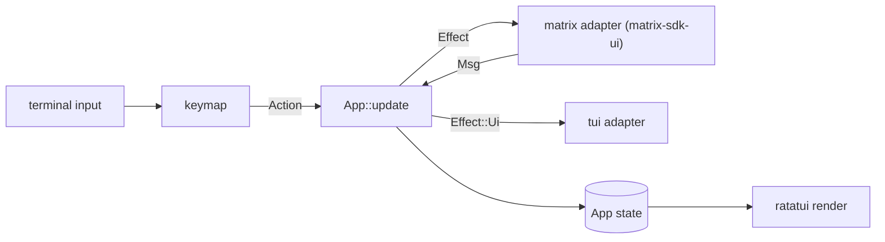
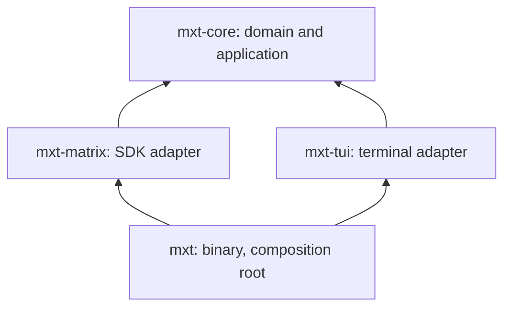

# mxt design

Date: 2026-11-18
Status: draft for review

## Summary

mxt is a terminal Matrix client with nvim-like keybindings. It targets
accounts where most rooms are bridged from other networks (Discord, Slack,
and similar), so it shows which network a room belongs to, makes unread state
easy to navigate, and lets users rebind every key.

mxt is a single Rust binary. End-to-end encryption, sync, event aggregation
and unread counting come from matrix-rust-sdk (`matrix-sdk` and
`matrix-sdk-ui`). mxt itself is the user interface and the glue around the
SDK.

## Goals

- Read and write in encrypted rooms, including rooms bridged by mautrix
  bridges that only accept cross-signed devices.
- Show bridged rooms as `<network> / <room>` (for example
  `myserver / #general`), so rooms with the same name on different networks
  can be told apart.
- Show unread state per room, including unread messages in muted rooms, and
  let keybindings jump between rooms by unread state.
- Default keybindings follow common nvim conventions. Every binding can be
  changed in the configuration file.
- Compose messages with vim-style modal editing.
- Keep the domain and application logic pure and testable without a terminal
  or a homeserver.

## Non-goals

- Implementing any part of the Matrix protocol or end-to-end encryption.
  matrix-rust-sdk owns these.
- Running as a daemon or offering a remote API. mxt starts when the user runs
  it and exits when the user quits.
- Multiple accounts in one process.
- Being a general text editor. Message editing uses an embedded editor widget
  plus an external editor for long text.

## Scope of the first release

Included:

1. Password login and session restore. Entering the recovery key once per
   device to obtain cross-signing and key backup.
2. A room list that shows network names and unread badges.
3. A fuzzy room picker.
4. A timeline that renders HTML message bodies and shows replies, edits and
   reactions.
5. Sending text messages and replies, and sending read receipts.
6. Sending reactions, editing and deleting (redacting) the user's own
   messages.
7. A list of rooms with unread mentions, and muting or unmuting a room.
8. Files: downloading and opening attachments, uploading a file, and image
   previews where the terminal supports them.
9. A keymap and action registry that lets the configuration bind any action,
   including "open the next unread room".

Not included in the first release:

- Threads, desktop notifications, typing notifications.
- Event-level mention lists (see "Mentions" below).
- SSO or OAuth login, logout, and account management.
- Themes and colors beyond the terminal's 16-color palette.
- Reloading the configuration at runtime.
- User-defined command aliases.
- Prebuilt release binaries.

## Conventions

- All documents, code, comments and commit messages in the repository are in
  English.
- License: MIT. Code adapted from Apache-2.0 projects keeps its Apache-2.0
  notice in the adapted files, and the repository then ships `LICENSE-APACHE`.
- Tests and fixtures use made-up identifiers (`@alice:example.org`,
  `!room:example.org`). Real user IDs, room IDs, access tokens and logs are
  never committed.
- Access tokens are never logged. Message bodies are logged only at the
  `trace` level.

## Architecture

### Process and data flow

mxt is one process on a tokio runtime. crossterm handles terminal input and
output, and ratatui draws the screen.



- The keymap turns key input into `Action`s. `App::update` applies actions and
  messages to the application state and returns `Effect`s.
- `update` never performs I/O. Effects are plain data. The matrix adapter
  executes matrix effects (send a message, subscribe to a timeline, mark a room
  as read) and reports results and SDK stream updates back as `Msg`s. The tui
  adapter executes UI effects (load text into the composer, open the external
  editor).
- Every frame is rendered from the state alone.
- Actions are resolved against the state, not against rendered widgets, so an
  action such as "open the next unread room" works the same whether or not a
  list has been drawn yet.

### Crates and the dependency rule

The repository is a Cargo workspace. Dependencies point inward, and Cargo
enforces it.



| Crate | Responsibility | May depend on |
|---|---|---|
| `mxt-core` | Domain types, keymap, action registry, `App` state and `update` | `std` and small pure crates without I/O (for example `nucleo-matcher`, `unicode-width`, `unicode-segmentation`). Not the SDK, `ruma`, an async runtime, a terminal library, `serde` or `toml`. |
| `mxt-matrix` | Builds the SDK client, converts SDK data into domain types, executes matrix effects, forwards SDK streams as `Msg`s, renders HTML bodies into domain rich text | `mxt-core`, `matrix-sdk`, `matrix-sdk-ui`, tokio |
| `mxt-tui` | Layout and widgets, input routing, the composer (edtui), image previews, OSC 52 clipboard, executing UI effects | `mxt-core`, ratatui, crossterm, edtui, ratatui-image |
| `mxt` | Command line, configuration file loading (TOML DTOs), paths, logging, wiring the adapters and the event loop | all of the above, `serde`, `toml`, `tracing` |

Because `mxt-core` does not depend on the SDK, its tests build and run without
compiling matrix-rust-sdk, and SDK upgrades only touch `mxt-matrix`.

### Functional core

Workflows are functions over domain types:

```rust
impl App {
    /// Deterministic and free of I/O. Mutates the state in place to avoid
    /// cloning the whole state for every message.
    pub fn update(&mut self, msg: Msg) -> Vec<Effect> { /* ... */ }
}

pub fn next_room(rooms: &RoomList, current: Option<&RoomId>, query: &RoomQuery) -> Option<RoomId> {
    /* ... */
}
```

Rules:

- Illegal states are unrepresentable where it is cheap to do so. Example:

  ```rust
  pub enum Draft {
      New,
      Reply { to: EventRef },
      Edit { target: OwnEvent },
  }

  /// An event sent by the current user. The only constructor checks the sender.
  pub struct OwnEvent(EventRef);

  impl OwnEvent {
      pub fn new(event: EventRef, sender: &UserId, me: &UserId) -> Option<Self> {
          (sender == me).then_some(Self(event))
      }
  }
  ```

  Replying and editing at the same time, or editing another user's message,
  cannot be expressed.
- Parse, don't validate. Configuration values and SDK data are converted into
  domain types once, at the boundary. Code inside the core trusts them.
- Identifiers in the core are mxt's own newtypes (`RoomId`, `EventId`,
  `UserId`), not `ruma` types.
- Subscriptions are effects too: `Effect::SubscribeTimeline(RoomId)` and
  `Effect::UnsubscribeTimeline(RoomId)`. Their output arrives as `Msg`s.
- No ceremony: no repository traits, dependency injection containers or one
  type per use case. Types and functions are enough.

### Domain model

The main types in `mxt-core`:

- `RoomSummary`: id, `RoomName { network: Option<String>, room: String }`,
  kind (direct message, group, space), `UnreadCounts`, `NotificationMode`
  (default, mentions and keywords only, mute), time of the latest activity.
- `UnreadCounts { messages, notifications, mentions, marked }`. `messages`
  counts unread messages even in muted rooms. `notifications` counts unread
  events that notify according to the user's push rules. `mentions` counts
  unread highlights. `marked` is the manual unread mark.
- `Badge`, derived from `UnreadCounts` (see "Unread badges").
- `RoomQuery { filter: RoomFilter, pick: Pick }` and fuzzy name queries.
- `TimelineItem`: sender, timestamp, `MessageContent` (text as `RichText`,
  notice, emote, image, file, undecryptable, unsupported), optional reply
  preview, reaction groups (key, count, whether the user reacted), an edited
  flag, and the local send state (sending, sent, failed).
- `RichText`: lines of styled spans (bold, italic, code, link with URL,
  mention). The terminal adapter maps it to ratatui spans.
- `Draft` and `OwnEvent` as shown above.
- UI state: focus (room list, timeline, composer), mode, picker state, cursor
  positions, the visible status message.

### Matrix adapter

- Sync: `SyncService` with simplified sliding sync (MSC4186) and
  `RoomListService` for the set of rooms. Each open room has a `Timeline`.
- Room summaries come from the SDK room info: display name,
  `num_unread_messages`, `num_unread_notifications`, `num_unread_mentions`,
  `is_marked_unread`, the user-defined notification mode and the latest event
  time. The core filters and sorts them itself, so the meaning of every filter
  is defined in one place.
- Network names: the `network.displayname` field of the room's `m.bridge`
  state event (falling back to `uk.half-shot.bridge`). Without a bridge event,
  the name of the room's canonical parent space (`SpaceService`). Otherwise the
  room has no network name.
- Recovery: `Recovery::recover(recovery_key)`.
- Mute: the SDK notification settings. Muting sets the room mode to mute.
  Unmuting removes the user-defined room rule, so the account default applies
  again.
- HTML bodies: `formatted_body` is rendered into `RichText` in this crate.
- Fallback: if phase 0 shows that a target homeserver cannot serve simplified
  sliding sync, the adapter uses classic `/sync` instead and builds the room
  set from `Client::rooms()`. The core does not change, because both paths
  produce the same `Msg`s.

### Terminal adapter and the composer

- The composer is an edtui editor (vim mode) owned by `mxt-tui`. Text editing
  is an input detail. The core only knows what the draft is (`Draft`).
- Sending: the tui adapter reads the editor text and sends
  `Msg::Submit(body)` to the core.
- Editing an existing message: the core returns
  `Effect::Ui(LoadComposer(text))`, and the tui adapter loads the text into
  edtui.
- Input routing while the composer has focus: look up the key in the core
  keymap table for the composer and the editor's current mode
  (`composer.insert` or `composer.normal`). If it is bound, run the action.
  Otherwise pass the key to edtui.
- The external editor (`composer.external_editor`) uses edtui's
  `system-editor` feature, which opens `$VISUAL` or `$EDITOR`.
- Replacing edtui later (with another editor widget or an in-house vim engine)
  only touches `mxt-tui`.

## User interface

### Layout

- Left: the room list, which can be hidden.
- Right: the timeline of the open room, with the composer below it.
- Bottom line: status line showing the mode, the open room and the sync state.
  Pressing `:` turns it into the command line.
- Overlays: the fuzzy room picker and the emoji picker.

### Modes

`NORMAL`, `INSERT` (composer), `COMMAND` (`:` command line) and `PICKER`. In
normal mode the room list and the timeline have no character cursor. They move
one room or one message at a time. Because of that, `<Space>` is free and is
the default leader.

### Room names

- Bridged rooms and rooms in a space: `<network> / <room>`.
- Direct messages: the other user's display name.
- Other rooms: the room's display name.

### Unread badges

A room shows at most one badge, chosen by the first rule that matches:

| Rule | Badge | Style |
|---|---|---|
| `mentions > 0` | `@<mentions>` | mention style |
| `notifications > 0` | `<notifications>` | bold |
| `messages > 0` | `<messages>` | dim (typical for muted rooms) |
| `marked` | `U` | marked style |

Counts above 99 show as `99+`. Muted rooms also show a `Muted` label, and
rooms set to mentions and keywords only show a `Mentions only` label.

### Room order

The default order is by latest activity, newest first. The configuration can
switch to alphabetical order by display name.

### Default keymap

| Where | Key | Action | nvim analogy |
|---|---|---|---|
| anywhere | `:` | `command_line.open` | same |
| anywhere | `<leader><leader>` | `picker.rooms` | file picker in common distributions |
| anywhere | `<leader>e` | `sidebar.toggle` | file explorer toggle |
| anywhere | `<leader>m` | `room.list_mentions` | |
| anywhere | `<C-w>h` / `<C-w>l` | `focus.room_list` / `focus.timeline` | window movement |
| room list, timeline | `j` / `k` | `cursor.down` / `cursor.up` | same |
| room list, timeline | `gg` / `G` | `cursor.first` / `cursor.last` | same |
| room list, timeline | `<C-d>` / `<C-u>` | `cursor.half_page_down` / `cursor.half_page_up` | same |
| room list, timeline | `/` / `n` / `N` | `search.start` / `search.next` / `search.prev` | same |
| room list | `<CR>` | `room.open_selected` | |
| timeline | `i` / `a` | `composer.new` | insert |
| timeline | `r` | `message.reply` | |
| timeline | `e` | `message.edit` (own messages only) | |
| timeline | `dd` | `message.delete` (own messages only, after confirmation) | delete line |
| timeline | `yy` | `message.yank` (OSC 52) | same |
| timeline | `+` | `message.react` (opens the emoji picker) | |
| timeline | `gx` | `message.open` (link or attachment) | `gx` |
| timeline | `gd` | `message.goto_reply` (the replied-to message) | go to definition |
| composer, insert | `<CR>` | `composer.send` | |
| composer, insert | `<C-j>` | `composer.newline` | |
| composer, insert and normal | `<C-x><C-e>` | `composer.external_editor` | shell edit-command-line |
| composer, insert | `<Esc>` | not bound; edtui switches to its normal mode and the draft is kept | same |
| composer, normal | `<Esc>` | `focus.timeline`; the draft is kept | |
| picker | `<C-n>` / `<C-p>` | `picker.next` / `picker.prev` | completion menu |
| picker | `<CR>` / `<Esc>` | `picker.accept` / `picker.cancel` | |

`<C-j>` inserts a newline because many terminals cannot tell Shift+Enter apart
from Enter.

There is no default binding for "open the next unread room". The action exists
and users bind it themselves, for example
`"]u" = { action = "room.open", filter = "unread", pick = "next" }`.

### Commands

Commands resolve through the same action registry as keys.

| Command | Action |
|---|---|
| `:open <room>` | `room.open` with `query`, with fuzzy completion over room names |
| `:mute` / `:unmute` | `room.mute` / `room.unmute` |
| `:upload <path>` | `file.upload` |
| `:recover` | `account.recover` (prompts for the recovery key) |
| `:q` | `app.quit` |

### Mentions

In the first release, `room.list_mentions` shows the rooms whose
`mentions > 0`. Listing individual mention events needs the server's
`/notifications` endpoint, and phase 0 checks whether the target homeservers
support it.

### Files and images

- `gx` on an attachment downloads it to `files.download_dir` and opens it
  with `files.opener`. The default opener is `xdg-open` on Linux and `open` on
  macOS.
- `:upload <path>` sends the file as an image or a file message, using the
  MIME type guessed from the file.
- Image previews use ratatui-image, which detects the terminal's graphics
  protocol (sixel, kitty, iTerm2) and falls back to half blocks.
  `ui.image_preview = "off"` disables previews.

## Configuration

### Location

`$XDG_CONFIG_HOME/mxt/config.toml`, or `~/.config/mxt/config.toml` when
`XDG_CONFIG_HOME` is unset. The same path is used on macOS.

### Example

```toml
[account]
user_id = "@alice:example.org"
# homeserver = "https://matrix.example.org"  # omitted: discovered via .well-known

[ui]
leader = "<Space>"
room_list = { visible = true, sort = "recent" }  # sort: "recent" | "name"
time_format = "%H:%M"
image_preview = "auto"                            # "auto" | "off"
read_receipts = "public"                          # "public" | "private"

[files]
download_dir = "~/Downloads"
# opener = "xdg-open"

[keymap.normal]                 # every pane in normal mode
"]u" = { action = "room.open", filter = "unread", pick = "next" }
"<leader>x" = ["room.mark_read", { action = "room.open", filter = "unread", pick = "next" }]

[keymap.timeline]               # only while the timeline has focus
"dd" = "nop"                    # remove a default binding
"D" = "message.delete"

[keymap.composer.insert]        # checked before keys reach the editor
"<C-s>" = "composer.send"
```

`ui.read_receipts = "public"` sends `m.read` receipts, which other users see.
`"private"` sends `m.read.private`, which only the user's own devices see.

### Binding values

- A string names an action without arguments: `"picker.rooms"`.
- A table names an action with arguments:
  `{ action = "room.open", filter = "unread", pick = "next" }`.
- An array runs several actions in order against the state.
- `"nop"` removes a binding, like nvim's `<Nop>`.

### Resolution

Tables: `normal`, `room_list`, `timeline`, `composer.insert`,
`composer.normal` and `picker`. A key is looked up in the table of the focused
pane first and then in `normal`, like buffer-local maps taking precedence over
global maps in nvim. The user's tables are merged over the defaults key by key.
Movement actions accept a count prefix (`5j`).

### Action registry

Actions are named `<target>.<verb>`. The first release has:

- rooms: `room.open`, `room.open_selected`, `room.mark_read`, `room.mute`,
  `room.unmute`, `room.list_mentions`
- messages: `message.reply`, `message.edit`, `message.delete`,
  `message.yank`, `message.react`, `message.open`, `message.goto_reply`,
  `message.resend`
- composer: `composer.new`, `composer.send`, `composer.newline`,
  `composer.external_editor`
- pickers: `picker.rooms`, `picker.next`, `picker.prev`, `picker.accept`,
  `picker.cancel`
- movement and search: `cursor.down`, `cursor.up`, `cursor.first`,
  `cursor.last`, `cursor.half_page_down`, `cursor.half_page_up`,
  `search.start`, `search.next`, `search.prev`
- other: `command_line.open`, `sidebar.toggle`, `focus.room_list`,
  `focus.timeline`, `file.upload`, `account.recover`, `app.quit`, `nop`

Each action declares typed arguments. `room.open` takes:

| Argument | Values | Meaning |
|---|---|---|
| `filter` | `all` (default) | every joined room |
| | `unread` | any badge: `messages`, `notifications` or `mentions` above zero, or `marked` |
| | `notify` | `notifications` or `mentions` above zero, or `marked` |
| | `mentions` | `mentions` above zero |
| `pick` | `first` (default) | the first matching room in the current room order |
| | `next` | the first matching room after the current room in the current room order, wrapping around; the first matching room when no room is open |
| | `prev` | the same, backwards |
| `query` | string | fuzzy name query, used by `:open`; the best match among the rooms that pass `filter` is opened and `pick` is ignored |

### Layers

- `mxt` reads the file into serde DTOs and converts argument values into the
  core's neutral `ArgValue` (string, integer, boolean).
- The core builds checked types with `Action::from_spec(name, args)`,
  `KeySeq::parse("<C-x><C-e>")` and `Keymap::new(..)`.
- Errors are reported with the file, line and reason before the terminal UI
  starts, and mxt exits with a non-zero status: unknown keys
  (`deny_unknown_fields`), unknown actions, wrong argument types, invalid key
  notation. A typo is never silently ignored.

## Storage

| Path | Contents |
|---|---|
| `$XDG_DATA_HOME/mxt/` | session file (mode 0600), SDK state and crypto stores |
| `$XDG_CACHE_HOME/mxt/` | SDK event cache, downloaded media |
| `$XDG_STATE_HOME/mxt/` | logs |

The usual defaults apply when the variables are unset (`~/.local/share`,
`~/.cache`, `~/.local/state`), on macOS as well.

## Error handling

- Startup failures (configuration, login, opening the stores) are printed
  before the terminal UI starts, and mxt exits with a non-zero status.
- Runtime failures of effects come back as `Msg::EffectFailed`. They are shown
  in the status line and logged. They never panic.
- Sync state (synced, offline, retrying) is shown in the status line. When the
  sync service stops with an error, mxt restarts it with backoff.
- Events that cannot be decrypted yet show a placeholder. The `Timeline`
  retries decryption when keys arrive.
- Failed sends keep the local echo with a failed marker. `message.resend` sends
  it again.
- Redaction asks for confirmation in the status line (`y` confirms, any other
  key cancels) because it cannot be undone.
- A panic hook restores the terminal before printing the panic.

## Logging

`tracing` writes daily files to `$XDG_STATE_HOME/mxt/` and keeps seven days.
`MXT_LOG` takes an `EnvFilter` directive. The default is `info` for mxt and
`warn` for matrix-rust-sdk.

## Testing

- `mxt-core` carries most tests, as plain unit tests:
  - state transitions in `update`
  - key notation parsing and keymap resolution order
  - `Action::from_spec` rejecting unknown actions and wrong arguments
  - room filtering, ordering and `pick = next` wrapping around
  - badge precedence
  - `OwnEvent` construction
- `mxt-matrix`: tests for converting SDK values into domain types and for HTML
  rendering, with constructed inputs. The SDK is not mocked. The rest is
  covered by phase 0 and by running mxt against a homeserver.
- `mxt-tui`: no rendering snapshots, which would pin incidental layout. It is
  verified by running mxt.
- Continuous integration (GitHub Actions, Linux and macOS), all inside the
  flake's toolchain:
  - `nix flake check`, which builds the package and runs `cargo test`
  - `nix develop -c cargo clippy --all-targets -- -D warnings`
  - `nix develop -c cargo fmt --check`
- A prek pre-commit configuration runs `cargo fmt --check` and clippy.

## Build and distribution

### Toolchain

The Rust toolchain comes from the flake's pinned nixpkgs (`nixos-unstable`).
matrix-sdk 0.19 needs Rust 1.96 or later. `nix develop` provides cargo, rustc,
clippy, rustfmt and rust-analyzer, so every machine and CI use the same
version. The version changes only with `nix flake update`. `Cargo.toml`
declares `rust-version = "1.96"` for builds outside Nix.

`[profile.dev]` reduces debug information of dependencies to
`line-tables-only`, which keeps the target directory smaller and linking
lighter.

### Nix flake

- Systems: `x86_64-linux`, `aarch64-linux`, `x86_64-darwin`,
  `aarch64-darwin`.
- `packages.default`: `rustPlatform.buildRustPackage` with
  `cargoLock.lockFile = ./Cargo.lock`. `Cargo.lock` is committed. Git
  dependencies are avoided, so no output hashes need maintenance. Native
  inputs follow the SDK's needs (nixpkgs' iamb package, also built on
  matrix-rust-sdk, needs `sqlite`, `aws-lc` and `pkg-config`).
- `devShells.default`: the toolchain listed above.
- `checks.package`: the package build.

### Installing

- Nix: `nix profile install github:kisepichu/mxt`, or use the flake as an
  input of a NixOS or home-manager configuration.
- Without Nix: `cargo install --git https://github.com/kisepichu/mxt`, for
  example through mise's cargo backend.

Prebuilt binaries on GitHub Releases are out of scope for the first release.

## Development phases

| Phase | Work | Exit criteria |
|---|---|---|
| 0. Spike | The flake's development shell. A throwaway binary that logs in, recovers, runs `SyncService` and `RoomListService`, prints the room list with unread counts and network names, and decrypts the latest message of a bridged room. A small edtui program for checking CJK text and input method input. The spike is deleted afterwards and its findings are added to this document. | Decisions recorded: sliding sync or classic sync per target homeserver; network names available from `m.bridge`; `/notifications` supported or not; edtui handles CJK width and input method input correctly, or the composer choice is revisited. |
| 1. Skeleton | Workspace and crates, the flake package and checks, CI, the prek configuration, core domain (room summaries, filters, ordering, keymap, actions, `update`), configuration loading, login, session restore, recovery, sync, the room list pane and the status line | The room list with network names and unread badges can be browsed, keymap overrides from the configuration work, and CI passes |
| 2. Timeline | `Timeline` subscription, HTML rendering, replies, edits and reactions shown, back pagination, read receipts | Rooms can be read day to day |
| 3. Sending | The edtui composer, sending, replying, editing, deleting, reacting with the emoji picker, the external editor | Messages can be written day to day |
| 4. Rest of the first release | Fuzzy room picker, mentions list, mute and unmute, file download, open and upload, image previews | Everything in "Scope of the first release" works |

## Risks and open questions

- **Sliding sync on bridge-heavy homeservers.** A homeserver can advertise
  `org.matrix.simplified_msc3575` and still behave differently from what
  `matrix-sdk-ui` expects. Phase 0 tests this, and the classic sync fallback
  limits the impact to `mxt-matrix`.
- **edtui and CJK text.** Cursor placement with wide characters and input
  method input are untested. Phase 0 tests them before the composer is built.
- **edtui differences from vim.** edtui has no count prefixes, and `r` is
  redo instead of replace. Rebinding through edtui's keybinding API covers
  what it can. The rest is accepted for the first release.
- **Network names for other bridges.** Discord rooms carry the server name in
  `m.bridge`. Other bridges are expected to fill `network.displayname`
  similarly, which is not yet verified.
- **SDK API churn.** matrix-rust-sdk is pre-1.0, and upgrades can break its
  API. The adapter boundary keeps that work inside `mxt-matrix`.

## Third-party licenses

| Component | License |
|---|---|
| matrix-rust-sdk (`matrix-sdk`, `matrix-sdk-ui`), vodozemac | Apache-2.0 |
| ratatui, ratatui-image, edtui | MIT |
| nucleo (`nucleo-matcher`) | MPL-2.0 |
| unicode-width, unicode-segmentation | MIT OR Apache-2.0 |

All of them can be used from an MIT-licensed program. No dependency is under
the AGPL or the GPL.
