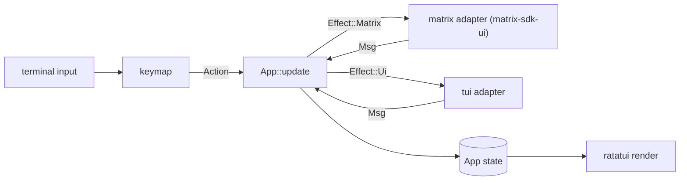
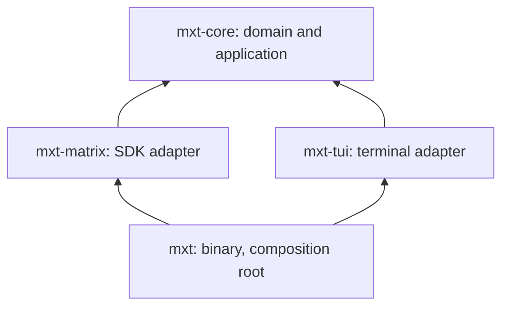

# mxt design

Date: 2026-11-18
Status: draft for review (revision 3)

## Summary

mxt is a terminal Matrix client with nvim-like keybindings. It targets
accounts where most rooms are bridged from other networks (Discord, Slack,
and similar), so it shows which network a room belongs to, makes unread state
easy to navigate, and lets users rebind every key.

mxt is a single Rust binary. End-to-end encryption, sync, event aggregation
and unread counting come from matrix-rust-sdk (`matrix-sdk` and
`matrix-sdk-ui`). mxt itself is the user interface and the glue around the
SDK.

## Goals

- Read and write in encrypted rooms, including rooms bridged by mautrix
  bridges that only accept cross-signed devices.
- Show bridged rooms as `<network> / <room>` (for example
  `myserver / #general`), so rooms with the same name on different networks
  can be told apart.
- Show unread state per room, including unread messages in muted rooms, and
  let keybindings jump between rooms by unread state.
- Default keybindings follow common nvim conventions. Every binding can be
  changed in the configuration file.
- Compose messages with vim-style modal editing.
- Keep the domain and application logic pure and testable without a terminal
  or a homeserver.

## Non-goals

- Implementing any part of the Matrix protocol or end-to-end encryption.
  matrix-rust-sdk owns these.
- Running as a daemon or offering a remote API. mxt starts when the user runs
  it and exits when the user quits.
- Multiple accounts in one process.
- Being a general text editor. Message editing uses an embedded editor widget
  plus an external editor for long text.

## Scope of the first release

Included:

1. Password login and session restore. Entering the recovery key once per
   device to obtain cross-signing and key backup.
2. A room list that shows network names and unread badges.
3. A fuzzy room picker, also used to list rooms with unread mentions.
4. A timeline that renders HTML message bodies and shows replies, edits and
   reactions, and a full-screen view for messages taller than the screen and
   for images.
5. Sending messages written in Markdown, replies, mentions of room members
   completed after typing `@`, and read receipts.
6. Toggling reactions, editing and deleting (redacting) the user's own
   messages.
7. Muting and unmuting a room.
8. Files: downloading and opening attachments, uploading a file, and image
   previews where the terminal supports them.
9. A keymap and action registry that lets the configuration bind any action,
   including "open the next unread room".

Not included in the first release:

- Threads, desktop notifications, typing notifications.
- Event-level mention lists (see "Mentions").
- Room-wide mentions (`@room`).
- SSO or OAuth login, logout, and account management.
- Setting up cross-signing or secret storage for an account that has none
  (bootstrapping needs user-interactive authentication). Such accounts must be
  set up in another client first.
- Themes and colors beyond the terminal's 16-color palette.
- Reloading the configuration at runtime.
- User-defined command aliases and a generic `:<action>` command.
- Prebuilt release binaries.

## Conventions

- All documents, code, comments and commit messages in the repository are in
  English.
- License: MIT. Code adapted from Apache-2.0 projects keeps its Apache-2.0
  notice in the adapted files, and the repository then ships `LICENSE-APACHE`.
- Dependency licenses are checked by `cargo-deny` in CI. GPL-family licenses,
  including the AGPL, are rejected. The allow list in `deny.toml` holds the
  permissive licenses the tree needs (MIT, Apache-2.0, BSD-3-Clause, ISC,
  MIT-0, Unicode-3.0, Unlicense and similar) and MPL-2.0.
- Tests and fixtures use made-up identifiers (`@alice:example.org`,
  `!room:example.org`). Real user IDs, room IDs, access tokens and logs are
  never committed.
- Access tokens are never logged. Message bodies are logged only at the
  `trace` level.

## Architecture

### Process and data flow

mxt is one process on a tokio runtime. crossterm handles terminal input and
output, and ratatui draws the screen.



- The keymap turns key input into `Action`s. `App::update` applies actions and
  messages to the application state and returns `Effect`s.
- `update` never performs I/O and never reads a clock. Effects are plain data.
  The matrix adapter executes matrix effects (send a message, subscribe to a
  timeline, mark a room as read) and reports results and SDK stream updates
  back as `Msg`s. The tui adapter executes UI effects (load text into the
  composer, start a timer, open a file) and reports terminal facts as `Msg`s
  (submitted text, viewport sizes, terminal focus, timer expiry).
- Every frame is rendered from the core state plus the widget state that
  `mxt-tui` owns (the edtui editors and the image cache).
- Actions are resolved against the state, not against rendered widgets, so an
  action such as "open the next unread room" works the same whether or not a
  list has been drawn yet.

### Crates and the dependency rule

The repository is a Cargo workspace. Dependencies point inward, and Cargo
enforces it.



| Crate | Responsibility | May depend on |
|---|---|---|
| `mxt-core` | Domain types, keymap and its resolver, action registry, pickers, mention rendering, `App` state and `update` | `std` and small pure crates without I/O (`nucleo-matcher`, `emojis`, `pulldown-cmark`, `unicode-segmentation`). Not the SDK, `ruma`, an async runtime, a terminal library, `serde` or `toml`. |
| `mxt-matrix` | Builds the SDK client, converts SDK data into domain types, executes matrix effects, forwards SDK streams as `Msg`s, reads bridge state, renders HTML bodies into domain rich text, reads and writes the session file | `mxt-core`, `matrix-sdk`, `matrix-sdk-ui`, tokio, `serde`/`serde_json` (the session file holds the SDK's serde session type); HTML parsing through `matrix_sdk::ruma::html`, plus a feature-only `ruma` dependency of the SDK's ruma version that enables `html-matrix` (the SDK enables only `html`) |
| `mxt-tui` | Layout and widgets, input routing, the composers and the message view (edtui), image decoding and previews, OSC 52 clipboard, local time formatting, executing UI effects | `mxt-core`, ratatui, crossterm, edtui, ratatui-image, image, jiff |
| `mxt` | Command line, startup flow, configuration file loading (TOML DTOs), paths, the data directory lock, logging, wiring the adapters and the event loop | all of the above, `serde`, `toml`, `tracing` |

Because `mxt-core` does not depend on the SDK, its tests build and run without
compiling matrix-rust-sdk, and SDK upgrades only touch `mxt-matrix`.

### Functional core

Workflows are functions over domain types:

```rust
impl App {
    /// Deterministic and free of I/O. Mutates the state in place to avoid
    /// cloning the whole state for every message.
    pub fn update(&mut self, msg: Msg) -> Vec<Effect> { /* ... */ }
}

pub fn resolve_room(rooms: &RoomList, current: Option<&RoomId>, target: &RoomTarget) -> Option<RoomId> {
    /* ... */
}
```

Rules:

- Illegal states are unrepresentable where it is cheap to do so. Examples:

  ```rust
  /// A timeline item: a local echo before the server assigns an event ID,
  /// or a remote event. Mirrors the SDK's `TimelineEventItemId`.
  pub enum ItemRef {
      Local(TxnId),
      Remote(EventId),
  }

  pub enum Draft {
      New,
      /// Replies go to remote events only: a reply to a local echo is refused
      /// until the echo is sent.
      Reply { to: EventId },
      Edit { target: OwnEvent },
  }

  /// An item sent by the current user. The sender is taken from the item
  /// itself, so a caller cannot pass the wrong one.
  pub struct OwnEvent(ItemRef);

  impl OwnEvent {
      pub fn new(item: &TimelineItem, me: &UserId) -> Option<Self> {
          (item.sender == *me).then(|| Self(item.id.clone()))
      }
  }

  /// Which room `room.open` and `picker.rooms` act on.
  pub enum RoomTarget {
      Pick { filter: RoomFilter, pick: Pick },
      Fuzzy { filter: RoomFilter, query: String },
  }
  ```

  Replying and editing at the same time, editing another user's message, and
  a `room.open` that has both a pick rule and a query cannot be expressed.
- Parse, don't validate. Configuration values and SDK data are converted into
  domain types once, at the boundary. Code inside the core trusts them.
- Identifiers in the core are mxt's own newtypes (`RoomId`, `EventId`,
  `TxnId`, `UserId`), not `ruma` types. Timestamps are UTC milliseconds.
- Effects come in two groups. `Effect::Matrix(..)` is executed by the matrix
  adapter (for example `SubscribeTimeline`, `UnsubscribeTimeline`,
  `PaginateBackwards`, `LoadMembers`, `FetchImage`, `Send`). `Effect::Ui(..)`
  is executed by the tui adapter (for example `StartTimer { id, after }`,
  `LoadComposer`, `ClearComposer`, `ReplayKeys`, `ReplaceMentionToken`,
  `OpenView`). Results arrive as `Msg`s (timeline diffs, `Msg::MembersLoaded`,
  `Msg::ImageFetched`, `Msg::Timeout { id }`).
- Media bytes pass through the core as an opaque `MediaBytes` handle
  (`Arc<[u8]>`). The core never decodes them; it only routes them from the
  matrix adapter to the tui adapter.
- No ceremony: no repository traits, dependency injection containers or one
  type per use case. Types and functions are enough.

### Domain model

The main types in `mxt-core`:

- `RoomSummary`: id, `RoomName { network: Option<String>, room: String }`,
  kind (direct message or group), `UnreadCounts`, `NotificationMode`
  (default, mentions and keywords only, mute), time of the latest activity.
  Spaces are not room summaries; their names only feed `RoomName.network`.
- `UnreadCounts { messages, notifications, mentions, marked }`. `messages`
  counts unread messages even in muted rooms. `notifications` counts unread
  events that notify according to the user's push rules. `mentions` counts
  unread highlights. `marked` is the manual unread mark. All counts are
  computed client-side by the SDK (see "Risks").
- `Badge`, derived from `UnreadCounts` (see "Unread badges").
- `RoomTarget`, `RoomFilter` and `Pick` (see "Action registry").
- `TimelineItem`: `id: ItemRef`, sender, timestamp, `MessageContent`,
  optional reply preview, reaction groups (key, count, whether the user
  reacted), an edited flag, and the local send state (sending, sent, failed).
  The timeline also contains date dividers and the read marker, which the SDK
  provides as virtual items.
- `MessageContent`: `Text { body, rich }` (the event's plain `body`, which
  `message.edit` loads, and its `RichText`), `Notice(RichText)`, `Emote(RichText)`,
  `Image { name, size, dimensions }`, `File { name, size, mime }` (also used
  for video and audio), `Sticker { body }`, `Redacted`, `Undecryptable`,
  `Unsupported { kind }`.
- `RichText`: a list of blocks (paragraph, code block with optional language,
  block quote, ordered or unordered list). Paragraphs hold inline spans: text
  with bold, italic, strikethrough, inline code or spoiler style; links with a
  URL; mentions of users or rooms; custom emoticons shown by their alt text.
  The terminal adapter maps it to ratatui lines.
- Composers: per room, the `Draft`, the mentions inserted so far
  (`MentionRef { user: UserId, text: String }`), and whether the composer is
  empty. They are kept when switching rooms.
- Room members: user ID and display name, loaded per room on demand, used for
  mention completion.
- UI state: focus (room list, timeline, composer), mode, keymap resolver
  state, picker state, the open message view, cursor positions, the last
  known viewport of each pane, terminal focus (initially focused), the status
  message.

### Keymap resolver

The resolver lives in `mxt-core` and is deterministic, so its behavior is
covered by unit tests.

- For the current mode, the tables in the fallback chain (see "Tables and
  resolution") are merged into one effective map before resolution. For the
  same key sequence, the earlier table wins. Prefixes are judged on the
  merged map, so with `"]"` in `timeline` and `"]u"` in `normal`, `]` waits
  like it does in nvim.
- `nop` is a binding that does nothing. It shadows the same key sequence in
  later tables.
- The resolver holds the pending key sequence. Count prefixes (`5j`) are part
  of the same pending state.
- A key sequence that is a complete binding and not a prefix of a longer one
  runs immediately.
- A key sequence that is a prefix of a longer binding stays pending. The
  resolver returns `Effect::Ui(StartTimer)` with `ui.timeoutlen` (default 1000 ms,
  like nvim's `timeoutlen`).
- On `Msg::Timeout`, and when the next key makes the pending sequence match
  nothing: the longest binding that is a prefix of the pending keys (with the
  new key, in the second case) runs, and the keys after it are resolved
  afresh, one by one. When no prefix is a binding, only the first pending key
  is released, and the keys after it are resolved afresh. This is nvim's
  behavior.
- Released keys go to the text input that would have received them: the
  composer's or the message view's editor through
  `Effect::Ui(ReplayKeys(keys))`, or the picker or command line query. In
  panes without text input they are dropped.

### Matrix adapter

- Sync: classic `/sync` (phase 0 decided it; see "Phase 0 findings"). mxt
  runs its own loop of `Client::sync_once` with the stored token, a long-poll
  timeout, presence offline, and a filter with lazy-loaded members and a
  small timeline limit. It subscribes the SDK's event cache, which computes
  unread counts and latest events for every room. The set of rooms comes from
  `Client::rooms()` (joined rooms that are not spaces), updated from each sync
  response and from room info updates.
- Timelines: only the open room has a subscribed `Timeline`. Opening another
  room unsubscribes the previous one. The core requests
  `Effect::Matrix(PaginateBackwards)` when the timeline cursor comes within 10 items
  of the oldest loaded item, with at most one request in flight per room.
- Room summaries come from the SDK room info: display name,
  `num_unread_messages`, `num_unread_notifications`, `num_unread_mentions`,
  `is_marked_unread`, the user-defined notification mode and the latest event
  time. The core filters and sorts them itself, so the meaning of every filter
  is defined in one place.
- Bridge state: classic sync delivers each room's full state (members are
  lazy-loaded), so `m.bridge` and `uk.half-shot.bridge` are read from the
  stored room state. `mxt-matrix` parses them itself and keeps, per room,
  either the bridge information or the fact that the room has none.
- Network names, for every room including direct messages, first match wins:
  1. `network.displayname` of the room's `m.bridge` event (or
     `uk.half-shot.bridge`)
  2. `protocol.displayname` of that event
  3. the name of the room's canonical parent space
  4. the name of the parent space, when the user has joined exactly one
  5. none
- Recovery: `Recovery::recover(recovery_key)`.
- Encryption settings: `backup_download_strategy` is
  `BackupDownloadStrategy::AfterDecryptionFailure`, so an event that fails to
  decrypt makes the SDK fetch its key from the key backup. The SDK default
  (`Manual`) never fetches keys, and `OneShot` downloads every key at once,
  which is heavy for accounts with many rooms. `auto_enable_backups` and
  `auto_enable_cross_signing` stay off, because creating them is out of
  scope.
- Mute: the SDK notification settings. Muting sets the room mode to mute.
  Unmuting removes the user-defined room rule, so the account default applies
  again.
- Sending: the composer text is Markdown. The core's
  `render_mentions(text, mentions)` returns three things:
  - the plain body: the editor text unchanged, so mentions read as
    `@Alice` in notifications and in clients that ignore HTML;
  - the Markdown for the HTML body: every inserted mention text that is still
    present and not inside inline code or a code block (found with
    `pulldown-cmark` offsets) replaced by a link to
    `https://matrix.to/#/<user ID>`, with Markdown in the link text escaped;
  - the user IDs of the mentions that remain.

  The adapter converts the Markdown with ruma's `FormattedBody::markdown`
  and sends `RoomMessageEventContent::text_html(plain, html)` with
  `m.mentions.user_ids` set. When the Markdown has no formatting at all, it
  sends `text_plain(plain)`. ruma turns soft line breaks into hard breaks, so
  newlines from `<C-j>` stay newlines in HTML. Bridges turn the links into
  mentions on the remote network. Replies and edits use the timeline's reply
  and edit calls.
- Reactions: `Timeline::toggle_reaction`. Choosing a reaction the user already
  sent removes it.
- Read receipts: the core requests a receipt for the latest event when the
  room is open, the timeline shows its newest item, and the terminal has
  focus. The terminal counts as focused from startup until a crossterm
  `FocusLost` event arrives, so terminals and multiplexers that never send
  focus events still get receipts. The adapter sends the configured receipt
  type (`m.read` or `m.read.private`) and moves the `m.fully_read` marker to
  the same event.
- `room.mark_read` acts on the room under the cursor when the room list has
  focus, and on the open room otherwise. It sends the same receipt for that
  room's latest event as known to the room list (the exact SDK call is
  settled in phase 1), and clears the room's manual unread mark.
- Optimistic clearing: when the core requests a receipt or runs
  `room.mark_read`, it sets that room's `UnreadCounts` to zero immediately.
  The next SDK update overwrites it. This makes action sequences such as
  `["room.mark_read", <open the next unread room>]` deterministic.
- Room keys are shared with the SDK's default recipient strategy
  (`CollectStrategy::AllDevices`), which does not refuse to send when another
  user's identity changes.
- HTML bodies: `formatted_body` is parsed with `ruma::html` into `RichText`.
  `<mx-reply>` fallbacks are dropped, `<del>` becomes strikethrough,
  `data-mx-spoiler` becomes spoiler style, and ``
  becomes its alt text.
- Images: `FetchImage` uses the event's thumbnail source when there is one.
  In encrypted rooms there is often none, and the SDK cannot ask the server to
  scale encrypted media, so the adapter downloads the full file. Files larger
  than 10 MB are not fetched for previews.
- Sync path: phase 0 decided on classic `/sync` for the target homeserver,
  and only that path is implemented (see "Phase 0 findings"). The core
  receives the same `Msg`s either way, so another path could be added in
  `mxt-matrix` alone.

### Terminal adapter and the composer

- The composer is an edtui editor in vim mode, owned by `mxt-tui`, one editor
  state per room. edtui is used with
  `default-features = false, features = ["system-editor"]`, which leaves out
  the system clipboard (arboard), mouse support and syntax highlighting.
- edtui's clipboard is a custom `ClipboardTrait` implementation: copying
  writes the text to the terminal clipboard with OSC 52 and keeps it in an
  internal register, and pasting reads the internal register. Every editor
  state gets the same `Rc<RefCell<Register>>` handle, and timeline yanks use
  the same register.
- Text editing is an input detail. The core only knows the room's `Draft` and
  whether its composer is empty, which the tui adapter reports with
  `Msg::ComposerEdited { room, empty }` when that changes.
- Sending: `composer.send` makes the tui adapter read the editor text and send
  `Msg::Submit { room, body }`. If the body is blank, nothing happens.
  Otherwise the core returns the send effect and
  `Effect::Ui(ClearComposer(room))`, and the room's draft returns to `New`.
  Failed sends are shown on the local echo (see "Error handling").
- Editing an existing message: `message.edit` requires an empty composer and
  otherwise reports "Clear the composer first" in the status line. On success
  the core loads the message's plain body (without a reply fallback) with
  `Effect::Ui(LoadComposer { room, text })`, and rebuilds the room's
  `MentionRef`s from the mention spans in the message's `RichText` whose text
  appears in that body. Edits keep their pills and `m.mentions`.
- `composer.focus` puts edtui into insert mode by default. With
  `mode = "keep"` it keeps edtui's previous mode.
- `composer.cancel`: a reply draft becomes `New` and keeps its text. An edit
  draft becomes `New` and the composer is cleared.
- Mention completion:
  - After each edit in insert mode, the tui adapter looks for an `@` token at
    the cursor (an `@` at the start of the text or after whitespace, followed
    by non-whitespace) and reports `Msg::MentionQuery { room, query }` when it
    changes, with `query: None` when there is no token.
  - The first time a room's composer gets focus, the core returns
    `Effect::Matrix(LoadMembers(room))`. The members arrive as `Msg::MembersLoaded`.
  - The core ranks the loaded members against the query with
    `nucleo-matcher`, on the display name and the user ID's localpart (the
    whole user ID when the query contains `:`, so same-named members on
    different servers can be told apart). Members who sent one of the
    loaded messages come first, newest sender first.
  - Accepting a candidate records a `MentionRef` in the room's composer and
    returns `Effect::Ui(ReplaceMentionToken { room, text })`, which replaces
    the token with the text and a space.
- Input routing while the composer has focus:
  - edtui in normal or visual mode: look the key up in `composer.normal` or
    `composer.visual`, then in `normal`. If it is not bound, pass it to edtui.
  - edtui in insert mode: while the mention menu is open, look the key up in
    `composer.completion`, then in `composer.insert`. Otherwise look it up in
    `composer.insert`. If it is not bound, pass it to edtui.
  - edtui in search mode: every key goes to edtui, including `<Esc>`.
- The external editor (`composer.external_editor`) uses edtui's
  `system-editor` feature, which opens `$VISUAL` or `$EDITOR`.
- The tui adapter reports `Msg::Viewport { pane, first, last }` after a render
  changes which items are visible. Half-page movement moves the cursor by half
  of the visible item count (at least one). The core never computes text
  layout.
- The message view: `message.view` opens the selected message in a
  full-screen overlay. For text, the overlay is an edtui scratch editor
  holding the message's text, so vim motions, search, visual selection and
  yanks work on messages taller than the timeline. Changes are discarded when
  the view closes. For images, the overlay shows the image (fetched with
  `FetchImage`, decoded and scaled down with the `image` crate, and kept in
  the tui adapter's image cache) and the file name and size. Messages taller
  than the timeline pane show a `[+N lines]` marker at the cut-off.
- Replacing edtui later (with another editor widget or an in-house vim engine)
  only touches `mxt-tui`.

## Startup

Command line: `mxt [--config PATH]` and `mxt --version`.

1. Load the configuration. If the file does not exist, print its path and a
   minimal example, and exit with a non-zero status.
2. Take an exclusive lock on `$XDG_DATA_HOME/mxt/lock` (`std::fs::File::try_lock`).
   If another mxt holds it, exit with a non-zero status. Two processes must
   never share the crypto store.
3. If a session file exists, restore the session; a session whose user ID
   differs from `account.user_id` stops the start with both IDs, and nothing
   is moved (removing the session file switches accounts). Otherwise ask for
   the password on the terminal without echo, log in (no refresh token is
   requested, so the stored access token does not change), and save the
   session.
4. Right after a first login, ask for the recovery key. An empty input skips
   it; `:recover` asks again later. If the account has no secret storage, mxt
   prints that recovery has to be set up in another client and continues.
5. Start the terminal UI and sync.

If the homeserver answers `M_UNKNOWN_TOKEN` at any time, mxt restores the
terminal, drops the SDK client so the stores are closed, renames the data
directory to `mxt.invalid-<timestamp>`, deletes the cache directory, prints
why, and exits. The next start logs in as a new device with fresh stores.

## User interface

### Layout

- Left: the room list, which can be hidden.
- Right: the timeline of the open room, with the composer below it.
- Bottom line: status line showing the mode, the open room and the sync state.
  Pressing `:` turns it into the command line.
- Overlays: the fuzzy room picker, the emoji picker, the mention menu above
  the composer, and the full-screen message view.

### Modes

| Mode | When | Keys |
|---|---|---|
| `NORMAL` | the room list or the timeline has focus | keymap |
| composer modes | the composer has focus; the status line shows edtui's mode (`INSERT`, `NORMAL`, `VISUAL`, `SEARCH`) | see "Input routing" above |
| `COMMAND` | the `:` command line is open | `command_line` table, then text input |
| `PICKER` | the room picker or the emoji picker is open | `picker` table, then text input |
| `VIEW` | the message view is open | `message_view` table while its editor is in normal or visual mode, then edtui |
| `CONFIRM` | an action asks for confirmation | `y` confirms, any other key cancels |
| `SECRET` | the recovery key is being entered | masked text input, `<CR>` submits, `<Esc>` cancels |

In `NORMAL`, the room list and the timeline have no character cursor. They
move one room or one message at a time. Because of that, `<Space>` is free
and is the default leader.

### Room names

- Rooms with a network name (see "Matrix adapter"): `<network> / <room>`.
  Direct messages use the other user's display name as `<room>`, so a
  Discord DM reads `Discord / Alice`, and a Slack DM whose bridge sets the
  workspace as `network` reads `<workspace> / Alice`.
- Rooms without a network name: the room's display name, or the other user's
  display name for direct messages.

### Unread badges

A room shows at most one badge, chosen by the first rule that matches:

| Rule | Badge | Style |
|---|---|---|
| `mentions > 0` | `@<mentions>` | mention style |
| `notifications > 0` | `<notifications>` | bold |
| `messages > 0` | `<messages>` | dim (typical for muted rooms) |
| `marked` | `U` | marked style |

Counts above 99 show as `99+`. Muted rooms also show a `Muted` label, and
rooms set to mentions and keywords only show a `Mentions only` label.

### Room list

The default order is by latest activity, newest first. `sort = "name"` sorts
case-insensitively by the full displayed name (`network / room`), which groups
rooms by network. Spaces themselves are not listed.

### Timeline

- State events (membership changes, name or topic changes) are not shown in
  the first release.
- Date dividers and the user's read marker come from the SDK's virtual items.
- Messages the SDK cannot decrypt yet show a placeholder. Redacted messages
  show `(deleted)`.
- Images show `[image: <name> <width>x<height>]` inline. Images are never
  drawn inside the scrolling timeline; `message.view` shows them.
- Messages taller than the pane show `[+N lines]`, and `message.view` shows
  them in full.

### Default keymap

| Table | Key | Action | nvim analogy |
|---|---|---|---|
| `normal` | `:` | `command_line.open` | same |
| `normal` | `<leader><leader>` | `picker.rooms` | file picker in common distributions |
| `normal` | `<leader>e` | `sidebar.toggle` | file explorer toggle |
| `normal` | `<leader>m` | `{ action = "picker.rooms", filter = "mentions" }` | |
| `normal` | `<C-w>h` / `<C-w>l` | `focus.room_list` / `focus.timeline` | window movement |
| `room_list`, `timeline` | `j` / `k` | `cursor.down` / `cursor.up` | same |
| `room_list`, `timeline` | `gg` / `G` | `cursor.first` / `cursor.last` | same |
| `room_list`, `timeline` | `<C-d>` / `<C-u>` | `cursor.half_page_down` / `cursor.half_page_up` | same |
| `room_list`, `timeline` | `/` / `n` / `N` | `search.start` / `search.next` / `search.prev` | same |
| `room_list` | `<CR>` | `room.open_selected` | |
| `timeline` | `i` / `a` | `composer.focus` (enters insert mode) | insert |
| `timeline` | `<CR>` | `message.view` | |
| `timeline` | `r` | `message.reply` | |
| `timeline` | `e` | `message.edit` (own messages only) | |
| `timeline` | `dd` | `message.delete` (own messages only, after confirmation) | delete line |
| `timeline` | `yy` | `message.yank` | same |
| `timeline` | `+` | `message.react` (opens the emoji picker) | |
| `timeline` | `gx` | `message.open` (link or attachment) | `gx` |
| `timeline` | `gd` | `message.goto_reply` (the replied-to message) | go to definition |
| `composer.insert` | `<CR>` | `composer.send` | |
| `composer.insert` | `<C-j>` | `composer.newline` | |
| `composer.insert`, `composer.normal` | `<C-x><C-e>` | `composer.external_editor` | shell edit-command-line |
| `composer.normal` | `<Esc>` | `focus.timeline`; the draft is kept | |
| `composer.normal` | `<C-c>` | `composer.cancel` | |
| `composer.completion` | `<C-n>` / `<C-p>` | `completion.next` / `completion.prev` | completion menu |
| `composer.completion` | `<C-y>` / `<Tab>` / `<CR>` | `completion.accept` | completion menu |
| `composer.completion` | `<C-e>` | `completion.cancel` | completion menu |
| `picker` | `<C-n>` / `<C-p>` | `picker.next` / `picker.prev` | completion menu |
| `picker` | `<CR>` / `<Esc>` | `picker.accept` / `picker.cancel` | |
| `command_line` | `<CR>` / `<Esc>` / `<Tab>` | `command_line.execute` / `command_line.cancel` / `command_line.complete` | same |
| `message_view` | `q` / `<Esc>` | `view.close` | close window |

`<Esc>` in the composer's insert mode is not bound: edtui switches to its
normal mode and the draft is kept.

`<C-j>` inserts a newline because many terminals cannot tell Shift+Enter apart
from Enter.

There is no default binding for "open the next unread room". The action exists
and users bind it themselves, for example
`"]u" = { action = "room.open", filter = "unread", pick = "next" }`.

### Search and jumps

- `/` searches the loaded items of the focused pane, case-insensitively, by
  substring: display names in the room list, plain-text bodies in the
  timeline. There is no server-side search. `n` and `N` wrap around.
- `gd` jumps to the replied-to message if it is loaded. Otherwise the status
  line says that it is not loaded.

### Commands

Commands resolve through the same action registry as keys. Everything after
the command name, trimmed, is one argument, so `:open my room` and paths with
spaces work without quoting.

| Command | Action |
|---|---|
| `:open <room>` | `room.open` with a fuzzy query, with completion over room names |
| `:mute` / `:unmute` | `room.mute` / `room.unmute` |
| `:upload <path>` | `file.upload` |
| `:recover` | `account.recover` (asks for the recovery key in `SECRET` mode) |
| `:q` | `app.quit` |

### Mentions

`<leader>m` opens the room picker filtered to rooms whose `mentions > 0`.
Listing individual mention events would need the server's `/notifications`
endpoint. Phase 0 found that the target homeserver answers it with an empty
list, so mxt does not offer an event-level mention list.

### Mention completion

- In the composer's insert mode, typing `@` at the start of the text or after
  whitespace opens the mention menu above the composer. Typing more characters
  narrows it. Whitespace or `completion.cancel` closes it.
- Accepting a candidate replaces `@<typed text>` with `@<display name>` and a
  space. If another member of the room has the same display name, it inserts
  the user ID (`@alice:example.org`) instead, so every inserted text names
  exactly one user.
- The inserted text stays plain text in the editor. Deleting or changing it
  removes the mention: only texts still present when sending become mentions.
  A text counts when it ends at a word boundary (Unicode UAX #29), so
  `@Bob` is not a mention inside `@Bobby`, while `@Aliceさん` and `@田中さん`,
  with an honorific written directly after the name, are.

### Files and images

- `gx` on an attachment downloads it to `files.download_dir` and runs
  `files.opener` with the file path appended. If a file with the same name
  exists, the download is saved as `name (1).ext`, `name (2).ext`, and so on.
- `:upload <path>` sends the file as an image or a file message, using the
  MIME type guessed from the file.
- Image previews use ratatui-image, which detects the terminal's graphics
  protocol (sixel, kitty, iTerm2) and falls back to half blocks. They appear
  only in the message view (`message.view`), which keeps the timeline's width
  fixed. The image comes from the thumbnail source when the event has one and
  from the full file otherwise, up to 10 MB, scaled down locally.
  `ui.image_preview = "off"` shows only the file name and size in the view.

### Clipboard and terminal focus

`message.yank` and edtui copies use OSC 52. Inside tmux, OSC 52 reaches the
outer terminal only with `set -g set-clipboard on`, and focus events reach mxt
only with `set -g focus-events on`. Without focus events, mxt treats the
terminal as always focused. The user documentation says so.

## Configuration

### Location

`$XDG_CONFIG_HOME/mxt/config.toml`, or `~/.config/mxt/config.toml` when
`XDG_CONFIG_HOME` is unset. The same path is used on macOS.

### Example

```toml
[account]
user_id = "@alice:example.org"
# homeserver = "https://matrix.example.org"  # omitted: discovered via .well-known

[ui]
leader = "<Space>"
timeoutlen = 1000                                 # milliseconds
room_list = { visible = true, sort = "recent" }  # sort: "recent" | "name"
time_format = "%H:%M"                             # strftime, in the local time zone
image_preview = "auto"                            # "auto" | "off" (message view)
read_receipts = "public"                          # "public" | "private"

[files]
download_dir = "~/Downloads"
opener = ["xdg-open"]           # for example ["wslview"] on WSL

[keymap.normal]                 # outside text input, in every pane
"]u" = { action = "room.open", filter = "unread", pick = "next" }
"<leader>x" = ["room.mark_read", { action = "room.open", filter = "unread", pick = "next" }]

[keymap.timeline]               # only while the timeline has focus
"dd" = "nop"                    # remove a default binding
"D" = "message.delete"

[keymap.composer.insert]        # checked before keys reach the editor
"<C-s>" = "composer.send"
```

Settings:

- `ui.read_receipts = "public"` sends `m.read` receipts, which other users
  see. `"private"` sends `m.read.private`, which only the user's own devices
  see.
- `ui.time_format` is applied in the local time zone (jiff, in `mxt-tui`).
- `files.download_dir` defaults to `~/Downloads`. A leading `~` is expanded
  when the configuration is loaded.
- `files.opener` is a command and its arguments. It defaults to `["xdg-open"]`
  on Linux and `["open"]` on macOS.

### Binding values

- A string names an action without arguments: `"picker.rooms"`.
- A table names an action with arguments:
  `{ action = "room.open", filter = "unread", pick = "next" }`.
- An array runs several actions in order against the state.
- `"nop"` is a binding that does nothing, like nvim's `<Nop>`. It shadows
  the same keys in fallback tables, which is how a default binding is
  removed.

### Tables and resolution

| Table | Used when | If the key is not bound |
|---|---|---|
| `room_list` | the room list has focus | look in `normal` |
| `timeline` | the timeline has focus | look in `normal` |
| `composer.normal`, `composer.visual` | the composer has focus and edtui is in normal or visual mode | look in `normal`, then pass the key to edtui |
| `composer.insert` | the composer has focus and edtui is in insert mode | pass the key to edtui |
| `composer.completion` | the mention menu is open in insert mode | look in `composer.insert`, then pass the key to edtui |
| `message_view` | the message view is open and its editor is in normal or visual mode | pass the key to edtui |
| `picker` | a picker is open | type it into the query |
| `command_line` | the command line is open | type it into the command line |
| `normal` | fallback for the tables above that name it | ignore the key |

`normal` holds only bindings that make sense everywhere outside text input.
Movement keys are in `room_list` and `timeline`, so they reach edtui in the
composer. The user's tables are merged over the defaults key by key, and the
resolver merges each fallback chain into one effective map (see "Keymap
resolver"). Movement actions accept a count prefix (`5j`).

### Action registry

Actions are named `<target>.<verb>`. The first release has:

- rooms: `room.open`, `room.open_selected`, `room.mark_read`, `room.mute`,
  `room.unmute`
- messages: `message.reply`, `message.edit`, `message.delete`,
  `message.yank`, `message.react`, `message.open`, `message.goto_reply`,
  `message.resend`, `message.view`
- composer: `composer.focus` (`mode = "insert" | "keep"`, default
  `"insert"`), `composer.send`, `composer.newline`, `composer.cancel`,
  `composer.external_editor`, `completion.next`, `completion.prev`,
  `completion.accept`, `completion.cancel`
- pickers: `picker.rooms`, `picker.next`, `picker.prev`, `picker.accept`,
  `picker.cancel`
- command line: `command_line.open`, `command_line.execute`,
  `command_line.cancel`, `command_line.complete`
- movement and search: `cursor.down`, `cursor.up`, `cursor.first`,
  `cursor.last`, `cursor.half_page_down`, `cursor.half_page_up`,
  `search.start`, `search.next`, `search.prev`
- other: `view.close`, `sidebar.toggle`, `focus.room_list`, `focus.timeline`,
  `file.upload`, `account.recover`, `app.quit`, `nop`

Each action declares typed arguments. `room.open` takes a `RoomTarget`:

| Argument | Values | Meaning |
|---|---|---|
| `filter` | `all` (default) | every joined room |
| | `unread` | any badge: `messages`, `notifications` or `mentions` above zero, or `marked` |
| | `notify` | `notifications` or `mentions` above zero, or `marked` |
| | `mentions` | `mentions` above zero |
| `pick` | `first` (default) | the first matching room in the current room order |
| | `next` | the first matching room after the current room in the current room order, wrapping around; the first matching room when no room is open |
| | `prev` | the same, backwards |
| `query` | string | fuzzy name query; the best match among the rooms that pass `filter` |

`pick` and `query` are mutually exclusive. A binding with both is rejected
when the configuration is loaded. `picker.rooms` takes an optional `filter`
with the same values.

### Layers

- `mxt` reads the file into serde DTOs and converts argument values into the
  core's neutral `ArgValue` (string, integer, boolean).
- The core builds checked types with `Action::from_spec(name, args)`,
  `KeySeq::parse("<C-x><C-e>")` and `Keymap::new(..)`.
- Errors are reported with the file, line and reason before the terminal UI
  starts, and mxt exits with a non-zero status: unknown keys
  (`deny_unknown_fields`), unknown actions, wrong or conflicting arguments,
  invalid key notation. A typo is never silently ignored.

## Storage

| Path | Contents |
|---|---|
| `$XDG_DATA_HOME/mxt/` (mode 0700) | session file (mode 0600), the lock file, SDK state and crypto stores |
| `$XDG_CACHE_HOME/mxt/` | the SDK's event cache and media cache (not user downloads, which go to `files.download_dir`) |
| `$XDG_STATE_HOME/mxt/` | logs |

The usual defaults apply when the variables are unset (`~/.local/share`,
`~/.cache`, `~/.local/state`), on macOS as well.

The SQLite stores have no passphrase. They are protected by the directory and
file permissions. An OS keyring would add dependencies and differs between
platforms.

## Error handling

- Startup failures (configuration, lock, login, opening the stores) are
  printed before the terminal UI starts, and mxt exits with a non-zero status.
- Runtime failures of effects come back as `Msg::EffectFailed`. They are shown
  in the status line and logged. They never panic. The status line shows only
  the latest message, so the log is the place to look for earlier ones.
- Sync state (synced, offline, retrying) is shown in the status line. When the
  sync service stops with an error, mxt restarts it with backoff.
- Events that cannot be decrypted yet show a placeholder. With
  `AfterDecryptionFailure` the SDK asks the key backup for the missing key,
  and the `Timeline` retries decryption when a key arrives.
- Failed sends keep the local echo with a failed marker. `message.resend` sends
  it again.
- Redaction asks for confirmation in `CONFIRM` mode because it cannot be
  undone.
- `M_UNKNOWN_TOKEN` is handled as described in "Startup".
- A panic hook restores the terminal before printing the panic.

## Logging

`tracing` writes daily files to `$XDG_STATE_HOME/mxt/` and keeps seven days.
`MXT_LOG` takes an `EnvFilter` directive. The default is `info` for mxt and
`warn` for matrix-rust-sdk.

## Testing

- `mxt-core` carries most tests, as plain unit tests:
  - state transitions in `update`, including drafts kept per room,
    `composer.cancel`, and the empty-composer rule for `message.edit`
  - key notation parsing, merging a fallback chain into one effective map,
    prefixes across tables, `nop` shadowing, pending sequences, timeouts and
    released keys
  - `Action::from_spec` rejecting unknown actions, wrong arguments and
    `pick` together with `query`
  - room filtering, ordering, `pick = next` wrapping around, optimistic
    clearing before a following action, and the `room.mark_read` target
  - badge precedence and the network name order, including direct messages
  - `OwnEvent` construction
  - `render_mentions`: the plain body is unchanged, mentions whose text was
    deleted are dropped, mentions inside inline code and code blocks are not
    linked, Markdown in display names is escaped, and only the remaining user
    IDs are returned
  - rebuilding `MentionRef`s when editing a message
  - mention candidate ranking and the rule for duplicate display names
- `mxt-matrix`: tests for converting SDK values into domain types and for HTML
  rendering, with constructed inputs. The SDK is not mocked. The rest is
  covered by phase 0 and by running mxt against a homeserver.
- `mxt-tui`: no rendering snapshots, which would pin incidental layout. It is
  verified by running mxt.
- Continuous integration (GitHub Actions, Linux and macOS on Apple Silicon),
  with the flake's toolchain:
  - On every push and pull request, inside `nix develop` with the Cargo cache
    restored between runs: `cargo fmt --check`,
    `cargo clippy --all-targets -- -D warnings`, `cargo test`, and
    `cargo deny check licenses advisories`.
  - The package build (`nix build`, which also runs the tests) runs when
    `flake.nix`, `flake.lock`, `Cargo.lock` or a `Cargo.toml` changes, every
    week, and on demand. This keeps the full Nix build of matrix-rust-sdk out
    of every push.
- A prek pre-commit configuration runs `cargo fmt --check` and clippy.

## Build and distribution

### Toolchain

The Rust toolchain comes from the flake's pinned nixpkgs (`nixos-unstable`).
matrix-sdk 0.19 needs Rust 1.96 or later. `nix develop` provides cargo, rustc,
clippy, rustfmt, rust-analyzer and cargo-deny, so every machine and CI use the
same version. The version changes only with `nix flake update`. `Cargo.toml`
declares `rust-version = "1.96"` for builds outside Nix.

`[profile.dev]` reduces debug information of dependencies to
`line-tables-only`, which keeps the target directory smaller and linking
lighter.

### Nix flake

- Systems: `x86_64-linux`, `aarch64-linux`, `aarch64-darwin`. nixpkgs
  dropped `x86_64-darwin` in 2026.
- `packages.default`: `rustPlatform.buildRustPackage` with
  `cargoLock.lockFile = ./Cargo.lock`. `Cargo.lock` is committed. Git
  dependencies are avoided, so no output hashes need maintenance. Native
  inputs follow the SDK's needs (nixpkgs' iamb package, also built on
  matrix-rust-sdk, needs `sqlite`, `aws-lc` and `pkg-config`).
- `devShells.default`: the toolchain listed above.
- `checks.package`: the package build.

### Installing

- Nix: `nix profile install github:kisepichu/mxt`, or use the flake as an
  input of a NixOS or home-manager configuration.
- Without Nix: `cargo install --git https://github.com/kisepichu/mxt`, for
  example through mise's cargo backend.

Prebuilt binaries on GitHub Releases are out of scope for the first release.

## Development phases

| Phase | Work | Exit criteria |
|---|---|---|
| 0. Spike | The flake's development shell. A throwaway binary that logs in, recovers, runs `SyncService` and `RoomListService`, fetches bridge state with the one-off MSC4186 request, prints the room list with unread counts and network names and the latest message of a bridged room, and sends a message that mentions a user. A small edtui program for checking CJK text and input method input. The spike is deleted afterwards and its findings are added to this document. | Decisions recorded: (1) sliding sync or classic sync for the target homeservers; (2) the one-off request returns `m.bridge`, and the network name order yields names for bridged channels and DMs; (3) after a long offline period, a muted room's `messages` count is not zero and is close to the real number of unread messages; (4) whether `/notifications` is supported; (5) edtui handles CJK width and input method input correctly, or the composer choice is revisited; (6) the bridge turns the mention into a mention that notifies the user on the remote network; (7) with `AfterDecryptionFailure`, messages of a bridged room from before this device logged in decrypt. |
| 1. Skeleton | Workspace and crates, the flake package and checks, CI, the prek configuration, core domain (room summaries, filters, ordering, keymap and resolver, actions, `update`), startup (configuration, lock, login, session restore, recovery), sync, the room list pane and the status line | The room list with network names and unread badges can be browsed, keymap overrides from the configuration work, and CI passes |
| 2. Timeline | `Timeline` subscription, HTML rendering, replies, edits and reactions shown, date dividers and the read marker, back pagination, read receipts, the message view for text | Rooms can be read day to day, including messages taller than the pane |
| 3. Sending | The edtui composers, sending Markdown, mention completion, replying, editing, deleting, toggling reactions with the emoji picker, the external editor | Messages can be written day to day, and mentions notify people on the remote network |
| 4. Rest of the first release | Fuzzy room picker, mentions filter, mute and unmute, file download, open and upload, images in the message view | Everything in "Scope of the first release" works |

## Phase 0 findings

Run against the target account on 2026-11-19 with the throwaway spike (a
separate device) and the edtui check program. Counts are from that account.

1. **Sync path: classic `/sync`.** The homeserver advertises simplified
   sliding sync, and `SyncService`/`RoomListService` run without errors, but
   the room list holds only rooms that are not bridged: 1 room
   (`maximum_number_of_rooms` 1), 2 after a new room was created. A one-off
   MSC4186 list without filters also reports a `count` of 1. Classic `/sync`
   (timeline limit 1, lazy-loaded members) returns all 363 joined rooms, about
   10 MiB of JSON and 13 655 state events, in 6 s. Decision: classic sync
   ("Matrix adapter").
2. **Bridge state and network names:** open. The one-off MSC4186 request is
   moot with classic sync; `m.bridge` is read from the room state that classic
   sync delivers. Checked with mxt itself once its adapter syncs classically.
3. **Unread counts after a long offline period:** open, measured with mxt.
   The SDK's event cache computes the counts (not sliding sync), so classic
   sync keeps them when mxt subscribes the event cache.
4. **`/notifications`:** answers 200 with an empty list and no `next_token`
   on an account with hundreds of rooms. Treated as unsupported; there is no
   event-level mention list ("Mentions").
5. **edtui with CJK text and input methods:** cursor columns, the drawn cell
   under the cursor, committed input method text (simulated with tmux
   `send-keys`), wrapping of wide characters at the pane edge and the internal
   register all work. With the terminal cursor at the editor's
   `cursor_screen_position()`, a real input method over SSH (from WSL and from
   macOS) shows the preedit and the candidate window at the cursor at the
   start of a line, after wide characters and on a wrapped second row;
   committing inserts the text with the cursor after it; `<Esc>` while a
   preedit is open is consumed by the input method, and edtui stays in insert
   mode. The composer choice stands. Not working in edtui 0.11.8: the cursor
   after emoji grapheme clusters (skin tones, ZWJ sequences, VS16; drawn up to
   4 columns off, `h`/`l` step into clusters), CJK word motions (`w`, `e`,
   `b` treat every non-ASCII character as its own word), `F`/`T`/`;`/`,`, and
   a linewise `p` on the last line (pastes above). `r` is unbound rather than
   redo.
6. **Mentions on the remote network:** open; needs a bridged channel, a
   second person, and mxt with classic sync and sending (phase 3).
7. **Key backup with `AfterDecryptionFailure`:** recovery imported the
   cross-signing keys and enabled the backup for the new device, and the
   device is cross-signed. Whether old messages of bridged rooms decrypt is
   checked with mxt's timeline (phase 2).

Also found: `Recovery::recover` signs the device and therefore needs the
device keys on the server first, so a first start waits for them before
asking for the recovery key ("Startup").

## Risks and open questions

- **Sync size on large accounts.** Classic sync's first response carries the
  state of every joined room (about 10 MiB for 363 rooms with lazy-loaded
  members). Later syncs are incremental.
- **Client-side unread counts.** The SDK counts unread messages from the
  events it has loaded since the user's read receipt. After a gap (a long
  offline period, or a `limited` sync response), it paginates back to find
  the receipt, and until then the count can be too low. The server's
  `unread_notification_counts()` follow push rules and are zero in muted
  rooms, so they cannot replace it. Measured with mxt (phase 0 finding 3).
- **edtui differences from vim.** edtui has no count prefixes; `r`, `F`, `T`,
  `;` and `,` are missing, CJK word motions and emoji clusters are wrong (see
  "Phase 0 findings"). Rebinding through edtui's keybinding API and small
  workarounds in `mxt-tui` cover what they can; the rest needs edtui patches
  or is accepted for the first release.
- **Mentions on the remote network.** mxt relies on bridges turning
  `matrix.to` user links and `m.mentions` into remote mentions. Phase 0
  checks this for the target bridges.
- **Member lists of large rooms.** Mention completion needs the room's member
  list. Bridged rooms with thousands of members load slowly the first time.
  The list is loaded once per room, and completion works on what has loaded
  so far.
- **Network names for other bridges.** Discord rooms carry the server name in
  `m.bridge`. Other bridges are expected to fill `network` or `protocol`
  similarly, which is not yet verified.
- **SDK API churn.** matrix-rust-sdk is pre-1.0, and upgrades can break its
  API. The adapter boundary keeps that work inside `mxt-matrix`.

## Third-party licenses

`cargo-deny` checks the full dependency tree. For reference, the direct
dependencies with notable licenses:

| Component | License |
|---|---|
| matrix-rust-sdk (`matrix-sdk`, `matrix-sdk-ui`), vodozemac | Apache-2.0 |
| ratatui, ratatui-image, edtui, ruma (`ruma::html`), pulldown-cmark | MIT |
| `nucleo-matcher` | MPL-2.0 |
| `emojis` | (MIT OR Apache-2.0) AND Unicode-3.0 |
| jiff | Unlicense OR MIT |
| image, unicode-segmentation | MIT OR Apache-2.0 |

All of them can be used from an MIT-licensed program.
