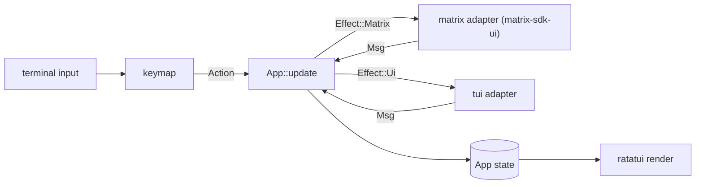
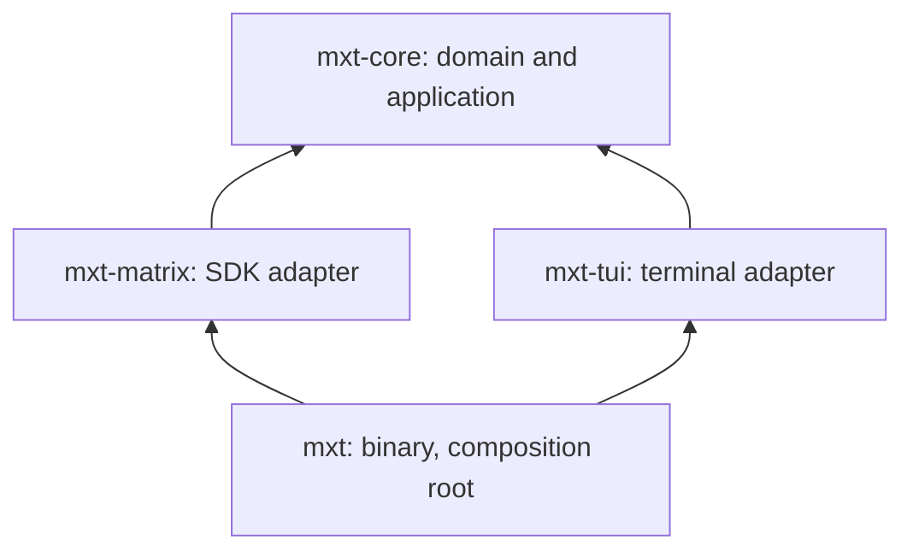

# mxt design

Date: 2026-11-18
Status: draft for review (revision 3)

## Summary

mxt is a terminal Matrix client with nvim-like keybindings. It targets
accounts where most rooms are bridged from other networks (Discord, Slack,
and similar), so it shows which network a room belongs to, makes unread state
easy to navigate, and lets users rebind every key.

mxt is a single Rust binary. End-to-end encryption, sync, event aggregation
and unread counting come from matrix-rust-sdk (`matrix-sdk` and
`matrix-sdk-ui`). mxt itself is the user interface and the glue around the
SDK.

## Goals

- Read and write in encrypted rooms, including rooms bridged by mautrix
  bridges that only accept cross-signed devices.
- Show bridged rooms as `<network> / <room>` (for example
  `myserver / #general`), so rooms with the same name on different networks
  can be told apart.
- Show unread state per room, including unread messages in muted rooms, and
  let keybindings jump between rooms by unread state.
- Default keybindings follow common nvim conventions. Every binding can be
  changed in the configuration file.
- Compose messages with vim-style modal editing.
- Keep the domain and application logic pure and testable without a terminal
  or a homeserver.

## Non-goals

- Implementing any part of the Matrix protocol or end-to-end encryption.
  matrix-rust-sdk owns these.
- Running as a daemon or offering a remote API. mxt starts when the user runs
  it and exits when the user quits.
- Multiple accounts in one process.
- Being a general text editor. Message editing uses an embedded editor widget
  plus an external editor for long text.

## Scope of the first release

Included:

1. Password login and session restore. Entering the recovery key once per
   device to obtain cross-signing and key backup.
2. A room list that shows network names and unread badges.
3. A fuzzy room picker, also used to list rooms with unread mentions.
4. A timeline that renders HTML message bodies and shows replies, edits and
   reactions, and a full-screen view for messages taller than the screen and
   for images.
5. Sending messages written in Markdown, replies, mentions of room members
   completed after typing `@`, and read receipts.
6. Toggling reactions, editing and deleting (redacting) the user's own
   messages.
7. Muting and unmuting a room.
8. Files: downloading and opening attachments, uploading a file, and image
   previews where the terminal supports them.
9. A keymap and action registry that lets the configuration bind any action,
   including "open the next unread room".

Not included in the first release:

- Threads (added after the first release; see "Threads"), desktop
  notifications, typing notifications.
- Event-level mention lists (see "Mentions").
- Room-wide mentions (`@room`).
- SSO or OAuth login, logout, and account management.
- Setting up cross-signing or secret storage for an account that has none
  (bootstrapping needs user-interactive authentication). Such accounts must be
  set up in another client first.
- Themes and colors beyond the terminal's 16-color palette.
- Reloading the configuration at runtime.
- User-defined command aliases and a generic `:<action>` command.

## Conventions

- All documents, code, comments and commit messages in the repository are in
  English.
- License: MIT. Code adapted from Apache-2.0 projects keeps its Apache-2.0
  notice in the adapted files, and the repository then ships `LICENSE-APACHE`.
- Dependency licenses are checked by `cargo-deny` in CI. GPL-family licenses,
  including the AGPL, are rejected. The allow list in `deny.toml` holds the
  permissive licenses the tree needs (MIT, Apache-2.0, BSD-3-Clause, ISC,
  MIT-0, Unicode-3.0, Unlicense and similar) and MPL-2.0.
- Tests and fixtures use made-up identifiers (`@alice:example.org`,
  `!room:example.org`). Real user IDs, room IDs, access tokens and logs are
  never committed.
- Access tokens are never logged. Message bodies are logged only at the
  `trace` level.

## Architecture

### Process and data flow

mxt is one process on a tokio runtime. crossterm handles terminal input and
output, and ratatui draws the screen.



- The keymap turns key input into `Action`s. `App::update` applies actions and
  messages to the application state and returns `Effect`s.
- `update` never performs I/O and never reads a clock. Effects are plain data.
  The matrix adapter executes matrix effects (send a message, subscribe to a
  timeline, mark a room as read) and reports results and SDK stream updates
  back as `Msg`s. The tui adapter executes UI effects (load text into the
  composer, start a timer, open a file) and reports terminal facts as `Msg`s
  (submitted text, pasted text, viewport sizes, terminal focus, timer
  expiry).
- Every frame is rendered from the core state plus the widget state that
  `mxt-tui` owns (the edtui editors and the image cache).
- Actions are resolved against the state, not against rendered widgets, so an
  action such as "open the next unread room" works the same whether or not a
  list has been drawn yet.

### Crates and the dependency rule

The repository is a Cargo workspace. Dependencies point inward, and Cargo
enforces it.



| Crate | Responsibility | May depend on |
|---|---|---|
| `mxt-core` | Domain types, keymap and its resolver, action registry, pickers, mention rendering, `App` state and `update` | `std` and small pure crates without I/O (`nucleo-matcher`, `emojis`, `pulldown-cmark`, `unicode-segmentation`). Not the SDK, `ruma`, an async runtime, a terminal library, `serde` or `toml`. |
| `mxt-matrix` | Builds the SDK client, converts SDK data into domain types, executes matrix effects, forwards SDK streams as `Msg`s, reads bridge state, renders HTML bodies into domain rich text, reads and writes the session file | `mxt-core`, `matrix-sdk`, `matrix-sdk-ui`, tokio, `futures-util`, `tracing`, `serde`/`serde_json` (the session file holds the SDK's serde session type), `mime_guess` (the MIME type of an upload), `image` (the dimensions of uploaded images); HTML parsing through `matrix_sdk::ruma::html`, plus a feature-only `ruma` dependency of the SDK's ruma version that enables `html-matrix` (the SDK enables only `html`) and `markdown` (`FormattedBody::markdown`); as dev-dependencies, `matrix-sdk` with its `testing` feature, `matrix-sdk-test` and `mxt-core` with its `testing` feature (the tests against `MatrixMockServer`), and `wiremock` (the requests of `:join` that `MatrixMockServer` has no mock for) |
| `mxt-tui` | Layout and widgets, input routing, the composers and the message view (edtui), image decoding and previews (the message view's, and the timeline's on a worker thread), OSC 52 clipboard, local time formatting, executing UI effects | `mxt-core`, ratatui, crossterm, edtui, ratatui-image, image, jiff, `base64` (OSC 52), `futures-util` (the terminal event stream), `unicode-segmentation`, `rustix` (reading the terminal's answer to XTVERSION with a timeout, and the window's size in pixels), `tracing` (failed timeline previews, and a panic on their worker thread) |
| `mxt` | Command line, startup flow, configuration file loading (TOML DTOs), paths, the data directory lock, logging, the command line history file (`Effect::Store`), wiring the adapters and the event loop | all of the above, `serde`, `toml`, `tracing`, `tracing-appender` and `tracing-subscriber` (the log files), `rpassword` (the password and recovery key prompts); `matrix-sdk` as a dev-dependency |

Because `mxt-core` does not depend on the SDK, its tests build and run without
compiling matrix-rust-sdk, and SDK upgrades only touch `mxt-matrix`.

### Functional core

Workflows are functions over domain types:

```rust
impl App {
    /// Deterministic and free of I/O. Mutates the state in place to avoid
    /// cloning the whole state for every message.
    pub fn update(&mut self, msg: Msg) -> Vec<Effect> { /* ... */ }
}

pub fn resolve_room(rooms: &RoomList, current: Option<&RoomId>, target: &RoomTarget) -> Option<RoomId> {
    /* ... */
}
```

Rules:

- Illegal states are unrepresentable where it is cheap to do so. Examples:

  ```rust
  /// A timeline item: a local echo before the server assigns an event ID,
  /// or a remote event. Mirrors the SDK's `TimelineEventItemId`.
  pub enum ItemRef {
      Local(TxnId),
      Remote(EventId),
  }

  pub enum Draft {
      New,
      /// Replies go to remote events only: a reply to a local echo is refused
      /// until the echo is sent.
      Reply { to: EventId },
      Edit { target: OwnEvent },
  }

  /// An item sent by the current user. The sender is taken from the item
  /// itself, so a caller cannot pass the wrong one.
  pub struct OwnEvent(ItemRef);

  impl OwnEvent {
      pub fn new(item: &TimelineItem, me: &UserId) -> Option<Self> {
          (item.sender == *me).then(|| Self(item.id.clone()))
      }
  }

  /// Which room `room.open` and `picker.rooms` act on.
  pub enum RoomTarget {
      Pick { filter: RoomFilter, pick: Pick },
      Fuzzy { filter: RoomFilter, query: String },
  }
  ```

  Replying and editing at the same time, editing another user's message, and
  a `room.open` that has both a pick rule and a query cannot be expressed.
- Parse, don't validate. Configuration values and SDK data are converted into
  domain types once, at the boundary. Code inside the core trusts them.
- Identifiers in the core are mxt's own newtypes (`RoomId`, `EventId`,
  `TxnId`, `UserId`), not `ruma` types. Timestamps are UTC milliseconds.
- Effects come in three groups. `Effect::Matrix(..)` is executed by the
  matrix adapter (for example `SubscribeTimeline`, `UnsubscribeTimeline`,
  `PaginateBackwards`, `LoadMembers`, `FetchImage`, `Send`). `Effect::Ui(..)`
  is executed by the tui adapter (for example `StartTimer { id, after }`,
  `LoadComposer`, `ClearComposer`, `ReplayKeys`, `ReplaceMentionToken`,
  `OpenView`). `Effect::Store(..)` (added after 0.1.4) is executed by the
  binary, which owns the files mxt keeps beside the SDK's stores, so far
  `SaveHistory` (see "Line editing"). Results arrive as `Msg`s (timeline
  diffs, `Msg::MembersLoaded`, `Msg::ImageFetched`, `Msg::Timeout { id }`).
- Media bytes pass through the core as an opaque `MediaBytes` handle
  (`Arc<[u8]>`). The core never decodes them; it only routes them from the
  matrix adapter to the tui adapter.
- No ceremony: no repository traits, dependency injection containers or one
  type per use case. Types and functions are enough.

### Domain model

The main types in `mxt-core`:

- `RoomSummary`: id, `RoomName { network: Option<String>, room: String }`,
  kind (direct message or group), `UnreadCounts`, `NotificationMode`
  (default, mentions and keywords only, mute), time of the latest activity,
  and the time of the user's own latest read receipt (`last_read`, for the
  `read` sort key; see "Room list").
  Spaces are not room summaries; their names only feed `RoomName.network`.
- `UnreadCounts { messages, notifications, mentions, marked }`. `messages`
  counts unread messages even in muted rooms. `notifications` counts unread
  events that notify according to the user's push rules. `mentions` counts
  unread highlights. `marked` is the manual unread mark. All counts are
  computed client-side by the SDK (see "Risks").
- `Badge`, derived from `UnreadCounts` (see "Unread badges").
- `RoomTarget`, `RoomFilter` and `Pick` (see "Action registry").
- `TimelineItem`: `id: ItemRef`, sender, timestamp, `MessageContent`,
  optional reply preview, reaction groups (key, count, whether the user
  reacted), an edited flag, the local send state (sending, sent, failed),
  and for a thread root its `ThreadSummary` (the number of replies, above
  zero, and the latest reply's time; see "Threads").
  The timeline also contains date dividers and the read marker, which the SDK
  provides as virtual items.
- `TimelineId { room: RoomId, thread: Option<EventId> }`: a room's main
  timeline, or one of its threads by the root's event ID. Composers,
  timeline diffs, pagination and jump list entries name their timeline
  with it.
- `MessageContent`: `Text { body, rich }` (the event's plain `body`, which
  `message.edit` loads, and its `RichText`), `Notice(RichText)`, `Emote(RichText)`,
  `Image { name, size, dimensions }`, `File { name, size, mime }` (also used
  for video and audio), `Sticker { body, dimensions }` (dimensions added
  after 0.1.4, for previews), `Redacted`, `Undecryptable`,
  `Unsupported { kind }`.
- `RichText`: a list of blocks (paragraph, code block with optional language,
  block quote, ordered or unordered list). Paragraphs hold inline spans: text
  with bold, italic, strikethrough, inline code or spoiler style; links with a
  URL; mentions of users or rooms; custom emoticons shown by their alt text.
  The terminal adapter maps it to ratatui lines.
- Composers: per timeline (`TimelineId`), so each room and each of its
  threads has its own: the `Draft`, the mentions inserted so far
  (`MentionRef { user: UserId, text: String }`), and whether the composer is
  empty. They are kept when switching rooms and threads.
- Room members: user ID and display name, loaded per room on demand, used for
  mention completion in the room's composers, its threads' included.
- UI state: focus (room list, timeline, composer), mode, keymap resolver
  state, picker state, the line editors' texts and cursors (see "Line
  editing"), the command line and search histories and the history line
  being browsed, the open view (a message's item, or a help view: `:help`,
  `:map` or `:messages`), cursor positions, the last known viewport of each
  pane, terminal focus (initially focused), the status message and the
  history of status messages (`:messages`), the last search pattern and
  whether it is highlighted (see "Search and jumps"), the pending invites
  (for `:join`'s completion), the target of the latest `:join`, whose
  answer the core waits for, the jump list with the entry whose message it
  loads (see "Jump list"), the open thread, with the main timeline kept
  aside while the thread is shown, the replied-to message whose thread
  `gd` waits for (see "Threads"), and the timeline previews that the tui
  adapter wants and those being fetched (see "Files and images").

### Keymap resolver

The resolver lives in `mxt-core` and is deterministic, so its behavior is
covered by unit tests.

- For the current mode, the tables in the fallback chain (see "Tables and
  resolution") are merged into one effective map before resolution. For the
  same key sequence, the earlier table wins. Prefixes are judged on the
  merged map, so with `"]"` in `timeline` and `"]u"` in `normal`, `]` waits
  like it does in nvim.
- `nop` is a binding that does nothing. It shadows the same key sequence in
  later tables.
- The resolver holds the pending key sequence. Count prefixes (`5j`) are part
  of the same pending state.
- A key sequence that is a complete binding and not a prefix of a longer one
  runs immediately.
- A key sequence that is a prefix of a longer binding stays pending. The
  resolver returns `Effect::Ui(StartTimer)` with `ui.timeoutlen` (default 1000 ms,
  like nvim's `timeoutlen`).
- On `Msg::Timeout`, and when the next key makes the pending sequence match
  nothing: the longest binding that is a prefix of the pending keys (with the
  new key, in the second case) runs, and the keys after it are resolved
  afresh, one by one. When no prefix is a binding, only the first pending key
  is released, and the keys after it are resolved afresh. This is nvim's
  behavior. Keys that wait while a key released to the editor changes its
  mode end the same way, before the next key or paste: with `gt` bound, the
  second `g` of `gg` waits while edtui, which got the first, starts waiting
  for its own next key.
- Released keys go to the text input that would have received them: the
  composer's or the message view's editor through
  `Effect::Ui(ReplayKeys(keys))`, or the picker or command line query. In
  panes without text input they are dropped.
- Keys resolved afresh after a binding or a release use the editor mode
  reported with the last typed key: the core learns of a mode change that a
  released key causes in the editor (`a` entering insert mode, `g` or `d`
  making edtui wait for the next key) only with the next typed key.

### Matrix adapter

- Sync: classic `/sync` (phase 0 decided it; see "Phase 0 findings"). mxt
  runs its own loop of `Client::sync_once` with the stored token, a long-poll
  timeout of 30 s (120 s until a sync token is stored, which gives the
  initial sync its time budget), presence offline, and a filter with
  lazy-loaded members, a timeline limit of 10, and neither presence nor
  `m.typing`. It subscribes the SDK's event cache, which computes
  unread counts and latest events for every room. The set of rooms comes from
  `Client::rooms()` (joined rooms that are not spaces), updated from each sync
  response and from room info updates.
- Timelines: only the open room has a subscribed `Timeline`, built with
  `TimelineFocus::Live { hide_threaded_events: true }`, so replies in
  threads are not among its items (see "Threads"), and while a thread is
  open, that thread has a second one, built with `TimelineFocus::Thread`.
  Opening another room unsubscribes the previous room's timeline and
  thread. The core requests
  `Effect::Matrix(PaginateBackwards)` for the shown timeline (the main one
  or the open thread's) when its cursor comes within 10 items of the oldest
  loaded item, with at most one request in flight per timeline.
- Room summaries come from the SDK room info: display name,
  `num_unread_messages`, `num_unread_notifications`, `num_unread_mentions`,
  `is_marked_unread`, the user-defined notification mode and the latest event
  time, and from the state store the time of the user's own latest read
  receipt (see "Room list"). The core filters and sorts them itself, so the
  meaning of every filter and sort key is defined in one place.
- Bridge state: classic sync delivers each room's full state (members are
  lazy-loaded), so `m.bridge` and `uk.half-shot.bridge` are read from the
  stored room state. `mxt-matrix` parses them itself and keeps, per room,
  either the bridge information or the fact that the room has none. Besides
  the network and protocol names it reads the bridge bot (`bridgebot`) and
  the room type that mautrix bridges declare (`com.beeper.room_type.v2`, else
  `com.beeper.room_type`: `dm`, `group_dm`, or another value).
- Members: after subscribing the open room's timeline, the adapter loads the
  room's members in the background (`Timeline::fetch_members`) when the room
  has at most 500 joined members, so sender names replace bare user IDs. The
  SDK marks a room's members as missing after every `limited` sync, so this
  is one `/members` request on the first open of a busy room per session.
  Bridged channels usually have few joined members (bridged users join when
  they first speak); phase 0 measured 0.4 to 2.1 KB per request. Mention
  completion loads the full list on the first composer focus, whatever the
  size.
- Pending invites: with each sync response the room list task reads
  `Client::invited_rooms()` and, when the set of room IDs and names
  changed, sends `Msg::Invites` with each invite's room ID and display
  name, for `:join`'s completion (see "Joining rooms and direct
  messages"). Names count too, because an invite's name often resolves a
  sync after the invite arrives. Invited rooms are not listed.
- Network names, for every room including direct messages, first match wins:
  1. `network.displayname` of the room's `m.bridge` event (or
     `uk.half-shot.bridge`)
  2. `protocol.displayname` of that event
  3. the name of the room's canonical parent space
  4. the name of the parent space, when the user has joined exactly one
  5. none
- Recovery: `Recovery::recover(recovery_key)`.
- Encryption settings: `backup_download_strategy` is
  `BackupDownloadStrategy::AfterDecryptionFailure`, so an event that fails to
  decrypt makes the SDK fetch its key from the key backup. The SDK default
  (`Manual`) never fetches keys, and `OneShot` downloads every key at once,
  which is heavy for accounts with many rooms. `auto_enable_backups` and
  `auto_enable_cross_signing` stay off, because creating them is out of
  scope.
- Mute: the SDK notification settings. Muting sets the room mode to mute.
  Unmuting a muted room removes the user-defined room rule, so the account
  default applies again. `room.unmute` on a room that is not muted sends
  nothing and shows the error "<room> is not muted", so a "mentions and
  keywords only" rule set in another client stays. Muting and unmuting show
  "Muted <room>" and "Unmuted <room>".
- Sending: the composer text is Markdown. The core's
  `render_mentions(text, mentions)` returns three things:
  - the plain body: the editor text unchanged, so mentions read as
    `@Alice` in notifications and in clients that ignore HTML;
  - the Markdown for the HTML body: every inserted mention text that is still
    present and not inside inline code or a code block (found with
    `pulldown-cmark` offsets) replaced by a link to
    `https://matrix.to/#/<user ID>`, with Markdown in the link text escaped;
  - the user IDs of the mentions that remain.

  The adapter converts the Markdown with ruma's `FormattedBody::markdown`
  and sends `RoomMessageEventContent::text_html(plain, html)`, or
  `text_plain(plain)` when the Markdown has no formatting at all. Every
  message carries `m.mentions` with the remaining user IDs, and an empty
  `m.mentions` when there are none, so the legacy display-name and `@room`
  push rules never fire for mxt's messages. ruma turns soft line breaks into
  hard breaks, so newlines from `<C-j>` stay newlines in HTML. Bridges turn
  the links into mentions on the remote network. Replies use the timeline's
  reply call; edits of sent messages are built with `Room::make_edit_event`
  and sent through the timeline (so they work after the target has left the
  loaded timeline), edits of local echoes use `Timeline::edit`. A message
  from a thread's composer goes through that thread's timeline, which adds
  the thread relation (see "Threads").
- The send queue: messages, edits, reactions and uploads go through the
  SDK's send queue, fed by one sequential task, so they keep their order
  without holding up other effects; a message sent right after `:upload`
  waits for the upload. The SDK disables a room's queue after a failed
  request; mxt enables it again on every write and whenever the sync state
  becomes synced, so a message that failed for a transient reason goes out
  when the connection returns. A failed message or upload stays as a local
  echo with a failed marker until `message.resend` (`R`) or its deletion, and
  holds back the room's later requests until then. An edit or reaction that
  the server refuses for good would block the room's queue; mxt aborts it
  and reports the failure, and a refused edit of a sent message is answered
  as its send (see "Error handling"). The SDK takes an aborted reaction off
  its target, but an aborted edit's text stays on it until the next
  matrix-sdk-ui release.
- Reactions: `Timeline::toggle_reaction`. Choosing a reaction the user already
  sent removes it.
- Redaction: a sent message is redacted with `Room::redact` directly, not
  through the send queue, so a refused redaction is reported at once and
  never blocks the queue. A local echo is aborted instead.
- Read receipts: the core requests a receipt for the latest event when the
  room is open, the timeline shows its newest item, and the terminal has
  focus. The terminal counts as focused from startup until a crossterm
  `FocusLost` event arrives, so terminals and multiplexers that never send
  focus events still get receipts. The adapter sends the configured receipt
  type (`m.read` or `m.read.private`) and moves the `m.fully_read` marker to
  the same event. These receipts are unthreaded; with replies in threads
  hidden, the latest event of the main timeline is the latest one outside
  threads. A thread that is shown sends receipts of its own (see
  "Threads").
- `room.mark_read` acts on the room under the cursor when the room list has
  focus, and on the open room otherwise. When the room's latest event as
  known to the room list (`Room::latest_event()`, which may be a reply in a
  thread) is a remote event, the
  adapter sends the configured receipt and `m.fully_read` for it with
  `Room::send_multiple_receipts`, which also clears the room's manual
  unread mark (matrix-sdk 0.19.1). Otherwise it only clears the mark with
  `Room::set_unread_flag(false)`. Its receipt is unthreaded, so it marks the
  room's threads read too.
- Optimistic clearing: when the core requests an unthreaded receipt (the
  main timeline's, or the one a thread sends when the main timeline is
  read; see "Threads") or runs `room.mark_read`, it sets that room's
  `UnreadCounts` to zero immediately and, added after 0.1.4, raises its
  `last_read` when the room has something to read: a badge (the rule of
  `unread`), or the event the receipt goes on (the timeline's newest
  remote item, or for `room.mark_read` the room's latest event) newer than
  its `last_read`. The receipt's echo brings the homeserver's time of
  taking it (see "Room list"), not the event's, and that is no earlier
  than any receipt it took before or any event time the room list holds
  (remote clocks ahead of it aside; see "Risks"). So `last_read` goes up
  to the later of the room's latest activity and 1 ms after the newest
  news time (the `read` key's time; see "Room list") of any other room:
  the room tops the read rooms at once, and the echo keeps it there. The
  1 ms keeps it off a tie with the room read last, which the name order
  would settle either way until the echo. A room with nothing to read
  keeps its `last_read` and its place: its receipt goes on the event of
  the user's receipt or an older one, which the homeserver ignores (see
  "Room list"), so no echo comes, when the user's newest receipt is the
  same kind of unthreaded receipt mxt sends (the configured type, no
  `thread_id`); a room last read with another kind moves once when the
  user's receipt of mxt's kind is older (see "Risks"). A room whose only
  news is an edit is such a room when it is opened, since the timeline
  shows the edit in the edited message's place, but not for
  `room.mark_read`, whose receipt goes on the edit.
  Raising `last_read` to the latest activity alone, as first designed,
  placed the room below the rooms read since its newest message until the
  echo moved it to the top. A room other than the open one
  moves in the room list when the sort keys depend on the counts or on
  `last_read` (the open room already sorts as read; next item). The next
  SDK update overwrites the counts, with the replies in threads after the
  receipt counted again, but never lowers `last_read`: the room list
  keeps the later of the stored and the updated time, since homeservers
  keep a receipt only when it moves forward (see "Room list"), so facts
  read from the store before the receipt's echo do not move the room
  back. This makes action sequences such as
  `["room.mark_read", <open the next unread room>]` deterministic.
- The open room sorts as read: under the `mentions`, `notify` and `unread`
  sort keys the core places the open room as if it had no unread messages,
  notifications or mentions, so it never moves into or within those groups
  while it is open, and under `read` it counts as read up to its latest
  activity: its time is the later of its `last_read` and its latest
  activity (added after 0.1.4), so it takes its place among the read rooms
  as it opens, and its receipt, when it has something to read, lifts it to
  their top (previous item). Once another room is opened, or no room is
  open, it sorts by its counts and `last_read` again. Its badge and the
  `filter`s use its real counts, and `recent` and `name` do not change.
  The reason: the SDK's counts can arrive after the receipt went out
  (matrix-sdk 0.19.1 saves a room's counts before it
  sends the timeline the same events, and the room list reads them on a
  task of its own), and until the next sync brings the receipt back they
  still count the events up to it, so the room being read would sit among
  the unread rooms. The rule relies on no SDK ordering. The badge can
  still show such a count until the receipt's echo. `RoomList` knows the
  open room (`RoomList::open`): opening a room places the previously open
  room and then the opened one again; opening puts the room list's cursor
  on the opened room, and that room's first move takes the cursor to the
  room after it (see "Room list").
- Room keys are shared with the SDK's default recipient strategy
  (`CollectStrategy::AllDevices`), which does not refuse to send when another
  user's identity changes.
- HTML bodies: `formatted_body` is parsed with `ruma::html` into `RichText`.
  `<mx-reply>` fallbacks are dropped, `<del>` becomes strikethrough,
  `data-mx-spoiler` becomes spoiler style (mentions, emoticons and code
  blocks inside it are hidden too, and so are spoilers inside code blocks),
  and `` becomes its alt text. Reply previews show
  spoilers as `[spoiler]`.
- Images: `FetchImage` uses the event's thumbnail source when there is one.
  In encrypted rooms there is often none, and the SDK cannot ask the server to
  scale encrypted media, so the adapter downloads the full file. Files larger
  than 10 MiB are not fetched for previews; an event that gives no size is
  fetched, and refused after the download if it is larger. `FetchPreview`,
  for previews in the timeline (added after 0.1.4), also asks the server to
  scale an unencrypted image without a thumbnail, and takes stickers too
  (see "Images in the timeline").
- Sync path: phase 0 decided on classic `/sync` for the target homeserver,
  and only that path is implemented (see "Phase 0 findings"). The core
  receives the same `Msg`s either way, so another path could be added in
  `mxt-matrix` alone.

### Terminal adapter and the composer

- The composer is an edtui editor in vim mode, owned by `mxt-tui`, one editor
  state per timeline (`TimelineId`: a room's main timeline, or a thread).
  edtui is used with
  `default-features = false, features = ["system-editor"]`, which leaves out
  the system clipboard (arboard), mouse support and syntax highlighting.
- edtui's clipboard is a custom `ClipboardTrait` implementation: copying
  writes the text to the terminal clipboard with OSC 52 and keeps it in an
  internal register, and pasting reads the internal register. Every editor
  state gets a handle to the same `Rc<RefCell<Register>>`, and timeline
  yanks use the same register. Each editor's handle can drop that
  editor's writes for one command, for the black hole register (added
  after 0.1.4; see "Input routing").
- Text editing is an input detail. The core only knows each composer's
  `Draft` and whether it is empty, which the tui adapter reports with
  `Msg::ComposerEdited { timeline, empty }` when that changes. The composer
  effects (`FocusComposer`, `RequestSubmit`, `InsertNewline`, `LoadComposer`,
  `ClearComposer`, `ReplaceMentionToken`, `ExternalEditor`, and after 0.1.4
  `ComposerNormal`, `EmptyComposer` and `DeleteWordBefore`) name the
  composer's `TimelineId`, and the shown composer is that of the shown
  timeline (`App::shown_timeline()`).
- Sending: `composer.send` makes the tui adapter read the editor text and send
  `Msg::Submit { timeline, body }`. If the body is blank, nothing happens.
  Otherwise the core returns the send effect and
  `Effect::Ui(ClearComposer(timeline))`, and that composer's draft returns
  to `New`.
  Failed sends are shown on the local echo, and a send that cannot be queued
  puts its draft back (see "Error handling").
- Editing an existing message: `message.edit` takes the user's own text
  messages only ("Only text messages can be edited"; other messages cannot
  become text without losing what they are), requires an empty composer and
  otherwise reports "Clear the composer first" in the status line. On success
  the core loads the message's plain body (without a reply fallback) with
  `Effect::Ui(LoadComposer { timeline, text })`, and rebuilds the composer's
  `MentionRef`s from the mention spans in the message's `RichText` whose text
  appears in that body. Edits keep their pills and `m.mentions`.
- Other refusals, reported in the status line: `message.reply` while an edit
  draft is open ("Cancel the edit first", since the composer holds the
  edit's text); `message.delete` and `message.react` on a deleted message
  ("The message is deleted"); `message.view` on an image and `message.open`
  on an attachment that are still local echoes ("Wait until the message is
  sent", because the adapter fetches media by remote event); and
  `message.resend` on anything but a failed local echo ("Nothing to
  resend").
- `composer.focus` puts edtui into insert mode by default. With
  `mode = "keep"` it keeps edtui's previous mode.
- `composer.normal` (`<C-c>` in insert mode, vim's insert-mode CTRL-C;
  added after 0.1.4) puts the shown timeline's composer in normal mode as
  edtui's own `<Esc>` does: the tui adapter gives edtui an `<Esc>` in
  insert, visual and search mode (edtui `src/events/key.rs:143-150,
  182-185`), so from insert mode the cursor moves one column left and `.`
  repeats the insert as after `<Esc>` (`src/state.rs:119-128`,
  `src/actions.rs:156-190`), a visual selection is dropped and a search
  stopped; in normal mode it does nothing. A key waiting for the next one
  is cancelled, the mention menu closes, and while the composer has focus
  keys resolved afresh after it are resolved in normal mode. Like
  `composer.send` it acts on the shown timeline's composer wherever the
  focus is (`UiEffect::ComposerNormal(TimelineId)`). An action array runs
  its actions in order against the state, and the binary executes their
  effects in that order (`event_loop::update`), so with
  `"<CR>" = ["composer.send", "composer.normal"]` the text is read
  (`RequestSubmit`) before the editor leaves insert mode; `Msg::Submit`
  then comes back and, unless the body is blank, `ClearComposer` resets
  the editor, which keeps insert mode only (`Composer::reset`), so the
  composer ends empty and in normal mode; a blank body sends nothing and
  leaves its text, in normal mode. Without such a binding the composer
  stays in insert mode after sending.
- `composer.cancel`: a reply draft becomes `New` and keeps its text. An edit
  draft becomes `New` and the composer is cleared.
- `composer.clear` (added after 0.1.4, no default key) empties the shown
  timeline's composer as one change that `u` undoes, writes no register,
  and keeps the draft (a reply or an edit stays; ending it is
  `composer.cancel`'s job) and its mentions, so that `u` brings them back
  with their text. The tui adapter puts the cursor after the last
  character and runs edtui's `DeleteChar` with the number of characters
  and line breaks in the text, which saves one undo state and writes no
  register (edtui `src/actions/delete.rs:73-121`); edtui's undo states are
  otherwise reachable only through its actions (`capture` is
  crate-private, `src/state/undo.rs:49`). The mode stays, except that a
  visual selection is dropped (normal mode); the mention menu closes; an
  empty composer stays as it is, with no undo state.
  `UiEffect::EmptyComposer(TimelineId)`, unlike `ClearComposer`, which
  starts a fresh editor state after a send.
- `composer.leave` (`<Esc>` in the composer's normal mode): when the draft
  is a reply or an edit and the composer is empty, it ends the draft as
  `composer.cancel` does; then the timeline gets the focus. Any text, also
  whitespace alone (the composer is empty only without a character), keeps
  its draft, so nothing typed is lost. `focus.timeline` never ends a draft.
- `composer.delete_word_before` (`<C-w>` and `<A-BS>` in insert mode;
  added after 0.1.4) deletes, in insert mode, the word before the cursor
  with the blanks between it and the cursor: from where the line editor's
  `<C-w>` would delete (`mxt_core::line::word_start`, by grapheme cluster
  with the line editor's word classes, CJK included; see "Line editing")
  up to the cursor, on the cursor's line. At the start of a line it
  deletes the line break, joining the line to the one above, as vim's
  `<C-w>` does with nvim's default `backspace`; at the start of the text
  it does nothing. The tui adapter runs edtui's `DeleteChar` with the
  number of characters to delete, so the deletion is one undo state,
  writes no register, and is to `.` what edtui's `<BS>` is (it saves an
  undo state on each run, and only typed characters are recorded for
  `.`; edtui `src/actions/delete.rs:73-121`, `src/actions/insert.rs:24`).
  edtui's own `DeleteWordBackward` is not used: it writes the register
  (`src/actions/delete.rs:325-394`) and classifies characters, not
  grapheme clusters. In normal and visual mode the action does nothing.
  `UiEffect::DeleteWordBefore(TimelineId)`.
- `<Up>` and `<Down>` at the composer's edges (added after 0.1.4): in
  insert and normal mode, with no key waiting, `<Up>` on the first line of
  the text moves the cursor to the start of the text and `<Down>` on the
  last line to its end (after the last character in insert mode; in
  normal mode on the start of the last grapheme cluster, so in `a👍🏽` on
  `👍🏽`'s first character, not on its skin tone modifier), as text fields
  do; elsewhere they go to edtui, whose
  `MoveUp` and `MoveDown` move by lines of the text and stop at the first
  and the last (`src/actions/motion.rs:54-85`). A line is a line of the
  text, not a row on the screen: edtui moves by text lines whether or not
  a line wraps, so `<Up>` from any row of a wrapped first line goes to the
  start, as `<Up>` from any row of a wrapped line goes to the line above.
  `k` and `j` keep vim's behaviour, visual mode keeps edtui's, and the
  mention menu's `<Up>` and `<Down>` (`composer.completion`) come first,
  since the keymap sees a key before the editor. The message view's
  editor, the same `Editor`, does the same.
- Mention completion:
  - After each edit in insert mode, the tui adapter looks for an `@` token at
    the cursor (an `@` at the start of the text or after whitespace, followed
    by non-whitespace) and reports `Msg::MentionQuery { timeline, query }`
    when it changes, with `query: None` when there is no token.
  - The first time one of a room's composers (its main one or a thread's)
    gets focus, the core returns `Effect::Matrix(LoadMembers(room))`. The
    members arrive as `Msg::MembersLoaded` and serve all of the room's
    composers.
  - The core ranks the loaded members against the query with
    `nucleo-matcher`, on the display name and the user ID's localpart (the
    whole user ID when the query contains `:`, so same-named members on
    different servers can be told apart). Members who sent one of the
    loaded messages come first, newest sender first.
  - Accepting a candidate records a `MentionRef` in the composer and returns
    `Effect::Ui(ReplaceMentionToken { timeline, text })`, which replaces the
    token with the text and a space.
- Input routing while the composer has focus:
  - edtui in normal or visual mode: look the key up in `composer.normal` or
    `composer.visual`, then in `normal`. If it is not bound, pass it to edtui.
  - edtui in insert mode: while the mention menu is open, look the key up in
    `composer.completion`, then in `composer.insert`. Otherwise look it up in
    `composer.insert`. If it is not bound, pass it to edtui.
  - edtui in search mode: every key goes to edtui, including `<Esc>`.
  - edtui in normal or visual mode while a key waits for the next one: the
    next key goes to edtui without the keymap (see "edtui differences from
    vim"), as in nvim, whose operator-pending mode sees no normal-mode
    mappings and which reads the key after `g` without mappings too. This
    is the key after:
    - `f`, `F`, `t`, `T` or `r`: its character, also after an operator, as
      in `df` or `yt`;
    - an operator, `d`, `c` or `y` in normal mode: `dw`, `yy`, and
      `d<Esc>`, which cancels the `d`;
    - a text object's `i` or `a` after an operator (`ci[`, `da(`, `yi"`) or
      in visual mode (`vi[`): the object;
    - `g` in normal or visual mode: edtui has only `gg`, so `gg` runs, any
      other key is dropped with the `g` (`g]`, `gx`, `g:`), and `g<Esc>`
      cancels the `g`. In nvim `g]` is a command of its own, so the default
      `]u` does not apply after `g` there either.
    - `"` in normal or visual mode: the register's name (see the black
      hole register below).

    These are all the keys after which edtui 0.11.8 (mxt's fork at the
    pinned commit) waits in normal and visual mode: `g` (`gg`), `d`, `c`
    and `y`, `di`, `ci` and visual `i` (text objects), and `df`, `dt`, `cf`
    and `ct` (a character); its insert mode has no key sequences. So
    bindings in `normal` that start with `[`, `]`, `(`, `"` and similar
    keys, the default `]u` and `[u` among them, neither delay these
    commands nor take their keys. The message view's editor routes keys
    the same way: `gq` and `g<Esc>` do not close the view.
  - A binding in `composer.normal`, `composer.visual` or `normal` that
    starts with `g` (or with an operator) keeps working in the composer:
    the keymap sees the key before edtui, so `g` waits there for the
    binding's next key, and edtui gets `g` only when the resolver releases
    it (the next key matched no binding, or `ui.timeoutlen` passed). Keys
    resolved afresh with that release still go through the keymap (see
    "Keymap resolver"); keys typed after it go to edtui. No default binding
    in those tables starts with `g`: `gg`, `gx` and `gd` are in `room_list`
    and `timeline`.
  - The black hole register (added after 0.1.4): `"` in the editors'
    normal and visual mode, with no key waiting, is mxt's. edtui binds no
    key sequence that starts with `"` in these modes (it appears only in
    `ci"`, `di"` and visual `i"`, edtui `src/events/key.rs:585-588,
    654-661, 719-726`), so before this `"` did nothing there and `_` moved
    to the first non-blank (`src/events/key.rs:335-350`): `"_dd` deleted
    the line into the register. The key after `"` goes to the editor
    without the keymap, as after `f`. `_` makes the next command write
    neither mxt's register nor the terminal's clipboard: the editor's
    handle to the shared register drops writes until edtui's command
    ends, that is until a key leaves nothing waiting (no operator, text
    object, `g` or character pending), also when the command writes
    nothing (`"_j`), and until then keys go to the editor without the
    keymap. So `"_dd`, `"_diw`, `"_cw`, `"_D`, `"_yy` and visual `"_d`
    and `"_c` leave the register as it was; `"_x` is `x`, since edtui's
    `x` writes no register (`RemoveChar`, `src/actions/delete.rs:18-44`).
    Reads are unaffected: `"_p` pastes mxt's register as `p` does, where
    vim's black hole register reads as empty. Whatever cancels a waiting
    key (`FocusComposer`, `LoadComposer`, a paste) ends it too. Any other
    register name (`"a`, `"+`) does nothing but set the status line error
    `Only the black hole register "_ is supported` (`Msg::EditorRefused`,
    shown as an error and not logged), and a key that is no character
    (`<Esc>`) cancels the `"` silently. The check that ends it runs after
    every key the editor is fed, whichever way the key's handling ends:
    `Editor::feed` wraps it and clears the flag when the flag is set and
    nothing waits, so mxt's own `f`, `t` and `r` with their character, a
    dropped key, a key edtui has no code for (`"_<F1>`) and `<Up>` or
    `<Down>` at the composer's edges end it as edtui's commands do. The
    flag belongs to the editor's handle, not to the shared register, so it
    never drops another editor's copy, and it is the only record of the
    state: the editor reads it from its handle. The message view's editor
    has it too. `.` is a command of its own: after `"_dd`, `.` deletes
    into the register, where vim repeats with `"_`. edtui keeps its record
    of the last change to itself (`last_change` and `execute_recorded`,
    crate-private, `src/state.rs:53, 119-138`), and a yank, an undo or a
    visual change in between does not replace it, so mxt cannot tell
    which change `.` repeats. `"_.` repeats without writing, so `"_dd`
    then `"_.` keeps the register. mxt handles it, not the edtui
    fork: mxt owns the clipboard (`SharedRegister`) and already tracks
    edtui's waiting keys (`Pending`).
- Pasted text, wherever the keys go: mxt turns on bracketed paste, so the
  terminal reports a paste as one event, which the tui adapter sends as
  `Msg::Paste` with its line breaks as `\n` (terminals and tmux send `\r`).
  A paste is text, never keys: it runs no binding, so a pasted line break
  never sends the message. Like a key, a paste goes to `CONFIRM` and then
  `SECRET` mode before anything else. Otherwise the core ends the pending
  keys first, as their timeout would, so they keep their order with the
  text, and then sends the paste where a released key would go (see "Keymap
  resolver"):
  - an editor (the composer's or the message view's), with
    `Effect::Ui(Paste(text))`: insert mode inserts the text at the cursor,
    line breaks as new lines. Normal mode puts it after the cursor like `p`
    with a characterwise register, and visual mode in place of the
    selection, each as one undo step ending in normal mode with the cursor
    on the last pasted character. This is what neovim's `vim.paste` does
    (vim, too, except that it inserts before a cursor in the first column),
    but the replaced selection goes to no register: a copy into mxt's
    register also goes to the clipboard. edtui's search mode adds the first
    line to the pattern, and a key waiting for its character is cancelled.
    The composer reports the edit once and never opens the mention menu for
    a paste, even one that ends in an `@` token; an open menu closes, and
    the next key looks for the token again.
  - the command line, the search line and the pickers, which hold one line:
    the text up to the first line break, inserted at the cursor (see "Line
    editing"); the rest is dropped.
  - `SECRET` mode, also when a binding that the paste ends enters it, as
    for the keys typed after that binding: the first line too, inserted
    into the key at the cursor and masked like typed text. The rest is
    dropped, with the line break a copied key ends in. The paste never
    submits the key and returns no effect: the key leaves the core only in
    the `Recover` effect of `<CR>`.
  - the room list and the timeline: nowhere.
  - `CONFIRM` mode: nowhere, and the question is cancelled, as by any key
    but `y`.
  - where the text would go, a paste larger than 256 KiB (four times the
    64 KiB limit on a Matrix event): nowhere, and the status line says
    "Paste too large (N KiB; the limit is 256 KiB)". The limit bounds the
    memory a mistaken paste of a whole file takes: edtui keeps a copy of
    the whole text for each undo step.
- The external editor (`composer.external_editor`) uses edtui's
  `system-editor` feature, which opens `$VISUAL` or `$EDITOR`.
- The tui adapter reports `Msg::Viewport { pane, first, last }` after a render
  changes which items are visible. Half-page movement moves the cursor by half
  of the visible item count (at least one). The core never computes text
  layout.
- The message view: `message.view` opens the selected message in a
  full-screen overlay. For text, the overlay is an edtui scratch editor
  holding the message's text, so vim motions, search, visual selection and
  yanks work on messages taller than the timeline. Changes are discarded when
  the view closes. For images, the overlay shows the image (fetched with
  `FetchImage`, decoded and scaled down with the `image` crate, and kept in
  the tui adapter's image cache) and the file name and size. Messages taller
  than the timeline pane show a `[+N lines]` marker at the cut-off.
  The help views (`:help`, `:map`, `:messages`; see "Help views") use the
  same overlay and editor for text the core generates. The core's open
  view is either a
  message (its item, whose content it sends as today, `ViewContent::Text` or
  `ViewContent::Image`) or a help view (its generated text, sent as
  `ViewContent::Text`), so the image checks stay tied to a message view, and
  the tui adapter draws a help view like a text message.
- Replacing edtui later (with another editor widget or an in-house vim engine)
  only touches `mxt-tui`.

## Startup

Command line: `mxt [--config PATH]` and `mxt --version`.

1. Load the configuration. If the file does not exist, print its path and a
   minimal example, and exit with a non-zero status. `HOME` must be an
   absolute path. A cache directory that contains the data or state
   directory is refused, because setting data aside deletes the cache
   directory. Names this version does not know are ignored with a warning
   (see "Layers"), which is logged once logging has started, after the
   lock, and shown when the terminal UI starts.
2. Take an exclusive lock on `$XDG_DATA_HOME/mxt/lock` (`std::fs::File::try_lock`).
   If another mxt holds it, exit with a non-zero status. Two processes must
   never share the crypto store.
3. If a session file exists, restore the session; the homeserver saved in it
   wins over `account.homeserver`. A session whose user ID differs from
   `account.user_id` stops the start with both IDs, and nothing is moved
   (removing the session file switches accounts). A session file without
   the store directory is set aside like an `M_UNKNOWN_TOKEN` session (see
   below), because a new crypto store would give an existing device new
   keys; the message adds that the old device stays in the account's device
   list. Without a session file, a store left by an earlier session is moved
   to `store.invalid-<unix seconds>` in the data directory and the cache
   directory is emptied, so a new device never reuses another device's
   crypto store or shows its decrypted events. Then mxt asks for the
   password on the terminal without echo, logs in (no refresh token is
   requested, so the stored access token does not change), and saves the
   session. A first login that fails before the session is saved deletes
   the new store and the cache, which belong to no device.
4. Start the sync. After a first login, the sync uploads the device keys,
   and mxt waits up to 90 s for this device's keys to reach the server,
   because recovery signs the device and needs them. It prints that it
   waits, and says so when the keys did not arrive in time or could not be
   checked. Then it asks for the recovery key. An empty input skips it;
   `:recover` asks again later. If the account has no secret storage, mxt
   prints that recovery has to be set up in another client and continues
   without asking.
5. Start the terminal UI.

If the homeserver answers `M_UNKNOWN_TOKEN` at any time, mxt restores the
terminal, drops the SDK client so the stores are closed, renames the data
directory to `mxt.invalid-<unix seconds>`, deletes the cache directory, prints
why, and exits. The next start logs in as a new device with fresh stores.

## User interface

### Layout

- Left: the room list, which can be hidden. `focus.room_list` shows it again.
- Right: the timeline of the open room, or the open thread in its place
  (see "Threads"), with the composer below it. The
  composer's top rule is labelled "Reply to <name>" or "Edit" while the
  composer's draft is a reply or an edit, and ends with `↓ N newer` while newer
  messages are below the timeline pane (see "Timeline").
- Bottom line: status line showing the mode, the pending count and keys
  (like nvim's showcmd), the open room, the status message or the `CONFIRM`
  question, and the sync state. When they do not fit, the room name is cut
  first. Pressing `:` turns it into the command line.
- Overlays: the fuzzy room picker, whose items show their unread badges, the
  emoji picker, the mention menu above the composer, and the full-screen
  message view, which also shows the help views (`:help`, `:map`,
  `:messages`).

### Modes

| Mode | When | Keys |
|---|---|---|
| `NORMAL` | the room list or the timeline has focus | keymap |
| composer modes | the composer has focus; the status line shows edtui's mode (`INSERT`, `NORMAL`, `VISUAL`, `SEARCH`) | see "Input routing" above |
| `COMMAND` | the `:` command line or a `/` search line is open | `command_line` table, then the line editor (see "Line editing") |
| `PICKER` | the room picker, the emoji picker or the link picker is open | `picker` table, then the line editor of the query |
| `VIEW` | the message view or a help view is open; the status line shows `VIEW` and the view editor's mode (`VIEW NORMAL`, `VIEW INSERT`, `VIEW VISUAL`, `VIEW SEARCH`) | `message_view` table while its editor is in normal or visual mode and no key waits for the next one (see "Input routing" above), then edtui |
| `CONFIRM` | an action asks for confirmation, or `:join` before it creates a direct message | `y` confirms, any other key cancels |
| `SECRET` | the recovery key is being entered | the line editor, masked; `<CR>` submits, `<Esc>` cancels; no keymap |

In `NORMAL`, the room list and the timeline have no character cursor. They
move one room or one message at a time. Because of that, `<Space>` is free
and is the default leader.

### Room names

- Rooms with a network name (see "Matrix adapter"): `<network> / <room>`.
  Direct messages use the other user's display name as `<room>`, so a
  Discord DM reads `Discord / Alice`, and a Slack DM whose bridge sets the
  workspace as `network` reads `<workspace> / Alice`.
- Rooms without a network name: the room's display name, or the other user's
  display name for direct messages.
- Bridged direct messages: bridges such as mautrix-discord keep their bot in
  the rooms they bridge, so a bridged DM has two other members and the SDK
  would name it after both. A bridged room is a direct message with one
  person when its joined members besides the user and the bridge bot are
  exactly that person, and the bridge declares the room a `dm` or declares no
  type and the room has no `m.room.name`. mautrix names every channel it
  bridges, so a quiet channel where only one person has spoken stays a
  channel; `group_dm` and other declared types are never taken for DMs.

### Unread badges

A room shows at most one badge, chosen by the first rule that matches:

| Rule | Badge | Style |
|---|---|---|
| `mentions > 0` | `@<mentions>` | mention style |
| `notifications > 0` | `<notifications>` | bold |
| `messages > 0` | `<messages>` | dim (typical for muted rooms) |
| `marked` | `U` | marked style |

Counts above 99 show as `99+`. Muted rooms also show a `Muted` label. Rooms
set to mentions and keywords only show no label.

### Room list

Spaces themselves and pending invites are not listed (`:join` completes the
invites).

The order is `ui.room_list.sort`: a comma-separated list of sort keys
applied in order (lists added after the first release), each deciding only
between the rooms that the keys before it leave tied. Rooms that every key
leaves tied are in `name` order, and rooms with the same name by room ID,
so the order is total and the same on every start.

| Key | First | From |
|---|---|---|
| `mentions` | rooms with unread mentions | `mentions > 0`: whether the room has any, not how many, so a new mention does not reorder the rooms that have some |
| `notify` | rooms that notify | the rule of `filter = "notify"` (see "Action registry"): `notifications` or `mentions` above zero, or `marked`, so a room whose only unread state is a dim count (see "Unread badges") is not among them (added after 0.1.4) |
| `unread` | rooms with unread messages | the rule of `filter = "unread"` (see "Action registry"): `messages`, `notifications` or `mentions` above zero, or `marked` |
| `recent` | the latest activity, newest first | `latest_activity`, the SDK's latest event time; rooms without one last |
| `read` | the latest news for you, newest first | the room's news time: for a room unread by the rule of `unread`, `latest_activity`, the time of its newest message (its `last_read` when it has no latest activity); for any other room `last_read`, the time of your own latest read receipt in it; for the open room, which sorts as read, the later of the two (see "Matrix adapter"). A room without such a time is last, as rooms you never read were before |
| `name` | the displayed name | case-insensitive, by the full displayed name (`network / room`), which groups rooms by network, whichever `network` layout is set |

The default is `"recent"`. A value with one key is the list of that key,
so `"recent"` and `"name"` keep the meaning they had. `sort = "mentions,
unread, read"` lists the rooms with unread mentions first, then the other
unread rooms, then the rest; in the first two groups the room with the
newest message comes first, so a room that gets a new message goes to the
top of its group, and the rest are in the order you last read them. `read`
alone orders the rooms by when each last had news for you or you last
read it. `sort = "mentions, notify, unread, read"` puts the rooms that
notify (bold counts, the `U` mark) after the mentions and before the rooms
whose only news is a dim count, each group newest message first. Spaces
around the commas are optional (`"mentions,unread,read"` is the same
list), and keys are lowercase, as every fixed value of the configuration
(`"Recent"` is an unknown key). A list with an unknown key, no key, an
empty key or a key given twice loads with a warning (see "Layers"). The
value stays a string, so mxt 0.1.3, which knows `"recent"` and `"name"`
only, reads a list or a new key as an unknown value: a warning, and its
default `"recent"` applies (0.1.3 `crates/mxt/src/config.rs:169-176`,
`choice` over `dto::ROOM_SORTS`, then the default). mxt 0.1.4 skips a key
it does not know with a warning and applies the others (0.1.4
`crates/mxt/src/config.rs:350-371`), so it sorts
`"mentions, notify, unread, read"` as `"mentions, unread, read"`. A
configuration shared with machines that run 0.1.3 or 0.1.4 can carry the
new value; the user documentation says so.

After 0.1.4 (owner work G) the room list gained the `notify` key, and two
rules changed: the `read` key's time for unread rooms, and the cursor when
the open room moves. mxt 0.1.4 ordered unread rooms by their `last_read`
under `read`, so a room unread after days of silence sat low in its
group, and moved the cursor with the room it opened.

- The `notify` key (added after 0.1.4): rooms whose
  messages do not notify, such as busy bridged channels set to mute or to
  mentions and keywords only, show dim counts, and under
  `"mentions, unread, read"` they share the unread group with the rooms
  that notify. With `sort = "mentions, notify, unread, read"` the order is
  the rooms with mentions, the rooms that notify, the rooms whose only
  unread state is a dim count, then the read rooms, each unread group
  newest message first (the `read` key) and the read rooms by your last
  read. A binding with `filter = "notify"`
  (`"]u" = { action = "room.open", filter = "notify" }` with `]u`'s
  `pick = "first"`, `"[u" = { action = "room.open", filter = "notify",
  pick = "prev" }`) then skips the rooms with dim counts. Nothing else
  changes: `unread`, `filter = "unread"`, the default `]u` and `[u`, the
  badges and muted rooms stay as they were, so a dim count still makes a
  room unread for the `unread` key, the default `]u` and the `read` key's
  news time. `SortKey::Notify` asks `RoomFilter::Notify`, as `Mentions`
  and `Unread` ask their filters.
- Where the keys' values come from, without a request per room:
  `mentions`, `notify` and `unread` read the room's `UnreadCounts`, the
  counts the badges and the `filter`s use, so optimistic clearing (see
  "Matrix adapter") moves a room at once; they take the open room as read
  (see "The open room sorts as read" there). `recent` reads the latest
  event time, as before. `read` reads `RoomSummary::last_read`:
  `mxt-matrix` reads, when it reads the room's facts, the user's own
  receipts from the state store (`Room::load_user_receipt`) for the types
  `m.read` and `m.read.private` and the threads `Unthreaded` (no
  `thread_id`) and `Main`, and takes the latest `ts` among the four;
  receipts without `ts` and a store without any give `None`. A receipt is
  the user's, whichever device sent it. The time is the homeserver's, set
  when it took the receipt. Receipts with a thread root as `thread_id` do
  not count: the store keeps them per root, and finding a room's thread
  roots would take a request. The facts are read at the start, for every
  room of each sync response (which lists the rooms whose only news is a
  receipt) and on room info updates, so `read` follows receipts from any
  device, mxt's own included once the next sync response brings them
  back. For an unread room `read` reads `latest_activity` instead: the
  timestamp of the SDK's latest event (`Room::latest_event_timestamp`,
  matrix-sdk-base `room/latest_event.rs:30-32`), read with the other
  facts. The SDK's latest event is the newest message (any
  `m.room.message` but a verification request), sticker, poll start, call
  invite, RTC notification or live location share (`beacon_info`), your
  own join or invite, or a knock you can act on; an edit of such an event
  counts too, at the edit's time; reactions, redactions, other members'
  joins and events not yet decrypted do not count (matrix-sdk
  `latest_events/latest_event/builder.rs:705-767, 769-826`; edits
  `:723-728`). While a room is unread its newest unread message is newer
  than your receipt, so the latest event is that message or something
  newer, such as an edit of an older message, which the counts leave out
  (`marks_as_unread`, matrix-sdk `event_cache/caches/read_receipts.rs:
  644-696`); an undecryptable newest message is passed over until it
  decrypts. A room marked unread by hand may have no unread message; its
  latest activity stands in as the last time it had news. The counts and
  the latest event come with the same room info update, so nothing else
  is read.
- Where the order lives: `mxt-core::rooms::RoomSort` holds the keys,
  `SortKey`s, whose `config_name()` is the one place their names are
  written (`SortKey::ALL` lists them, as `RoomFilter::ALL` does for
  `filter`; the configuration loader in `mxt` parses the list with them).
  `RoomList` keeps its rooms in that order, placing a room again when an
  update replaces it, when optimistic clearing changes its counts and
  `last_read`, and when it is opened or stops being the open room.
- The room list's cursor stays on its room when the order changes under
  it: a room that moves takes the cursor along when the cursor is on it,
  and otherwise the cursor's index shifts with the rooms that move past
  it. One exception (added after 0.1.4), so that the cursor goes to "the
  next one after where it was", as in a mail inbox: opening a room by any
  path (`<CR>`, `]u`, `[u`, any `room.open` binding, the room picker,
  `:open`, `:join`, the jump list) puts the cursor on it, and the first
  time the open room then moves in the list while the cursor is still on
  it, the cursor goes to the room that came right after it in the order
  before the move, to the room before it when it was the last, and stays
  when the list has only that room. From then on the cursor is on another
  room and follows that room, as every cursor does, so later moves of the
  open room never take the cursor along. A move is any change of the
  room's index: it sorts as read as it opens, its receipt or
  `room.mark_read` lifts it, an update places it again (new activity, a
  receipt from another device, a rename under `name`, a new notification
  mode), or other rooms move past it or are added or removed above it.
  When the cursor moved off the open room before the room moved (a
  motion or a search; moving off and back counts, a change of focus does
  not), nothing special happens: the cursor follows its room. One rule
  for every way of opening, and no row is kept anywhere. Under
  `"mentions, notify, unread, read"` this walks the inbox: `<CR>` or `]u`
  opens the top room, it drops out of its group, and the cursor is on the
  next one. Under `read` alone, `<CR>` on an unread room leaves it in
  place, its receipt lifts it to the top, and the cursor goes to the room
  that was right below it. The supervisor decided this rule on
  2026-11-22. It replaces the earlier rules of G7, which kept the cursor's
  row when the open room moved because it was opened or read: the row
  holds the next room only when the room moves down, while a read only
  raises the open room's time under `read` and so moves it up, and after
  `]u` opened a room away from the cursor, its receipt left the cursor far
  down among the read rooms. `App` keeps one flag, set as opening puts
  the cursor on the room and cleared by the room's first move, by a
  cursor action that takes the cursor to another row, and by the removal
  of the open room. `RoomList::open` places the previously open room
  again and then the opened one, one room at a time, so the cursor and
  the room after it follow both moves and "the order before the move" is
  the order before the open. Opening also places the previously open room
  again by its counts: when it is still unread (the terminal had no
  focus, so no receipt went out), it goes back among the unread rooms.
  Before the cursor was first placed it stays on the first room,
  whichever room that is. `]u`, `[u`, `room.open` and the
  room picker follow the list's order: `first`, `next` and `prev` are
  positions in it, `first` skipping the open room (see "Action
  registry"), and the picker lists rooms in it for an empty query.
- Opening a room in mxt sends a read receipt once its newest message is
  on the pane and the terminal has focus (see "Read receipts"). With
  `read`, the open room counts as read up to its latest activity (see
  "The open room sorts as read" in "Matrix adapter"), so a room with
  something new takes its place among the read rooms as it opens, goes to
  their top as its receipt goes out (optimistic clearing), and keeps it
  when the receipt's echo brings the new `last_read`, the homeserver's
  time of taking the receipt, later than the receipts it took before.
  Opening a room with nothing new leaves it in place: its `last_read` is
  already at or after its latest activity, and homeservers keep a receipt
  only when it moves forward (Synapse ignores a receipt whose event is at
  or before the event of the user's receipt of that type and thread,
  `_insert_linearized_receipt_txn` in
  `synapse/storage/databases/main/receipts.py`), so no new `ts` comes back
  for a room already read, here or on another device that sends the same
  kind of unthreaded receipt (the configured type, no `thread_id`). A room
  last read by a client that sends main-thread receipts (Element) or the
  other type moves once when the user's receipt of mxt's kind is older
  (see "Risks"). With `unread` or `mentions` the room moves among the
  rooms without unread messages when it is opened, since the open room
  sorts as read. The user documentation says so.

The list is `ui.room_list.width` columns wide, its border included (30 by
default). Terminals narrower than 90 columns give it a third of their width
instead, and it never takes more than half of the width.

`ui.room_list.network` places the network part of the name:

- `"inline"` (default): one row per room, `network / room` as in "Room names".
- `"below"`: a room with a network part takes two rows. The first row has the
  room part (bold when the room is open) and, right-aligned, the badge and
  the `Muted` label. The second row has the network part, dim,
  indented two columns and cut with `…` at its end when it does not fit. A
  Discord DM reads `Alice` over `  Discord`. A room without a network part
  takes one row. The cursor covers both rows of a room, and half-page moves
  count rooms, not rows.

### Timeline

- State events (membership changes, name or topic changes) are not shown in
  the first release.
- Replies in threads are not shown; their root is, with a dim
  `💬 <N> · <time>` row, marked `· unread` while the room's count includes
  replies of that thread (see "Threads"). The rules below hold for a thread
  shown in the pane as for the main timeline.
- Date dividers and the user's read marker come from the SDK's virtual items.
- Each item starts with a header: the local time, the sender, and
  `(edited)`, `sending…` or `failed` when they apply. A reply has a one-row
  preview of the replied-to message under it, `> name: body` (dim, the first
  line of the body). Reactions follow the body on a line of `key count`
  chips, the user's own in bold.
- Messages the SDK cannot decrypt yet show `(unable to decrypt)`. Redacted
  messages show `(deleted)`, and messages of other kinds
  `(unsupported: <kind>)`.
- Images show `[image: <name> <width>x<height>]` inline, or
  `[image: <name>]` without dimensions. Files (also video and audio) show
  `[file: <name> <size>]`, without the size when the event has none, and
  stickers `[sticker: <body>]`. With `ui.timeline.images = "on"` (added
  after 0.1.4) an image's or a sticker's preview follows its line, at most
  `ui.timeline.image_rows` rows tall (see "Images in the timeline");
  otherwise images are not drawn inside the scrolling timeline, and
  `message.view` shows them.
- After a search, the matches of its pattern in the messages on the pane
  are highlighted until `:noh` (see "Search and jumps").
- The cursor follows the newest message from the room's opening until `k`,
  `<C-u>`, `gg`, a search, `gd` or the jump list moves it to another
  message; moving down onto the newest message or `G` follows again, and
  so does going to a jump list entry without a message. While the pane
  shows the newest entry's last row, entries that arrive appear at the
  bottom whether or not the cursor follows: the view moves up, but never so
  far that the cursor's message leaves the pane. Otherwise the view stays
  put while entries arrive above or below it. Moving the cursor never jumps
  the view: it stays put while the cursor's message is on the pane, and
  otherwise scrolls just far enough to bring that message in at the edge
  the cursor moved towards, so `j` at the bottom edge scrolls one message
  at a time all the way to the newest. When the pane gets taller (the
  composer gives back the rows of a draft that was sent, say), the new rows
  show what is below the cursor's message first, so the newest entry is
  back at the bottom when it fits. Entries that arrived below the pane stay
  there until the cursor reaches them or a taller pane shows them.
- The newer-messages hint: while items exist after the last entry with a
  row on the pane, the composer's top rule ends with a dim `↓ N newer`. `N`
  counts those items: messages of every kind, deleted, undecryptable and
  unsupported ones, the user's own and local echoes included; date
  dividers, the read marker and hidden entries (state events) do not
  count. Above 99 it reads `↓ 99+ newer`. The entry that the pane cuts at
  its bottom edge has a row on the pane, so it does not count. The hint is
  right-aligned on the rule with one `─` after it (`──── ↓ 3 newer ─`) and
  keeps the draft label (`─ Reply to <name> `, `─ Edit `) and at least one
  `─` before it; where that does not fit it shortens to `↓ N`, and where
  that does not fit either it is left out, so the label is never cut for
  it. Each frame computes it from what it draws, so it follows the cursor
  and the entries that arrive, and is gone once the pane shows the newest
  item. It covers what the rules above leave below the pane until the
  cursor moves down to it or a taller pane shows it: a burst taller than
  the rows above the cursor's message, or anything that arrives while the
  pane does not show the newest entry's last row. The tui adapter counts
  from its frame (`TimelinePane` knows the last entry with a row,
  `App::timeline` the entries) and stops counting at 100 items; the core is
  not involved. It reads "newer", not "new": after the cursor moved up, the
  count includes messages the pane showed before.
- Messages taller than the pane show `[+N lines]`, and `message.view` shows
  them in full. A thread root keeps its `💬` row as its last row: the body
  is cut above it, with the marker where the body is cut.

### Default keymap

| Table | Key | Action | nvim analogy |
|---|---|---|---|
| `normal` | `:` | `command_line.open` | same |
| `normal` | `<leader><leader>` | `picker.rooms` | file picker in common distributions |
| `normal` | `<leader>e` | `sidebar.toggle` | file explorer toggle |
| `normal` | `<leader>m` | `{ action = "picker.rooms", filter = "mentions" }` | |
| `normal` | `<C-w>h` / `<C-w>l` | `focus.room_list` / `focus.timeline` | window movement |
| `normal` | `<C-w><C-h>` / `<C-w><C-l>` | `focus.room_list` / `focus.timeline` | the same with ctrl held |
| `normal` | `<C-w>j`, `<C-w><C-j>` | `{ action = "composer.focus", mode = "keep" }` | window below |
| `normal` | `<C-w>k`, `<C-w><C-k>` | `focus.timeline` | window above |
| `normal` | `]u` / `[u` | `{ action = "room.open", filter = "unread" }`, the topmost unread room other than the open one / `{ action = "room.open", filter = "unread", pick = "prev" }` | `]` / `[` motions |
| `normal` | `<C-o>` / `<Tab>` | `jump.back` / `jump.forward` (see "Jump list") | `<C-o>` / `<C-i>`, which terminals send as `<Tab>` |
| `room_list`, `timeline` | `j` / `k` | `cursor.down` / `cursor.up` | same |
| `room_list`, `timeline` | `gg` / `G` | `cursor.first` / `cursor.last` | same |
| `room_list`, `timeline` | `<C-d>` / `<C-u>` | `cursor.half_page_down` / `cursor.half_page_up` | same |
| `room_list`, `timeline` | `/` / `n` / `N` | `search.start` / `search.next` / `search.prev` | same |
| `room_list` | `<CR>` | `room.open_selected` | |
| `timeline` | `i` / `a` | `composer.focus` (enters insert mode) | insert |
| `timeline` | `<CR>` | `message.view` | |
| `timeline` | `r` | `message.reply` | |
| `timeline` | `e` | `message.edit` (own text messages only) | |
| `timeline` | `dd` | `message.delete` (own messages only, after confirmation) | delete line |
| `timeline` | `yy` | `message.yank` | same |
| `timeline` | `+` | `message.react` (opens the emoji picker) | |
| `timeline` | `gx` | `message.open` (link or attachment) | `gx` |
| `timeline` | `gd` | `message.goto_reply` (the replied-to message) | go to definition |
| `timeline` | `R` | `message.resend` (a failed message) | |
| `timeline` | `t` | `thread.open` (the message's thread; see "Threads") | |
| `thread` | `q` / `<Esc>` | `thread.close` (back to the main timeline) | close window |
| `composer.insert` | `<CR>` | `composer.send` | |
| `composer.insert` | `<C-j>` | `composer.newline` | |
| `composer.insert` | `<C-c>` | `composer.normal`: normal mode | `i_CTRL-C` |
| `composer.insert` | `<C-w>`, `<A-BS>` | `composer.delete_word_before` | `i_CTRL-W` |
| `composer.insert`, `composer.normal` | `<C-x><C-e>` | `composer.external_editor` | shell edit-command-line |
| `composer.normal` | `<Esc>` | `composer.leave`: back to the timeline; a reply or an edit without text ends | |
| `composer.normal` | `<C-c>` | `composer.cancel` | |
| `composer.completion` | `<C-n>` / `<C-p>` | `completion.next` / `completion.prev` | completion menu |
| `composer.completion` | `<Down>` / `<Up>` | `completion.next` / `completion.prev` | completion menu |
| `composer.completion` | `<C-y>` / `<Tab>` / `<CR>` | `completion.accept` | completion menu |
| `composer.completion` | `<C-e>` | `completion.cancel` | completion menu |
| `picker` | `<C-n>` / `<C-p>` | `picker.next` / `picker.prev` | completion menu |
| `picker` | `<Down>`, `<Tab>` / `<Up>`, `<S-Tab>` | `picker.next` / `picker.prev` | completion menu |
| `picker` | `<CR>` / `<Esc>` | `picker.accept` / `picker.cancel` | |
| `command_line` | `<CR>` / `<Esc>` / `<Tab>` | `command_line.execute` / `command_line.cancel` / `command_line.complete` | same |
| `command_line` | `<Up>` / `<Down>` | `command_line.history_prev` / `command_line.history_next` (see "Line editing") | same, by the text before the cursor |
| `message_view` | `q` / `<Esc>` | `view.close` | close window |

`<Esc>` in the composer's insert mode is not bound: edtui switches to its
normal mode and the draft is kept. A user binding of `<Esc>` in
`composer.normal`, such as `"<Esc>" = "focus.timeline"`, replaces
`composer.leave` like any other default.

`<C-c>`, `<C-w>` and `<A-BS>` in `composer.insert` were added after 0.1.4.
They did nothing in the composer's insert mode before: edtui's vim keys
bind none of them there, and its insert mode inserts only characters
without ctrl or alt (edtui `src/events/key.rs:139-837, 1098-1158`).
`composer.insert` falls back to no table, so these defaults hide no user
binding: a binding of the same keys in `[keymap.composer.insert]`
replaces them, and `"<C-c>" = "nop"` brings back the old behaviour. The
mention menu's table falls back to `composer.insert`, so they work there
too. `<C-w>` as the window prefix (`<C-w>h`, `<C-w>j`, …) is a `normal`
key, which applies in the composer's normal and visual mode and not in
insert mode, so the two never meet. `<C-BS>` is no default: terminals
usually send it as `<C-h>` (byte 0x08) or as `<BS>` (0x7F), which
crossterm reads as ctrl and `h` and as Backspace (crossterm 0.29
`src/event/sys/unix/parse.rs:103-109`), so a binding of `<C-BS>` fires
only where the terminal reports it as a key of its own (the kitty
keyboard protocol, which mxt does not turn on). `<A-BS>` arrives as ESC
and 0x7F, which crossterm reads as alt and Backspace (`parse.rs:76-87`).

`t`, `q` and `<Esc>` did nothing in the timeline before threads. `q` and
`<Esc>` are in the table `thread`, which applies only while a thread is
shown, so a binding of them in `normal` still works in the main timeline.
`t` is in `timeline`, which comes before `normal`: a binding of `t` in
`normal` no longer applies while the timeline has focus, unless it is also
written in `timeline` (see "Threads").

`<C-j>` inserts a newline because many terminals cannot tell Shift+Enter apart
from Enter.

The emoji picker lists, for an empty query, the user's own reactions on the
message first, then the most common reactions, then every other emoji; a
query is matched against shortcodes and names.

`]u` opens the topmost unread room in the room list's order other than
the open one (`pick = "first"`, which skips the open room; changed after
0.1.4 from `pick = "next"`, the next unread room after the open one,
which, under sorts where the open room keeps its place (`recent`, `read`
alone, `name`), was often far down, while a room with a new mention at
the top waited; under sorts that put every unread room before the open
room (`unread` before `recent` or `read`, as in `"mentions, unread,
read"`) the open room sorts as read, below the unread rooms, so `next`
already wrapped to the topmost one). `[u` opens the previous unread room,
wrapping around (`pick = "prev"`). Both count every badge, dim counts
included; a binding with `filter = "notify"` skips the rooms whose only
news is a dim count (see "Room list"). A room opened but not read (the
terminal has no focus, or `]u` comes again before the timeline is drawn),
or whose only unread messages are replies in threads that were not shown
(see "Threads"), stays unread: the next `]u` skips it while it is open,
and once that `]u` has opened another room it is among the unread rooms
again, so repeated `]u` alternates between the two topmost unread rooms.
`room.mark_read` has no default binding; the
configuration example binds it to `<leader>x` together with opening the
next unread room.

### Search and jumps

- `/` searches the loaded items of the focused pane, case-insensitively, by
  substring: display names in the room list, plain-text bodies in the
  timeline. There is no server-side search. `n` and `N` wrap around.
- Highlighting (added after 0.1.4), as nvim's `hlsearch`: after a search
  in either pane (`/`, `n` or `N`; the room list and the timeline share
  the last pattern), every match of the pattern in the timeline's messages
  on the pane is highlighted, until `:noh` (`:nohlsearch`,
  `search.clear_highlight`) hides it or another room opens; the next
  search shows it again. `App::search_highlight()` gives the pattern while
  it is shown. Entering or leaving a thread keeps it: the thread is in the
  same room, and the word followed in the timeline is as likely wanted in
  the thread.
  - The matches are exactly the search's. `mxt-core::search::Needle`
    lowercases the pattern and the text with `char::to_lowercase`, as the
    search does today, and the search's own checks (`find_item`,
    `find_room`) use it too. `Needle::find_in(text)` gives the matches'
    byte ranges in the original text, from left to right without
    overlapping (as `str::match_indices`), each widened to whole grapheme
    clusters: a pattern that matches part of `👍🏽`, or a letter without
    its combining accent, highlights the whole cluster, and a lowercase
    form of another length (`İ`'s is two characters) maps back to the
    whole character. The text is the item's `plain_text()`, which the
    search searches. A pattern holds no line break, so no match spans
    lines, and `search::plain_line_matches(content, needle)` gives each
    plain line's matches relative to the text after the line's prefix,
    which only rich text has (`> ` for a quote, `- ` or `1. ` for a list
    item, as `RichText::to_plain` writes them); a match that starts in the
    prefix is cut to its part after it (`> h` in a quoted `hello` marks
    the `h`).
  - The tui adapter draws them on that text: the timeline writes a
    message's lines in the order of `to_plain` (one call of `Body::line`
    per plain line), the name of `[image: …]`, `[file: …]` and
    `[sticker: …]` after the opening, the lines `(deleted)`, `(unable to
    decrypt)` and `(unsupported: <kind>)` as they are, and leaves an
    emote's `* <name> ` lead and the quote and list prefixes out of every
    match, since it draws prefixes differently (`│ `). The headers, reply
    previews, reactions and `💬` rows hold no matches, since the search
    does not look there, and matches in the cut-off part of a tall message
    (`[+N lines]`) are not drawn: `<CR>` opens the message.
  - The styles. mxt sets no background colour anywhere and leaves colours
    to the terminal's theme, so a match is marked with reverse video, the
    attribute vim's default `Search` highlight uses on a terminal without
    colours (`term=reverse`), patched over the text's own style. Reverse
    video is in use already,
    so the rules make every match visible and distinct from its
    surroundings:
    - text in other messages: reverse video added; its bold, italics,
      strike-through and underline stay;
    - inline code, which `inline_style` draws reversed: reverse video is
      taken off and underline added, so the match is plain underlined text
      inside the reversed code (adding reverse video would change
      nothing);
    - spoiler blocks that a match touches are drawn as `▒` (U+2592, as wide
      as `█`) in place of `█`, all of the spoiler's blocks: a reversed `█`
      paints the cell in the background colour, a blank, and an underline
      is drawn in the glyph's colour under a block that already fills the
      cell, so neither would show;
    - in the cursor's message the same, with bold added to each: the
      search moves the cursor by message and `n` goes to the next message,
      so every match in the cursor's message is the current one, and
      marking only its first would suggest that `n` goes to the second. A
      match in text that is bold already looks the same in either message;
      the cursor bar shows which message is the cursor's.

    The timeline's cursor bar, a reversed space, is in the column left of
    the text and never meets a match. Code blocks are dim, not reversed,
    so their matches are reversed as text is.
  - The room list's names are not highlighted: its rows cut names with
    `…` and split them into styled network and room parts in two layouts,
    and its cursor already shows the matching room.
  - The message view opened with `<CR>` while the highlight is shown marks
    the same matches on its text (`plain_text()` too) with edtui's
    highlights (`EditorState::set_highlights`, edtui
    `src/state.rs:197-210`, `src/state/highlight.rs:6-15`), given as byte
    ranges in `ViewContent::Text { text, matches }` (empty for the help
    views). Their style is underline and bold, not reverse video: the
    editors draw a visual selection and edtui's search reversed
    (`selection_style`, `crates/mxt-tui/src/editor.rs:310`; edtui
    `src/view.rs:281-286`), and a selection's style replaces a
    highlight's (`src/view/internal.rs:202-211`), so a selection over a
    match still looks like a selection and a match never looks like one.
    The view's text is plain, without reversed code or spoiler blocks.
    edtui's own `/` in the editors stays as it is: it matches
    case-sensitively and shows only the current match while its pattern is
    typed (`src/state/search.rs:31-37`, `src/view.rs:281-286`).
- `gd` jumps to the replied-to message if it is loaded, or to the thread
  that holds it, or from a thread to the main timeline when that holds it
  (see "Threads"). Otherwise the status line says that it is not loaded.

### Jump list

`jump.back` (`<C-o>`) and `jump.forward` (`<Tab>`, that is `<C-i>`) go
back to where the cursor was before a jump and forward again, also across
rooms, as nvim's jump list does.

- An entry is a position: the open room, the open thread's root while a
  thread is shown (a `TimelineId`), and the remote event under the shown
  timeline's cursor. With no item under the cursor (an empty timeline, or
  one still loading) or a local echo under it, whose ID the remote event
  does not keep, the entry is the room (and thread) alone. The list is the
  core's, for
  the session only, never stored. It keeps at most 100 entries, oldest
  first, dropping the oldest. A position equal to the newest entry is not
  added again.
- A jump records the position before it: opening another room by any path
  (`room.open_selected`, the room picker, `room.open` from `]u`, `[u` or
  `:open`, and `:join` once its room is listed); opening a thread
  (`thread.open`, the position in the main timeline) and closing it
  (`thread.close`, the position in the thread; see "Threads");
  `cursor.first` and
  `cursor.last` in the timeline (`gg`, `G`); a search that moves the
  timeline cursor (`/`, `n`, `N`); and `message.goto_reply` (`gd`) when it
  moves the cursor or goes to another timeline of the room (see
  "Threads"). In a thread these record positions in the thread. The
  core records room switches in `App::open_at`, the
  one place where the open room becomes another room, so every path
  records without a call of its own, and a path added later does too.
  Nothing else records: not `cursor.down`, `cursor.up` and the half pages
  (`j`, `k`, `<C-d>`, `<C-u>`), not the cursor following new messages, not
  a search or `gg` in the room list, whose cursor is no part of an entry,
  not losing the open room (`Msg::RoomRemoved`), and not the jump list's
  own moves. With no room open there is no position to record.
- The list has an index: the entry the last move went to, or the newest
  position after every entry, where a jump leaves it. `jump.back` at the
  newest position first adds the current position, unless the newest
  entry equals it, so that `jump.forward` returns there, as in nvim; it
  then goes to the entry before. Elsewhere `jump.back` goes to the entry
  before the index and `jump.forward` to the entry after it. A jump while
  the index is on an entry drops the entries after that entry (as nvim's
  `jumpoptions=stack`) before the position is added, and the index is at
  the newest position again. Neither action takes a count.
- Going to an entry opens its room, as `room.open` does but without
  recording a jump, or only focuses the timeline when the room is open.
  For an entry with a thread it then opens that thread as `thread.open`
  does, without recording, in place of another open thread, or keeps it
  when it is the one shown; for an entry without one it closes an open
  thread, without recording. The cursor goes onto the entry's event in
  that timeline; for a room (or thread) alone it follows the
  newest message, as in a room just opened. An event that is not loaded,
  as in a room that opens with a new timeline, is loaded: the status line
  says `Loading older messages…`, and the core requests back pagination of
  that timeline
  and looks for the event after each change of the timeline and each
  page, as long as it takes, then puts the cursor on it and clears that
  status. The next key or paste ends the wait before it does anything
  else, so the cursor never jumps under a user who has moved on; so do a
  failed page, whose error the status line shows, opening another room,
  and losing the open room (`Msg::RoomRemoved`). `gd` loads nothing in
  the timeline it is used in; going into a thread, it loads the message
  there as going to an entry does (see "Search and jumps" and "Threads").
- An entry whose room is not in the room list (the user left it) is
  skipped, and so is an entry whose event is not in its timeline (the
  room's main timeline, or the thread's)
  once that timeline's start is loaded: the event is gone (a deleted message
  keeps its event, so it is not). The move goes on to the next entry in
  the same direction, and the status line says what it skipped:
  `Skipped a jump to a room you left`, `Skipped 2 jumps to messages that
  are gone`, `Skipped 3 jumps to rooms you left and messages that are
  gone`, followed by `; loading older messages…` while the entry it went
  to loads. Skipped entries stay in the list, so a room joined again can
  be gone to again.
- A wait judges the event gone only after a grace period. Nothing orders
  `Msg::PaginationDone { reached_start: true }` after the diffs of the
  page that reached the start: matrix-sdk 0.19 hands the page to the
  timeline's own task and returns, so the adapter reports the start at
  once while the diffs still pass that task and the adapter's. When the
  start is loaded without the event, the wait goes on, the status line
  still says `Loading older messages…`, and the core starts a timer of
  1 s (`UiEffect::StartTimer` with an ID the resolver hands out, so it
  never equals a key sequence's, answered by `Msg::Timeout`). Each change
  of the timeline looks for the event again, without a new timer; the
  event is gone only when the timer expires while the wait still holds.
  Whatever ends the wait ends the grace period with it, and its timer
  then does nothing. A timeline reset (`Clear`, `Reset`) has its start to
  load again, so the grace period ends, pagination resumes, and a new
  one starts once the start is loaded again. An entry in the open room
  whose start was loaded before the move is judged at once.
- With no entry left in that direction, nothing moves: the index stays,
  the position `jump.back` would have added is not added, and the status
  line says `No older jump` or `No newer jump`, after what was skipped
  (`Skipped a jump to a room you left; no older jump`). An event found
  gone only once its room has opened, its start has loaded and the grace
  period has passed is skipped then; when no entry is left after it, its
  room stays open, with the cursor on the newest message.
- The keys are in `normal`, so they work in the room list, the timeline,
  and the composer's normal and visual modes, which they leave for the
  timeline, as nvim's `<C-o>` jumps from any window. edtui's normal and
  visual modes have no command on either key. Terminals send the same
  byte for `<C-i>` and `<Tab>` unless the kitty keyboard protocol is on,
  which mxt does not enable, so `KeySeq::parse` reads `<C-i>` as another
  name for `<Tab>`, and `<C-A-i>` for `<A-Tab>`, as nvim does; `:map`
  shows `<Tab>`. The tables that do not fall back to `normal` keep these
  keys: in the composer's insert mode both go to edtui, as before, which
  inserts a tab for `<Tab>`; in the mention menu, whose table falls back
  to insert mode's, `<Tab>` accepts and `<C-o>` goes to edtui as in
  insert mode; a picker's `<Tab>` selects the next item and the command
  line's completes, while `<C-o>` does nothing on those lines; the message
  view binds neither and passes both to its editor, whose normal mode has
  no command on them.
- A configuration that bound both `<C-i>` and `<Tab>` in one table, which
  mxt 0.1.2 and earlier read as two keys, loads the same, with a warning
  (see "Layers").

### Threads

A thread is a root message and the messages sent with an `m.thread`
relation to it, its replies (added after the first release). mxt shows an
open thread in place of the main timeline. Line numbers below are of the
registry sources of matrix-sdk, matrix-sdk-common and matrix-sdk-ui 0.19.1
and ruma-events 0.35.2; Synapse code is named by function (element-hq
`synapse`, `develop`, as of 2026-11-22).

The main timeline:

- The room's timeline is built with `TimelineFocus::Live {
  hide_threaded_events: true }` (matrix-sdk-ui `timeline/mod.rs:129-135`),
  so the SDK makes no item of an event with a thread root: remote events
  (`timeline/controller/state_transaction.rs:538-542`) and local echoes
  (`timeline/controller/state.rs:156-159`). Replies in threads are no
  entries: the newer-messages hint does not count them, search does not
  find them, and back pagination pages past them. So no item of the main
  timeline is a reply in a thread, and `TimelineItem` has no field for
  the thread an item is in.
- A thread root ends with a row of its own after its body and reactions:
  `💬 <N> · <time>`, dim. `N` is the SDK's reply count
  (`ThreadSummary::num_replies`, which leaves out the root). A message
  without a summary, as one whose replies are all gone, has no row, and
  neither has one whose summary counts no reply: the SDK documents that
  `num_replies` "can be zero if all the events in the thread have been
  redacted" (`timeline/event_item/content/msg_like.rs:54-56`), and a
  summary the server bundled may say so, so the adapter maps such a
  summary to `None`. The time is the latest reply's, in `ui.time_format`
  and the local time zone, with its date (`%Y-%m-%d`) and a space before
  it when it is on another local day than the root; while the SDK has not
  loaded the latest reply the row is `💬 <N>`. The summary is the item's
  (`MsgLikeContent::thread_summary`,
  `timeline/event_item/content/msg_like.rs:51-62,73-76`; the latest reply
  an `EmbeddedEvent` with its `timestamp`, `content/reply.rs:65-79`). The
  SDK's event cache keeps a cache per thread that sync brings events for
  and updates the root's summary when replies arrive (matrix-sdk
  `event_cache/caches/mod.rs:339-375`; no replies, no summary,
  `caches/thread/state.rs:372-376`), so the row follows new replies
  without a request: the root's item changes with a `Set`.
- The row of a root whose thread has replies that the room's unread count
  includes ends with ` · unread`, bold, the rest staying dim:
  `💬 3 · 14:32 · unread`. The core decides, from what it has: a root is
  marked when its summary's latest reply time is newer than `read_up_to`,
  the timestamp of the event of the latest unthreaded receipt mxt
  requested in the room since it opened the room, and the room has unread
  messages (`UnreadCounts::messages` above zero). `read_up_to` is kept
  with the main timeline (so it starts at `None` with each opening and
  stays while a thread is shown) and is the latest of: the main timeline's
  receipt (the timestamp of the item it is on), the unthreaded receipt of
  a thread (the timestamp of the thread's item it is on; see "Read
  receipts and unread counts" below), and `room.mark_read` on the open
  room (the room's `latest_activity`, the time of the latest event it
  marks read). By timestamp, these are the threads whose replies the SDK
  counts in the room's badge: it counts the events after the latest
  unthreaded receipt, replies in threads included (matrix-sdk
  `event_cache/caches/read_receipts.rs:321-329`). The terminal adapter
  asks `App::thread_marks_after()`, which is `read_up_to` while marks
  apply and `None` otherwise, and marks a root whose
  `ThreadSummary::latest` is newer. No root is marked before the first such
  receipt (`read_up_to` is `None`), without the latest reply's time, in a
  room without unread messages (whichever device read it), or in the
  thread view, whose root shows the row without the mark. A threaded
  receipt does not clear the mark, as it does not clear the badge (below).
  A receipt that another device sends clears the marks only once the
  room has no unread messages; before that, until mxt sends a newer
  unthreaded receipt, a root may stay marked by mxt's older one. The SDK's
  per-thread counts are not used: they ignore unthreaded receipts (below),
  so they would mark threads read in other ways as unread.

Opening:

- `thread.open` (`t` in `timeline`) opens the thread whose root is the
  item under the cursor, with or without replies (no item of the main
  timeline is a reply in a thread, above). On a message without
  replies the thread is new and empty, and the first message sent from its
  composer starts it: its fallback points at the root, and ruma makes a
  message that falls back to an event in no thread a reply in the thread
  rooted at that event (`make_for_thread`,
  `room/message/without_relation.rs:183-193`). The status line refuses a
  local echo, `Wait until the message is sent` (a root needs its event
  ID), and a deleted message without replies, `The message is deleted`.
  With no item under the cursor nothing happens, and in a thread, whose
  items all belong to it, the action only keeps the focus on the timeline.
  Opening a thread records a jump (see "Jump list").
- Opening closes what belongs to the pane it replaces, as opening another
  room does: a message view (a help view stays), the mention menu and the
  composer's focus; the timeline gets the focus.
- The core keeps the main timeline aside while the thread is shown (its
  entries, cursor, pagination, last requested receipt and `read_up_to`),
  and the main
  timeline's diffs still apply to it, so it is current when the thread
  closes. `App::timeline()`, `App::timeline_cursor()` and every action on
  the timeline see the thread while it is shown; `App::shown_timeline()` is
  its `TimelineId`.
- The adapter keeps a second subscription for the thread:
  `MatrixEffect::SubscribeThread { room, root }` builds a timeline with
  `TimelineFocus::Thread { root_event_id }` (`timeline/mod.rs:146`;
  `RoomExt::timeline_builder`, `timeline/traits.rs:80-83`, then
  `TimelineBuilder::with_focus`, `timeline/builder.rs:74-77`), whose diffs
  arrive as `Msg::Timeline` with the thread's `TimelineId`. It starts with
  the replies the event cache has. Back pagination
  (`MatrixEffect::PaginateBackwards` with the thread's `TimelineId`) loads
  older replies with `/relations` and, at the start, the root
  (`event_cache/caches/thread/pagination.rs:292-303`), so the root is the
  thread's first item once its start is loaded. The room's members are not
  loaded again.
- The pane keeps the room's name on its header row. Below it, a title row
  `Thread · <sender>: <first line>`: `Thread ·` dim, the root's sender
  bold, the first line of the root's text as `yy` copies it
  (`MessageContent::plain_text`), cut with `…` at the end; `Thread` alone
  while the root is neither in the thread's entries nor in the main
  timeline's. Then the thread's entries, root first, then the replies,
  under the rules of "Timeline"; the root's `💬` row shows there too,
  without the unread mark.
- Every key of the timeline works on the thread's items as on the main
  timeline's: the cursor moves and their counts, `/`, `n`, `N`, `<CR>`,
  `r`, `e`, `dd`, `yy`, `+` and `:react`, `gx`, `gd` (see "Going to the
  replied-to message" below), `R`, `i` and `a`, and back
  pagination near the oldest item. `room.mark_read`, `room.mute` and
  `room.unmute` act on the room.

Closing:

- `thread.close` (`q` and `<Esc>` in `thread`) records the position in the
  thread as a jump, shows the main timeline again with the cursor on the
  root, and unsubscribes the thread (`MatrixEffect::UnsubscribeThread {
  room, root }`). Without an open thread it does nothing. When the main
  timeline does not hold the root (the thread was opened from the jump
  list in a room just opened, or the SDK rebuilt the timeline meanwhile),
  older messages load until it does, as for a jump list entry (`Loading
  older messages…`, ended by the next key or paste, a failed page, another
  room or the room's removal); when the main timeline's start loads
  without it and the grace period passes, the cursor follows the newest
  message.
- Opening another room by any path, and losing the open room, leave the
  thread too: the jump that opening a room records is the position in the
  thread, and the core sends `UnsubscribeThread` before
  `UnsubscribeTimeline`.
- The keymap table `thread` applies while the timeline has focus and a
  thread is shown (`InputContext::Thread`): its bindings come first, then
  `timeline`'s, then `normal`'s. Its defaults are `q` and `<Esc>`
  (`thread.close`). The main timeline binds neither, so a binding of `q`
  or `<Esc>` in `normal` (`"q" = "app.quit"`) still applies there.

Going to the replied-to message:

- A main timeline message can reply to a reply in a thread: clients
  without threads send such replies without a thread relation, so they
  stay in the main timeline, while the message they reply to is hidden
  there and loading older messages never brings it. The SDK's reply
  details do not say where the replied-to message is: an event it fetches
  for a reply preview gets no thread root (matrix-sdk-ui
  `timeline/event_item/content/reply.rs:119-121`), and with replies in
  threads hidden, no preview of such a message comes from an item.
- So when the replied-to message is not in the shown timeline, `gd` looks
  further. While a thread is shown, it first looks in the main timeline's
  entries, kept aside: there it records the jump, closes the thread as
  going to a jump list entry without a thread does (no second jump), and
  puts the cursor on the message. Otherwise the core asks the adapter
  which thread holds the message: `MatrixEffect::FindThread { room,
  event }`, answered by `Msg::ThreadFound { room, event, root:
  Option<EventId> }`. The adapter looks in the room's event cache only,
  in memory and then in its store, without a request (`Room::event_cache`,
  matrix-sdk
  `room/mod.rs:3969-3973`; `RoomEventCache::find_event`,
  `event_cache/caches/room/mod.rs:169-180`), and reads the thread relation
  of what it finds (`TimelineEvent::raw`, matrix-sdk-common
  `deserialized_responses.rs:810-812`; `serde_helpers::extract_thread_root`,
  `serde_helpers.rs:69-71`, which matrix-sdk re-exports). With the root of
  a thread that is not the shown one, `gd` records the jump and goes to
  the message in that thread as going to a jump list entry does: the
  thread opens in place of the main timeline or of the other thread, and
  its older replies load until the message arrives (`Loading older
  messages…`, ended as there). Without a root, or with the shown thread's,
  the status line says `The replied-to message is not loaded`, as before:
  `gd` loads nothing in the timeline it is used in. The next key or
  paste, opening another room and losing the open room drop the pending
  question, as they end a jump list wait, and an answer to a dropped
  question is ignored.
- Why `gd` opens the thread rather than only saying where the message is:
  telling that it is in a thread takes the same lookup as opening it,
  since nothing the timeline has says so, and with the root, going there
  is the jump list's way into a thread, which exists anyway. A status
  alone would leave the user to find the root by hand.

The composer:

- Each thread has its own composer, as each room has (drafts are per
  `TimelineId`). Opening a thread shows the thread's composer, empty or
  with what was left in it earlier in the session; closing it shows the
  main timeline's composer with its draft, reply or edit as it was left.
  Nothing moves between them, so text written for the room never goes
  into a thread or back, and a draft started in a thread waits for the
  thread to open again. The rule's label and the newer-messages hint are
  the shown composer's and timeline's.
- `composer.send` in a thread sends into it: `MatrixEffect::Send` with the
  thread's `TimelineId` goes through the thread's timeline (a thread no
  longer subscribed answers `SendFailed`, as a room no longer open does).
  Its `Timeline::send` turns a message without a relation into a thread
  message with the fallback the spec asks for: `rel_type: m.thread` on the
  root, `m.in_reply_to` the latest event the thread's timeline has (the
  root in a new thread), `is_falling_back: true` (`timeline/mod.rs:373-408`,
  `infer_reply` at 502-549). The fallback adds no mention (ruma calls
  `make_reply_to` only for a reply within the thread,
  `room/message/without_relation.rs:169-196`), and mxt's `m.mentions`
  stay. Clients without threads show the message as a reply to the
  thread's previous message.
- `message.reply` (`r`) in a thread replies within it:
  `Timeline::send_reply` on a thread's timeline sends `rel_type: m.thread`
  on the root with `m.in_reply_to` the replied message and
  `is_falling_back: false` (`EnforceThread::Threaded(ReplyWithinThread::Yes)`,
  `timeline/mod.rs:451-462, 505-515`), mentioning that message's sender as
  replies outside threads do. In a thread the SDK gives a reply preview
  only to such replies, not to fallbacks
  (`timeline/controller/metadata.rs:517-528`).
- An edit of a thread's message is an edit as anywhere (the `m.replace`
  event needs no thread relation): `Room::make_edit_event`, sent through
  the thread's timeline, or `Timeline::edit` of the thread's timeline for
  a local echo.
- `:upload` while a thread is shown sends the file into it:
  `MatrixEffect::Upload` with the thread's `TimelineId`, and the adapter's
  matrix-sdk `AttachmentConfig::reply` (`attachment.rs:200-202, 277-280`)
  is `Reply { event_id, enforce_thread:
  EnforceThread::Threaded(ReplyWithinThread::No), add_mentions:
  AddMentions::No }` (`room/reply.rs:38-46, 66-78`), with `event_id` the
  thread timeline's latest event (`Timeline::latest_event_id`,
  `timeline/mod.rs:322-324`) or else the root: the relation a message
  gets.
- Effects on an item (`ToggleReaction`, `Redact`, `Resend`, `Download`,
  `FetchImage`) find it in the thread's timeline when a thread is
  subscribed and has it, else in the main timeline: replies are only in
  the thread's, the root is in both.

Read receipts and unread counts:

- How mxt counts: the SDK computes each room's counts in its event cache
  (matrix-sdk `event_cache/caches/read_receipts.rs`, `compute_unread_counts`
  at 561). mxt builds its client without the SDK's thread support
  (`ThreadingSupport::Disabled`, the default of `ClientBuilder`,
  `client/builder/mod.rs:184`). The room's count then keeps every event,
  replies in threads included (the filter at `read_receipts.rs:321-325`
  drops them only with thread support), and counts the interesting events
  after the latest of the user's unthreaded and `main` receipts
  (`read_receipts.rs:327-329`) and own messages, in the room's order. So
  unread replies in threads count in the room's badge, and mentions in
  them in its `@` count and for `filter = "mentions"`. That stays.
- What threaded receipts change in it: nothing. A receipt whose
  `thread_id` is a root is not one the room's count reads. The SDK keeps a
  count per thread besides (`ThreadEventCache::num_unread_messages` and
  its siblings, `event_cache/caches/thread/mod.rs:163-191`), from that
  thread's receipts and the user's own replies only
  (`read_receipts.rs:393-398`): it ignores unthreaded receipts, so a thread
  read with a client that sends only those, mxt 0.1.3 included, counts all
  its replies; nothing adds these counts to the room's, and nothing lists a
  room's threads without a request. Turning the SDK's thread support on
  (`ClientBuilder::with_threading_support`, `client/builder/mod.rs:615-618`;
  matrix-sdk reads it only for this filter, `event_cache/caches/mod.rs:110-111`,
  and for thread subscriptions, `client/mod.rs:3742-3745`, so hidden
  replies, summaries and thread timelines work without it) would take
  replies in threads out of the room's counts, and mentions in threads with
  them. So with matrix-sdk 0.19.1 a threaded receipt alone cannot make the
  room's count agree with other clients. mxt keeps thread support off, and
  its receipts make the counts agree as far as they can:
- The main timeline sends what it sends now (see "Read receipts"): an
  unthreaded receipt and `m.fully_read` on its newest remote event, the
  newest message outside threads. Everything before it is read, replies in
  threads included, for mxt and for every client, as before; replies after
  it stay unread.
- A shown thread sends, when its pane shows its newest item and the
  terminal has focus, once per event, one receipt of the configured type
  on the thread's newest remote event (`MatrixEffect::SendThreadReceipt {
  room, root, event, unthreaded }`; `Room::send_single_receipt(type,
  thread, event)`, matrix-sdk `room/mod.rs:2177-2211`). It never moves
  `m.fully_read`, which stays the main timeline's. Which receipt:
  - When the main timeline is read to its newest message (the last
    receipt the core requested for it is on its newest remote event) and
    that message is older than the thread's newest event by their
    timestamps, `unthreaded` is true and the receipt is unthreaded
    (`ReceiptThread::Unthreaded`, which also clears the manual unread mark,
    `room/mod.rs:2193-2206`). The core clears the room's counts at once
    (optimistic clearing) and moves the main timeline's `read_up_to` to the
    event's timestamp. The room is then read up to that reply, in mxt and
    for every client that follows the spec, which defines an unthreaded
    receipt as "a read-up-to receipt regardless of threads"
    (Client-Server API, "Threaded read receipts").
  - Otherwise the receipt is threaded, with the root as `thread_id`
    (`ReceiptThread::Thread(root)`), which thread-aware clients and the
    homeserver count for the thread.
- Never both on the same event: a receipt event in `/sync` maps an event
  ID to receipt types and each type to users, so it carries at most one
  receipt per user, type and event (matrix-org/matrix-spec#1727). Synapse
  settles the clash as MSC4102 proposes and drops a threaded receipt when
  an unthreaded one has the same user and event
  (`ReceiptInRoom.merge_to_content` in
  `synapse/storage/databases/main/receipts.py`: "always replace threaded
  receipts with unthreaded ones if there is a clash"). Sending both would
  show other clients the unthreaded receipt alone, or the threaded one
  first when a sync response falls between the two requests: the outcome
  of the unthreaded receipt alone, with a second request and a result
  that depends on timing. One request gives that outcome every time.
  Across openings of a thread too: the main timeline remembers, while the
  room is open, the events that got a thread's unthreaded receipt, and a
  thread opened again sends no receipt for them, so the threaded receipt
  that would follow once the main timeline has a newer message never goes
  out.
- What does not agree:
  - While the main timeline has unread messages, reading a thread sends
    the threaded receipt. Thread-aware clients then show the thread read,
    while mxt counts its replies after the main timeline's receipt, and
    marks its root, until the room is read past them (the main timeline
    read to a newer message, a thread read after the main timeline, or
    `room.mark_read`).
  - When the main timeline is read, reading a thread sends the unthreaded
    receipt alone. A client that counts a thread only from threaded
    receipts, as matrix-sdk does with its thread support on
    (`read_receipts.rs:393-398`), may then keep the thread unread, while
    clients that follow the spec show it read. Sending the threaded receipt
    too would not change this (above).
  - A thread's unthreaded receipt also reads the other threads' replies
    before it, in mxt and for every client, as the main timeline's receipt
    does for those before its newest message. The user documentation says
    so next to `thread.open` (`docs/keys.md`).

### Commands

Commands resolve through the same action registry as keys. Everything after
the command name, trimmed, is one argument, so `:open my room` and paths with
spaces work without quoting.

The commands are declared in one registry in `mxt-core`: each entry has the
command's name, its argument (none, required or optional) with its usage
(`:open <room>`), a one-line description, and the action it becomes. Parsing,
`<Tab>` completion of command names, the usage errors and `:help` all read
the registry, so a new command needs only its entry.

| Command | Action |
|---|---|
| `:open <room>` | `room.open` with a fuzzy query, with completion over room names |
| `:join <target>` | `room.join` with `target`, with completion over the names of pending invites (see "Joining rooms and direct messages") |
| `:mute` / `:unmute` | `room.mute` / `room.unmute` |
| `:upload <path>` | `file.upload` |
| `:react [<emoji>]` | `message.react` with `emoji`, with completion over shortcodes; without an argument the emoji picker |
| `:recover` | `account.recover` (asks for the recovery key in `SECRET` mode) |
| `:help` | `help.commands`: the command list (see "Help views") |
| `:map` | `help.keymap`: the effective key bindings (see "Help views") |
| `:messages` | `status.messages`: the status line's message history (see "Help views") |
| `:noh`, `:nohlsearch` | `search.clear_highlight`: hides the search highlight until the next search (see "Search and jumps"); added after 0.1.4 |
| `:q` | `app.quit` |

`:mute`, `:unmute`, `:recover`, `:help`, `:map`, `:messages`, `:noh`,
`:nohlsearch` and `:q` reject an argument, and `:open`, `:join` and
`:upload` without one show their usage (`usage: :open <room>`). `:react`
takes an optional argument. Command names match exactly: `:q` and `:noh`
are the only short names (`:noh` and `:nohlsearch` are two registry
entries for one action, the two spellings vim users type), and `:h` and
`:nohl` are unknown commands. The command line, the `/` search line and
picker queries are edited with the line editor (see "Line editing").

`:react` runs `message.react`, with `emoji` when an argument is given, on the
open room's timeline cursor, whichever pane has focus (unlike `:mute`, which
acts on the room under the room list's cursor when the room list has focus).
Its argument is an emoji (`:react 👍`) or a shortcode, with colons on both
sides or none (`:react thumbsup`, `:react :+1:`; `:react :+1` is unknown),
resolved with the `emojis` crate; an unknown one is an error in the status
line, `unknown emoji "<argument as typed>"`, and nothing is sent. Completing
the name `react` adds a space, as for `:open`, and `<Tab>` after `:react `
completes shortcodes: those that start with the typed text (a leading `:` is
ignored; shortcodes are lower case, so matching is case-sensitive), written
without colons, in alphabetical order, cycling like `:open`'s completion.
What `message.react` then does is in "Action registry".

### Line editing

The `:` command line, the `/` search lines, the pickers' queries and the
`SECRET` prompt share one line editor in `mxt-core`: a text and a cursor,
which sits between grapheme clusters, never inside one. A key reaches it
after the `command_line` or `picker` table, as a key that table does not
bind (see "Tables and resolution"), or directly in `SECRET` mode, which has
no table. The `:` command line and the `/` search lines have a history
(below); the pickers' queries and the `SECRET` prompt have none.

| Key | Effect |
|---|---|
| a character (also with shift; not with ctrl or alt) | inserted at the cursor, which moves after it |
| `<Left>` / `<Right>` | the cursor moves one grapheme cluster left / right; nothing at the start / end |
| `<Home>`, `<C-b>` | the cursor moves to the start |
| `<End>`, `<C-e>` | the cursor moves to the end |
| `<S-Left>` | the cursor moves to the start of the word before it: back over blanks, then back over a run of one class |
| `<S-Right>` | the cursor moves to the end of the word after it: forward over blanks, then forward over a run of one class |
| `<BS>` | deletes the cluster before the cursor; at the start: nothing, except that an empty command or search line closes |
| `<Del>` | deletes the cluster after the cursor; nothing at the end |
| `<C-w>` | deletes from where `<S-Left>` would move the cursor up to the cursor |
| `<C-u>` | deletes everything before the cursor |

Any other key does nothing. Words: each grapheme cluster has the class of
its first character, one of the classes of the editors' word motions
(vim's character classes, as mxt's edtui fork has them; see "edtui
differences from vim"): blanks (spaces, tabs, the no-break and the
ideographic space); letters, digits and `_`; punctuation and symbols,
full-width ones and emoji included; kanji; hiragana; katakana; hangul;
and a few rarer ones (superscripts, subscripts, braille). A word is a run
of clusters of one class other than blank. So `<C-w>` at the end of
`日本語のテキスト` deletes `テキスト`, then `の`, then `日本語`, and at the end
of `open foo.bar` it deletes `bar`, then `.`, then `foo`, then `open `.
nvim's `<S-Left>` and `<S-Right>` on its command line move by
blank-separated WORDs, which would make a line of Japanese one word; mxt
uses the same words for all three keys. `mxt-core` keeps its own copy of
the class table, since it cannot depend on edtui. `line::word_start`, where
`<C-w>` deletes from, is public: the composer's
`composer.delete_word_before` deletes back to it too (see "Terminal
adapter and the composer").

- Typing, deleting and moving the cursor end a `<Tab>` completion cycle,
  so the next `<Tab>` completes the text as it is then.
  `command_line.complete` reads the whole text, wherever the cursor is,
  and every completion step (a candidate, or the typed text again) leaves
  the cursor at the end.
- A picker ranks its items again, and selects the first, when an edit
  changes the query; moving the cursor does not.
- A paste inserts its first line at the cursor (see "Input routing").
- The tui adapter draws the prompt (`:`, `/`, `> ` in a picker,
  `Recovery key: `) and the text, and puts the terminal cursor on the
  cursor's column: on the first column of the cluster after the cursor, or
  after the text at its end. A text wider than the line is cut at its
  start, by whole clusters, by as little as it takes for the cursor's cell
  to fit; with the cursor at the end, the end of the text and the cursor
  stay visible, as before the line had a cursor.
- In `SECRET` mode the line shows one `*` per grapheme cluster of the key,
  with the cursor among them; the core gives the tui adapter only the
  number of clusters and the cursor's position among them. Editing in the
  middle moves bytes within the key's buffer, which is allocated large
  enough for a recovery key or a long passphrase, so it leaves no partial
  copies in freed memory.
- The `command_line` and `picker` tables come first: a user binding of one
  of these keys there (`"<C-e>" = "picker.cancel"`) takes the key, and the
  line editor never sees it. No default binding in those tables uses
  them. The default `<C-e>` of `composer.completion` (`completion.cancel`)
  belongs to the composer's mention menu, which is not a line.
- The editors' own `/` search (edtui's search mode, in the composer and the
  message view) is edtui's, not this line editor.

The history (added after 0.1.4) of the `:` command line and the `/`
search lines:

- Two histories, each of at most 100 lines, the oldest dropped first:
  commands (`:`), and searches (`/`), which the room list's and the
  timeline's search lines share, as they share the last pattern. The
  editors' `/` is edtui's search mode, not this line, and has none. A
  line goes in when `command_line.execute` runs it, as it was typed, also
  when the command then fails; an empty line does not (an empty search
  reuses the last pattern). A line equal to one in its history moves to
  the newest place instead of being added twice. Lines hold no line
  break: no key types one, and a paste keeps its first line.
- `command_line.history_prev` (`<Up>`) and `command_line.history_next`
  (`<Down>`), in the `command_line` table. The first `history_prev` on a
  line takes the text before the cursor as the filter, keeps the line's
  text and cursor, and puts the newest line of the line's history that
  starts with the filter in the line, the cursor at its end (byte-wise and
  case-sensitive, as vim filters its history); each further one the next
  older match, and with none left it does nothing. `history_next` goes to
  the next newer match, and past the newest it brings back the kept text
  and cursor and ends the browsing; without browsing it does nothing. With
  nothing before the cursor every line matches. Any other change of the
  line (typing, deleting, moving the cursor, `<Tab>`, a paste) ends the
  browsing, so the next `<Up>` filters by the text then, and the history
  keys end a `<Tab>` completion cycle as other edits do. Recalling uses
  `LineEditor::set_text`, so the cursor is at the end, as after
  completion.
- Kept in `$XDG_STATE_HOME/mxt/history`, mode 0600 (see "Storage"):
  UTF-8 text whose first line is exactly `mxt history 1`, then one line
  per entry, `:` and a command line's text or `/` and a search line's
  text, oldest first, the commands before the searches. The name does not
  start with `mxt`: tracing-appender's pruning of old logs deletes the
  files in the state directory whose names start with `mxt` and end with
  `log` (tracing-appender 0.2.5 `rolling.rs:670-680`). `mxt` reads the
  file once at the start and gives it to the core with
  `Msg::HistoryLoaded { commands, searches }` right after `App::new`, as
  `Msg::ConfigWarnings`; the core keeps the last 100 of each and drops
  repeats, keeping the newer. A missing file gives two empty histories
  and an `info` line in the log (target `mxt::history`): it is normal
  until the first `:` or `/` line is executed, which a user who never
  types one never does. A file that cannot be read or is not UTF-8, a
  first line other than `mxt history 1`, or any later line that starts
  with neither `:` nor `/` (an empty one too) gives two empty histories
  and a warning in the log with the reason (`warn`, the same target); the
  next write replaces the file.
- Written whenever a line goes into a history: the core returns
  `Effect::Store(StoreEffect::SaveHistory { commands, searches })` with
  both histories, and the binary hands it to one writer task, which
  writes the snapshots in order, a newer one replacing any still waiting,
  on a blocking thread so the UI never waits. Each write is done as
  `mxt-matrix`'s `save_session` writes the session file
  (`crates/mxt-matrix/src/session.rs:58-97`): it removes a leftover
  `history.tmp` (a missing one is fine), creates `history.tmp` with
  `create_new` and mode 0600, so the mode applies and a symlink placed
  there is never followed, writes and syncs it, renames it over
  `history`, removes `history.tmp` when writing or renaming fails, and
  syncs the directory. Truncating an existing `history.tmp` instead would
  keep a leftover file's mode and follow a symlink. The first failure of
  a run is sent as `Msg::EffectFailed { error: "Saving the command line
  history failed: <reason>" }` through the channel the matrix adapter's
  messages use, so the status line shows it once, and the event loop logs
  it at `warn` as it logs every `EffectFailed` (`event_loop::log_failure`);
  the writer logs that failure's full error only at `debug`, so nothing
  is logged twice. Later failures are logged by the writer at `warn` and
  not shown, so they do not hide each command's own status. On quit, mxt
  waits up to 1 s for the writer to finish, so `:q` and the lines before
  it are kept.
- The `SECRET` prompt never reaches a history: it is neither a command
  nor a search line, and `:recover` goes in as the command alone.

### Joining rooms and direct messages

`:join <target>` (`room.join` with `target`) joins a room, which also
accepts a pending invite to it, or opens a direct message, for new users
and for talking to bridge bots. The core reads the argument as:

- a room alias, `#` and text with a `:` (`#mxt:example.org`), or a room ID,
  `!` and text (`!abc:example.org`; newer room versions have IDs without a
  server name);
- a user ID, `@` and text with a `:` (`@alice:example.org`);
- a matrix.to link to one of those, `https://matrix.to/#/` followed by it,
  percent-encoded or not, optionally with `?via=<server>` parameters; a
  link to an event (`https://matrix.to/#/!abc:example.org/$event`) stands
  for its room;
- anything else: the name of a pending invite, the best fuzzy match among
  the pending invites' names, as `:open` matches room names; with no
  match the status line says `No pending invite matches "<argument as
  typed>"`. When another pending invite has the same name as the best
  match, the status line says `More than one pending invite is named
  "<name>"; <Tab> completes their room IDs`, and nothing is joined.

The first three forms contain no whitespace; a name that has one of their
forms is taken as that form. A room ID of a room in the room list opens it
at once, without a request. Otherwise the core shows `Joining…` and sends
`MatrixEffect::Join { target }`: the argument as typed, or for an invite
its room ID. The matrix adapter parses it with ruma (`MatrixToUri::parse`,
`OwnedRoomOrAliasId`, `OwnedUserId`) and answers with one of:

- `Msg::Joined { target, room, how }`, where `how` is `Already` (the user
  was in the room), `Joined` or `Created`;
- `Msg::NoDirectMessage { target, user }`, for a user target whose direct
  message the lookup below does not find, with the user ID;
- `Msg::EffectFailed`.

`target` is the effect's, so the core can tell the answer to its latest
`:join` from an earlier one's.

A room target:

- A joined room with that ID, or whose canonical alias or one of whose
  alternative aliases is that alias, is answered `Already`, without a
  request.
- Otherwise `Client::join_room_by_id_or_alias(target, via)`: the SDK
  resolves an alias through the room directory, then sends `/join`, which
  also accepts an invite. `via` is the link's `via` servers. Without them
  it is the room ID's server name, when the ID has one, and, for a room
  the store still has (one the user left, or an invite), the server names
  of the room's creators (`Room::creators`): a homeserver that has left a
  room can join it again only through a server in it, and room IDs of
  newer room versions have no server name. With none of these there is no
  `via`.
- mxt does not list spaces, so a space is answered with an error, whether
  the user was in it before or the join just entered it:
  `The room is a space, which mxt does not list`, or `Joined, but the room
  is a space, which mxt does not list`. The core then has no room to wait
  for.

A user target opens the direct message with that user. A new one is
created only when none is found and the user answers `y`, because a new
room invites the other person and, for a bridged user, may start a
conversation on the remote network. The user's own ID is the error
`Opening the direct message failed: that is your own user ID`. The
adapter looks in this order, stops at the first step that finds a room,
and takes the room with the latest activity when one step finds several:

1. Direct messages: the rooms this session created with that user, while
   the user is still in them (see below), and the joined rooms whose
   `m.direct` targets are exactly that user (`Client::get_dm_rooms`),
   except those where the store has that user's membership as left or
   banned (`Room::get_member_no_sync`); a room where the store has no
   member event of that user stays. The rooms' heroes are not used: they
   carry no membership.
2. A room the user shares with that user alone: joined, not a space, the
   server's joined member count (`Room::joined_members_count`) is 2, and
   that user is a joined member. The store decides when it has that
   user's member event (`Room::get_member_no_sync`), and rules the room
   out when its joined members (`Room::joined_user_ids`) include someone
   other than the user's own account and that user, since only one other
   member is joined. Otherwise, when the room has no invited members
   (`Room::invited_members_count` is 0; heroes list invited members as
   well as joined ones), the room's heroes (`Room::heroes`) decide when
   they are exactly one user: that user finds the room, anyone else rules
   it out. Otherwise one `/members` request for that room decides
   (`Room::get_member`). A store or heroes that are behind can make this
   step pass over the room wanted; that leads at most to the question of
   step 5, never to a room created without `y`. The room has no bridge
   state (`m.bridge` or `uk.half-shot.bridge`), with one exception: that
   user is the bridge's bot (`bridgebot`), the room has no `m.room.name`,
   and the bridge declares no room type or `dm`. This finds a bridge bot's
   management room, with or without bridge state, and direct messages
   that `m.direct` lacks. Other bridged rooms are left out, because a
   bridged channel that only the user and the bridge bot have joined
   would look the same; the exception relies on mautrix naming every
   channel it bridges, as "Room names" does.
3. Bridged direct messages by the rule in "Room names": a room that the
   rule takes for a direct message with that user, from the store, the
   same check that names the room in the room list.
4. A pending invite from that user to a room marked direct (the invite's
   `is_direct`, `Room::is_direct` of an invited room): joining it accepts
   it, answered `Joined`.
5. Nothing found: the answer is `Msg::NoDirectMessage`, and the core asks
   in `CONFIRM` mode `Create a direct message with <user ID>? (y/n)`. Any
   key but `y` cancels, and nothing is created. `y` sends
   `MatrixEffect::CreateDm { user }`, shows `Creating a direct message…`
   and waits for the answer with the user ID as its target. The adapter
   looks again, steps 1 to 4, and only when they still find nothing calls
   `Client::create_dm(user)`, which creates a room with
   `m.room.encryption` (the SDK's recommended settings) in its initial
   state, `is_direct`, the `trusted_private_chat` preset and the user
   invited, and adds it to the account's `m.direct`; answered `Created`,
   or like the step that found a room.

Opening an existing direct message and joining a room by its alias, ID or
link never ask.

User targets and `CreateDm` run one at a time in the adapter: each lookup,
with its creation, ends before the next starts, so two quick `:join`s of
one user, or a `y` and a `:join` of the same user right after it, never
create two rooms. Room targets do not wait for them. The adapter keeps,
for the session, the room `create_dm` returned for each user (step 1):
`create_dm` writes `m.direct` to the server, but the store's `m.direct`
(`Room::direct_targets`, which `get_dm_rooms` reads) changes only when a
later sync brings the account data back, and step 2 misses the new room
while the other person is only invited. The adapter logs at `info` which
step found the room, or that none did (`direct message lookup: step 2
found a room`, `direct message lookup: no step found a room`), without
user IDs, names or room IDs.

The core waits for the answer to its latest `:join` (or `y`) only, and
opens the answered room when the room list has it, else when its
`Msg::RoomUpserted` arrives. The first key or paste after the `:join` or
the `y` ends the wait, before the key does anything else: the join goes
on and its room appears in the room list, but a room never opens under a
user who has moved on, also when a slow federated join ends much later,
and an answer to an earlier `:join` changes nothing. The question of step
5 is asked only while the wait is on, so a key typed before it appears
never answers it. A `NoDirectMessage` that arrives while no `:join` is
waited for sets the status `No direct message found; :join again to
create one` instead, and one that arrives while a later `:join` is
waited for changes nothing.
When the room opens, the status line says `Joined <room>` after
`Joined`, `Created a direct message` after `Created`, and nothing after
`Already` (a `Joining…` still shown is cleared).

Failures are status line errors, logged like every failure, and name
neither the target nor the room, which can be an ID: `Joining failed: no
room has this alias` when the room directory does not know the alias
(`M_NOT_FOUND`); `Joining failed: not a room alias, room ID, user ID or
matrix.to link` when ruma rejects the target; for a user target and
`CreateDm` `Opening the direct message failed: <reason>`; otherwise
`Joining failed: <reason>`, with the shortened reason other failures show
(`the homeserver answered 403 M_FORBIDDEN` for a refused join). The
`CONFIRM` question names the user, but it is neither logged nor kept in
the status line's history.

Pending invites come from `Msg::Invites` (see "Matrix adapter"): each
invited room's ID and display name (`Room::display_name`; for an invite to
a direct message, the inviter's name), sorted by name. `<Tab>` after
`:join ` completes their names, ranked against the typed text as `:open`
ranks room names and cycling like `:open`'s completion; an invite whose
name another invite shares completes to its room ID instead, so each of
them can be joined. Completing the name `join` adds a space.

### Help views

`:help`, `:map` and `:messages` open a view over the whole screen, the same
overlay and editor as the message view for a text message: `j`/`k`, `/`
search, visual selection and `yy` work, changes are discarded as in the
message view, and `q` or `<Esc>` closes it (the `message_view` table). The
text is generated each time the view opens, so it shows the running mxt's
commands, configuration and messages; a long text scrolls and wraps like a
long message. A help
action while a view is open replaces that view. The view has no title: its
first line says what it is.

- `:help` (`help.commands`): the first line is exactly

  ```text
  mxt is a Matrix client with nvim-like keys; docs/keys.md describes every key and action.
  ```

  then an empty line, then one line per registry entry in the order of the
  Commands table above (`:open`, `:join`, `:mute`, `:unmute`, `:upload`,
  `:react`, `:recover`, `:help`, `:map`, `:messages`, `:noh`,
  `:nohlsearch`, `:q`): the usage,
  padded with spaces to the longest usage plus two, then the description
  (`:open <room>      Open a room by its name`). No other usage text.
- `:map` (`help.keymap`): the bindings of each table after the user's
  bindings are merged over its defaults, before fallback: a table shows its
  own bindings, not those it falls back to (`:` is listed under `normal`
  only). The first line names the leader (`leader = "<Space>"`). Then, for
  each table in the order `normal`, `room_list`, `timeline`, `thread`,
  `composer.normal`, `composer.visual`, `composer.insert`,
  `composer.completion`, `message_view`, `picker`, `command_line`, an empty
  line, a header in the configuration's syntax (`[keymap.timeline]`), and one
  line per binding in the keymap's key order (the order of key sequences
  the resolver uses, not the text's alphabetical order): `keys -> action`, or
  `keys -> action (arguments)`. Keys are in the configuration's notation with
  the leader expanded (`<C-w>h`, `<Space>m`). Arguments are rendered from the
  checked action, since the core does not keep what the user wrote:
  arguments at their default are left out (`room.open` with `filter = "all"`
  and `pick = "first"` is `room.open`; `composer.focus` with
  `mode = "insert"` is `composer.focus`), the others follow in the order
  `filter`, `pick`, `query`, `mode`, `path`, `emoji`, `target`, as
  `name = value` with TOML strings (quoted, with escapes), separated by
  `, `; `emoji` shows the
  emoji itself (`emoji = "👍"`). An array of actions is written with `; `
  between them; a `nop` binding is listed as `nop`, since it hides a
  default. A table without bindings is listed with its header only.
- `:messages` (`status.messages`): the first line is exactly

  ```text
  Status line messages, oldest first; the last 200 are kept.
  ```

  then an empty line, then the status line's messages, oldest first, one
  per line as they were shown, without times (the core reads no clock;
  the log has the times of failures and configuration warnings). The
  history keeps every status message since mxt started, informational ones
  and errors alike, also one shown again, at most 200, dropping the oldest
  first. The `CONFIRM` question, the `SECRET` prompt, the mode, the
  pending keys and the sync state are not status messages. At startup each
  configuration warning comes first, as a message of its own that the
  status line did not show, then the status message that counts them (see
  "Layers"). With no messages the text is the first line alone. The view
  opens at the first line like the other views; `G` goes to the newest
  message.
- All three have actions without a default key, so the user can bind them
  (`<leader>sk = "help.keymap"`).

### Mentions

`<leader>m` opens the room picker filtered to rooms whose `mentions > 0`.
Listing individual mention events would need the server's `/notifications`
endpoint. Phase 0 found that the target homeserver answers it with an empty
list, so mxt does not offer an event-level mention list.

### Mention completion

- In the composer's insert mode, typing `@` at the start of the text or after
  whitespace opens the mention menu above the composer. Typing more characters
  narrows it. Whitespace or `completion.cancel` closes it. The menu holds at
  most 50 candidates, so a lone `@` in a room with thousands of members stays
  cheap.
- Accepting a candidate replaces `@<typed text>` with `@<display name>` and a
  space. If another member of the room has the same display name, it inserts
  the user ID (`@alice:example.org`) instead, so every inserted text names
  exactly one user.
- The inserted text stays plain text in the editor. Deleting or changing it
  removes the mention: only texts still present when sending become mentions.
  A text counts when it ends at a word boundary (Unicode UAX #29), so
  `@Bob` is not a mention inside `@Bobby`, while `@Aliceさん` and `@田中さん`,
  with an honorific written directly after the name, are.

### Files and images

- `gx` on a message with links opens the link with `files.opener`, or offers
  a link picker when there are several. Links are the message's anchors and
  the bare `http://`/`https://` URLs in its text (not inside inline code;
  surrounding brackets, quotes and sentence punctuation, including
  full-width punctuation, are not part of the URL). Other schemes
  (`mailto:`, `matrix:`) are not offered. The status line shows
  `Opening <url>`, because the link text may differ from its target.
- `gx` on an attachment shows `Downloading <name>`, downloads it to
  `files.download_dir` (created when it is missing), shows `Saved <path>`,
  and runs `files.opener` with the file path appended.
  The file name comes from the event, made safe (no path separators, control
  or bidirectional control characters, or leading dots) and kept within 255
  bytes with its extension. If a file with the same name exists, the
  download is saved as `name (1).ext`, `name (2).ext`, and so on; an
  existing file is never overwritten. The opener gets the path or URL as one
  argument and never runs through a shell; mxt does not wait for it, and its
  output is discarded.
- `:upload <path>` sends the file as an image, video, audio or file message
  by the MIME type guessed from the file (mxt shows video and audio as
  files). A leading `~/` is the home directory; relative paths are relative
  to the directory mxt was started in. Before reading the file, mxt refuses
  anything that is not a regular file and files above the homeserver's
  upload limit.
- Image previews use ratatui-image, in sixel, kitty or iTerm2 graphics or
  in half blocks, and inside tmux in sixel that tmux stores. They appear
  in the message view (`message.view`), which keeps the timeline's width
  fixed, and with `ui.timeline.images = "on"` in the timeline (see
  "Images in the timeline" below). In the view, the image comes from the
  thumbnail source when the event has one and from the full file
  otherwise, up to 10 MiB, scaled down locally. Decoding is limited to
  128 MiB of memory, so an image that claims huge dimensions shows an
  error instead.
- The protocol, chosen when the tui adapter sets up the terminal, after
  raw mode and the alternate screen and before the key reader starts:
  - `ui.image_preview = "auto"` inside WSL without SSH (`WSL_DISTRO_NAME`
    set, neither `SSH_CONNECTION` nor `SSH_TTY`): half blocks, and no query
    at all. Every graphics protocol breaks in ConPTY; half blocks need no
    cell size; and ConPTY does not reliably pass a query's answers on (as
    ratatui-image notes), so ratatui-image's query would wait for its
    timeout and leave its thread blocked on stdin, taking the first key.
  - `auto` inside tmux (`TMUX` set): sixel that tmux stores in the pane,
    else kitty graphics for a kitty or Ghostty client, or else half blocks,
    and no query of the terminal. The tui adapter asks tmux once,
    `tmux display -p '#{version} #{sixel_support} #{window_cell_width}
    #{window_cell_height} #{client_cell_width} #{client_cell_height}
    #{client_termfeatures} #{client_termtype}'`, read by position (a
    variable an older tmux does not know expands to nothing; the terminal's
    name, which may hold spaces, comes last). tmux stores sixel when its
    version is 3.4 or later (or `next-3.4` and later) and `#{sixel_support}`
    is `1`, which tmux reports from 3.6; tmux draws sixel for its client
    when `#{client_termfeatures}` has `sixel` and `#{client_cell_width}` and
    `#{client_cell_height}` are not 0, and shows a placeholder otherwise
    (tmux's tty.c). Otherwise a client whose terminal's name
    (`#{client_termtype}`, its answer to the XTVERSION query that tmux
    sends it) is kitty or Ghostty by the mapping used outside tmux, and
    whose cell size tmux knows, gets ratatui-image's kitty graphics, as in
    mxt 0.1.1. Any other client, WezTerm and iTerm2 without sixel too, and
    a tmux that cannot be asked or read, get half blocks: ratatui-image
    wraps its iTerm2 images, and sixel, in tmux passthrough, which tmux
    writes to the outer terminal at the outer cursor, without the pane's
    offset, and does not track, so in mxt 0.1.1 they appeared over the
    view's text and left pieces at the bottom after the view closed.
  - tmux's sixel: ratatui-image's picker takes tmux from `TERM` or
    `TERM_PROGRAM`, has no setter, and wraps its sixel for passthrough, so
    the tui adapter encodes the sixel itself from ratatui-image's public
    parts: `Resize::size_for` and `Resize::resize` as `StatefulImage`
    uses them, `protocol::sixel::Sixel::new` with `is_tmux` false, and the
    `Image` widget, again only when the image's size in cells or the cell
    size changes. The cell size is tmux's, with which tmux turns the image's
    pixels into cells: `#{window_cell_width}` and `#{window_cell_height}`
    when mxt starts, and after each resize of mxt's pane the pane's size in
    pixels over its size in cells, which tmux sets to exactly its cell size
    times the pane's columns and rows (tmux's window.c), so no tmux runs
    (tmux's answer again when the pane has no size in pixels). Only whole
    sixel bands of 6 pixel rows are kept (at most 5 rows of pixels go):
    tmux counts an image's height in whole bands and its cells rounded up
    (tmux's image-sixel.c), so a height that is not a multiple of 6 takes a
    row more than the cells ratatui keeps for the
    image. tmux drops an image when ASCII text, a blank too, or an erase is
    written over any of its cells, which the view's blanks below the image
    did in its first frame, and an image that reaches past the pane's last
    row scrolls the pane (screen-write.c); one that ends on the last row
    does not. tmux also drops images on a cleared screen and a resize, but
    not when characters outside ASCII are written over them, which it then
    draws again over that text on its next redraw. So when the view of an
    image closes or another view replaces it, the next frame starts with a
    cleared screen.
  - kitty graphics inside tmux: ratatui-image sends the image through
    tmux's passthrough, which it turns on (`allow-passthrough`), and draws
    it with Unicode placeholders, text with the image's ID in its colour,
    which tmux places, crops, scrolls and redraws like any other text. The
    terminal takes the placement's size in cells from the image's pixels
    and its own cell size (ratatui-image names no rows or columns; kitty's
    graphics.c), so the tui adapter makes the picker with the client's
    `#{client_cell_*}` and without ratatui-image's query
    (`Picker::from_fontsize`, deprecated in favour of the query but the only
    way to give the picker a cell size). Where ratatui-image does not take
    tmux from `TERM` or `TERM_PROGRAM`, it would not wrap the upload for
    passthrough, so images are half blocks there. Not yet tried in a real
    kitty or Ghostty inside tmux.
  - Elsewhere, with `auto`, the terminal's name decides where mxt knows
    better than ratatui-image: WezTerm and iTerm2 get iTerm2, kitty and
    Ghostty kitty. Over SSH ratatui-image cannot tell WezTerm (it reads
    only `WEZTERM_EXECUTABLE`, which SSH does not forward), picks kitty,
    and ratatui-image's kitty graphics always use Unicode placeholders,
    which WezTerm draws as boxes (wezterm#7924; kitty has no way to ask
    for placeholder support, kitty#10732). Any other name, a name that
    starts with `tmux` (a local tmux in front of SSH answers for the
    terminal), and no name leave ratatui-image's own choice. Windows
    Terminal does not answer XTVERSION; ratatui-image finds sixel in its
    DA1 reply.
  - The name, outside tmux: the tui adapter writes XTVERSION (`CSI > q`)
    and DA1 (`CSI c`). Terminals answer in order and all answer DA1, so the
    DA1 reply ends the answers at once for a terminal without XTVERSION.
    It reads stdin one byte per read, with `VMIN` 0 and `VTIME` up to a
    deadline 1 s away, so no thread is left blocked on input, and stops
    at the DA1 reply's last byte, so the bytes after it stay unread. The
    name is the text of `DCS > | text ST` before that; other input before
    it is skipped. An answer later than 1 s goes to ratatui-image's query,
    which runs next and reads up to its own last answer.
  - ratatui-image's query then runs as before, for the cell size and its
    own choice, with the workaround for its thread in tmux. The protocol
    for the name replaces ratatui-image's choice only when the cell size
    was measured (answered by the terminal, or from the window's size in
    pixels), as ratatui-image itself uses only half blocks with a guessed
    size.
  - `"iterm2"`, `"sixel"`, `"kitty"` and `"halfblocks"` force that
    protocol, also in WSL: no name, and ratatui-image's query still runs
    for the cell size. In WSL that brings back what `auto` avoids there:
    when ConPTY drops the answers, the query waits for its 2 s timeout, and
    its thread stays blocked on stdin and takes the first key. Inside tmux,
    `"sixel"` is tmux's sixel wherever tmux stores sixel, whatever
    `#{client_termfeatures}` says, and without ratatui-image's query;
    elsewhere in tmux it and `"iterm2"` go through passthrough and may be
    misplaced, as the user documentation says. `"kitty"` inside tmux is
    ratatui-image's kitty graphics in the cell size from its query.
  - `"off"` shows only the file name and size in the view, and mxt then
    never queries the terminal for its graphics protocol.
  - Under tmux with several clients attached, `#{client_termfeatures}`,
    `#{client_cell_*}` and `#{client_termtype}` are those of the client
    tmux takes for the session, and tmux draws a sixel image only for
    clients whose terminal draws sixel, a text placeholder for the others.
    Kitty graphics reach every client that shows the pane, in the cell size
    of that one client; other terminals draw the placeholder characters as
    they draw characters they do not know. tmux's cell size is that of
    the client that sets the window's size: with tmux's default
    `window-size latest`, the client that attached or typed last (with
    `largest` or `smallest`, the largest cells among the clients). When a
    client with another window size takes over, tmux resizes the window and
    takes that client's cell size (with the same window size, it keeps
    both). mxt's pane then resizes, so mxt takes the new cell size, ratatui
    redraws every cell, tmux drops the pane's images, and the image is
    encoded again in the new cell size. A take-over that leaves mxt's pane
    at its size, which can happen in a window split into panes, leaves mxt
    with the old cell size until the pane resizes again: an image then
    takes more or fewer rows than its area, and one that reaches past the
    pane's last row scrolls the pane. With forced protocols through
    passthrough, the cell size comes from whichever terminal answers
    ratatui-image's query first.
  - Checked on real terminals (owner, 2026-11-20, mxt 0.1.2): WezTerm on
    macOS over SSH, outside tmux (iTerm2 graphics) and inside tmux 3.6a
    (tmux's sixel), draws the image sharp and in place, and in place again
    after the view is closed and opened again; WSL without SSH draws half
    blocks in place. Not tried yet: kitty, Ghostty, iTerm2 and Windows
    Terminal, and kitty graphics inside tmux.
- Images in the timeline (added after 0.1.4). `ui.timeline.images = "on"`
  (off by default; `ui.image_preview = "off"` turns it off too) shows
  image messages and stickers with a preview below their `[image: …]` or
  `[sticker: …]` line, at most `ui.timeline.image_rows` rows tall (8 by
  default), with the message view's protocol choice:
  - Layout, in the tui adapter alone. A preview's box is `image_rows` rows
    by the item's text width in columns, measured in the encoder's cell
    size in pixels (tmux's cell size for tmux's sixel,
    `Picker::font_size()` otherwise, 10 by 20 pixels for half blocks).
    From the event's dimensions (`info.w`, `info.h`), before anything
    loads, the preview's rows and columns are ratatui-image's
    `Resize::Fit` of those pixels into the box: in proportion, never
    larger than the image itself, rounded up to whole cells (ratatui-image
    `src/lib.rs:440-447, 526-545`). Without dimensions it reserves
    `image_rows` rows and the text width. The reserved size follows the
    box alone, never what loads, so the timeline does not jump: a loaded
    image is scaled to fit it in proportion, up as well as down for an
    event with dimensions (a thumbnail is often smaller than the image;
    `Resize::Scale`), only down without them (`Resize::Fit`). Local echoes
    reserve their rows too, and their preview loads once they are sent,
    as their `ItemRef` changes. An item whose rows with the preview would
    not fit the pane, and an item whose preview failed, show the text line
    alone, as without previews.
  - Fetching, only what is on or near the pane, and never more than the
    cache keeps. After each frame the tui adapter lays out the targets:
    the remote image and sticker items whose preview has not failed
    among the entries with a row on the pane, all of them, then those
    among as many entries again above
    and below them (at least 5 each way), by distance from the pane, below
    first, until the next one would take the targets past the cache's
    limits (below: 64 previews, 64 MiB), counting a kept preview's size,
    at most what it was counted as before it was kept (a kitty preview
    holds more, see "Memory"), and for one not kept yet its reserved
    size's pixels at 4 bytes each for the scaled image and the same again
    for its encoding. The pane's
    own items always count, so a pane full of previews is shown however
    much it takes; it cannot take more than about 8 bytes per pixel of the
    pane. The wanted list is the targets that the adapter neither keeps
    nor is decoding nor has seen fail, in that order, and when it changes
    the adapter reports it as `Msg::PreviewsWanted { timeline, items }`.
    When the shown timeline changes, also through no room open, the
    adapter forgets its last report, so a room opened again after it was
    gone reports its list, which the core dropped with the room.
    The cache never drops a target (see "Memory"), so a window that holds
    more previews than the cache keeps does not fetch, decode and drop the
    same previews in turn: once every target is kept or failed, the list is
    empty and an idle frame reports nothing new. The core keeps the latest
    list for the shown timeline as its queue and has at most 4
    `MatrixEffect::FetchPreview { room, item }` in flight, starting the
    next wanted item as each answer arrives, so an item scrolled away
    before its turn is never fetched.
    The answers, `Msg::PreviewFetched { room, item, bytes }` and
    `Msg::PreviewFailed { room, item }`, become `UiEffect::ShowPreview {
    item, bytes }` and `UiEffect::PreviewFailed(item)` while `room` is the
    open room; opening another room or losing the open one drops the
    queue, and late answers for it are dropped. The adapter tries, in
    order: the event's thumbnail (`info.thumbnail_source`, plain or
    encrypted) unless its size is above 10 MiB; for an unencrypted file,
    the server's thumbnail, `MediaFormat::Thumbnail(
    MediaThumbnailSettings::new(uint!(640), uint!(480)))` (scaled, not
    animated; it takes `UInt`s, matrix-sdk-base `media/mod.rs:86-101`;
    matrix-sdk `media.rs:859-888`),
    and the file when that request fails; for an encrypted file without a
    thumbnail, the file, decrypted, since the SDK ignores the format for
    encrypted media (`media.rs:827-857`). Files above 10 MiB are not
    fetched, and one without a size is refused after the download when it
    is larger, as for the message view. 640 by 480 is one of the sizes
    Synapse makes ahead of time by default (`DEFAULT_THUMBNAIL_SIZES` in
    `synapse/config/repository.py`), enough for 8 rows of 40-pixel cells.
    Every fetch goes through the SDK's media cache (`get_media_content`
    with the cache, `media.rs:431-484`), so a preview fetched again after
    it left mxt's memory comes from the disk. A sticker's info and source
    come from its `StickerEventContent` (ruma-events `sticker.rs:59-97`;
    matrix-sdk-ui `TimelineItemContent::as_sticker`,
    `event_item/content/mod.rs:307, 613`), and `MessageContent::Sticker`
    carries its dimensions. A failure answers `PreviewFailed` and is
    logged at `debug`: the item shows its text line, without a status
    message, and is not wanted again until the shown timeline changes
    (another room or thread, or no room).
  - Decoding, never on the UI thread. `ShowPreview` queues the bytes in
    the tui adapter, which hands its one worker thread one job at a time
    and, after each frame's targets, drops the queued jobs whose item is
    no target any more: an item scrolled away is not decoded, and fetched
    files wait only for targets (a dropped item is wanted again once it
    is a target). The worker decodes the bytes with the message
    view's `decode` (the format sniffed, the 128 MiB limit, the Exif
    orientation), scales them to the reserved size with a triangle filter
    and pads them to whole cells (`Resize::resize`, ratatui-image
    `src/lib.rs:413-437`), encodes them for the protocol (half blocks with
    ratatui-image's `Halfblocks::new`, which fills the reserved size
    exactly, not with its picker, which would fit them again in the cell
    size it measured, a row or some columns short; `src/picker.rs:270-287`),
    and calls the
    waker `mxt` gave the tui adapter (`Tui::enable_previews(rows, wake)`):
    a `tokio::sync::Notify` that is a fourth branch of the event loop's
    `select!`, so the next frame takes the finished previews. A decoding
    or encoding failure is a failed preview, logged at `debug`. So is a
    panic while decoding or encoding, an image anyone in the room sent
    being the input: the worker catches it (`catch_unwind`), and the panic
    hook leaves the terminal alone for the worker's thread, `mxt-previews`,
    and logs the panic at `warn` (see "Error handling"). A preview whose
    reserved size or cell
    size changed (the room list was toggled, tmux took another cell size)
    is encoded again on the worker from the scaled image it keeps, and is
    not drawn meanwhile.
  - Memory: the tui adapter keeps the previews last drawn or finished, at
    most 64 of them and 64 MiB counting what each one holds: its scaled
    image in RGBA and its encoding as ratatui-image keeps it, that is the
    escape sequence of sixel and of each iTerm2 row (their public `data`,
    `src/protocol/sixel.rs:20-24`, `iterm2.rs:16-20`; the sliced sixel's
    through its `borrow_owner()`), kitty's transmission computed from its
    pixels as base64 of RGBA, about 5.3 bytes per pixel, which
    ratatui-image keeps after sending it (`kitty.rs:25-41`), and half
    blocks' cells. It drops the least recently drawn first, but never one
    of the current targets (see "Fetching"): those stay even past a limit,
    which the targets' cut keeps them near. The fetched bytes are dropped
    once decoded; until then they wait only for targets (see "Decoding").
    The limits are fields of the cache, set from these
    constants, so tests can give smaller ones.
  - Drawing, and what each protocol leaves behind. Previews are drawn with
    ratatui-image's `SlicedImage` (`src/sliced.rs:15-125`), which draws
    the rows of an image that are on the pane, so an image at the pane's
    top or bottom edge shows its visible part. For sixel and iTerm2,
    ratatui-image puts the image's escape sequence in the first cell of
    its area (of each row, for iTerm2) and marks the other cells to be
    skipped; kitty's placeholders are text in every cell of the area, and
    half blocks are plain text. ratatui compares a cell's diff option as
    part of the cell (ratatui-core `buffer/cell.rs:253-278`,
    `buffer/diff.rs:121-195`). So in the frame
    where an image moves or leaves, every cell of its old area that does
    not hold the same image is written again, as text or a blank, and a
    frame that draws an image where the last one did writes nothing for
    it. For an 8-row preview about 30 columns wide at 10 by 20 pixels
    (300 by 160 pixels), a scroll step costs:
    - half blocks: coloured `▀` text, about 240 cells with two colours
      each, a few kilobytes; nothing can be left behind.
    - kitty graphics (kitty and Ghostty, outside tmux and inside):
      ratatui-image sends the image once, on its first draw (an
      `AtomicBool` per encoded image, `src/protocol/kitty.rs:44-53`), as a
      virtual placement (`kitty.rs:211-213, 262`), and draws Unicode
      placeholders, text with the image's ID as its colour (`render`,
      `kitty.rs:146`). A step rewrites placeholder text, a few kilobytes;
      the terminal removes the pieces whose placeholders are overwritten
      (`kitty.rs:212-213`), and inside tmux, tmux moves and clears the
      placeholders as text. The image data stays in the terminal's memory
      until the terminal's own limit evicts it: ratatui-image keeps the ID
      to itself, so mxt sends no delete, and a preview that left mxt's
      cache is sent again under a new ID when it comes back.
    - iTerm2 (WezTerm, iTerm2): ratatui-image slices the image into rows,
      one PNG per row (`src/sliced.rs:209-219, 245-268`). A step sends
      every visible row again, the whole visible PNG in base64, tens to a
      hundred-odd kilobytes per preview: the expensive case, quick
      locally, possibly slow over SSH while `j` is held. Each row's
      sequence erases its cells first (`clear_area`, ECH,
      `src/protocol.rs:286-300`; `encode`, `iterm2.rs:33`), and both
      terminals keep images in cells that text written over them
      replaces, so the cells ratatui writes when the image moves or leaves
      remove it.
    - sixel outside tmux: ratatui-image keeps the encoded sixel and cuts
      whole bands for the visible rows at draw time (`src/sliced.rs:276`,
      `to_sequence`, `sliced.rs:345`), erasing the area first. A step sends
      the visible bands again, tens of kilobytes per preview. The cells
      written over an old position remove it in terminals that replace
      sixel pixels with text, which ratatui-image's own scrolling example
      relies on (`examples/sliced.rs`).
    - tmux's sixel: ratatui-image's sliced sixel would be wrapped for
      tmux's passthrough (its picker takes tmux from `TERM` and has no
      setter, `src/picker.rs:57-63`; `sliced.rs:189-199`), so previews are
      encoded with the message view's `tmux_sixel` (whole bands, no
      wrapper) and drawn only while all their rows are on the pane. The
      sixel is the whole image: one reaching past the pane's last row
      would be drawn over the composer and the status line below the
      timeline, and one cut at the top cannot be placed above it, so a
      preview partly off the pane leaves its rows blank. tmux keeps an
      image until ASCII text or an erase is written over it, but not other
      characters (see above), so a preview that moved or left could stay
      over CJK text. So when a placement of the last frame (a preview and
      its place) is missing from this frame, the tui adapter draws this
      frame without tmux's sixel previews, clears the screen (`repaint`,
      as after closing an image view), which drops every image, and draws
      the frame again with them: each preview is sent once per step, on
      the cleared screen. A frame that only adds a placement draws it at
      once. A step that moves a preview on the pane then writes the whole
      screen once and its previews once.
    - iTerm2 images, and sixel that tmux does not store, would go through
      tmux's passthrough, which tmux neither moves nor clears. Previews are
      half blocks whenever the preview encoder would be ratatui-image's
      with the iTerm2 or sixel protocol while its picker sees tmux
      (`Picker::tmux_detected`, from `TERM` or `TERM_PROGRAM`, ratatui-image
      `src/picker.rs:237-239, 341-347`): a forced
      `"iterm2"` or `"sixel"` inside tmux, and `auto` over SSH from a
      local tmux, where `TMUX` is unset on the remote host, so mxt's own
      choice is the protocol the terminal reports (`Choice::Detected`),
      while `TERM` names tmux and ratatui-image wraps its sequences for
      passthrough. The message view keeps the chosen protocol, as it does
      today.
  - Overlays: a preview drawn under the room picker, the emoji or link
    picker or the mention menu would lose cells to it, and a kitty image
    whose first cell it covered would lose its one transmission. So the
    frame computes these overlays' areas first, with the geometry
    `Overlays` draws them with, and leaves out every preview that
    intersects one; once the overlay closes, the preview's first cell
    changes and its sequence is sent again, erasing what the overlay left.
    While the message view is open the timeline is not drawn, so its
    cells are all written.
  - Shared with the message view: the protocol choice at startup
    (`Images::query`, the encoder and its cell size, tmux's cell size
    after a resize), `decode` and `tmux_sixel`; with the matrix side,
    `media::fetch`, the 10 MiB limit and the media cache. Separate: the
    message view still decodes its image on the UI thread when
    `ShowImage` arrives, scaled to the screen, draws it with
    `StatefulImage` (or `Image` for tmux's sixel) and keeps its last 4;
    previews have their own effects, worker, cache and `SlicedImage`
    drawing.
  - Half blocks give a cell 1 pixel across and 2 down, so an 8-row preview
    is 16 pixels tall: enough to recognise a picture, not to read it;
    `message.view` shows it larger. `auto` chooses them inside WSL,
    inside tmux without sixel or kitty, and where nothing better is known.
  - `<CR>` on a sticker shows its image in the message view, as on an
    image (`ViewContent::Image`, with its body as the name).

### Clipboard and terminal focus

`message.yank` and edtui copies use OSC 52, except a command after `"_`
(see "Input routing"). Inside tmux, OSC 52 reaches the
outer terminal only with `set -g set-clipboard on`, and focus events reach mxt
only with `set -g focus-events on`. Without focus events, mxt treats the
terminal as always focused. Unless `ui.image_preview = "off"` or images are
tmux's sixel, under tmux ratatui-image turns tmux's `allow-passthrough` on
for the active pane of the tmux session's current window (mxt's own pane
when mxt's window is in front), and the option stays on after mxt exits.
When mxt runs over SSH from inside a local tmux, the remote mxt cannot tell
the terminal (see "Files and images"), and images are usually half blocks.
The user documentation, [Terminal setup](../../terminal.md), says so.

Checked (owner, 2026-11-20): `yy` in mxt over SSH from WezTerm on macOS put
the message's text on the Mac's clipboard.

## Configuration

### Location

`$XDG_CONFIG_HOME/mxt/config.toml`, or `~/.config/mxt/config.toml` when
`XDG_CONFIG_HOME` is unset. The same path is used on macOS.

### Example

```toml
[account]
user_id = "@alice:example.org"
# homeserver = "https://matrix.example.org"  # omitted: discovered via .well-known

[ui]
leader = "<Space>"
timeoutlen = 1000                                 # milliseconds
# sort: comma-separated keys from "mentions", "notify", "unread", "recent", "read", "name"
# width: 12 to 80; network: "inline" | "below"
room_list = { visible = true, sort = "recent", width = 30, network = "inline" }
time_format = "%H:%M"                             # strftime, in the local time zone
image_preview = "auto"                            # "auto" | "off" | "iterm2" | "sixel" | "kitty" | "halfblocks"
timeline = { images = "off", image_rows = 8 }    # images: "off" | "on"; image_rows: 1 to 50
read_receipts = "public"                          # "public" | "private"

[files]
download_dir = "~/Downloads"
opener = ["xdg-open"]           # for example ["wslview"] on WSL

[keymap.normal]                 # outside text input, in every pane
"]n" = { action = "room.open", filter = "notify", pick = "next" }
"<leader>x" = ["room.mark_read", { action = "room.open", filter = "unread", pick = "next" }]

[keymap.timeline]               # only while the timeline has focus
"dd" = "nop"                    # remove a default binding
"D" = "message.delete"

[keymap.composer.insert]        # checked before keys reach the editor
"<C-s>" = "composer.send"
```

Settings:

- `ui.image_preview` is `"auto"` (the default), `"off"`, or one of
  `"iterm2"`, `"sixel"`, `"kitty"` and `"halfblocks"`, which force that
  graphics protocol when the choice for the terminal is wrong; see "Files
  and images".
- `ui.timeline` (added after 0.1.4) is a table: `images = "off"` (the
  default) or `"on"`, which shows image messages and stickers with a
  preview in the timeline, and `image_rows`, an integer from 1 to 50 (8 by
  default), the most rows a preview takes; see "Images in the timeline".
  `ui.image_preview = "off"` turns previews off too, whatever `images`
  says. mxt 0.1.4 does not know the table and ignores it with a warning.
- `ui.read_receipts = "public"` sends `m.read` receipts, which other users
  see. `"private"` sends `m.read.private`, which only the user's own devices
  see.
- `ui.room_list.sort` is a comma-separated list of sort keys, applied in
  order (see "Room list"); the default is `"recent"`.
- `ui.room_list.width` is an integer from 12 to 80; see "Room list" for
  narrow terminals.
- `ui.time_format` is applied in the local time zone (jiff, in `mxt-tui`).
- `files.download_dir` defaults to `~/Downloads`. A leading `~` is expanded
  when the configuration is loaded.
- `files.opener` is a command and its arguments. It defaults to `["xdg-open"]`
  on Linux and `["open"]` on macOS.

### Binding values

- A string names an action without arguments: `"picker.rooms"`.
- A table names an action with arguments:
  `{ action = "room.open", filter = "unread", pick = "next" }`.
- An array runs several actions in order against the state.
- `"nop"` is a binding that does nothing, like nvim's `<Nop>`. It shadows
  the same keys in fallback tables, which is how a default binding is
  removed.

### Tables and resolution

| Table | Used when | If the key is not bound |
|---|---|---|
| `room_list` | the room list has focus | look in `normal` |
| `timeline` | the timeline has focus | look in `normal` |
| `thread` | the timeline has focus and a thread is shown (see "Threads") | look in `timeline`, then `normal` |
| `composer.normal`, `composer.visual` | the composer has focus, edtui is in normal or visual mode, and no key waits for the next one (see "Input routing") | look in `normal`, then pass the key to edtui |
| `composer.insert` | the composer has focus and edtui is in insert mode | pass the key to edtui |
| `composer.completion` | the mention menu is open in insert mode | look in `composer.insert`, then pass the key to edtui |
| `message_view` | the message view is open, its editor is in normal or visual mode, and no key waits for the next one | pass the key to edtui |
| `picker` | a picker is open | the line editor of the query (see "Line editing") |
| `command_line` | the `:` command line or a `/` search line is open | the line editor of the line (see "Line editing") |
| `normal` | fallback for the tables above that name it | ignore the key |

`normal` holds only bindings that make sense everywhere outside text input.
Movement keys are in `room_list` and `timeline`, so they reach edtui in the
composer. The user's tables are merged over the defaults key by key, and the
resolver merges each fallback chain into one effective map (see "Keymap
resolver"). Movement actions accept a count prefix (`5j`).

### Action registry

Actions are named `<target>.<verb>`. The first release has:

- rooms: `room.open`, `room.open_selected`, `room.mark_read`, `room.mute`,
  `room.unmute`, `room.join` (`target`; added after the first release)
- messages: `message.reply`, `message.edit`, `message.delete`,
  `message.yank`, `message.react`, `message.open`, `message.goto_reply`,
  `message.resend`, `message.view`
- composer: `composer.focus` (`mode = "insert" | "keep"`, default
  `"insert"`), `composer.send`, `composer.newline`, `composer.cancel`,
  `composer.leave` (added after the first release),
  `composer.external_editor`, `composer.normal`, `composer.clear` and
  `composer.delete_word_before` (these three added after 0.1.4; see
  "Terminal adapter and the composer"), `completion.next`,
  `completion.prev`, `completion.accept`, `completion.cancel`
- pickers: `picker.rooms`, `picker.next`, `picker.prev`, `picker.accept`,
  `picker.cancel`
- command line: `command_line.open`, `command_line.execute`,
  `command_line.cancel`, `command_line.complete`,
  `command_line.history_prev`, `command_line.history_next` (added after
  0.1.4; see "Line editing")
- movement and search: `cursor.down`, `cursor.up`, `cursor.first`,
  `cursor.last`, `cursor.half_page_down`, `cursor.half_page_up`,
  `search.start`, `search.next`, `search.prev`, `search.clear_highlight`
  (`:noh`; added after 0.1.4, no default key; see "Search and jumps")
- jump list: `jump.back`, `jump.forward`, added after the first release
  (see "Jump list")
- threads: `thread.open`, `thread.close`, added after the first release
  (see "Threads")
- help: `help.commands` (`:help`), `help.keymap` (`:map`), both added after
  the first release; no default keys (see "Help views")
- status line: `status.messages` (`:messages`), added after the first
  release; no default key (see "Help views")
- other: `view.close`, `sidebar.toggle`, `focus.room_list`, `focus.timeline`,
  `file.upload`, `account.recover`, `app.quit`, `nop`

Each action declares typed arguments. `room.open` takes a `RoomTarget`:

| Argument | Values | Meaning |
|---|---|---|
| `filter` | `all` (default) | every joined room |
| | `unread` | any badge: `messages`, `notifications` or `mentions` above zero, or `marked` |
| | `notify` | `notifications` or `mentions` above zero, or `marked`: the rooms that notify, also the `notify` sort key's rule |
| | `mentions` | `mentions` above zero |
| `pick` | `first` (default) | the first matching room in the current room order other than the open room (the skip added after 0.1.4: before, `first` could pick the open room, which only moved the focus to its timeline) |
| | `next` | the first matching room after the current room in the current room order, wrapping around; the first matching room when no room is open |
| | `prev` | the same, backwards |
| `query` | string | fuzzy name query; the best match among the rooms that pass `filter` |

`pick` and `query` are mutually exclusive. A binding with both is rejected
when the configuration is loaded. `picker.rooms` takes an optional `filter`
with the same values.

`message.react` takes an optional `emoji` (added after the first release): an
emoji or a shortcode with colons on both sides or none, resolved with the
`emojis` crate. In a binding, an empty emoji is an error when the
configuration is loaded and an unknown one a warning that ignores the
binding (see "Layers"), since a newer `emojis` knows more shortcodes; in
`:react`, an unknown one is an error in the status line (see
"Commands"). Both forms act on the open room's timeline cursor and first
check it, for `+` and `:react` alike: with no open room the status line says
`No room is open`, with an empty timeline `No message to react to`, and on a
deleted message `The message is deleted`; nothing else happens. Then,
without `emoji`, the action opens the emoji picker, as before. With `emoji`,
it toggles that reaction: the key sent is the key of the user's own reaction
on that message when it is the same emoji (compared through `Emoji::get`,
so `❤` without the variation selector matches `❤️`), otherwise the emoji
itself (`Emoji::as_str`), the same choice the emoji picker makes, so a
second `:react heart` removes the reaction rather than adding a second one.
A binding such as `{ action = "message.react", emoji = "thumbsup" }` reacts
with one key.

`room.join` (added after the first release) takes `target`, a non-empty
string, required: a room alias, a room ID, a user ID, a matrix.to link or
the name of a pending invite, read as `:join` reads its argument when the
action runs (see "Joining rooms and direct messages").

### Layers

- `mxt` parses the file into a TOML document (`toml::de::DeTable`, which
  keeps every key's and value's position), sets aside the keys and tables
  it does not know (see below), reads the rest into serde DTOs, and
  converts argument values into the core's neutral `ArgValue`: a string,
  an integer, a boolean, or `Unsupported` for any other TOML value (a
  float, an array, a table, a date-time), which no action takes. So every
  argument is read whatever its value, and `Action::from_spec` decides
  about it: an unknown argument with an array value is as unknown as one
  with a string.
- The core builds checked types with `Action::from_spec(name, args)`,
  `KeySeq::parse("<C-x><C-e>")` and `Keymap::new(..)`.
- Errors are reported with the file, line, column and reason before the
  terminal UI starts, and mxt exits with a non-zero status: TOML syntax
  errors; a value of the wrong type for a known key or for a known
  argument of a known action (a binding that is not a string, a table or
  an array, a binding table without `action`, `filter = 1`,
  `filter = 3.5`); a missing `account.user_id`; conflicting arguments
  (`pick` with `query`); a missing required argument (`file.upload`
  without `path`); an empty string where a value is required (`query`,
  `path`, `emoji`, `target`); an empty array as a binding; malformed key
  notation (an empty key sequence, a `<` without `>`, `S-` on a key it
  does not change, `<leader>` in `ui.leader`, `<leader>` with modifiers
  such as `<C-leader>`); two spellings of one key sequence in a table
  (`<leader>x` and `<Space>x`, `<C-a>` and `<C-A>`); a malformed
  `account.user_id`, an `account.homeserver` that is not an `http(s)` URL,
  a `ui.room_list.width` outside 12 to 80, a `ui.timeline.image_rows`
  outside 1 to 50, an empty `ui.time_format`, a
  `files.download_dir` that is neither absolute nor `~/…`, and an empty
  `files.opener`.
- Names this version does not know are warnings, not errors: dotfiles
  share one configuration between machines that run different versions,
  and a setting written for a newer mxt must not stop an older one. These
  are unknown keys and tables anywhere (`ui.font`, `[notifications]`,
  `[keymap.foo]`, `[keymap.composer.foo]`), whose contents are then not
  checked; an unknown value of a setting with fixed values
  (`ui.image_preview`, `ui.read_receipts`, `ui.room_list.network`,
  `ui.timeline.images`) and an
  unknown key in the list of `ui.room_list.sort`; a `ui.time_format` that
  jiff rejects (see the last item); and in a binding an unknown action, an
  unknown argument,
  whatever its value (`sort = ["name"]`, `ratio = 0.5`), an unknown value
  of an argument with fixed values (`filter`, `pick`, `mode`), an unknown
  emoji, or an unknown key name or modifier in its keys (`<F13>`,
  `<D-s>`), also in `ui.leader`. The setting or binding is ignored and
  the default applies: an ignored setting has its documented default
  (`ui.leader` `<Space>`, `ui.time_format` `"%H:%M"`); an ignored binding
  leaves the default binding of the same keys in its table, if there is
  one; an array with one unknown action is ignored whole.
- `ui.read_receipts` is the one exception: an unknown value falls back to
  `"private"`, not to its default `"public"`. Receipts go out as soon as a
  room opens; opening one takes a key, and a key clears the status line,
  so public receipts could be sent before the user has seen the warning.
  Its warning says what applies instead of ending in `(ignored)`:
  `ui.read_receipts: unknown value "x", using "private"`.
- `ui.room_list.sort` is a list (see "Room list"): the loader splits it at
  commas and trims the spaces around each key. An unknown key is a warning
  and is skipped, and the other keys apply in their order:
  `ui.room_list.sort: unknown value "size"; expected one of "mentions",
  "notify", "unread", "recent", "read", "name" (ignored)` (`"notify"`
  listed after 0.1.4), the text of any unknown
  value. When every key is unknown, the default `"recent"` applies. A list
  the loader cannot use is a warning too, and the default applies: no key
  (`sort = ""`, `ui.room_list.sort: names no sort key (ignored)`), an
  empty key (two commas in a row, or one at the start or the end:
  `ui.room_list.sort: empty sort key in "mentions,,read" (ignored)`), and
  a known key given twice (`ui.room_list.sort: "unread" is listed twice
  (ignored)`; an unknown key given twice gets its warning twice). The
  checks run in that order: no key, then an empty key, each the only
  warning; then every unknown key gets its warning and is skipped, and a
  known key given twice then adds its warning and the default applies.
  Every warning of the setting is at its value, as for the other settings
  with fixed values: a key's own column would be wrong in a string with
  escapes. None of them is an error, as for an unknown value: mxt 0.1.3
  reads every list as an unknown value, a warning, and a list stays one
  setting with one rule.
- While `ui.leader` is ignored, `<leader>` stands for `<Space>`, so two
  bindings of one table that a newer version tells apart can become one
  key sequence (`"<leader>x"` and `"<Space>x"` under `leader = "<F13>"`).
  Such a duplicate, where one of the two spellings uses `<leader>` and the
  fallback makes them the same, is a warning that ignores the later
  binding in the file; every other duplicate stays an error.
- mxt 0.1.2 and earlier read `<C-i>` as ctrl and `i`, a key that never
  arrives; now it is another name for `<Tab>` (see "Jump list"). So two
  spellings of one table that only this makes one key sequence (`"<C-i>"`
  and `"<Tab>"`, `"<C-w><C-i>"` and `"<C-w><Tab>"`, `"<C-A-i>"` and
  `"<A-Tab>"`) loaded before. Such a duplicate is a warning that ignores
  the spelling that writes `<C-i>`, whether it comes first or second, since
  only the `<Tab>` binding could fire: `keymap.picker: "<C-i>" is the same
  key sequence as "<Tab>" on line 5, since <C-i> is another name for
  <Tab> (ignored)`. When both write `<C-i>`, the later is ignored. An
  earlier `<C-i>` binding already ignored for its action gets no second
  warning. The loader compares the keys as 0.1.2 read them as well
  (`KeySeq::parse_ctrl_i_apart`, with `ui.leader` read the same way), so
  spellings that were one key sequence then stay an error (`"<C-i>"` and
  `"<C-I>"`, also after a `"<Tab>"`).
- Within one binding the checks run in order and the first problem
  decides: its keys (malformed notation is an error, an unknown key name a
  warning), the same keys spelled twice in the table, then each action in
  turn, where the first error `Action::from_spec` returns decides. It
  checks the action's name, then its arguments' names, then conflicts
  between arguments, then each argument's type and value, and a missing
  required argument, in the order the action reads them. So
  `{ action = "room.open", sort = "name", pick = "next", query = "x" }` is
  a warning (the unknown argument comes first), and
  `{ action = "room.open", pick = "next", query = "x", filter = "dm" }` an
  error (the conflict comes before the values).
- A warning has the form of an error and ends in `(ignored)`:
  `<file>:<line>:<column>: <setting>: <reason> (ignored)`, for example
  `/home/alice/.config/mxt/config.toml:5:7: keymap.timeline.x: unknown action "message.dlete" (ignored)`;
  other reasons are `unknown table`, `unknown key`, `unknown value "wezterm";
  expected one of "auto", "off", …`, jiff's error for `ui.time_format`, the
  action errors' texts (`room.open: unknown argument "sort"`,
  `room.open: unknown "filter" value "dm"; expected one of …`) and the key
  errors' texts (`invalid key "<F13>": unknown key <F13>`). mxt logs each
  at `warn` with the target `mxt::config` once logging has started, so the
  log line is the subscriber's UTC time, `WARN`, `mxt::config:` and the
  warning. The binary then feeds them to the core with
  `Msg::ConfigWarnings` right after `App::new`: the core puts each into
  the status line's history and sets the status message, in the error
  style so that it is not missed, `Ignored 1 setting in the configuration;
  see :messages` (`Ignored 3 settings in the configuration; see :messages`
  for more). Nothing is printed to the terminal.
- A typo is never silently ignored: it is an error, or a warning that the
  status line points to at every start. When the DTOs stop at a wrong type
  or a missing key, the error is printed with the warnings found so far,
  since a missing key may be one of them misspelled (`[acount]`,
  `user-id`), and a key missing at the root (`account`) names no setting.
  A configuration that loaded before loads the same way, since every
  warning was an error before.
- Later versions extend the configuration with new names only (keys,
  tables, actions, arguments, values, key names) and keep the meaning of
  the existing ones, so that older versions can skip what they do not
  know. They never accept what the errors above reject: ranges, conflicts,
  required arguments and values, key notation, and the forms of user IDs,
  URLs and paths stay as they are, so no setting of a newer version is an
  error in an older one. `ui.time_format` is the exception, and so a
  warning: jiff, which checks it, may accept new directives in compatible
  releases (its documentation says the set of rejected ones may shrink),
  and its errors do not say whether a directive is unknown or malformed.
  Giving an existing name another meaning is a breaking change (see
  [Releasing](../../releasing.md)).
- `ui.room_list.sort` grew from one value to a list without a new type:
  the list is a string, which mxt 0.1.3 reads as one unknown value, a
  warning, so a newer configuration never stops it (see "Room list"). The
  key `notify`, added after 0.1.4, is an unknown key to 0.1.4, which
  skips it with a warning and applies the others.

## Storage

| Path | Contents |
|---|---|
| `$XDG_DATA_HOME/mxt/` | `session.json` (mode 0600, written atomically), the lock file `lock` (mode 0600), and `store/` with the SDK's state and crypto stores |
| `$XDG_CACHE_HOME/mxt/` | the SDK's event cache and media cache (not user downloads, which go to `files.download_dir`) |
| `$XDG_STATE_HOME/mxt/` | logs, `mxt.<date>.log` with dates in UTC, and `history`, the command line and search history (mode 0600, written through `history.tmp`; see "Line editing") |

mxt creates the three directories with mode 0700 and tightens existing ones
to 0700, the cache too, because it holds decrypted events and media.

The usual defaults apply when the variables are unset (`~/.local/share`,
`~/.cache`, `~/.local/state`), on macOS as well.

The SQLite stores have no passphrase. They are protected by the directory and
file permissions. An OS keyring would add dependencies and differs between
platforms.

## Error handling

- Startup failures (configuration, lock, login, opening the stores) are
  printed before the terminal UI starts, and mxt exits with a non-zero status.
- Runtime failures of effects come back as `Msg::EffectFailed`. They are shown
  in the status line and logged. They never panic. The status line shows only
  the latest message; `:messages` lists the last 200 of the run, and the log
  keeps the failures with their times.
- Sync state (`starting` until the first response, then `synced`,
  `offline`, `retrying`) is shown in the status line. The client's request
  configuration sends a request at most three times (`retry_limit(3)`), so
  the SDK retries server errors (5xx), rate limits and network failures at
  most twice within a request, which the state does not show. When a sync
  request still fails, the state shows `offline` after a network error (no
  answer arrived) and `retrying` after any other error, and the sync loop
  tries again after a delay that starts at 1 s and doubles up to 60 s.
- Events that cannot be decrypted yet show a placeholder. With
  `AfterDecryptionFailure` the SDK asks the key backup for the missing key,
  and the `Timeline` retries decryption when a key arrives.
- Failed sends keep the local echo with a failed marker. `message.resend`
  (`R`) sends it again; a transient failure also goes out by itself when the
  sync is back. Edits and reactions that the server refuses for good are
  dropped from the send queue with an error in the status line (see "The
  send queue"); an edit of a sent message gets its draft back as below.
- A message that cannot be queued (its room or thread is not open, or the
  replied-to or
  edited event cannot be fetched) gets no local echo. `MatrixEffect::Send`
  carries a `SendId`, and the matrix adapter answers it with
  `Msg::SendQueued` or `Msg::SendFailed`. Until then the core keeps the
  submitted draft (text, mentions and kind: new, reply or edit) under that
  ID, with the composer's `TimelineId`.
  On `SendFailed` it shows the error and loads the draft back into the
  composer if its timeline (the room's main timeline, or the thread) is
  shown and the composer is still empty with a new
  draft. Otherwise the user has moved on, and only the status message is
  shown.
- An edit of a sent message has no local echo of its own: it is a request in
  the send queue, dropped when the homeserver refuses it, and the composer
  was cleared when it was submitted. So the adapter answers such an edit
  only when it leaves the send queue: `SendQueued` once the homeserver has
  accepted it, `SendFailed` when the homeserver refuses it for good, and the
  core keeps its draft until then and puts it back under the rule above. The
  adapter finds the edit's request among the send queue's updates by its
  room, its content and its creation time, because the SDK's send handle
  does not expose its transaction ID. Edits left in the send queue by an
  earlier session are only reported, and so is an edit of a local echo that
  the SDK turns into an edit request of its own (when the echo is being sent
  at that moment, or was sent meanwhile). matrix-sdk-ui 0.19 keeps showing a
  dropped edit's text on its target, when no other edit applies, until the
  timeline is built again.
- The command line history (added after 0.1.4) never stops mxt: a missing
  file gives empty histories with an `info` line in the log, a broken one
  empty histories with a warning, and a failed write is logged, the first
  of a run also shown in the status line (see "Line editing").
- A timeline preview that cannot be fetched, decoded or encoded shows its
  text line instead, with no status message (see "Files and images").
- Redaction asks for confirmation in `CONFIRM` mode because it cannot be
  undone.
- `M_UNKNOWN_TOKEN` is handled as described in "Startup".
- A panic hook restores the terminal before printing the panic, except
  on the timeline previews' worker thread (`mxt-previews`), where a panic
  fails only the preview being made (see "Images in the timeline") and is
  logged at `warn` instead.

## Logging

`tracing` writes daily files to `$XDG_STATE_HOME/mxt/` and keeps seven days.
`MXT_LOG` takes an `EnvFilter` directive. The default is `info` for mxt and
`warn` for matrix-rust-sdk.
Configuration warnings are logged at `warn` (see "Layers"), and `:join`'s
direct message lookup logs at `info` which step found a room (see
"Joining rooms and direct messages").
The command line history file is logged with the target `mxt::history`
(see "Line editing"): a missing file at `info`, a broken one and the
write failures after the first at `warn`, the first write failure's full
error at `debug`, since the event loop logs its status text at `warn`.
Failed timeline previews are logged at `debug`, since a room can hold
many and the text line shows them: fetch failures by the matrix
adapter, decoding and encoding failures by the tui adapter's worker. A
panic on that worker is logged at `warn` (see "Error handling").

## Testing

- `mxt-core` carries most tests, as plain unit tests:
  - state transitions in `update`, including drafts kept per room,
    `composer.cancel`, and the empty-composer rule for `message.edit`
  - key notation parsing, merging a fallback chain into one effective map,
    prefixes across tables, `nop` shadowing, pending sequences, timeouts and
    released keys
  - `Action::from_spec` rejecting unknown actions, wrong arguments and
    `pick` together with `query`
  - room filtering, ordering, `pick = next` wrapping around, optimistic
    clearing before a following action, and the `room.mark_read` target
  - badge precedence and the network name order, including direct messages
  - `OwnEvent` construction
  - `render_mentions`: the plain body is unchanged, mentions whose text was
    deleted are dropped, mentions inside inline code and code blocks are not
    linked, Markdown in display names is escaped, and only the remaining user
    IDs are returned
  - rebuilding `MentionRef`s when editing a message
  - mention candidate ranking and the rule for duplicate display names
  - the line editor: moving and deleting by grapheme cluster, words across
    classes (CJK, punctuation, emoji), `<C-u>`, `<BS>` closing an empty
    line, the cursor after completion and paste, and the masked `SECRET`
    key
  - the status message history and `:messages`, configuration warnings
    included
  - `:join`'s reading of targets and invite names (duplicate names
    included), its completion, opening the answered room when the room
    list has it or once it does, the wait ending at the next key, and the
    `CONFIRM` question before a direct message is created
  - the jump list: what records a jump and what does not, room switches
    by every path, back and forward with the position `jump.back` adds,
    dropping the newer entries on a jump, the 100-entry limit, the newest
    entry not added twice, loading an entry's message, skipping a left
    room or a gone message, the grace period (the start reported before
    the page that holds the message, and the timer expiring without it),
    the case with nothing left, the wait ending at a key, a paste, a
    failed page and the room's removal, and `<Tab>` and `<C-o>` where
    `normal` does not apply
  - the room list's sort keys: the order for each key and for combinations,
    presence (not the count) for `mentions`, rooms without activity or a
    receipt last, the remaining ties by name and then by room ID, the cursor
    staying on its room when an update, optimistic clearing or opening a
    room moves rooms, the open room sorting as read under `mentions` and
    `unread` (not under `recent`) until another room is opened, and `]u`
    following the order
  - threads: opening a thread on a root, on a message without replies and
    from within a thread, the refusals, closing with the cursor on the root
    (also when the root has to load), the main timeline's diffs applied
    while a thread is shown, the jump entries of opening and closing and
    going back and forward between the main timeline and a thread, a room
    switch leaving the thread, the composers kept per timeline, the send
    and upload effects naming the thread, the receipts (threaded while the
    main timeline is unread or newer, unthreaded instead when it is read to
    an older message, and optimistic clearing only then), the roots' unread
    mark (`read_up_to` from each kind of unthreaded receipt, none before
    one, in a room without unread messages or in the thread view), and
    `gd` to a message in the main timeline from a thread and to a message
    in a thread through `FindThread`, with the answers that do not apply
  - owner work G: the timeline previews' queue (the wanted items fetched
    at most 4 at a time, a newer list replacing the queue, answers for
    another room dropped, the queue dropped on a room switch, local echoes
    and other contents never fetched); `composer.normal` and an array of
    `composer.send` and `composer.normal`; `composer.clear` and
    `composer.delete_word_before` as effects on the shown composer; the
    command line and search histories (the filter by the text before the
    cursor, newest first, a repeat moved to the newest place, the 100-line
    limit, `<Down>` past the newest bringing back the typed text and
    cursor, browsing ended by an edit, executed lines only, the `SECRET`
    prompt never recorded, `HistoryLoaded` trimmed and without repeats,
    `SaveHistory` after each new line); the `notify` sort key (rooms that
    notify before the dim counts under `"mentions, notify, unread, read"`,
    the open room sorting as read for it, `unread` and its filter still
    counting dim counts, a `filter = "notify"` binding skipping them); the
    `read` key's news time (unread rooms by their
    latest activity, the open room up to its latest activity, the
    optimistic `last_read` at the top of the read rooms for a room with
    something to read, a badge or a receipt on a newer event, and
    unchanged for one without, such as a room whose only news is an edit,
    an update never lowering it); `pick =
    "first"` skipping the open room; the room list's cursor put on the
    room that opens by any path and, on that room's first move, going to
    the room right after it (down as it opens under `"mentions, notify,
    unread, read"`, up as its receipt, `room.mark_read` or an update lifts
    it under `read` alone, `]u` from a cursor elsewhere, the unfocused
    case), to the room before it when it was last, staying in a list of
    one room, and following its room on a second move, after a cursor
    motion and around removed rooms; the search matcher
    (case-insensitive as the search, byte
    ranges on grapheme cluster boundaries, CJK, emoji with modifiers,
    lowercase forms of another length), the matches per plain line after
    the line's prefix, and the highlight turned on by every search and
    off by `:noh` and by opening another room, kept across threads
- `mxt-matrix`: tests with constructed inputs for converting SDK values into
  domain types, HTML rendering, download file names, the dimensions of
  uploaded images and the session file. The send queue paths are tested
  against matrix-sdk's `MatrixMockServer`, a mock homeserver on 127.0.0.1
  (matrix-sdk's `testing` feature, `matrix-sdk-test`, and `mxt-core`'s
  `testing` feature for `SendId::new`, all as dev-dependencies only):
  `run_effects` and the send queue's failure handling run as `Matrix::start`
  runs them, without the sync loop and the room list, and the tests check
  that a refused edit of a sent message is answered with `SendFailed` and
  leaves nothing in the send queue, that an accepted edit is answered with
  `SendQueued`, that a refused upload is reported, stays in the send queue
  and shows as a failed local echo, and that a refused reaction is reported
  and then dropped from the timeline and the send queue. `room.join` is
  tested the same way, with `wiremock` as one more dev-dependency: the
  mock server `MatrixMockServer` runs on, in the version and features the
  SDK's `testing` feature already builds, so nothing more compiles. Its
  plain mocks answer what `MatrixMockServer` has no mock for (`/join` by
  ID or alias, the `m.direct` account data, a room's `m.room.create`
  state), and the tests read the requests it received. They cover the
  targets (an alias, a room ID with a pending invite, a matrix.to link
  with `via`, a left room by its ID with its creators' servers as `via`,
  a space the join entered), each step of the direct message lookup
  finding its room with no `createRoom` request (a bridge bot's room with
  bridge state among them, and heroes that do or do not decide), two-member
  rooms with someone else passed over without a `/members` request, an
  answer that nothing was found, and the creation of an encrypted direct
  message (`is_direct`, the invite, the preset and `m.room.encryption` in
  the request, then `m.direct`), once only for two quick requests. The
  rest is covered by phase 0 and by running mxt against a homeserver.
  The same harness covers threads: replies in threads missing from the
  main timeline, a root's summary (none for a summary of zero replies), a
  thread's timeline with the root after back pagination, a message and a
  reply sent into a thread (the `m.thread` relation, `m.in_reply_to` and
  `is_falling_back` in the request), an upload into a thread, a thread's
  receipt as one request, threaded or unthreaded (`thread_id` in the
  request or not), and `FindThread` on an event in a thread, on one
  outside threads and on one the event cache does not have; and the room
  list's read time from the store, with receipts of both types,
  unthreaded and `main`, and threaded ones and other users' left out.
  For owner work G, the same harness covers previews: `FetchPreview` on
  an image with a thumbnail fetches the thumbnail (plain and encrypted),
  on an unencrypted image without one asks for the server's 640 by 480
  thumbnail (`mock_authed_media_thumbnail`, matrix-sdk
  `test_utils/mocks/mod.rs:1585-1597`) and falls back to the file when
  that fails, on an encrypted image without one downloads and decrypts
  the file, takes a sticker's source, and answers `PreviewFailed` for
  every failure. An image whose info says 11 MiB and that has no
  thumbnail: encrypted, it answers `PreviewFailed` without a request;
  plain, it makes one thumbnail request, and when that answers 404 it
  answers `PreviewFailed` without downloading the file.
- `mxt-tui`: unit tests, for example of key conversion, the editor keys
  `mxt-tui` handles itself, wrapping and the cursor by grapheme cluster, the
  composers' reports to the core, and the layout; some assert rendered rows
  and buffers drawn on ratatui's `TestBackend`. There are no rendering
  snapshots, which would pin incidental layout. The rest is verified by
  running mxt.
  Owner work G adds tests of: the previews' reserved rows from the
  event's dimensions (the box, no enlargement, the aspect kept, images
  limited by the width, `image_rows` without dimensions, local echoes),
  an item that does not fit the pane or whose preview failed shown with
  its text line alone, the wanted list (on and near the pane, in order,
  without kept, decoding or failed items, reported when it changes, the
  failed marks dropped with another shown timeline, reported again for a
  room opened again after it was gone, the margin cut at the
  cache's limits, and a window holding more previews than the limits
  whose idle frame reports nothing new while the cache keeps every
  target), the worker's preparation as a plain function (decode, scale,
  pad, encode, a decode failure, a panic), a queued job whose item
  scrolled away dropped before it is decoded, a preview encoded again
  for another cell size and not drawn meanwhile, the cache's limits (by
  what a kitty preview holds), half-block previews filling their box
  whatever cell size their pixels are in and
  drawn on `TestBackend` with a partly visible one cut to its visible
  rows, tmux's sixel drawn only whole, left out of the first draw and
  drawn in the second on a cleared screen when a placement goes, previews
  under an overlay left out; the composer's normal mode from insert,
  visual and search mode, `composer.clear` as one undo state without a
  register write, the word delete (CJK, emoji with a skin tone, blanks, a
  line join, the start of the text, no register write), `<Up>` and
  `<Down>` at the composer's edges (a wrapped first line, insert and
  normal mode, the start of the last grapheme cluster in normal mode,
  visual mode unchanged), the black hole register (each command of
  "Input routing" leaving the register and the OSC 52 queue untouched,
  `"_j` ending it, and `"_fa`, `"_rx` and `"_<F1>` ending it, so a `dd`
  after each writes the register again; `"a` reporting and doing
  nothing, a paste or a focus ending it, another editor's copies
  unaffected, `.` after `"_dd` writing the register and `"_.` not); the
  search highlight on the cells of each content kind (rich text across
  styles, quotes and lists, inline code underlined instead of reversed,
  spoilers drawn as `▒` whole, the name in an image's line, the
  `(deleted)` line, an emote's lead left out), the cursor's message with
  bold added, the matches of a cut-off message left out, and the message
  view's highlights in underline and bold.
- `mxt`: configuration loading from strings: each error and each warning
  with its position and text (the `<C-i>` and `<Tab>` duplicate in either
  order among them, and the `ui.room_list.sort` lists: each key alone,
  several keys with and without spaces, an unknown key in a list, a list
  of unknown keys, a key in capitals, no key, an empty key and a repeated
  key), a
  document with every key and every table loading without warnings, and
  the complete example of the user documentation loading without
  warnings.
  Owner work G adds: `ui.timeline` (each value, an unknown `images` value
  as a warning that keeps `"off"`, `image_rows` outside 1 to 50 and of the
  wrong type as errors); the history file (a round trip, mode 0600, the
  replace through `history.tmp` (a leftover `history.tmp` removed first,
  a symlink there not followed), a missing, unreadable, wrongly headed or
  otherwise broken file giving empty histories, a newer snapshot replacing
  a waiting one, and the writer reporting only its first failure as a
  status message).
- Continuous integration (GitHub Actions, Linux and macOS on Apple Silicon),
  with the flake's toolchain:
  - On every push and pull request, inside `nix develop` with the Cargo cache
    restored between runs: `cargo fmt --check`,
    `cargo clippy --all-targets -- -D warnings`, `cargo test`, and
    `cargo deny check licenses advisories sources`.
  - The package build (`nix build`) runs when `flake.nix`, `flake.lock`,
    `Cargo.lock` or a `Cargo.toml` changes, every week, and on demand. This
    keeps the full Nix build of matrix-rust-sdk out of every push. It also
    runs the tests, except `mxt-matrix`'s (`cargoTestFlags`): their
    dev-dependency features would build the SDK stack a second time, and
    `cargo test` above runs them.
- A prek pre-commit configuration runs `cargo fmt --check` and clippy.

## Build and distribution

### Toolchain

The Rust toolchain comes from the flake's pinned nixpkgs (`nixos-unstable`).
matrix-sdk 0.19 needs Rust 1.96 or later. `nix develop` provides cargo,
rustc, clippy, rustfmt, rust-analyzer, cargo-deny and prek, so every machine
and CI use the same version. The version changes only with
`nix flake update`. `Cargo.toml` declares `rust-version = "1.96"` for builds
outside Nix.

`[profile.dev]` reduces debug information of dependencies to
`line-tables-only`, which keeps the target directory smaller and linking
lighter.

### Nix flake

- Systems: `x86_64-linux`, `aarch64-linux`, `aarch64-darwin`. nixpkgs
  dropped `x86_64-darwin` in 2026.
- `packages.default`: `rustPlatform.buildRustPackage` with
  `cargoLock.lockFile = ./Cargo.lock`. `Cargo.lock` is committed. Git
  dependencies are avoided, so no output hashes need maintenance, with one
  exception: edtui comes from mxt's fork, the `mxt` branch of
  `kisepichu/edtui` (edtui 0.11.8 with the cursor and line wrapping
  measured by grapheme cluster and vim's character classes for word
  motions, which upstream does not have yet; see "edtui differences from
  vim"). `Cargo.toml` pins it in `[patch.crates-io]` to a full commit hash,
  and `cargoLock.allowBuiltinFetchGit = true` lets nixpkgs fetch it with
  `builtins.fetchGit` by the commit in `Cargo.lock`, so it needs no output
  hash either. `fetchGit` fetches all refs, so a pinned commit must stay
  reachable: every fork commit mxt pins is tagged `mxt-<short hash>` in the
  fork, and neither the tags nor the `mxt` branch are rewritten (the branch
  takes fork changes as new merge commits), so earlier mxt commits still
  build. `cargo deny check sources` allows only crates.io and that
  repository, and requires a git dependency to name a commit. Native inputs
  follow the SDK's needs (nixpkgs' iamb package, also built on
  matrix-rust-sdk, needs `sqlite`, `aws-lc` and `pkg-config`).
- `devShells.default`: the toolchain listed above.
- `checks.package`: the package build.

### Release binaries

`.github/workflows/release.yml` publishes prebuilt binaries on GitHub
Releases. How versions are chosen and a release is cut:
[Releasing](../../releasing.md).

- Triggers: a `v*` tag on `main` builds and checks the archives and publishes
  the release. `workflow_dispatch` runs the same build and checks on any
  branch and keeps the archives as workflow artifacts without publishing, so
  the workflow can be tested without a tag. A run fails before building if
  the tag is not `v` followed by the workspace version, if a tag names a
  commit that is not on `main`, or if `CHANGELOG.md` has no section for the
  version; that section is the release notes.
  `gh release create` publishes the release: with assets it creates a draft,
  uploads them and then publishes it, so a release never appears without its
  archives, and it needs no third-party action.
- Targets: `x86_64-unknown-linux-gnu`, built on `ubuntu-22.04`, the oldest
  GitHub runner whose glibc is 2.35 or older, so the binary runs on Ubuntu
  22.04 and on any system with a newer glibc; the workflow prints the
  highest `GLIBC_` symbol version the binary needs and fails above 2.35.
  `aarch64-apple-darwin`, built on `macos-latest` for macOS 11, rustc's
  minimum for the target, which `MACOSX_DEPLOYMENT_TARGET` also applies to
  the C code. Other systems use the flake or `cargo install`.
- Assets: `mxt-v<version>-<target>.tar.gz`, a directory with `mxt`,
  `LICENSE`, `README.md` and `CHANGELOG.md`, and a `.sha256` file per
  archive. The names carry the OS, architecture and C library as mise's
  github backend detects them (the layout of ripgrep's releases), so
  `mise use -g github:kisepichu/mxt` installs the right archive.
- Toolchain: rustup's Rust at the flake's rustc version, pinned in the
  workflow. Not Nix: a Nix-built binary needs the Nix store's glibc and
  libraries.
- SQLite: a prebuilt binary can rely neither on the flake's SQLite nor on a
  system SQLite (Ubuntu 22.04's is older than 3.54.0), and libsqlite3-sys
  0.38's bundled copy is the affected one (RUSTSEC-2026-0459). The workflow
  downloads the official amalgamation of a fixed SQLite release, pinned in
  the workflow, checks it against the SHA3-256 that sqlite.org publishes,
  builds a static library with the compile options libsqlite3-sys uses for
  its bundled copy (what matrix-sdk's opt-in `bundled-sqlite` feature would
  build), and has libsqlite3-sys link it with `SQLITE3_LIB_DIR`,
  `SQLITE3_INCLUDE_DIR`, `SQLITE3_STATIC=1` and `SQLITE3_NO_PKG_CONFIG=1`
  (otherwise pkg-config would find the runner's system SQLite first). It
  then checks that `ldd` or `otool -L` lists no SQLite and that the binary
  holds the source ID of that SQLite and no other, and prints its version.

### Installing

- Prebuilt binaries: `mise use -g github:kisepichu/mxt` (mise's github
  backend), or an archive from GitHub Releases. They need no system SQLite.
- Nix: `nix profile install github:kisepichu/mxt`, or use the flake as an
  input of a NixOS or home-manager configuration.
- From source without Nix: `cargo install --locked --git https://github.com/kisepichu/mxt mxt`,
  for example through mise's cargo backend. `--locked` builds with the
  committed `Cargo.lock`, which pins matrix-sdk's stack and
  `libsqlite3-sys`. matrix-sdk is built with `sqlite` and without
  `bundled-sqlite`, so such a build links the system SQLite, which must be
  SQLite 3.54.0 or newer (RUSTSEC-2026-0459, see `deny.toml`). The build
  looks for it with `pkg-config`; when pkg-config does not find it, the
  build still links any `libsqlite3` the linker finds, without checking its
  version.

The [README](../../../README.md) describes all three and the first start;
[Configuration](../../configuration.md), [Keys](../../keys.md) and
[Terminal setup](../../terminal.md) are the user's reference.

## Development phases

| Phase | Work | Exit criteria |
|---|---|---|
| 0. Spike | The flake's development shell. A throwaway binary that logs in, recovers, runs `SyncService` and `RoomListService`, fetches bridge state with the one-off MSC4186 request, prints the room list with unread counts and network names and the latest message of a bridged room, and sends a message that mentions a user. A small edtui program for checking CJK text and input method input. The spike is deleted afterwards and its findings are added to this document. | Decisions recorded: (1) sliding sync or classic sync for the target homeservers; (2) the one-off request returns `m.bridge`, and the network name order yields names for bridged channels and DMs; (3) after a long offline period, a muted room's `messages` count is not zero and is close to the real number of unread messages; (4) whether `/notifications` is supported; (5) edtui handles CJK width and input method input correctly, or the composer choice is revisited; (6) the bridge turns the mention into a mention that notifies the user on the remote network; (7) with `AfterDecryptionFailure`, messages of a bridged room from before this device logged in decrypt. |
| 1. Skeleton | Workspace and crates, the flake package and checks, CI, the prek configuration, core domain (room summaries, filters, ordering, keymap and resolver, actions, `update`), startup (configuration, lock, login, session restore, recovery), sync, the room list pane and the status line | The room list with network names and unread badges can be browsed, keymap overrides from the configuration work, and CI passes |
| 2. Timeline | `Timeline` subscription, HTML rendering, replies, edits and reactions shown, date dividers and the read marker, back pagination, read receipts, the message view for text | Rooms can be read day to day, including messages taller than the pane |
| 3. Sending | The edtui composers, sending Markdown, mention completion, replying, editing, deleting, toggling reactions with the emoji picker, the external editor | Messages can be written day to day, and mentions notify people on the remote network |
| 4. Rest of the first release | Fuzzy room picker, mentions filter, mute and unmute, file download, open and upload, images in the message view | Everything in "Scope of the first release" works |

## Phase 0 findings

Run against the target account on 2026-11-19 with the throwaway spike (a
separate device) and the edtui check program. Counts are from that account.

1. **Sync path: classic `/sync`.** The homeserver advertises simplified
   sliding sync, and `SyncService`/`RoomListService` run without errors, but
   the room list holds only rooms that are not bridged: 1 room
   (`maximum_number_of_rooms` 1), 2 after a new room was created. A one-off
   MSC4186 list without filters also reports a `count` of 1. Classic `/sync`
   (timeline limit 1, lazy-loaded members) returns all 363 joined rooms, about
   10 MiB of JSON and 13 655 state events, in 6 s. Decision: classic sync
   ("Matrix adapter").
2. **Bridge state and network names:** with classic sync, `m.bridge` comes
   from the stored room state, and the network names work on the target
   account: bridged Discord channels read `<server> / #<channel>`, traQ
   channels `traQ / <channel>`. Bridged Discord DMs first read
   `Discord / Discord bridge bot, <name>`, because the bridge bot is a member;
   the rule in "Room names" makes them `Discord / <name>`.
3. **Unread counts after a long offline period:** answered (owner,
   2026-11-20): the counts match the owner's other client. After a first
   sync many rooms showed a count of 1, and within a minute, as receipts
   arrived, they settled (1 of 69 visible rooms kept a badge).
4. **`/notifications`:** answers 200 with an empty list and no `next_token`
   on an account with hundreds of rooms. Treated as unsupported; there is no
   event-level mention list ("Mentions").
5. **edtui with CJK text and input methods:** cursor columns, the drawn cell
   under the cursor, committed input method text (simulated with tmux
   `send-keys`), wrapping of wide characters at the pane edge and the internal
   register all work. With the terminal cursor at the editor's
   `cursor_screen_position()`, a real input method over SSH (from WSL and from
   macOS) shows the preedit and the candidate window at the cursor at the
   start of a line, after wide characters and on a wrapped second row;
   committing inserts the text with the cursor after it; `<Esc>` while a
   preedit is open is consumed by the input method, and edtui stays in insert
   mode. The composer choice stands. edtui 0.11.8 has no `F`, `T`, `;` or `,`,
   leaves `r` unbound rather than redo, and its `h`/`l` step into emoji
   grapheme clusters; `mxt-tui` now handles these keys itself (see "edtui
   differences from vim"). Still wrong in edtui 0.11.8 and needing patches:
   the cursor drawn after emoji grapheme clusters (skin tones, ZWJ sequences,
   VS16; up to 4 columns off), CJK word motions (`w`, `e`, `b` treat every
   non-ASCII character as its own word), operators with `F`, `T`, `;` and `,`,
   and a linewise `p` on the last line (pastes above). mxt's edtui fork fixes
   the first two (see "Nix flake").
6. **Mentions on the remote network:** answered for the Discord bridge. A
   mention sent from mxt in a bridged guild channel (a `matrix.to` link and
   `m.mentions`) arrived on Discord as a real mention of that user, with a
   notification, not as plain `@name` text. The other way, a Discord mention
   of the account showed the channel with an `@1` badge in mxt. The
   mentioned Discord user has to be a joined member of the Matrix room for
   the mention menu to offer them; the bridge adds Discord users when they
   first speak in the channel.
7. **Key backup with `AfterDecryptionFailure`:** answered. Recovery imported
   the cross-signing keys and enabled the backup for the new device. In mxt's
   timeline, a bridged DM paged back months before the device existed, and a
   bridged channel paged back two days, show every message; the SDK logged
   the initial decryption failures, then the keys arrived from the backup.

Also found: `Recovery::recover` signs the device and therefore needs the
device keys on the server first, so a first start waits for them before
asking for the recovery key ("Startup").

## Risks and open questions

- **Sync size on large accounts.** Classic sync's first response carries the
  state of every joined room (about 10 MiB for 363 rooms with lazy-loaded
  members). Later syncs are incremental.
- **Client-side unread counts.** The SDK counts unread messages from the
  events it has loaded since the user's read receipt. After a gap (a long
  offline period, or a `limited` sync response), it paginates back to find
  the receipt, and until then the count can be too low. The server's
  `unread_notification_counts()` follow push rules and are zero in muted
  rooms, so they cannot replace it. Measured with mxt (phase 0 finding 3).
- **edtui differences from vim.** edtui has no count prefixes. In normal and
  visual mode, `mxt-tui` handles some keys before edtui, computed from the
  editor's lines and cursor: `f`, `F`, `t` and `T` with their character
  (on the cursor's line, by grapheme cluster) and `;` and `,` repeating them
  (after `t` and `T`, `;` does not stay before the match it stopped at);
  `r{char}` in normal mode, one undo step; and `h`, `l`, `<Left>` and
  `<Right>` over whole grapheme clusters (skin tones, ZWJ sequences, VS16).
  The key after `f`, `t` or `r` goes to the editor without the keymap (`f:`
  finds a colon, `<Esc>` cancels), and so does the key after an operator, a
  text object's `i` or `a`, or `g` (see "Input routing"). edtui's own `df`,
  `dt`, `cf` and `ct` still work, and `;` and `,` repeat their find. Other
  operators with these motions (`dF`, `cT`, `yf`, `d;`) are not supported
  and do nothing; the character after `dF` or `yf` is dropped, as are the
  one after `r` in visual mode and the key after `gf`, `gF`, `gt` or `gT`
  (edtui's only `g` command is `gg`). edtui's text objects are `i` with
  `w`, `W`, a quote or a bracket, after `d` and `c` and in visual mode
  (there without
  `iW`). It has no `a` objects and no `yi`: `da(`, `ya"`, `yi"` and visual
  `a(` do nothing, and the object's key is dropped. A text object edtui
  does not know (`dif`) drops its keys. mxt's edtui fork (see "Nix flake")
  draws the cursor and wraps lines by grapheme cluster, and groups
  characters for `w`, `e`, `b`, `dw`, `cw` and `iw` into vim's classes:
  kanji, hiragana and katakana are separate words, full-width punctuation
  is punctuation, and the ideographic space is a space; emoji count as
  punctuation, where vim gives them a class of their own. Still needing
  edtui patches, or accepted for the first release: `x`, `r`, `a`,
  insert-mode arrows and visual selections that work on single characters
  inside a cluster, `e` stopping on the last character of a cluster (the
  variation selector of `❤️`, drawn on the emoji's cell), edtui's `df`,
  `dt`, `cf` and `ct`, which work on single characters and can split a
  cluster (`df👍` leaves the skin tone), `df<Tab>`, which cancels where
  `f<Tab>` finds a tab, operators with `F`, `T`, `;` and `,`, `a` text
  objects and `yi`, a linewise `p` on the last line, `.` repeating `r`, and
  `r` in visual mode.
  Registers: edtui has one register, which mxt shares with timeline
  yanks and the terminal clipboard; mxt adds `"_` for one command (see
  "Input routing"), refuses other register names, and edtui's `x` writes
  no register (`RemoveChar`, edtui `src/actions/delete.rs:18-44`). `.`
  after `"_dd` writes the register, where vim repeats with `"_`; `"_.`
  does not.
- **Mentions on the remote network.** mxt relies on bridges turning
  `matrix.to` user links and `m.mentions` into remote mentions. Phase 0
  confirmed it for the Discord bridge in both directions; other bridges are
  not yet verified. Mention completion only offers joined members, so a
  remote user who has not spoken in a bridged channel cannot be mentioned
  from mxt yet.
- **Member lists of large rooms.** Mention completion needs the room's member
  list. Bridged rooms with thousands of members load slowly the first time.
  The SDK forgets that a room's members are loaded after every `limited` sync,
  so the full list is requested again on the first composer focus (and, for
  rooms up to 500 members, on the first open) of each session, and the SDK
  rotates the room's outbound key each time. Completion works on what has
  loaded so far.
- **Network names for other bridges.** Discord and traQ rooms on the target
  account get their network names from `m.bridge`. Other bridges are
  expected to fill `network` or `protocol` similarly, which is not yet
  verified.
- **SDK API churn.** matrix-rust-sdk is pre-1.0, and upgrades can break its
  API. The adapter boundary keeps that work inside `mxt-matrix`.
- **Deeply nested HTML.** mxt polls every future, the SDK's included, on
  runtime threads with 16 MiB stacks, because ruma-html drops its HTML tree
  recursively and the SDK's sanitizer drops the tree of every message body.
  One event at the size limit holds about 21,800 nested tags: on tokio's
  default 2 MiB stack that aborts the process in debug builds (about 5,600
  levels fit) and leaves release builds (about 32,800 levels) little margin
  once other frames are on the stack. An iterative `Drop` in ruma-html would
  make this unnecessary.
- **Finding an existing direct message.** `:join @user` creates a room only
  when the lookup in "Joining rooms and direct messages" finds none and the
  user answers `y` to the question that follows. Step 2 finds a bridge
  bot's management room with or without bridge state, as long as the
  bridge gives it no name and declares no room type other than `dm`; a
  bridged direct message whose other person has not joined yet looks the
  same, so `:join` with the bot's ID may open that room instead, which
  creates nothing. The owner's account check (`:join` with a bridge bot's
  user ID opens the existing room, and the log names the step that found
  it) confirms it for the bridge checked. Members are lazy-loaded, so the
  lookup reads the store and, in step 2, the rooms' heroes, which decide
  most two-member rooms without a request, the user's direct messages
  with other people included: another joined member in the store, or a
  single hero other than the user with nobody invited, rules a room out.
  Only a room that neither decides, such as one with an invited member,
  costs one `/members` request in step 2, one after another while the
  lookup holds its lock; a failed one fails the lookup. A store or heroes
  that are behind can make step 2 pass over the room wanted: that leads
  at most to the question of step 5, never to a room created without
  `y`, though `y` then creates a second direct message with that user.
- **Ignored settings.** An ignored setting takes its documented default,
  which can be the opposite of what the newer setting asked for. For
  `ui.read_receipts`, whose default sends receipts that others see, mxt
  falls back to `"private"` instead (see "Layers"). The status line says
  at every start that settings were ignored, and `:messages` names them.
- **Threads and unread counts.** matrix-sdk 0.19.1 counts a room's unread
  messages either with replies in threads and without threaded receipts
  (thread support off, as mxt builds it) or without replies in threads at
  all (thread support on), and its per-thread counts ignore unthreaded
  receipts. mxt keeps the first, so mentions in threads count, and sends a
  thread's receipt unthreaded instead of threaded when the main timeline
  is read (see "Threads"). While the main timeline has unread messages,
  reading a thread leaves its replies counted in mxt although thread-aware
  clients show the thread read; an unthreaded receipt from a thread reads
  the other threads' older replies for every client. An SDK that adds the
  threads' counts to the room's would let mxt send threaded receipts
  alone.
- **One receipt per user, type and event in `/sync`.** A threaded and an
  unthreaded receipt of the same user on the same event cannot both reach
  other clients (matrix-org/matrix-spec#1727), and Synapse keeps the
  unthreaded one (MSC4102). So a thread read while the main timeline is
  read reaches other clients as an unthreaded receipt only, and a client
  that counts a thread from threaded receipts alone (matrix-sdk with its
  thread support on) may keep that thread unread. A later spec change
  that carries both would let mxt send both.
- **Thread features without the SDK's thread support.** matrix-sdk-ui's
  own thread tests build the client with thread support on. mxt relies on
  hidden replies, summaries and thread timelines working with it off,
  which the code shows (the option is read only for the room's count
  filter and thread subscriptions) and mxt's tests against
  `MatrixMockServer` confirm.
- **Images in the timeline** (owner work G). iTerm2 previews cost the
  most per scroll step: every visible row's PNG is sent again whenever a
  preview moves (see "Images in the timeline"), tens to a hundred-odd
  kilobytes per preview, which a slow SSH link can feel when `j` is held.
  Sixel outside tmux relies on the terminal replacing an image's pixels
  with the text written over them, as ratatui-image's own scrolling does;
  a terminal that keeps the pixels would show stale pieces. kitty keeps
  every image mxt sent in its memory until its own limit evicts it. Inside
  tmux, tmux's sixel previews redraw the whole screen on each step that
  moves one. Checked so far by tests only; the owner checks WezTerm
  (iTerm2 graphics outside tmux, tmux's sixel inside) after the release,
  and kitty, Ghostty, iTerm2 and Windows Terminal are untried.
- **A room's news time** (owner work G). Under `read`, an unread room's
  time is the SDK's latest event time, which stands for its newest unread
  message: an edit of an older message, which the counts leave out, is
  newer and moves the room to the edit's time, and an undecryptable
  newest message is passed over until it decrypts, so such a room can sit
  a little higher or lower in its group than its newest unread message
  would put it. Nothing lowers a `last_read` within a session, so an
  optimistic raise (see "Optimistic clearing" in "Matrix adapter") that
  no echo confirms keeps a room higher until mxt starts again: a room
  marked unread with nothing new and read in mxt (the mark counts as
  something to read, but the homeserver ignores the receipt), and the
  rooms read in mxt while a remote event with an `origin_server_ts` ahead
  of the homeserver's clock is some room's news time (they go past it, so
  above the rooms read elsewhere until the clock passes it). A room whose
  only news is an edit keeps its `last_read` and sits at the edit's time
  only while open. Two rooms read in mxt before the first one's echo
  comes can swap once: that echo, stamped by the homeserver's clock,
  passes the second room's optimistic time until the second room's echo
  comes. A room last read by a client that sends main-thread receipts
  (Element) or the other receipt type moves to the top of the read rooms
  one sync after mxt opens it, though it had nothing to read: the
  homeserver compares mxt's unthreaded receipt only with the user's
  unthreaded receipt of that type, which is older or absent, so it keeps
  it, and the echo brings a new time.
- **Registers in the editors** (owner work G). Only the black hole
  register `"_` exists; other register names are refused. edtui's `x`
  writes no register, unlike vim's, so `x` and `"_x` are the same,
  `"_p` pastes mxt's register where vim's black hole register is empty,
  and `.` repeats a change made after `"_` with a write to the register
  (see "Input routing").

## Third-party licenses

`cargo-deny` checks the full dependency tree. For reference, the direct
dependencies with notable licenses:

| Component | License |
|---|---|
| matrix-rust-sdk (`matrix-sdk`, `matrix-sdk-ui`), vodozemac | Apache-2.0 |
| ratatui, ratatui-image, edtui (mxt's fork, see "Nix flake"), ruma (`ruma::html`), pulldown-cmark | MIT |
| `nucleo-matcher` | MPL-2.0 |
| `emojis` | (MIT OR Apache-2.0) AND Unicode-3.0 |
| jiff | Unlicense OR MIT |
| image, unicode-segmentation | MIT OR Apache-2.0 |

All of them can be used from an MIT-licensed program.
